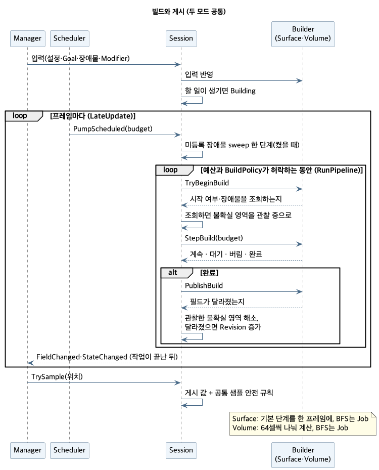
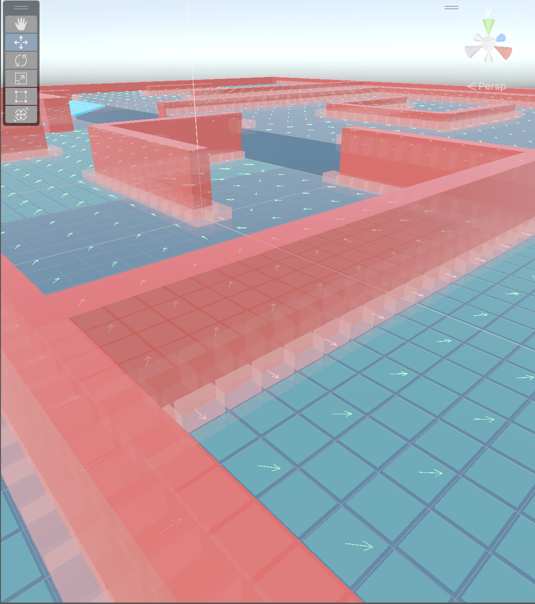

# FlowField 기술 참고

[README](../README.md)를 보완하는 구현 요약입니다.

## 어셈블리

| 어셈블리 | 폴더 | 내용 |
| --- | --- | --- |
| `Common.FlowField` | `Script/` | 계약, 격자, Session, 계산 단계, 결과 저장소, Bake 데이터, `FlowFieldManager`와 Modifier 컴포넌트 |
| `Common.FlowField.Editor` | `Script/Editor/` | Inspector, Bake, Scene View 표시 |
| `Common.FlowField.Samples` | `Samples/Scripts/` | 샘플 씬의 에이전트·컨트롤러·UI(UGUI 참조) |
| `Common.FlowField.PlayerProbe`, `.PlayerProbe.Editor` | `Dev/` | 이 저장소의 성능·회귀 측정 Player와 `-executeMethod` 빌드 진입점 |

시스템과 에디터는 `Script/` 폴더 하나입니다. 샘플과 측정 도구는 시스템을 참조하고, 시스템은 샘플을 모릅니다. 측정 도구에는 `FlowFieldAssemblyInfo`의 `InternalsVisibleTo`로 내부를 열고, Scheduler의 `LongestPumpMilliseconds`처럼 측정이 읽는 값을 둡니다. `Dev/`가 없어도 시스템은 그대로 컴파일됩니다. 측정 어셈블리는 Editor와 `FLOWFIELD_PLAYER_PROBE`를 정의한 측정 빌드(`Tools/run-player-probe.sh`)에서만 컴파일합니다.

## 파이프라인과 전략

- `FlowFieldSession`은 두 모드가 같이 쓰는 파이프라인입니다. 모드와 무관한 규칙은 모두 여기 있습니다.
  - 수명 전이(`Initialize`·`Stop`·`Restart`·`Release`·Fault·`Dispose`), 세대 번호, 이벤트
  - 빌드 루프(`RunPipeline`, 직접 소유자의 `Pump`). 빌드 중 상태 전이, Revision, `FieldChanged`, Fault, 불확실 영역 갱신도 여기서만 합니다. Builder는 빌드를 시작할 때 그 빌드가 장애물을 조회하는지와 새 장애물 설정이 불확실하게 만든 영역(`FlowFieldBuildStart`)을, 단계마다 결과(계속·대기·버림·완료)와 "게시한 필드가 달라졌는지"만 돌려주고, 실패는 예외로 알립니다. 버린 결과 뒤에 남은 입력이 있으면 Ready로 돌아가지 않고 Building을 유지합니다.
  - Surface 풀이 완료 콜백은 세대 번호와 빌드 단계(`WaitingSolve`)로 유효성을 판단합니다. 콜백은 `Poll` 안, 곧 `StepBuild` 안에서만 옵니다.
  - 조회(`TrySample`·`ClampPositionToGrid`·`IsReady`·`TryGetFieldInfo`의 준비 판정)와 조회 실패를 예외로 바꾸는 일(`FlowFieldFailures`). `TrySample`과 `TryClampPositionToGrid`는 예외 없이 상태를 돌려주는 같은 함수(`TrySampleStatus`·`TryClampStatus`)를 쓰고, 예외를 던지는 쪽은 그 상태를 예외로 바꿉니다.
  - 장애물 등록(`FlowFieldObstacleRegistry`), Modifier 등록(`FlowFieldModifierRegistry`), 통지 영역을 불확실 영역으로 표시하는 일(`FlowFieldSafety`, 여백 = 셀 크기 + Obstacle Clearance)
- 모드마다 다른 일은 `IFlowFieldSpaceBuilder`(`FlowFieldSurfaceBuilder`, `FlowFieldVolumeBuilder`)가 맡습니다. 자기 멤버 21개와 상속한 `Dispose`입니다.
  - 요청 만들기(`Initialize`, `SubmitConfig`)
  - 빌드 단계(`TryBeginBuild`·`StepBuild`·`PublishBuild`, `BuildPolicy`)
  - 게시 필드와 격자(`PublishedField`·`TryGetFieldInfo`, `LatestGrid` = 마지막 요청의 Grid로 `ClampPositionToGrid`가 씀), 게시 필드보다 새 셀 정보(`LatestCells`: Surface는 진행 중인 빌드의 기본 단계 결과, Volume은 없음)
  - 입력 반영(`ApplyObstacleChange`·`ApplyModifierChange`·`CreateModifierArea`)
  - 수명 훅(`CancelWork`·`DropComputedState`·`ReleaseResources`)
- Manager와 Session은 모드에 따라 달라지는 것을 모드별 정적 묘사 `FlowFieldSpaceStrategy.For(mode)`로 고릅니다: 세션 생성, 검증(`TryValidate`), 격자(`TryCreateLayout`), 최대 셀 수(`MaxCellCount`), Bounds 스냅(`SnapBounds`, 핸들 크기 조정은 `SnapResized`), sweep 조회 범위(`ObstacleSweepBounds`). 각 묘사는 Builder의 정적 함수로 넘기고, Builder는 `FlowFieldManagerConfig` 스냅샷으로 요청을 스스로 만듭니다.
- Editor도 검증, 레이아웃, Bake를 이 strategy와 `FlowFieldBakeService`로 합니다(Bake 세션도 모드마다 BakeService가 만듭니다). 표시만 모드를 보고 그리는 쪽을 고릅니다. Scene View와 Inspector는 Surface2D를 `FlowFieldGizmoDrawer`로, Volume3D를 `FlowFieldVolumeVisualizationEditor`로 그립니다.
  - 검증은 한 경로입니다. `TryValidate`가 처음 잘못된 설정의 이유를 돌려주고, Init의 `Validate`는 그 이유로 `InvalidOperationException`을 던집니다. 실행 중 세션과 다른 Space Mode·Bake Mode(`spaceModeLocked`·`bakeModeLocked`)도 여기서 거부합니다. Inspector, Scene View, Volume 표시도 같은 `TryValidate`를 써서 Init과 같은 문구를 보여 줍니다.
  - 공통 검사는 `FlowFieldManagerConfig.TryValidateShared`가 같은 순서와 메시지로 합니다.
- 공통 부품: 게시 필드 `FlowFieldField`, 조회 `FlowFieldSampler`, 요청 보관 `FlowFieldRequestInbox`, 셀 합성 규칙 `FlowFieldVectorUtility.ApplyModifier`, 이벤트 경계 `FlowFieldExecutionBoundary`, 예산 `FlowFieldBuildScheduler`.
- Modifier가 닿는 셀을 찾는 방식만 모드별입니다. Surface는 셀 마스크(`FlowFieldSurfaceModifierArea`)를 보관해 바뀐 영역만 다시 합성하고, Volume은 빌드마다 64셀씩 후보를 조회합니다.
- **Editor 경계:** Runtime Manager가 공개 API 밖으로 Editor에 내놓는 것은 설정 스냅샷 `CaptureConfig()`, 게시 필드 `TryGetPublishedField`, 직렬화 경로 `PropertyNames`입니다. 그 밖에 Editor가 쓰는 시스템 내부는 다음과 같습니다.
  - 모드별 묘사 `FlowFieldSpaceStrategy`(레이아웃, 검증, 스냅, 최대 셀 수)
  - Bake와 미리보기의 독립 세션(`FlowFieldSession`)과 Builder 정적 함수(요청, Goal 해석), 내보내기 `TryExportBakeData`(Builder마다 하나)
  - Bake Asset의 검증과 쓰기(`Apply`), Volume 표시의 검증기 `FlowFieldVolumeBakeValidator`
  - Modifier 규칙(`FlowFieldModifierRegistry.DuplicatePriorityMessage`, `FlowFieldModifierMaskBuilder.TryValidateInfluenceCollider`)
  - `FlowFieldBakeService`가 레이아웃(`TryGetLayout`)과 설정 검사(`TryValidateConfig`)는 strategy로, 요청과 Goal 해석은 Builder 정적 함수로 만들고, 두 모드의 독립 Bake 세션(Surface2D는 지면 scan이 끝난 뒤 `CreateSurfaceBakeSession`, Volume3D는 `CreateVolumeBakeSession`)도 만듭니다. Volume 표시는 Init이 payload 전에 하는 검사(`TryValidateVolumeConfigBeforePayload`)를 같은 순서·문구로 하고, payload는 단계로 나눠 검증한 뒤 그 결과를 Bake 검증 캐시에 넣어 `TryValidateConfig`를 그대로 돌립니다. Bake 입력 해시(`ComputeBakeInputHash`)는 BakeService가 설정 스냅샷으로 계산하고, Bake는 프레임마다 시작 때와 비교합니다.
  - 쓰기는 `SerializedObject`로 합니다. Bounds 핸들은 Undo를 남기고, Bake Asset 지정은 Bake 저장과 같은 Undo 묶음에, Clear Bake의 해제는 자기 Undo 단계에 기록합니다. 실행 중인 세션에는 `OnValidate`로 통지됩니다.

## 수명과 게시 규칙



<sub>PlantUML 원본: [flowfield-pipeline.puml](flowfield-pipeline.puml)</sub>

- **입력:** Builder는 최신 요청 한 벌과 대기 표시만 보관합니다(`FlowFieldRequestInbox`). Volume은 빌드 시작 때 요청을 BuildContext에 고정하고, Surface는 풀이가 끝나면 최신 요청으로 합성합니다. 빌드 중 온 입력은 다음 빌드로 넘기고, 그동안 두 모드 모두 Building을 유지합니다. Ready에서 받은 입력(설정, Goal, 장애물, Modifier)은 Session이 그 자리에서 Building으로 바꿉니다. 그래서 명령 직후 `State`와 `IsRebuilding`이 두 모드에서 같고, 다음 Pump를 기다리지 않습니다. 할 일이 없어진 Building은 게시된 필드가 있으면 Ready로 돌아갑니다.
- **게시:** 완성된 결과만 게시하고, 일반 조회는 게시 값을 읽은 뒤 아래 샘플 안전 규칙을 적용합니다.
- **샘플 안전 규칙(`FlowFieldSampleSafetyRule`, 두 모드·모든 Bake 모드 공통):** 게시 값을 읽은 뒤 아래 순서로 덮어씁니다. "위험한 칸"은 불확실 영역에 있거나, 최신 정보에서 막혔거나, 걸을 수 없는(Surface 지면 없음) 칸입니다.
  1. 지금 칸이 불확실 영역이거나 걸을 수 없으면 정지합니다.
  2. 지금 칸이 막혔으면 탈출 방향으로 내보냅니다. 탈출 방향이 없거나, 그 방향 이웃이 격자 밖이거나 불확실 영역이거나 걸을 수 없으면 정지합니다. 이웃이 막힌 것은 괜찮습니다(장애물 깊은 곳에서는 여러 칸을 지나 빠져나갑니다).
  3. 다음 칸이 있으면 지금 칸과 다음 칸을 감싸는 칸 중 하나라도 위험하거나 그 방향 연결이 끊겼으면 정지합니다.
  4. Default Direction 칸(`NextCells == -1`)은 기본 방향의 축 부호로 갈 수 있는 이웃 조합 중 하나라도 격자 밖이거나 위험하면 정지합니다.
  - "최신 정보"는 Surface의 경우 진행 중인 빌드의 작업 공간이 게시 필드와 같은 격자·지면일 때의 막힘·지면·탈출이고, 그 밖에는 게시 필드입니다. 연결은 항상 게시 필드에서 읽습니다. 진행 중인 빌드는 새 Goal의 영향 반경으로 연결을 다시 만들기 때문에, 게시된 걸음과 맞지 않습니다. 새로 막힌 칸은 3번의 칸 검사가 막습니다. 세션 상태(`IsRebuilding`)는 보지 않습니다.
- **끝난 풀이:** 새 입력이 들어와 있어도 게시합니다. 계속 움직이는 Goal 때문에 결과가 끊기지 않게 하기 위해서입니다. Grid나 설정이 바뀌었거나 Goal이 사라진 경우만 거부합니다.
- **Revision:** 두 모드 모두 게시 내용(셀 상태, 방향, 속도, Goal)이 실제로 바뀔 때만 증가하고 `FieldChanged`를 보냅니다. Volume은 `FlowFieldField.HasSameContent`(memcmp)로 비교합니다. 내용이 같아도 요청 스냅샷 갱신, 불확실 영역 정리, Ready 전환은 그대로 합니다.
- **재진입 없음:** `FlowFieldExecutionBoundary`가 이벤트를 큐에 모아 가장 바깥 작업이 끝난 뒤 전달합니다. `Release`·`Stop`·`Restart`·Fault 이전의 이벤트는 버리고 `Released`만 항상 전달합니다. 핸들러가 서로를 계속 깨우면 100,000건에서 오류를 남기고 남은 일을 버립니다. 이때도 `Released`와 해제 이벤트는 순서대로 한 번 전달하고, 그 핸들러가 새로 만든 일은 버립니다.
- **정지와 재시작:** 비활성화는 `Stop`(빌드 취소, 게시 결과 버림)입니다. 다시 활성화와 Fault 재시도(`RequestRebuild`)는 같은 `Restart` 경로로 처음부터 다시 빌드하고, 등록된 장애물과 Modifier는 유지합니다. 재시작에 실패하면 Fault로 남습니다. 새 결과가 게시되기 전까지 Ready가 아니고, `ClampPositionToGrid`는 최신 요청의 격자로 계속 동작합니다. 비활성 상태에서 `Init()`해도 요청은 제출하므로, 두 모드 모두 그 격자로 Clamp하고 장애물 통지를 받습니다.
- **수명 종료:** 실행 중인 풀이 Job에 취소를 요청하고 끝날 때까지 기다립니다. Job은 4,096셀마다 취소를 확인합니다.
- **Inspector 편집:** Play 중 Inspector에서 값을 바꾸면 `OnValidate` 안에서 검증하고 바로 다시 빌드합니다. Grid가 바뀌면 이전 결과를 즉시 숨기고 Building을 알립니다. 값이 잘못되면 Fault입니다. `StateChanged` 핸들러가 `OnValidate` 안에서 실행될 수 있습니다.

## 입력 변경

- **통지 방식:** 기본으로 FlowField는 씬을 폴링하지 않습니다. 변경은 공개 API와 FlowField 컴포넌트의 통지로만 들어옵니다. `FlowFieldDynamicObstacle`, `FlowFieldGoalTarget`, Modifier Volume은 자기 Transform이나 Collider Bounds를 프레임당 한 번 확인합니다(컴포넌트당 O(1)).
- **장애물 등록부(`FlowFieldObstacleRegistry`):** Collider에서 자리로 가는 사전을 두어, 등록·해제·이동 통지가 목록을 훑지 않습니다. 등록 순서를 읽는 곳이 없으므로 해제는 마지막 항목을 빈 자리로 옮깁니다. 정적 마스크 규칙, sweep, `FlowFieldDynamicObstacle`은 `Contains`로 등록 여부만 묻습니다.
- **미등록 장애물 sweep(`FlowFieldObstacleSweep`):** Session이 소유하고, runtime scheduler가 부르는 빌드 루프(`RunPipeline`의 try 안)에서만 프레임당 한 번 돕니다. 그래서 Bake와 Edit Mode 미리보기, 직접 `Pump()`하는 세션은 sweep하지 않습니다(`SweepsObstacles`). 한 pass는 sweep Bounds(`FlowFieldSpaceStrategy.ObstacleSweepBounds`: Surface2D는 장애물 조회 상자가 닿는 높이와 Clearance까지, Volume3D는 셀 하나와 Clearance만큼 넓힌 Bounds)를 한 번 조회하고, 등록하지 않은 Collider를 1,024개씩 이전 pass의 Bounds와 비교합니다. 사라짐은 pass 끝에서 판정합니다. 바뀐 Collider는 이전·현재 Bounds를 `RegionDirty` 장애물 변화로 보내 기존 경로(불확실 영역, 다시 조회)를 탑니다. 첫 pass는 목록을 뽑은 그 프레임에 모두 기록만 합니다. 여러 프레임에 나누면 빌드가 scan한 뒤 옮겨진 Collider가 옮긴 자리로 기록되어 그 이동을 놓치기 때문입니다. 설정(켜기, Bounds, Layer)이 바뀌거나 Stop·Release 때 기록을 비웁니다. 65,536개에 이르면 그 세션에서 멈추고, 멈춘 Bounds 전체를 다시 빌드합니다.
  - Surface2D 동적 마스크 = 등록 overlay ∪ swept 마스크(모든 obstacle Collider, dirty 영역만 다시 scan)입니다. `RuntimeDynamic`에서 sweep이 이 세션에서 돌면 정적 마스크는 비웁니다. 옮긴 정적 Collider의 잔상을 남기지 않기 위해서입니다. `BakedBase`의 정적 마스크는 Bake에서 시작하므로 그대로 두고, sweep이 알린 영역을 정적 규칙으로도 다시 scan해 옮긴 Collider의 Bake 자리를 풉니다. sweep이 시작되거나 멈추면 모든 장애물 마스크를 다시 만듭니다.
  - Volume3D는 다시 조회할 때 이미 레이어의 모든 Collider를 읽으므로 영역 알림만으로 충분합니다. Bake 때 Rigidbody Collider가 있던 자리도 sweep이 그 영역을 알리면 풀립니다.
- **불확실 영역:** 장애물 등록·해제·이동·영역 dirty 통지를 받은 그 프레임에 영역을 표시하고, 그 영역을 조회한 빌드가 게시될 때까지 그 셀과 그 셀로 가는 경로는 속도 0입니다. 목록은 Session만 바꿉니다(`FlowFieldSafety`). 장애물을 조회하는 빌드가 시작되면 목록을 옮기고, 다음 게시 때 지웁니다. 시작 후 기록된 영역은 다음 빌드까지 남습니다. 게시하지 못하고 끝난 빌드가 옮긴 영역도 남았다가 뒤따르는 빌드의 게시 때 지웁니다. Surface에서 거부된 빌드의 조회 결과는 staging에 남고 대체 빌드는 항상 Goal 플래그를 가지며, Volume에서는 남은 영역 때문에 뒤따르는 빌드가 장애물 결과를 재사용하지 못하고 그 영역(또는 전체)을 다시 조회하기 때문입니다. `RequestRebuild`가 시작한 빌드가 버려지면 전체 조회 요청은 대신하는 빌드가 이어받습니다. 목록이 64개를 넘으면 합쳐서 더 넓게 정지합니다(Surface는 XZ, Volume은 3D로 비교). 장애물 설정(Layer, Clearance 등)이 바뀌면 알린 그 순간부터 필드 전체가 불확실합니다. 비교 대상은 마지막으로 받은 요청이라, 첫 빌드나 이전 설정으로 시작한 빌드가 게시되어도 새 설정으로 조회한 빌드가 게시될 때까지 정지합니다.
- `SetGoal()`은 장애물 결과를 재사용합니다. 같이 `RequestRebuild()`를 부르면 이 이점을 잃습니다.
- `RequestRebuild()`는 두 모드 모두 장애물을 전체 다시 조회합니다. `BakedBase`는 Bake 막힘에서 다시 시작해 Init 뒤 바뀐 영역과 등록 장애물 영역만 다시 조회합니다. Surface의 `RequestRebuild()`는 바닥 Raycast를 다시 하지 않으므로, 바닥 형상이 바뀌면 `NotifyCellsDirty()`를 씁니다. `NotifyCellsDirty()`는 두 모드 모두 바닥(Volume은 모든 셀)과 장애물을 다시 계산합니다.
- 풀이 중에 바뀐 Goal과 설정은 Builder가 보관했다가 다음 빌드를 시작할 때 제출합니다.
- Surface2D의 정적 장애물은 Obstacle Layer에서 Rigidbody가 없고 등록하지 않은 Collider입니다. 장애물 변화는 그 변화가 닿는 셀(Bounds + 셀 크기 + Clearance)만 정적 마스크를 다시 scan합니다. 대상은 Rigidbody 없는 Collider의 등록·해제와 `NotifyObstacleRegionDirty`이고, `BakedBase`에서는 모든 장애물 변화입니다. 영역 없이 들어온 장애물 작업(첫 빌드, 장애물 설정 변경)은 전체를 scan합니다.
- `StaticBaked`는 동적 장애물 등록을 거부하고, 형식이 다른 Bake Asset도 거부하므로 다시 Bake해야 합니다.

## Surface2D

- 통지가 dirty 표시와 요청을 남기면 Scheduler가 Session을 진행합니다. 직접 `Session.Pump()`를 호출하는 베이크와 미리보기는 호출자가 입력을 책임집니다.
- 표면·장애물·Goal·Modifier 영역은 Physics 결과가 한 스냅샷이 되도록 한 프레임에 실행합니다. 장애물 마스크를 다시 만들 때는 먼저 `Physics.SyncTransforms`를 한 번 합니다. 등록부도 Collider Bounds를 읽기 전에 sync하므로, Auto Sync Transforms가 꺼져 있어도 같은 프레임에 옮기고 알린 이동을 놓치지 않습니다. BFS와 방향은 워커 스레드, Topology는 메인 스레드의 Burst입니다. 합성은 예산에 맞춰 나눕니다.
- BFS가 예정된 빌드는 사전 합성을 생략하고, 완료 후 전체를 한 번 합성합니다.
- 바닥 Layer와 경사·단차 조건이 필요합니다.
- 격자가 2,500셀을 넘으면 Scene View는 표시 대상을 줄입니다.
- 한 번의 조회에서 겹치는 장애물이 4,096개에 이르면 Session이 Fault 납니다. 일부만 쓰면 장애물을 놓치기 때문입니다. Volume3D는 이때 셀별 검사로 넘어갑니다.
- 특정 Collider가 한 셀에 닿는지 확인할 때(장애물 마스크, Modifier 영향 영역, Volume3D 셀별 검사), 그 셀 상자에 겹친 Collider가 256개에 이르면 같은 이유로 Session이 Fault 납니다(`FlowFieldOverlapUtility`).

## Volume3D

- 셀은 `x + Width × (z + Depth × y)` 순서로 저장합니다. 두 축·세 축 대각선은 중간 셀이 모두 통과 가능할 때만 연결합니다.
- 장애물·Modifier 단계는 64셀씩 진행합니다. 스텝마다 `OverlapBox`로 후보를 모아 후보가 닿는 셀만 정확히 검사합니다(`FlowFieldVolumeCellQuery`). 등록 장애물은 빌드가 장애물 조회 전에 `Physics.SyncTransforms`한 직후 한 번(`CaptureRegistered`: Collider, 넓힌 Bounds, Layer) 읽고, 스텝마다 그 Bounds가 스텝 상자에 닿는 것만 고릅니다. 읽은 뒤 움직이거나 해제된 등록 장애물은 통지로 불확실 영역이 되고, 그 영역은 이 빌드가 게시된 뒤에도 남아 다음 빌드가 다시 조회합니다.
- **부분 재계산:** Modifier만 바뀌면 게시된 내비게이션에 다시 합성합니다. 첫 빌드 중 바뀐 Modifier도 그 빌드가 게시된 뒤 합성만 다시 합니다. 장애물 입력과 불확실 영역이 그대로인 빌드(Goal이나 Default Direction 변경)는 장애물 결과와 Topology를 재사용합니다. 그래서 Play 중 Inspector 설정 변경도 장애물을 다시 조회하지 않고, 알리지 않은 Collider는 `RequestRebuild`나 `NotifyCellsDirty`, 영역 알림, sweep으로 반영합니다. Goal이 같은 셀 안에서 움직이면 빌드하지 않습니다. Goal을 지우면 진행 중인 빌드를 버립니다.
- **등록하지 않은 Collider:** `RequestRebuild()`나 `NotifyCellsDirty()`의 전체 조회, 또는 `NotifyObstacleRegionDirty()`와 sweep이 알린 영역의 조회에서 반영됩니다.
- **배열 재사용:** 교체된 게시 배열을 다음 빌드에 씁니다(`FlowFieldSpareArrays`).

## Modifier

- Modifier 적용 여부는 두 모드 모두 `FlowFieldVectorUtility.CanApplyModifier`로 판정합니다. 막힌 셀, Goal Anchor, 도달할 수 없는 셀, 기본 방향이 0인 셀에는 적용하지 않습니다.
- 등록, Priority 순서(낮은 값부터, 중복 거부), 변경 통지, 값 Snapshot은 두 모드가 같은 `FlowFieldModifierRegistry`를 씁니다. 이미 등록된 Modifier를 다시 등록하면 false를 돌려줍니다. Editor의 중복 경고(`FlowFieldModifierPriorities`)는 Manager의 씬에서 그 Manager를 지정한 Modifier Volume을 비활성까지 모아 같은 문구(`DuplicatePriorityMessage`)로 보여 줍니다.
- 셀 하나에 적용하는 규칙(적용 조건, `Modify()` 호출, 출력 검사)도 공통입니다. 출력은 유한해야 하고 속도는 0 이상, 방향은 단위 벡터나 0이어야 합니다. Surface는 방향이 표면에 접해야 합니다.
- Priority 기본값은 Speed 100, Noise 200입니다. 런타임 값은 `SetSpeedMultiplier()`, `SetNoise()`, `SetPriority()`로 바꿉니다.
- `CaptureSnapshot()`이 빌드에 쓸 값을 고정합니다. Collider 형상까지 복제하지는 않습니다.
- FlowField는 Modifier를 폴링하지 않습니다. 값, Priority, 영역 변경은 `NotifyModifierChanged`로 알립니다. 기본 Modifier Volume은 setter와 `OnValidate`에서 알리고, Influence Collider의 이동과 파괴는 프레임당 한 번 스스로 알립니다. `Observe()`는 등록과 통지 때 호출됩니다.
- 등록된 Modifier의 설정이 통지 시점에 잘못되면 두 모드 모두 Fault입니다. 등록되지 않은 Modifier를 통지하면 `InvalidOperationException`입니다.
- Fault 중에는 해제만 받습니다. 재시도가 전부 다시 빌드하므로 작업을 예약하지 않고, Fault 중 켜진 Modifier는 재시작의 요청 제출 전에 등록합니다.
- 셀 판정은 `FlowFieldOverlapUtility.CellHalfExtent`로 0.0001 줄인 상자를 써서, 격자에 맞춘 Collider가 이웃 셀을 잡지 않게 합니다.
- Influence Collider가 파괴되면 설정 오류로 보고 Fault를 냅니다. 무시하면 영향 영역이 조용히 사라집니다. 기본 Modifier Volume은 파괴를 다음 LateUpdate에 알립니다.
- Modifier 자체의 Fault는 Manager 재빌드로 풀리지 않습니다. Modifier를 끈 상태에서 `Release()`, 값 수정, `Init()` 순서로 복구한 뒤 원래 활성 상태로 되돌립니다.

직접 구현한 `IFlowFieldVectorModifier`의 `Observe()`, `CaptureSnapshot()`, `Modify()` 안에서는 호출이 다음과 같이 제한됩니다.

| 호출 | 동작 |
| --- | --- |
| `TrySample` 등 읽기 | 바로 실행 |
| Modifier·동적 장애물 등록과 해제, `NotifyModifierChanged` | 작업이 끝난 뒤 실행. 그 사이 Session이 멈추면 버려지고 등록은 경고를 남김 |
| `Init`, `RequestRebuild`, `Release`, `SetSpaceMode`, `SetGoal`, `NotifyCellsDirty`, `NotifyObstacleRegionDirty`, `NotifyDynamicObstacleMoved` | `InvalidOperationException` |

## StaticBaked와 BakedBase

- Surface2D는 `FlowFieldSurfaceBakeData`, Volume3D는 `FlowFieldVolumeBakeData`이며 v6만 허용합니다. 둘 다 `FlowFieldBakeAsset`을 상속해 포맷 버전, Revision, 내용 세대(Inspector 편집과 다시 읽기를 알림)를 같은 방식으로 관리합니다. 두 Bake 모드는 같은 Asset을 씁니다.
- 모드별 규칙: Asset이 필요한지는 `FlowFieldBakeModes.UsesBakeAsset`(두 모드), 필드가 고정인지는 `BakeMode == StaticBaked`로 판단합니다. Init의 Goal 일치 검사와 Goal·장애물 입력 거부는 `StaticBaked`만, `NotifyCellsDirty` 거부(`FlowFieldFailures.NotAllowedIn`)는 두 모드 모두입니다.
- **BakedBase(Surface2D):** request의 source는 `BakedBase`(`ForBakedBase`)이고, Surface는 Bake의 Surface, 정적 마스크는 Bake의 막힘(`_blocked`)에서 시작합니다. escape, topology, Goal, BFS는 Scene 빌드와 같은 단계(`BuildSceneBase`)가 다시 계산합니다. Bake 세션은 등록 장애물이 없으므로, 문처럼 런타임에 등록할 장애물도 Bake 막힘에 들어 있습니다. 그래서 장애물 변화(등록·해제·이동·영역 알림)마다 이전과 현재 영역을 등록 Collider를 뺀 정적 규칙으로 다시 scan합니다. Bake를 다시 읽는 빌드(첫 빌드, 재시작, `RequestRebuild` 뒤 전체 빌드)는 Bake 막힘에서 다시 시작해, Init 뒤 변화가 닿은 영역(`BakedBaseTouched`)과 등록 장애물 영역을 다시 scan합니다.
- **BakedBase(Volume3D):** 첫 빌드와 Bake를 다시 읽는 빌드는 Allocate 다음 `BakedObstacles` 단계에서 막힘·topology·탈출 방향을 예산 단위(4,096셀)로 복사하고(`CopyObstaclesToBuild`), 불확실 영역·Init 뒤 변화가 닿은 영역·등록 장애물 영역만 다시 조회합니다. 셋 다 없으면 obstacle 결과를 Bake 그대로 쓰고 BFS만 합니다. 게시된 필드가 있으면 `RuntimeDynamic`처럼 Goal 변경은 obstacle 결과를 재사용하고, 장애물 변화는 바뀐 영역만 다시 조회합니다. topology와 탈출 방향은 막힘에만 기대므로 Goal이 다른 Bake에서도 복사할 수 있습니다.
- **BakedBase가 모르는 것:** Bake 뒤 아무도 지켜보지 않을 때 옮긴 장면 장애물(등록 전이나 알리지 않은 이동)은 Bake 때 자리가 막힌 채, 새 자리는 열린 채 남습니다. 등록 장애물은 등록할 때 지금 자리를 조회하므로 새 자리는 막히고, 등록 전에 옮겼다면 Bake 때 자리만 남습니다.
- Editor Bake는 두 모드가 같은 실행 코드(`BakeRun`), 입력 검사, 저장 코드(`SaveBakeAsset`)를 쓰고, 모드마다 다른 이름·파일 접미사·참조 속성은 `BakeTarget`에 둡니다. Bake 입력 해시가 시작 때와 달라지면 그 프레임에 멈추고 기존 Asset을 유지하며, 저장은 Undo 한 묶음입니다.
- Volume은 방향·속도·탈출 벡터를 저장하지 않고 NextCell과 면 인덱스(`_escapeFaces`)에서 재구성합니다. Surface는 배열을 `FlowFieldBakeBlob`으로 `byte[]`에 비트 그대로 저장합니다.
- Surface 런타임은 Asset을 검증한 뒤 만든 변하지 않는 사본(`FlowFieldSurfaceBakeSnapshot`, Revision마다 한 번)을 읽습니다. request가 들고 있는 Asset 참조는 Revision·내용 세대와 함께 같은 Bake인지 비교하는 데만 씁니다.
- 저장에 실패하면 기존 Asset의 내용, Revision, GUID를 유지합니다.
- `StaticBaked` 런타임은 Asset에 구운 Goal을 그대로 씁니다. Init은 Goal Transform 위치가 구운 Goal과 같은지 검사합니다. `BakedBase`는 구운 Goal을 쓰지 않으므로 검사하지 않습니다.
- Bake는 연결된 Asset이 있으면 그 경로에 씁니다. 참조가 빈 Manager의 Bake 대상은 씬 옆, 씬 이름의 폴더에 씬 GUID와 Manager ID로 만든 고정 경로(`<씬 폴더>/<씬 이름>/<씬GUID>_<ManagerID>_<이름>_<SurfaceBake|VolumeBake>.asset`)이며, 그 경로의 같은 형식 Asset은 이 Manager의 것으로 보고 덮어씁니다. Asset을 새로 만든 Bake가 실패하면 그때 만든 Asset과 폴더를 지웁니다. 고정 경로는 씬의 위치·이름과 Manager 이름을 따르므로, 씬을 옮기거나 이름을 바꾼 뒤 참조가 빈 채로 Bake하면 새 Asset을 만들고 예전 Asset은 그대로 둡니다.

## Editor 표시

표시 상한은 FullVolume 8,192셀, Slice 4,096셀입니다. Volume 표시는 갱신 요청이 있거나 상태가 바뀔 때만 repaint합니다. 에디터 이벤트(변경 알림, Undo, 계층 변경, Play Mode, 씬 닫기, 업데이트)는 `FlowFieldEditorLifecycle` 한 곳에서 받아 Surface 미리보기와 Volume 표시에 알립니다. Surface의 Edit Mode 미리보기는 처음 그릴 때 바로 풀고, 그 뒤 변경은 표시만 해 두었다가 변경이 약 150ms 멈추면 한 번 다시 풉니다. 그동안에는 마지막 결과를 그립니다. 실패한 미리보기는 다음 변경까지 그대로 두고 그 이유를 Manager Inspector에 보여 주며, 켜진 Modifier만 등록합니다. Bake와 Clear Bake는 Edit Mode에서만 실행하고, Play Mode에 들어가면 진행 중인 Bake를 멈춥니다. Play Mode의 Surface 표시는 합성을 거친 최종 결과이므로 Asset의 원본 방향과 다를 수 있습니다. 왼쪽은 Surface2D 상세, 오른쪽은 Volume3D 중앙 단면입니다.

<p align="center">
  
  
</p>

## UML 갱신

원본은 `Docs/*.puml`이고, 렌더링한 PNG를 `Docs/Images`에 저장해 문서에 넣습니다. Graphviz 없이 PlantUML 1.2024.3으로 렌더링합니다. Docs 폴더에서 실행합니다.

```sh
java -Djava.awt.headless=true -Djava.io.tmpdir="$TMPDIR" -jar plantuml.jar \
  -tpng -charset UTF-8 -o Images \
  flowfield-uml.puml flowfield-structure.puml flowfield-pipeline.puml
```

임시 폴더에 쓸 수 없으면 종료 코드 0으로 0바이트 PNG가 나오니 파일 크기를 확인합니다. 한글은 macOS의 `Apple SD Gothic Neo` 글꼴로 렌더링합니다.
