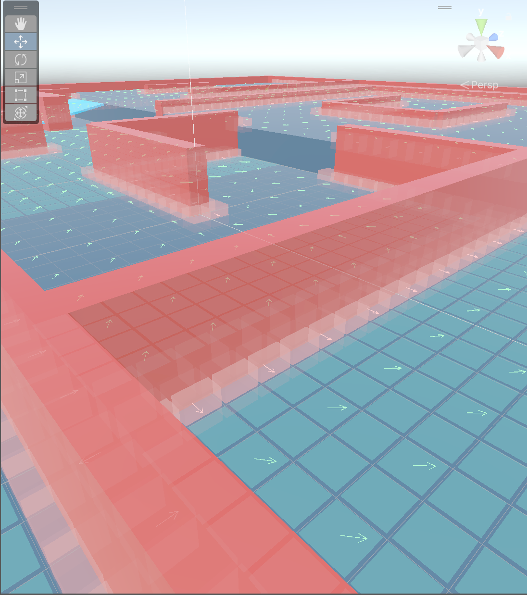
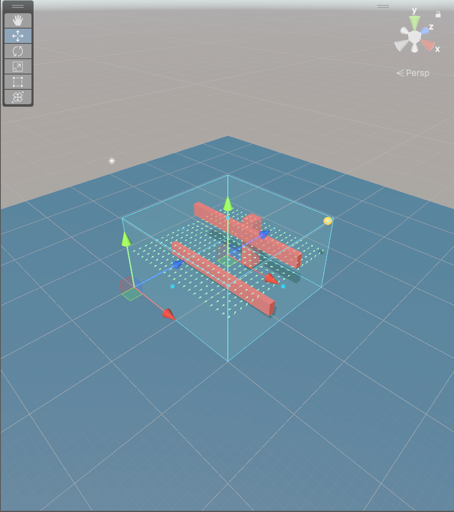
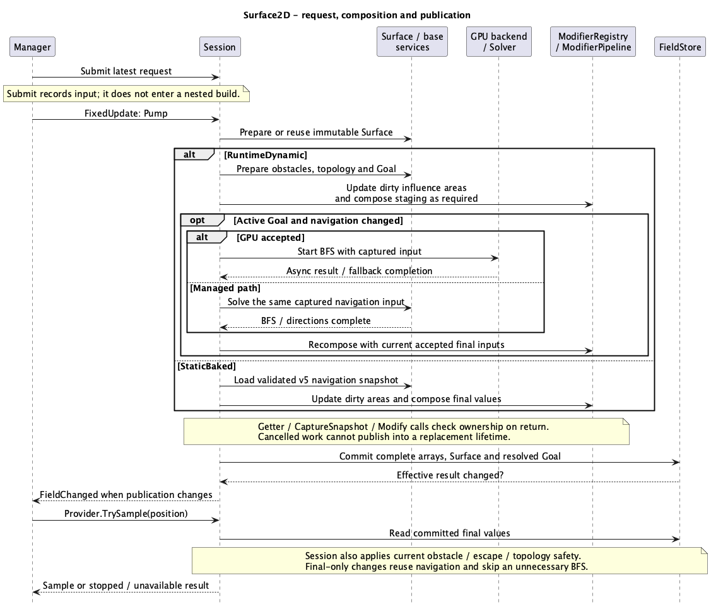
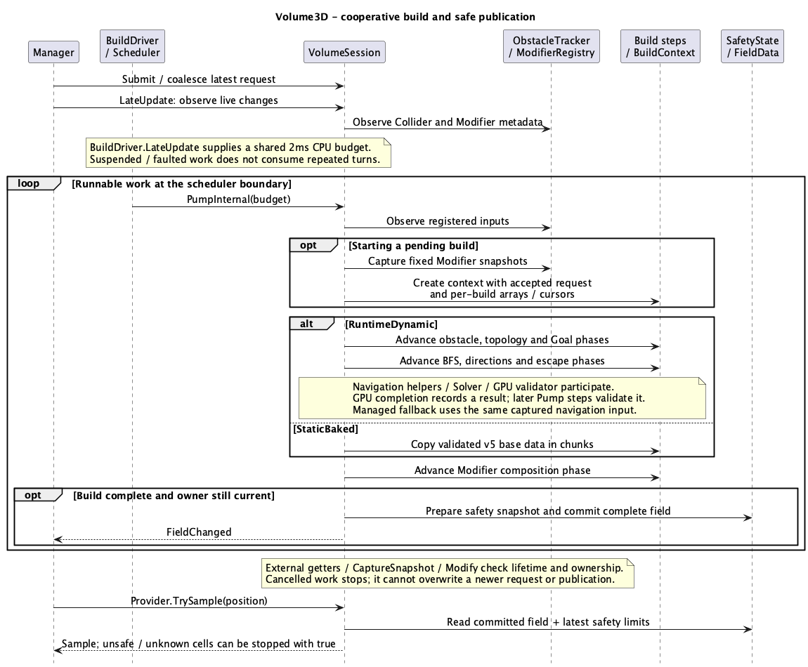

# FlowField 기술 참고

이 문서는 [FlowField README](../README.md)의 네 가지 기능 설명을 보완하는 구현 참고 문서입니다. 요청·수명·베이크·Editor 표시의 실제 책임을 구분하고, README에 표시하지 않은 보조 화면과 문서 갱신 검증 범위를 기록합니다.

## 어셈블리와 리소스 위치

- `Common.FlowField.Core`: 계약, 격자, 모드별 Session, 계산 단계, 결과 저장소와 Bake 데이터.
- `Common.FlowField.Runtime`: `FlowFieldManager`, Modifier 컴포넌트와 Unity 수명주기·실행 연결.
- `Common.FlowField.Editor`: Inspector, Bake 작업, Editor 시각화와 Editor 수명 처리.
- `Common.FlowField.Samples`: 공개 Provider·Controller를 사용하는 Agent, HUD와 샘플 카메라.
- `Common.FlowField.PlayerProbe`: Player 측정 도구. Editor와 `FLOWFIELD_PLAYER_PROBE`를 넘기는 측정 빌드에서만 컴파일합니다.

프로젝트 기준 Unity 버전은 2023.2.20f1입니다. Burst, Collections, Mathematics, URP, UGUI 패키지 버전과 개별 asmdef 참조는 이 문서의 기능 설명과 분리해 프로젝트 설정에서 관리합니다.

## 수명·입력·샘플링

`FlowFieldManager`는 설정을 검증하고 Surface 또는 Volume Session을 준비한 다음 실행 경계에 작업을 등록합니다. `OnDisable`에서는 실행을 중단하고, `Release`·`OnDestroy`에서는 Session을 정리하고 실행 중인 풀이 Job을 멈춥니다. 최초 게시 결과가 없으면 `IsReady`가 false이며 `TrySample`은 미준비·영역 밖·안전성 검증 실패를 실패와 정지 샘플로 나타냅니다. 이동 주체는 이 결과를 정지 또는 감속으로 처리해야 합니다.

`FlowFieldSessionBase`는 공통 조회·명령 계약과 게시·상태·실패 이벤트의 예외 격리 경계입니다. 수명 세대는 이 클래스가 관리하고, 수락 입력은 각 모드의 Session이 소유합니다. Surface 배열·FieldStore와 Volume 작업 배열·게시 저장소도 각 자식 Session이 소유합니다.

Volume은 최신 수락 `FlowFieldVolumeRequest` 한 벌과 대기 여부를 보관합니다. 작업 시작 시 이 값을 BuildContext에 고정하고, 게시 결과는 완료된 작업의 입력을 보관합니다. Manager의 자동 변경 감지는 Session의 최신 입력을 비교하며 별도 요청 캐시를 두지 않습니다. 명시적인 `RequestRebuild()`와 재활성화·재초기화는 같은 설정이어도 재계산을 요청합니다.

Surface도 최신 수락 `FlowFieldSessionRequest` 한 벌과 대기 플래그를 보관합니다. Pump 시작 시 지역 값으로 캡처하고, BFS는 이때 준비한 작업 배열을 입력으로 씁니다. 실행 중 요청 복사본은 두지 않으며 풀이 완료 시 최신 요청을 최종 합성에 사용합니다. Submit 이전에 관측된 Default Direction은 별도 상태로 유지해 진행 중 결과에 반영합니다.

Surface의 상태·게시 이벤트는 작업이 끝난 뒤 전달됩니다. Fault·Retry·Release·Suspend는 수명 세대를 올려 이전 이벤트와 늦은 콜백을 무효화하고, 정리와 dirty 설정을 끝낸 뒤 이벤트를 전달하므로 핸들러가 제출한 새 요청은 보존됩니다. Dispose는 Released 알림 전에 영구 종료 상태가 됩니다.

끝난 풀이와 합성은 새 입력이 들어와 있어도 게시합니다. 계속 움직이는 Goal이나 장애물 때문에 이동 주체가 필드를 받지 못하는 일을 막기 위해서입니다. 예외는 Grid나 설정이 바뀐 경우(셀이 맞지 않음)와 Goal이 사라진 경우(이동 주체가 더 따라가면 안 됨)뿐입니다. 합성은 이어 가기 직전에 이를 확인합니다. 거부하면 작업 배열을 게시 결과로 되돌리고 다음 제출에서 다시 풉니다. Goal이 같은 셀 안에서만 움직이면 다음 Goal 단계가 변경 없음으로 끝내므로 풀이를 새로 시작하지 않습니다.

Session은 수명이 끝날 때 실행 중인 풀이 Job에 취소를 요청하고 끝날 때까지 기다린 뒤 작업 배열을 재사용합니다. Job은 4,096셀마다 취소 표시를 확인하므로 기다림은 짧습니다. 게시 Grid·Surface와 해석된 Goal은 FieldStore에서만 가져오며 내부 FieldCommitted 이벤트는 인자 없이 변경된 결과의 게시만 알립니다. 일반 샘플은 합성 중 작업 배열이 아닌 게시 저장소를 읽고, 최신 장애물·탈출·연결 안전성 검사를 추가로 적용합니다.

Surface 기본 준비 요청의 Grid·Surface는 장애물 요청에서 얻습니다. 준비 결과는 장애물 변경·변경 영역·이동 가능한 표면 여부·Goal 상태만 보관하고, Goal 변경 여부는 그 상태에서 계산합니다. 스케줄러 계약은 대기 여부·작업 여부·Pump만 노출하며 취소는 Session이 소유합니다.

RuntimeDynamic의 입력 변경은 후보를 검증해 최신 요청에 반영합니다. Surface의 Modifier 등록·변경·관측은 첫 Submit 이후 같은 대기 플래그에 처리를 예약하며 추가 RequestRebuild 없이 다음 Pump에서 합성합니다. Manager의 LateUpdate는 실행 직전 현재 작성 설정을 요청에 반영합니다. Surface Scheduler는 이렇게 제출된 요청만 빌드하므로 stale 설정이나 잘못된 설정으로는 빌드하지 않고, 대기 중에는 프레임 예산을 쓰지 않습니다. 직접 `Pump()`를 호출하는 베이크와 테스트는 호출자가 입력을 책임집니다. 명시적 RequestRebuild도 같은 제출 경로를 사용하고, 진행 중인 작업의 고정 입력은 덮어쓰지 않습니다. StaticBaked에서는 Play Mode에 Goal·장애물 변경 API나 Editor의 Bake 저장 API를 호출하지 않고 Bake Asset을 로드합니다.

같은 Grid·Source의 읽을 수 있는 이전 결과가 있는 동안에는 해당 결과를 사용할 수 있습니다. Surface의 Revision은 실제 FieldStore 결과 변경 여부에 따라, Volume의 Revision은 완료된 결과 저장소 교체 정책에 따라 갱신됩니다. 두 모드의 Revision을 하나의 일반 규칙으로 해석하면 안 됩니다.

Manager의 활성 Session은 초기화 시 선택한 실행 모드를 소유하며 Faulted 상태도 명시적 해제 전까지 그 소유권을 유지합니다. Manager는 두 Session의 이벤트를 자신의 수명 내내 구독하고, 이벤트는 작업이 끝난 뒤 전달되므로 외부 콜백 뒤에 소유권을 다시 확인하지 않습니다. Fault 로그는 Faulted 상태를 받을 때 남기므로 핸들러가 바로 재시도해도 사라지지 않습니다.

Surface의 ConfigurationStale은 이전 게시 샘플을 숨기며, Grid dirty가 아직 제출되지 않은 경우에만 명시적 재빌드가 필요합니다. 유효한 Submit 이후에는 기존 결과를 숨긴 상태에서도 Pump가 실행되어 새 결과를 게시할 수 있습니다. Volume의 작업 여부는 실행 가능 상태와 진행 중/대기 작업에서 계산하므로 Suspend·Fault·Dispose 상태의 대기 입력이 Scheduler를 반복 실행시키지 않습니다.

Surface의 해석된 Goal 메타데이터는 StaticBaked에서도 게시 FieldStore를 기준으로 합니다. 요청 Goal은 최신 수락 입력을 설명합니다. 같은 내용의 Snapshot은 기존 불변 Surface geometry를 재사용할 수 있고, 명시적인 Surface 재빌드는 새 geometry를 게시할 수 있습니다. FieldStore는 참조 교체와 셀 데이터 변경 여부를 구분하므로 동일 내용 교체만으로 공개 Revision을 늘리지 않습니다. Snapshot은 내비게이션 배열을 복사하고 전달된 불변 Surface 참조는 유지합니다.

## Surface2D와 Volume3D 계산

Surface2D는 바닥 Raycast로 표면 높이·법선을 확보하고, 경사·단차·장애물 조건과 8방향 연결을 계산합니다. Scene View 표시 경로는 계산 결과와 별개로 표시 대상을 축약할 수 있습니다. 현재 100×100 격자는 2,500셀을 초과하므로 X·Z 두 칸 간격을 사용해 50×50개를 표시하며, 실제 계산 셀 수는 10,000개로 유지됩니다.

Volume3D는 Bounds 전체를 CellSize 정육면체 셀로 분할하고 `x + Width × (z + Depth × y)` 순서로 저장합니다. 26방향 동일 비용 BFS를 사용하고, 두 축·세 축 대각선은 중간 셀이 모두 통과 가능할 때만 연결합니다. FullVolume 표시 상한은 8,192셀, Slice 표시 상한은 4,096셀입니다. 표시 표본 수는 계산 격자나 샘플링 해상도를 변경하지 않습니다.

## Modifier와 풀이 Job

등록 Registry는 Modifier 참조, 유일한 Priority·Revision과 Collider 관측을 관리합니다. 별도 등록 순서 카운터나 동점 정렬 상태는 없습니다. Surface 영향 마스크·목록·영역은 Registry Entry에 지연 할당하며 별도 캐시 래퍼를 두지 않습니다. Surface Registry는 Snapshot을 만들지 않고 Modifier Pipeline이 `CaptureSnapshot()`을 호출합니다. Volume은 VolumeModifierRegistry가 Snapshot을 캡처해 Session의 작업 단계에 고정 작업 집합을 제공합니다. Snapshot은 작업 중 설정값을 고정하지만 Collider 형상·Transform을 복제하는 물리 프록시는 아닙니다.

내비게이션 계산은 Burst Job(`FlowFieldNavigationJobs.cs`)입니다. 게시 결과의 관리 배열을 고정(pin)해 포인터로 넘기므로 샘플링과 베이크 저장 형식은 그대로입니다. 모든 Job은 `FloatMode.Strict`로 컴파일해 Vector3 연산과 같은 값을 냅니다. Volume은 Obstacles 단계 뒤 Topology·Goal·BFS·방향·탈출을 Job 하나로 워커 스레드에서 실행합니다. Surface는 Goal 단계의 Topology를 메인 스레드에서 Burst로 실행하고, BFS와 방향은 `IFlowFieldSolveBackend`를 거쳐 워커 스레드에서 실행합니다. Manager는 매 프레임 완료를 확인하므로 풀이를 기다리는 프레임은 없습니다. 베이크와 테스트처럼 세션을 직접 Pump하는 쪽은 완료까지 기다립니다.

2026-11-01 Player 측정에서 Burst 경로가 모든 시나리오의 최대 프레임 시간과 게시 시간에서 GPU보다 나아 Compute Shader 경로를 제거했습니다. 수치는 [StatusAndBacklog.md](StatusAndBacklog.md)에 있습니다.

Modifier 적용 대상은 두 모드가 같은 `FlowFieldVectorUtility.CanApplyModifier`로 판정합니다. 막힌 셀, Goal Anchor, 도달 불가 셀과 기본 방향이 0인 셀은 Modifier를 적용하지 않고 기본 속도 0을 유지합니다. Surface 빌드에서 BFS가 예정되면 BFS 전 합성을 생략하고, BFS 완료 후 전체를 한 번 합성합니다. Surface의 부분 합성 영역은 실제 Modifier 마스크 범위에서 계산합니다.

Unity 오버랩 쿼리는 면만 닿아도 겹침으로 칩니다. 장애물과 Modifier의 셀 판정은 모두 `FlowFieldOverlapUtility.CellHalfExtent`로 0.0001을 뺀 상자를 쓰므로, 격자에 맞춘 Collider는 맞닿은 이웃 셀을 잡지 않습니다. Clearance를 준 만큼의 확장은 그대로 적용합니다.

Volume Modifier의 등록·해제·값·영역·우선순위 변경은 입력이 게시 결과와 같으면 전체 빌드 대신 Modifier 단계만 다시 실행합니다. 이때 게시된 내비게이션 배열을 읽기 전용으로 공유하고 최종 방향·속도 배열만 새로 만듭니다. Goal만 바뀌고 불확실 영역이 없으면 게시된 Blocked·Topology·탈출 방향을 공유하고 나머지 내비게이션 배열은 새로 계산합니다. `RequestRebuild()`와 `NotifyCellsDirty()` 같은 명시적 재빌드는 Goal이 함께 바뀌어도 장애물을 다시 조회합니다. Goal이 같은 셀 안에서만 움직이면 최신 입력만 갱신하고 빌드하지 않습니다. 추적한 장애물이 바뀌면 그 영역의 셀만 다시 조회하고 나머지는 게시된 Blocked를 복사합니다. 추적되지 않은 Collider는 명시적 재빌드나 같은 요청의 재제출로 전체 조회할 때 반영됩니다. Modifier 단계는 기본 필드를 복사한 뒤 Modifier가 닿을 수 있는 범위의 셀만 돕니다. Surface의 풀이 Job은 Goal 단계가 만든 Topology를 재사용합니다.

Surface와 Volume 작업은 `FlowFieldBuildScheduler`와 `FlowFieldBuildDriver`의 협력 실행 경계를 사용합니다. Volume의 장애물·Modifier 단계는 최대 64셀, StaticBaked 데이터 복사는 최대 4,096원소 단위로 진행합니다. 나머지는 워커 스레드에서 실행되어 이 예산을 쓰지 않습니다. deadline은 단계 호출 사이에 확인하므로 한 단계의 여러 Physics·Modify 호출이나 배열 할당·게시 처리가 예산을 초과할 수 있습니다. 2ms는 협력 CPU 예산이며 프레임 실행 시간이나 전체 빌드 완료 시간의 보장이 아닙니다.

Volume의 장애물·Modifier 단계는 `FlowFieldVolumeCellQuery`로 스텝마다 Layer 후보를 `OverlapBox` 한 번으로 모으고 등록 장애물·Modifier Collider의 Bounds를 한 번 읽습니다. 후보의 AABB(contactOffset 여유 포함)가 닿는 셀만 정확한 `CheckBox`·`OverlapsTarget`을 실행하므로 결과는 셀마다 쿼리한 것과 같습니다. 후보가 4,096개를 넘는 스텝은 셀별 쿼리로 돌아갑니다. 추적한 장애물이 바뀌면 그 영역의 셀만 다시 조회하고 나머지는 게시된 Blocked를 복사하며, Modifier 단계는 Modifier가 닿는 범위의 셀만 돕니다(`FlowFieldCellRegionCursor`). Topology는 `FlowFieldVolumeSolveJob`이 계산합니다. 경계가 아닌 셀은 평탄 인덱스 오프셋으로 이웃·코너 셀의 Blocked만 확인하고, 경계 셀은 `CanTraverse`를 사용합니다. 커밋된 빌드의 Costs·Queue·Influence 배열과 교체된 필드의 게시 배열은 다음 같은 크기 빌드에서 재사용합니다(`FlowFieldVolumeSpareArrays`). 뷰로 내준 필드와 그 `Blocked`를 공유하는 필드의 배열은 재사용하지 않습니다.

Volume의 Modifier 등록·변경 관측·Snapshot 캡처는 `FlowFieldVolumeModifierRegistry`, Physics와 무관한 탐색 연산은 `FlowFieldVolumeSolveJob`이 담당합니다. `FlowFieldVolumeBuildContext`는 한 작업의 배열·진행 커서를, `FlowFieldVolumeFieldData`는 완성된 게시 결과를 보관합니다. `FlowFieldVolumeSafetyState`는 불확실 영역과 샘플링의 보수적 정지 판정을 담당합니다. 불확실 영역은 빌드 시작 때 관측 목록으로 옮겨 그 빌드를 게시할 때 지우고, 시작 후 기록된 영역은 다음 빌드까지 남깁니다. Modifier 재합성은 장애물을 조회하지 않으므로 영역을 그대로 둡니다. 풀이 Job을 기다리는 동안 Scheduler는 등록 장애물 관측만 실행하고 작업 없음으로 세어 예산을 쓰지 않습니다. `FlowFieldVolumeObstacleTracker`는 등록·미등록 Collider 관측과 스윕 버퍼를 소유하고 변경 Bounds를 Session에 동기 통지합니다. Session은 요청 수락·취소, 수명, Physics 입력, Scheduler·풀이 Job 연결과 게시 정책을 유지합니다. 단계별 회귀 검증과 보존 범위는 [RefactoringNotes.md](RefactoringNotes.md)에 기록합니다.

`FlowFieldExecutionBoundary`는 FlowField가 소유하지 않은 코드를 작업 밖으로 분리합니다. 세션 이벤트는 큐에 쌓였다가 가장 바깥 작업이 끝나면 순서대로 전달되고, 전달 중 생긴 이벤트는 같은 큐에 이어 붙습니다. 각 이벤트에는 만들어진 수명 세대가 붙어 있어 `Release`·`Suspend`·Fault 이전의 이벤트는 버려지며 `Released`만 예외입니다. Modifier의 `Observe`·`CaptureSnapshot`·`Modify`를 부르는 구간은 사용자 코드 구간으로 표시합니다. 이 구간의 등록 계열 명령과 Manager의 `OnEnable`·`OnDisable`·`OnDestroy`는 큐에 넣고, 그 밖의 명령은 거부합니다. Manager는 두 세션에 경계 하나를 공유합니다. 세션을 직접 쓰는 베이크와 테스트에는 세션마다 경계가 하나씩 생깁니다. 세션 내부 호출은 이 경계를 믿으므로, 내부 명령을 Modifier에서 직접 부르는 것은 지원하지 않습니다. Dispose는 대기 요청과 최신 입력의 유효 표시도 해제합니다.

워커 스레드의 풀이는 수명이 끝날 때 취소하므로 늦은 결과가 남지 않습니다. Surface는 주입된 Backend의 늦은 콜백에 대비해 수명 세대도 비교합니다.

## StaticBaked와 Asset 검증

Surface2D는 `FlowFieldStaticBakeData`, Volume3D는 `FlowFieldVolumeBakeData` v6을 사용합니다. 현재 형식 이외의 입력은 거부하며 자동 변환·마이그레이션은 제공하지 않습니다. Volume3D v6은 방향·속도·탈출 벡터를 저장하지 않습니다. 방향은 `(NextCell − 셀).normalized`, 영향 범위 밖 셀은 베이크 시점 Default Direction, 탈출 방향은 6개 면 인덱스(`_escapeFaces`)에서 `OnAfterDeserialize`로 재구성하며, `Apply`는 재구성 결과가 입력과 같지 않으면 저장을 거부합니다. 재구성한 배열은 Asset 검증과 Editor 표시에 쓰고, 런타임 로드는 영향 범위 밖 셀에 Manager의 현재 Default Direction을 적용합니다. Surface2D v6은 float·Vector3 배열을 `FlowFieldBakeBlob`으로 `byte[]`에 담아 비트 그대로 저장합니다. Asset의 구조 검증은 메타데이터·내용 세대·Revision을 기준으로 캐시할 수 있지만 Manager 설정 일치 검사는 별도로 수행합니다.

정적 로드에서는 저장된 내비게이션·Goal·NextCell·장애물 결과를 사용하며 Physics나 BFS를 다시 실행하지 않습니다. 로드 후 Default Direction과 Modifier의 최종 합성은 저장된 기본 데이터와 구분합니다. Payload 검증·Apply·저장에 실패한 경우 기존 Asset 내용·Revision·GUID를 보존해야 합니다.

## Editor 표시 경로

Surface2D의 비 Play Mode Scene View 미리보기는 표시 요청에 따라 SceneBuild 또는 StaticSnapshot 입력을 준비하고, 최초에는 독립 Preview Session이 계산을 수행할 수 있습니다. 같은 소스와 표시 설정을 다시 그릴 때는 완료된 표시 상태와 인덱스 캐시를 사용할 수 있습니다. 따라서 모든 Repaint에서 Physics·BFS·전체 복사가 0회라고 일반화하지 않습니다.

Play Mode의 Surface 표시는 Manager가 게시한 결과를 사용합니다. StaticBaked 여부에 따라 Asset의 내비게이션 데이터를 읽고 현재 Default Direction·Modifier 합성을 거친 최종 결과가 표시될 수 있으므로, 화면의 화살표를 Asset 원본 방향 배열과 동일하다고 설명하지 않습니다.

Volume3D 표시는 게시된 ReadView 또는 검증된 Bake View에서 선택 인덱스를 계산합니다. FullVolume과 Slice의 선택 상한을 적용하지만 표시를 위해 전체 Workspace를 복제하거나 탈출 BFS를 다시 실행하지 않습니다. 단면 축·인덱스 변경은 선택 목록과 Repaint만 갱신합니다.

### 추가 Editor 시각 자료

README의 네 번째 기능에는 대표 화면 두 장만 배치하고, 다음 세부 화면은 여기에서 제공합니다. 왼쪽은 Surface2D 통로 상세 미리보기, 오른쪽은 Volume3D 중앙 Y 단면입니다. 서로 다른 씬의 화면이므로 전후 상태 비교가 아닙니다.

<p align="center">
  
  
</p>

## 구조도 상세

README의 [핵심 흐름](Images/flowfield-uml.png)은 요청부터 조회까지의 실행 경계를 보여주는 활동도입니다. 아래 두 순서도는 모드별 준비·합성·게시 책임을 구분합니다. 그림 안의 짧은 이름은 `FlowField` 접두사를 생략했으며, 주요 클래스의 전체 이름과 역할은 [README의 역할 표](../README.md#클래스인터페이스별-역할)에서 확인할 수 있습니다.

### Surface2D 상세 흐름



[원본 이미지](Images/flowfield-surface.png) · [PlantUML 원본](flowfield-surface.puml)

- `FlowFieldManager.LateUpdate`가 입력을 관측하고 현재 설정을 Submit합니다. 그 뒤 `FlowFieldBuildDriver.LateUpdate`의 Scheduler가 Session을 진행합니다. 표면·장애물·Goal·Modifier 영역은 Physics 조회가 한 스냅샷이 되도록 한 프레임에 실행하고, BFS는 워커 스레드, 합성은 예산에 맞춰 여러 프레임에 나눕니다. 게임 시간이 멈춰도 같은 경로로 진행합니다.
- Surface/base 서비스는 Surface Source, `FlowFieldSurfaceBuildPipeline`, `FlowFieldObstaclePipeline`, `FlowFieldGoalPipeline`의 준비 처리를 묶어 표시합니다. RuntimeDynamic은 변경된 기본 입력을 계산하고 StaticBaked는 검증한 v6 내비게이션을 로드합니다.
- Modifier Registry/Pipeline은 필요할 때 영역을 갱신하고 staging에 값을 합성합니다. 내비게이션 변경으로 BFS를 수행하면 완료 후에도 현재 수락 입력의 최종 합성을 거칩니다. Modifier·Default Direction만 바뀌면 기존 내비게이션을 사용합니다.
- 완성된 결과만 `FlowFieldFieldStore`에 반영합니다. 일반 조회는 게시된 값에서 읽고 최신 장애물·탈출·연결 안전성 검사를 더합니다. 수명이 끝나면 작업을 취소하므로 이전 작업은 게시되지 않습니다.

### Volume3D 상세 흐름



[원본 이미지](Images/flowfield-volume.png) · [PlantUML 원본](flowfield-volume.puml)

- Manager는 최신 요청과 관측 변경을 Session에 전달합니다. `FlowFieldBuildDriver.LateUpdate`가 `FlowFieldBuildScheduler.PumpAll`을 호출하며, Session이 실행 가능한 상태인 작업을 공통 CPU 예산 안에서 진행합니다.
- 관측 경계는 `FlowFieldVolumeObstacleTracker`와 `FlowFieldVolumeModifierRegistry`입니다. 새 작업은 요청과 Modifier Snapshot을 고정해 `FlowFieldVolumeBuildContext`의 배열·커서를 준비합니다.
- Build steps는 Session의 단계 실행과 `FlowFieldVolumeSolveJob`을 묶어 표시합니다. RuntimeDynamic은 장애물 단계 뒤 연결·Goal·BFS·방향·탈출을 Job으로, StaticBaked는 v6 기본 데이터 복사를 수행한 뒤 Modifier를 합성합니다. 각 메시지는 여러 Pump에 걸칠 수 있는 단계 처리를 요약합니다.
- Job 완료 후 `FlowFieldVolumeFieldData`를 게시하고, 이 빌드가 관측한 불확실 영역을 `FlowFieldVolumeSafetyState`에서 지웁니다.
- 샘플은 게시 데이터와 최신 안전성 상태를 함께 사용합니다. 불확실·위험 셀은 조회 성공 상태에서도 속도 0을 반환할 수 있으며, 취소된 작업은 새 수명의 결과를 덮어쓰지 않습니다.

## UML과 문서 이미지 갱신

| 구분 | 원본 | 렌더 결과 |
| --- | --- | --- |
| 핵심 흐름 | [flowfield-uml.puml](flowfield-uml.puml) | [flowfield-uml.png](Images/flowfield-uml.png) |
| Surface 상세 | [flowfield-surface.puml](flowfield-surface.puml) | [flowfield-surface.png](Images/flowfield-surface.png) |
| Volume 상세 | [flowfield-volume.puml](flowfield-volume.puml) | [flowfield-volume.png](Images/flowfield-volume.png) |

현재 이미지는 2026-11-01 PlantUML 1.2024.6, Unity AndroidPlayer에 포함된 OpenJDK 11.0.14.1(macOS), UTF-8로 렌더했습니다. Java 임시 폴더에 쓸 수 없으면 렌더가 실패해도 종료 코드는 0이고 PNG가 0바이트가 되므로, 렌더 뒤 파일 크기를 확인합니다. 그때는 `-Djava.io.tmpdir`로 쓸 수 있는 폴더를 지정합니다. 활동도·순서도를 사용하며 Graphviz는 사용하지 않습니다. 별도 도구 경로의 PlantUML JAR를 지정하고 Docs 폴더에서 세 파일을 함께 렌더합니다. Java 실행 파일은 설치 환경에 맞는 경로를 사용합니다.

```sh
"/Applications/Unity/Hub/Editor/2023.2.20f1/PlaybackEngines/AndroidPlayer/OpenJDK/bin/java" \
  -Djava.awt.headless=true -jar "/absolute/path/to/plantuml-1.2024.6.jar" \
  -tpng -charset UTF-8 -o Images \
  flowfield-uml.puml flowfield-surface.puml flowfield-volume.puml
```

현재 Docs/Images에는 기능 확인용 PNG 10장이 있습니다. README에는 베이킹·2D·3D·Editor 기능별 대표 화면 2장씩 8장을 연결하고, Surface 상세와 Volume Slice 2장은 이 문서에서만 연결합니다. Runtime 캡처는 3840×2160, Scene View 캡처는 저장된 Unity 패널 해상도를 유지하며 이미지 편집으로 화살표나 셀을 추가하지 않습니다.

## 검증 기록

### 기존 캡처 기록

- 2026-11-01 기능 이미지 10장을 열어 현재 HUD 코드와 대조했습니다. 제거한 C 키나 GPU 전환 이유가 보이는 이미지는 없어 다시 찍지 않았습니다. Editor 이미지 4장은 HUD가 없어 글자를 대조하지 않았습니다.
- `feature-staticbaked-surface.png`와 `feature-staticbaked-volume.png`는 각각 2D·3D StaticBaked 로드 화면으로 사용합니다.
- `feature-surface2d-runtime-baseline.png`와 `feature-surface2d-runtime-rebuild.png`는 Surface2D RuntimeDynamic의 기본·재빌드 화면으로 사용합니다.
- `feature-volume3d-runtime-baseline.png`와 `feature-volume3d-runtime-gate.png`는 Volume3D RuntimeDynamic의 기본·Gate 변경 화면으로 사용합니다.
- `feature-surface2d-editor-overview.png`와 `feature-surface2d-editor-detail.png`는 Surface2D Scene View 전체·상세 화면으로 사용합니다.
- `feature-volume3d-editor-full-volume.png`와 `feature-volume3d-editor-slice.png`는 Volume3D FullVolume·Slice 화면으로 사용합니다.

### 문서 갱신 점검 항목

- README에 네 개 기능 제목이 지정된 순서로 존재하고, 각 기능에 이미지가 정확히 두 장씩 연결되는지 확인합니다.
- README에는 핵심 흐름 1장과 기능 이미지 8장이 있어 ``가 총 9개인지 확인합니다. 기술 참고에는 기능 보조 이미지 2장과 모드별 상세 흐름 2장을 연결합니다.
- 세 PlantUML 파일의 렌더 종료 코드와 PNG를 확인하고, 원본 크기와 본문 표시 크기에서 잘림·겹침·글자 가독성을 점검합니다. 역할 묶음이 실제 코드의 실행 경계와 일치하는지도 확인합니다.
- README·TechnicalNotes의 상대 이미지·PlantUML·문서 링크와 모든 PNG 파일의 존재 여부를 확인합니다.
- 변경 전 기준선과 비교해 씬·Prefab·Bake Asset·기존 `.meta` 및 실행 코드를 보존했는지 확인합니다. 변경한 실행 코드가 있다면 해당 회귀 검증을 별도로 기록합니다.
- `git diff --check`를 실행합니다.

기존 캡처 정리에서는 새 Bake/ReBake·GPU 일치 검증·성능 프로파일을 수행하지 않았습니다. 이후 구조 개선의 실제 GPU를 포함한 회귀 검증과 각 단계의 보존 범위는 [RefactoringNotes.md](RefactoringNotes.md)에 별도로 기록합니다.

### README 사용 안내·구조도 분리 검증

샘플 반환값 표와 Surface·Volume 공통 이동 예제를 추가하고, Modifier 참조·Trigger·Convex·유일한 Priority·등록 수명과 값 변경 절차를 기록했습니다. README의 핵심 흐름과 이 문서의 Surface·Volume 상세 흐름은 각각 독립 원본·PNG로 관리합니다.

문서 링크·앵커·이미지 참조 43개를 확인했고, 세 구조도는 모두 정상 렌더링 후 잘림·겹침·가독성을 시각 점검했습니다. README에서 추출한 이동 예제는 Unity에 포함된 Roslyn과 .NET Standard 2.1 참조, 현재 FlowField 어셈블리로 오류·경고 없이 컴파일했습니다. 기존 파일 250개가 바이트 단위로 동일하며 코드·테스트·씬·Prefab·베이크·기존 meta/GUID·asmdef·셰이더를 유지했습니다. 검증 기록은 Git에서 제외되는 `ToyProject/Logs/FlowFieldReadmeUsage/`에 보관합니다. Unity 전체 회귀는 문서 변경에서 다시 실행하지 않았고, 직전 445개 통과 기록의 컴파일 입력 86개가 현재 소스와 일치함을 확인했습니다. 이동 예제 컴파일은 게임 내 충돌·표면 추종·물리 이동 검증을 뜻하지 않습니다.
