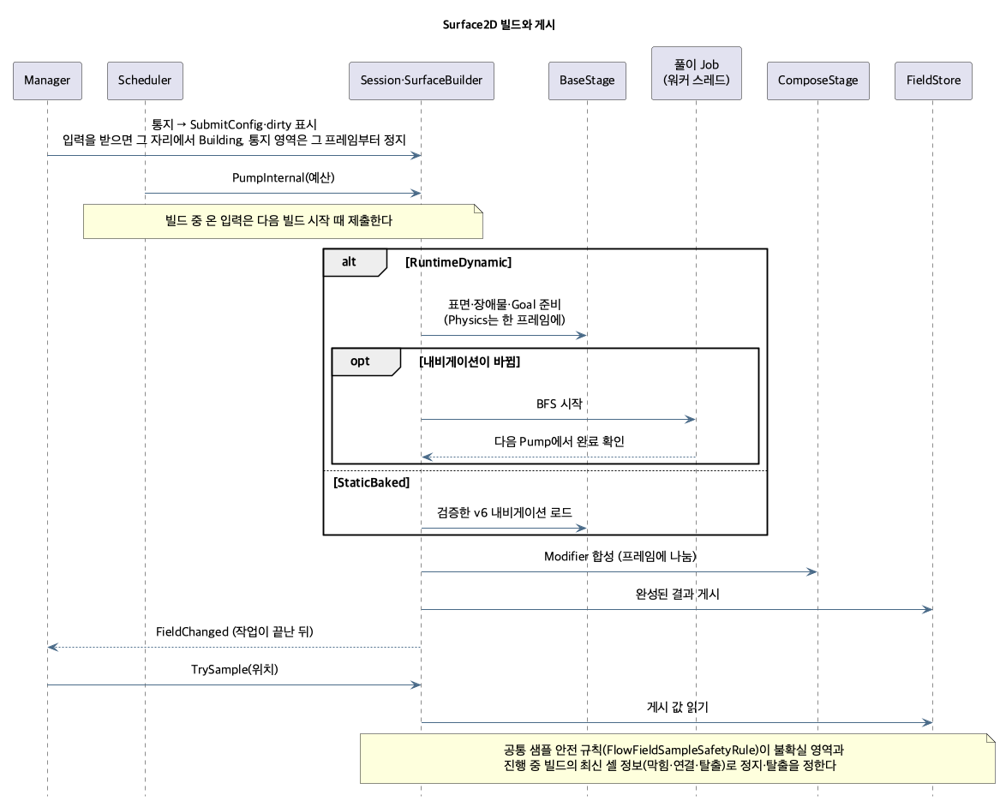
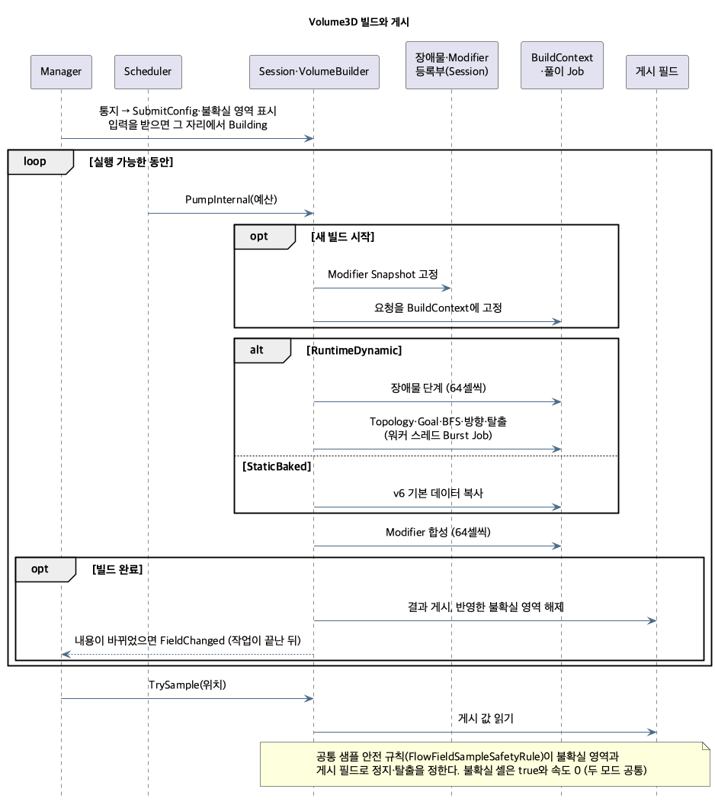
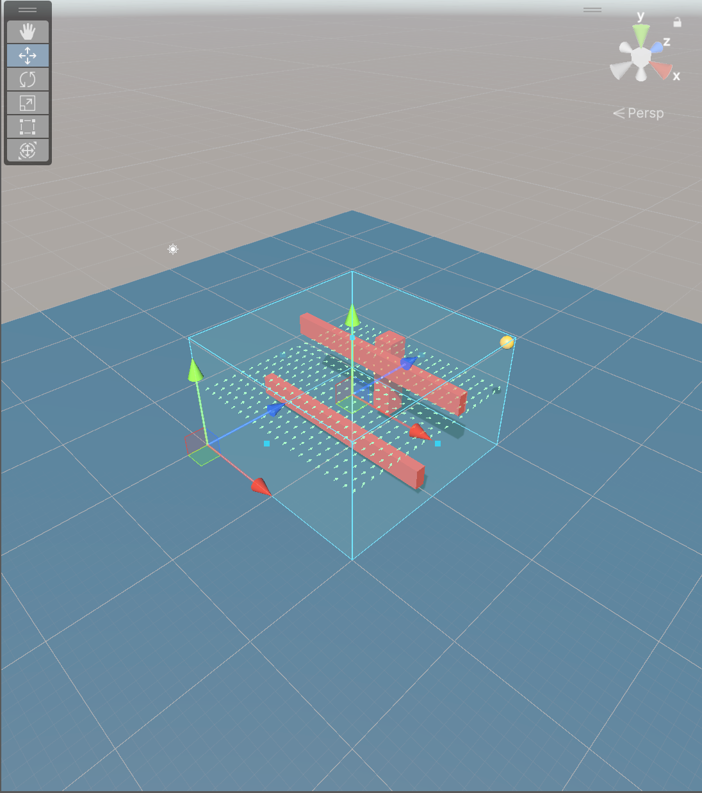

# FlowField 기술 참고

[README](../README.md)를 보완하는 구현 요약입니다.

## 어셈블리

| 어셈블리 | 내용 |
| --- | --- |
| `Common.FlowField` | 계약, 격자, Session, 계산 단계, 결과 저장소, Bake 데이터, `FlowFieldManager`와 Modifier 컴포넌트, 샘플, Player 측정 |
| `Common.FlowField.Editor` | Inspector, Bake, Scene View 표시 |

Player 측정(`PlayerProbe` 폴더, `Tools/run-player-probe.sh`)은 Editor와 `FLOWFIELD_PLAYER_PROBE`를 정의한 측정 빌드에서만 컴파일합니다. 샘플이 UGUI를 쓰므로 `Common.FlowField`는 `UnityEngine.UI`를 참조합니다.

## 파이프라인과 전략

- `FlowFieldSession`은 두 모드가 같이 쓰는 파이프라인입니다. 모드와 무관한 규칙은 모두 여기 있습니다.
  - 수명 전이(`Initialize`·`Stop`·`Restart`·`Release`·Fault·`Dispose`), 세대 번호, 이벤트
  - 빌드 루프(`RunPipeline`, 직접 소유자의 `Pump`). 빌드 중 상태 전이, Revision, `FieldChanged`, Fault도 여기서만 합니다. Builder는 단계 결과(계속·대기·버림·완료)와 "게시한 필드가 달라졌는지"만 돌려주고, 실패는 예외로 알립니다. 버린 결과 뒤에 남은 입력이 있으면 Ready로 돌아가지 않고 Building을 유지합니다.
  - Surface 풀이 완료 콜백은 세대 번호와 빌드 단계(`WaitingSolve`)로 유효성을 판단합니다. 콜백은 `StartBfs`나 `Poll` 안, 곧 `StepBuild` 안에서만 옵니다.
  - 조회(`TrySample`·`ClampPositionToGrid`·`IsReady`)와 조회 실패를 예외로 바꾸는 일(`FlowFieldFailures`)
  - 장애물 등록(`FlowFieldObstacleRegistry`), Modifier 등록(`FlowFieldModifierRegistry`), 통지 영역을 불확실 영역으로 표시하는 일(`FlowFieldSafety`, 여백 = 셀 크기 + Obstacle Clearance)
- 모드마다 다른 일은 `IFlowFieldSpaceBuilder`(`FlowFieldSurfaceBuilder`, `FlowFieldVolumeBuilder`)가 맡습니다. 자기 멤버 21개와 상속한 `Dispose`입니다.
  - 요청 만들기(`Initialize`, `SubmitConfig`)
  - 빌드 단계(`TryBeginBuild`·`StepBuild`·`PublishBuild`, `BuildPolicy`)
  - 게시 필드와 격자(`PublishedField`·`TryGetFieldInfo`, `LatestGrid` = 마지막 요청의 Grid로 `ClampPositionToGrid`가 씀), 게시 필드보다 새 셀 정보(`LatestCells`: Surface는 진행 중인 빌드의 기본 단계 결과, Volume은 없음)
  - 입력 반영(`ApplyObstacleChange`·`ApplyModifierChange`·`CreateModifierArea`)
  - 수명 훅(`CancelWork`·`DropComputedState`·`ReleaseResources`)
- Manager는 모드별 정적 묘사 `FlowFieldSpaceStrategy.For(mode)`로 세션 생성, 검증, 격자, Bounds 스냅을 고릅니다. Builder는 `FlowFieldManagerConfig` 스냅샷으로 검증(`Validate`), 격자(`TryCreateLayout`), 요청을 스스로 만듭니다. 공통 검사는 `FlowFieldManagerConfig.ValidateShared`가 같은 순서와 메시지로 합니다.
- 공통 부품: 게시 필드 `FlowFieldField`, 조회 `FlowFieldSampler`, 요청 보관 `FlowFieldRequestInbox`, 셀 합성 규칙 `FlowFieldVectorUtility.ApplyModifier`, 이벤트 경계 `FlowFieldExecutionBoundary`, 예산 `FlowFieldBuildScheduler`.
- Modifier가 닿는 셀을 찾는 방식만 모드별입니다. Surface는 셀 마스크(`FlowFieldSurfaceModifierArea`)를 보관해 바뀐 영역만 다시 합성하고, Volume은 빌드마다 64셀씩 후보를 조회합니다.
- **Editor 경계:** Runtime Manager가 Editor에 내놓는 것은 `CaptureConfig()`와 `TryGetPublishedField`뿐입니다.
  - 레이아웃, Bake 검증, 요청, Goal 해석, Bake 입력 해시는 `FlowFieldBakeService`가 Builder 정적 함수로 만듭니다.
  - 쓰기는 `SerializedObject`로 합니다. Bounds 핸들은 Undo를 남기고, Bake Asset 지정은 Undo 없이 씁니다. 실행 중인 세션에는 `OnValidate`로 통지됩니다.
  - Bake 내보내기는 각 Builder의 `TryExportBakeData` 하나입니다.

## 수명과 게시 규칙

- **입력:** Builder는 최신 요청 한 벌과 대기 표시만 보관합니다(`FlowFieldRequestInbox`). Volume은 빌드 시작 때 요청을 BuildContext에 고정하고, Surface는 풀이가 끝나면 최신 요청으로 합성합니다. 빌드 중 온 입력은 다음 빌드로 넘기고, 그동안 두 모드 모두 Building을 유지합니다. Ready에서 받은 입력(설정, Goal, 장애물, Modifier)은 Session이 그 자리에서 Building으로 바꿉니다. 그래서 명령 직후 `State`와 `IsRebuilding`이 두 모드에서 같고, 다음 Pump를 기다리지 않습니다. 할 일이 없어진 Building은 게시된 필드가 있으면 Ready로 돌아갑니다.
- **게시:** 완성된 결과만 게시하고, 일반 조회는 게시 값을 읽은 뒤 아래 샘플 안전 규칙을 적용합니다.
- **샘플 안전 규칙(`FlowFieldSampleSafetyRule`, 두 모드·두 Bake 모드 공통):** 게시 값을 읽은 뒤 아래 순서로 덮어씁니다. "위험한 칸"은 불확실 영역에 있거나, 최신 정보에서 막혔거나, 걸을 수 없는(Surface 지면 없음) 칸입니다.
  1. 지금 칸이 불확실 영역이거나 걸을 수 없으면 정지합니다.
  2. 지금 칸이 막혔으면 탈출 방향으로 내보냅니다. 탈출 방향이 없거나, 그 방향 이웃이 격자 밖이거나 불확실 영역이거나 걸을 수 없으면 정지합니다. 이웃이 막힌 것은 괜찮습니다(장애물 깊은 곳에서는 여러 칸을 지나 빠져나갑니다).
  3. 다음 칸이 있으면 지금 칸과 다음 칸을 감싸는 칸 중 하나라도 위험하거나 그 방향 연결이 끊겼으면 정지합니다.
  4. Default Direction 칸(`NextCells == -1`)은 기본 방향의 축 부호로 갈 수 있는 이웃 조합 중 하나라도 격자 밖이거나 위험하면 정지합니다.
  - "최신 정보"는 Surface의 경우 진행 중인 빌드의 작업 공간이 게시 필드와 같은 격자·지면일 때의 막힘·지면·연결·탈출이고, 그 밖에는 게시 필드입니다. 세션 상태(`IsRebuilding`)는 보지 않습니다.
- **끝난 풀이:** 새 입력이 들어와 있어도 게시합니다. 계속 움직이는 Goal 때문에 결과가 끊기지 않게 하기 위해서입니다. Grid나 설정이 바뀌었거나 Goal이 사라진 경우만 거부합니다.
- **Revision:** 두 모드 모두 게시 내용(셀 상태, 방향, 속도, Goal)이 실제로 바뀔 때만 증가하고 `FieldChanged`를 보냅니다. Volume은 `FlowFieldField.HasSameContent`(memcmp)로 비교합니다. 내용이 같아도 요청 스냅샷 갱신, 불확실 영역 정리, Ready 전환은 그대로 합니다.
- **재진입 없음:** `FlowFieldExecutionBoundary`가 이벤트를 큐에 모아 가장 바깥 작업이 끝난 뒤 전달합니다. `Release`·`Stop`·`Restart`·Fault 이전의 이벤트는 버리고 `Released`만 항상 전달합니다. 핸들러가 서로를 계속 깨우면 100,000건에서 오류를 남기고 남은 일을 버립니다. 이때도 `Released`와 해제 이벤트는 순서대로 한 번 전달하고, 그 핸들러가 새로 만든 일은 버립니다.
- **정지와 재시작:** 비활성화는 `Stop`(빌드 취소, 게시 결과 버림)입니다. 다시 활성화와 Fault 재시도(`RequestRebuild`)는 같은 `Restart` 경로로 처음부터 다시 빌드하고, 등록된 장애물과 Modifier는 유지합니다. 재시작에 실패하면 Fault로 남습니다. 새 결과가 게시되기 전까지 Ready가 아니고, `ClampPositionToGrid`는 최신 요청의 격자로 계속 동작합니다. 비활성 상태에서 `Init()`해도 요청은 제출하므로, 두 모드 모두 그 격자로 Clamp하고 장애물 통지를 받습니다.
- **수명 종료:** 실행 중인 풀이 Job에 취소를 요청하고 끝날 때까지 기다립니다. Job은 4,096셀마다 취소를 확인합니다.
- **Inspector 편집:** Play 중 Inspector에서 값을 바꾸면 `OnValidate` 안에서 검증하고 바로 다시 빌드합니다. Grid가 바뀌면 이전 결과를 즉시 숨기고 Building을 알립니다. 값이 잘못되면 Fault입니다. `StateChanged` 핸들러가 `OnValidate` 안에서 실행될 수 있습니다.

## 입력 변경

- **통지 방식:** FlowField는 씬을 폴링하지 않습니다. 변경은 공개 API와 FlowField 컴포넌트의 통지로만 들어옵니다. `FlowFieldDynamicObstacle`, `FlowFieldGoalTarget`, Modifier Volume은 자기 Transform이나 Collider Bounds를 프레임당 한 번 확인합니다(컴포넌트당 O(1)).
- **불확실 영역:** 장애물 등록·해제·이동·영역 dirty 통지를 받은 그 프레임에 영역을 표시하고, 그 영역을 조회한 빌드가 게시될 때까지 그 셀과 그 셀로 가는 경로는 속도 0입니다. 빌드 시작 때 목록을 옮기고 그 빌드를 게시할 때 지우며, 시작 후 기록된 영역은 다음 빌드까지 남습니다. 목록이 64개를 넘으면 합쳐서 더 넓게 정지합니다(`FlowFieldSafety`; Surface는 XZ, Volume은 3D로 비교). 장애물 설정이 바뀌면 필드 전체가 불확실해집니다.
- `SetGoal()`은 장애물 결과를 재사용합니다. 같이 `RequestRebuild()`를 부르면 이 이점을 잃습니다.
- Surface의 `RequestRebuild()`는 바닥 Raycast를 다시 한다고 보장하지 않습니다. 바닥 형상이 바뀌면 `NotifyCellsDirty()`를 씁니다. Volume의 `NotifyCellsDirty()`는 새 전체 작업을 예약합니다.
- 풀이 중에 바뀐 Goal과 설정은 Builder가 보관했다가 다음 빌드를 시작할 때 제출합니다.
- Surface2D의 정적 장애물은 Obstacle Layer에서 Rigidbody가 없고 등록하지 않은 Collider입니다. `StaticBaked`는 동적 장애물 등록을 거부하고, 형식이 다른 Bake Asset도 거부하므로 다시 Bake해야 합니다.

## Surface2D



- 통지가 dirty 표시와 요청을 남기면 Scheduler가 Session을 진행합니다. 직접 `Session.Pump()`를 호출하는 베이크와 미리보기는 호출자가 입력을 책임집니다.
- 표면·장애물·Goal·Modifier 영역은 Physics 결과가 한 스냅샷이 되도록 한 프레임에 실행합니다. BFS와 방향은 워커 스레드, Topology는 메인 스레드의 Burst입니다. 합성은 예산에 맞춰 나눕니다.
- BFS가 예정된 빌드는 사전 합성을 생략하고, 완료 후 전체를 한 번 합성합니다.
- 바닥 Layer와 경사·단차 조건이 필요합니다.
- 격자가 2,500셀을 넘으면 Scene View는 표시 대상을 줄입니다.
- 한 번의 조회에서 겹치는 장애물이 4,096개에 이르면 Session이 Fault 납니다. 일부만 쓰면 장애물을 놓치기 때문입니다. Volume3D는 이때 셀별 검사로 넘어갑니다.

## Volume3D



- 셀은 `x + Width × (z + Depth × y)` 순서로 저장합니다. 두 축·세 축 대각선은 중간 셀이 모두 통과 가능할 때만 연결합니다.
- 장애물·Modifier 단계는 64셀씩 진행합니다. 스텝마다 `OverlapBox`로 후보를 모아 후보가 닿는 셀만 정확히 검사합니다(`FlowFieldVolumeCellQuery`).
- **부분 재계산:** Modifier만 바뀌면 게시된 내비게이션에 다시 합성하고, Goal만 바뀌면 장애물 결과와 Topology를 재사용합니다. Goal이 같은 셀 안에서 움직이면 빌드하지 않습니다. Goal을 지우면 진행 중인 빌드를 버립니다.
- **등록하지 않은 Collider:** `RequestRebuild()`나 `NotifyCellsDirty()`의 전체 조회에서 반영됩니다.
- **배열 재사용:** 교체된 게시 배열을 다음 빌드에 씁니다(`FlowFieldSpareArrays`).

## Modifier

- Modifier 적용 여부는 두 모드 모두 `FlowFieldVectorUtility.CanApplyModifier`로 판정합니다. 막힌 셀, Goal Anchor, 도달할 수 없는 셀, 기본 방향이 0인 셀에는 적용하지 않습니다.
- 등록, Priority 순서(낮은 값부터, 중복 거부), 변경 통지, 값 Snapshot은 두 모드가 같은 `FlowFieldModifierRegistry`를 씁니다. 이미 등록된 Modifier를 다시 등록하면 false를 돌려줍니다.
- 셀 하나에 적용하는 규칙(적용 조건, `Modify()` 호출, 출력 검사)도 공통입니다. 출력은 유한해야 하고 속도는 0 이상, 방향은 단위 벡터나 0이어야 합니다. Surface는 방향이 표면에 접해야 합니다.
- Priority 기본값은 Speed 100, Noise 200입니다. 런타임 값은 `SetSpeedMultiplier()`, `SetNoise()`, `SetPriority()`로 바꿉니다.
- `CaptureSnapshot()`이 빌드에 쓸 값을 고정합니다. Collider 형상까지 복제하지는 않습니다.
- FlowField는 Modifier를 폴링하지 않습니다. 값, Priority, 영역 변경은 `NotifyModifierChanged`로 알립니다. 기본 Modifier Volume은 setter와 `OnValidate`에서 알리고, Influence Collider의 이동과 파괴는 프레임당 한 번 스스로 알립니다. `Observe()`는 등록과 통지 때 호출됩니다.
- 등록된 Modifier의 설정이 통지 시점에 잘못되면 두 모드 모두 Fault입니다. 등록되지 않은 Modifier를 통지하면 `InvalidOperationException`입니다.
- Fault 중에는 해제만 받습니다. 재시도가 전부 다시 빌드하므로 작업을 예약하지 않고, Fault 중 켜진 Modifier는 재시작의 요청 제출 전에 등록합니다.
- 셀 판정은 `FlowFieldOverlapUtility.CellHalfExtent`로 0.0001 줄인 상자를 써서, 격자에 맞춘 Collider가 이웃 셀을 잡지 않게 합니다.
- Influence Collider가 파괴되면 설정 오류로 보고 Fault를 냅니다. 무시하면 영향 영역이 조용히 사라집니다. 기본 Modifier Volume은 파괴를 다음 LateUpdate에 알립니다.
- Modifier 자체의 Fault는 Manager 재빌드로 풀리지 않습니다. Modifier를 끈 상태에서 `Release()`, 값 수정, `Init()` 순서로 복구한 뒤 원래 활성 상태로 되돌립니다.

직접 구현한 `IFlowFieldVectorModifier`의 `Observe()`, `CaptureSnapshot()`, `Modify()` 안에서는 호출이 다음과 같이 제한됩니다.

| 호출 | 동작 |
| --- | --- |
| `TrySample` 등 읽기 | 바로 실행 |
| Modifier·동적 장애물 등록과 해제, `NotifyModifierChanged` | 작업이 끝난 뒤 실행. 그 사이 Session이 멈추면 버려지고 등록은 경고를 남김 |
| `Init`, `RequestRebuild`, `Release`, `SetSpaceMode`, `SetGoal`, `NotifyCellsDirty`, `NotifyObstacleRegionDirty`, `NotifyDynamicObstacleMoved` | `InvalidOperationException` |

## StaticBaked

- Surface2D는 `FlowFieldStaticBakeData`, Volume3D는 `FlowFieldVolumeBakeData`이며 v6만 허용합니다. 둘 다 `FlowFieldBakeAsset`을 상속해 포맷 버전, Revision, 내용 세대(Inspector 편집과 다시 읽기를 알림)를 같은 방식으로 관리합니다.
- Editor Bake는 두 모드가 같은 실행 코드(`BakeRun`)와 저장 코드(`SaveBakeAsset`)를 씁니다. 입력이 바뀌면 그 프레임에 멈추고 기존 Asset을 유지하며, 저장은 Undo 한 묶음입니다.
- Volume은 방향·속도·탈출 벡터를 저장하지 않고 NextCell과 면 인덱스(`_escapeFaces`)에서 재구성합니다. Surface는 배열을 `FlowFieldBakeBlob`으로 `byte[]`에 비트 그대로 저장합니다.
- 저장에 실패하면 기존 Asset의 내용, Revision, GUID를 유지합니다.
- 런타임은 Asset에 구운 Goal을 그대로 씁니다. Init은 Goal Transform 위치가 구운 Goal과 같은지 검사합니다.
- 참조가 빈 Manager의 Bake 대상은 씬 GUID와 Manager ID로 만든 고정 경로입니다. 그 경로의 같은 형식 Asset은 이 Manager의 것으로 보고 덮어씁니다.

## Editor 표시

표시 상한은 FullVolume 8,192셀, Slice 4,096셀입니다. Volume 표시는 갱신 요청이 있거나 상태가 바뀔 때만 repaint합니다. Play Mode의 Surface 표시는 합성을 거친 최종 결과이므로 Asset의 원본 방향과 다를 수 있습니다. 왼쪽은 Surface2D 상세, 오른쪽은 Volume3D 중앙 단면입니다.

<p align="center">
  
  
</p>

## UML 갱신

원본은 `Docs/*.puml`이고, 렌더링한 PNG를 `Docs/Images`에 저장해 문서에 넣습니다. Graphviz 없이 PlantUML 1.2024.6으로 렌더링합니다. Docs 폴더에서 실행합니다.

```sh
java -Djava.awt.headless=true -Djava.io.tmpdir="$TMPDIR" -jar plantuml-1.2024.6.jar \
  -tpng -charset UTF-8 -o Images \
  flowfield-uml.puml flowfield-structure.puml flowfield-surface.puml flowfield-volume.puml
```

임시 폴더에 쓸 수 없으면 종료 코드 0으로 0바이트 PNG가 나오니 파일 크기를 확인합니다. 한글은 macOS의 `Apple SD Gothic Neo` 글꼴로 렌더링합니다.
