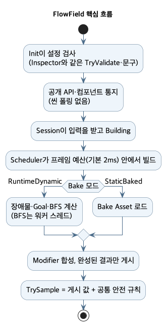
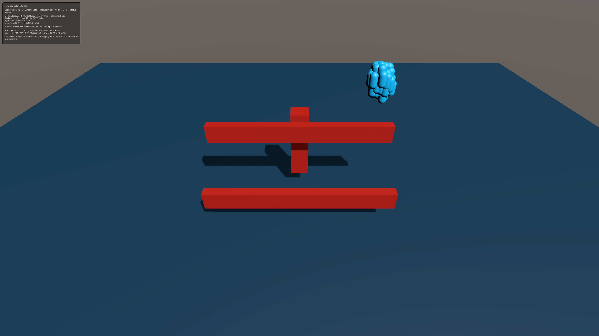
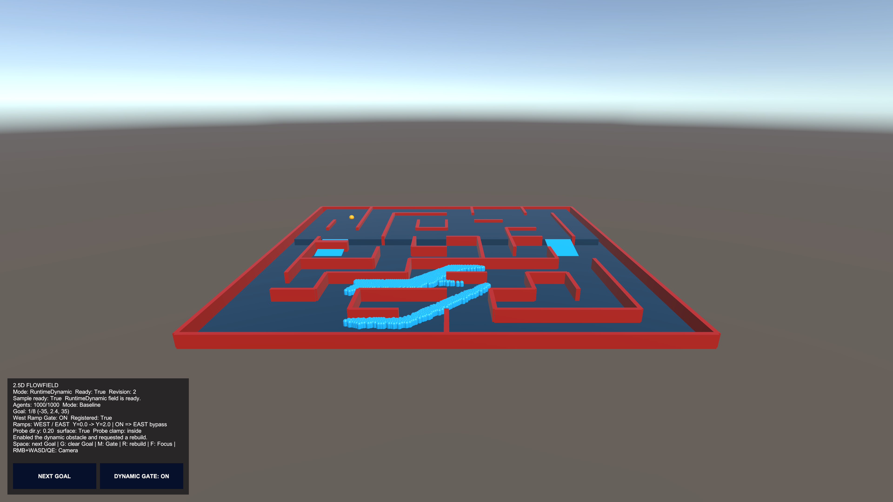
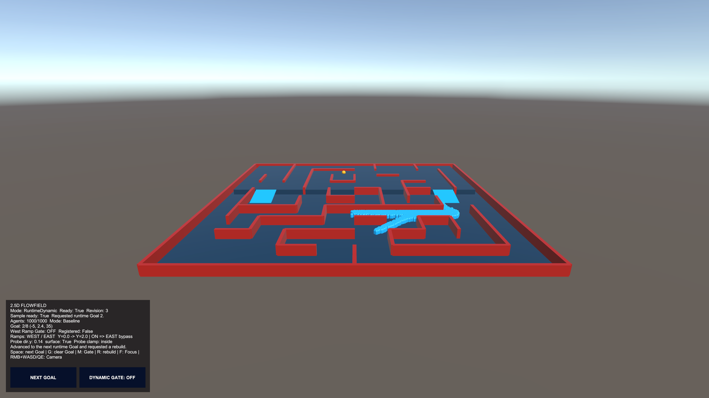
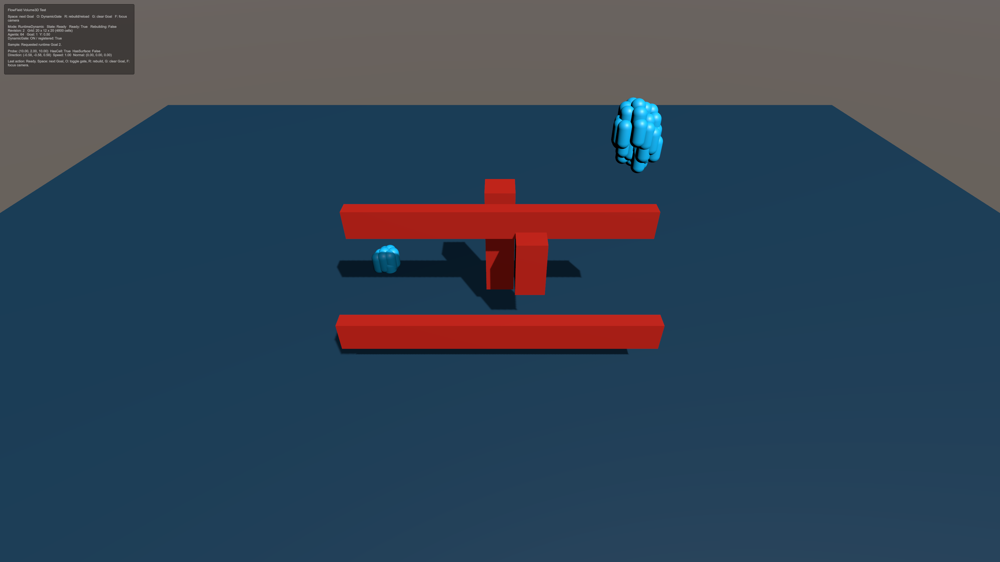
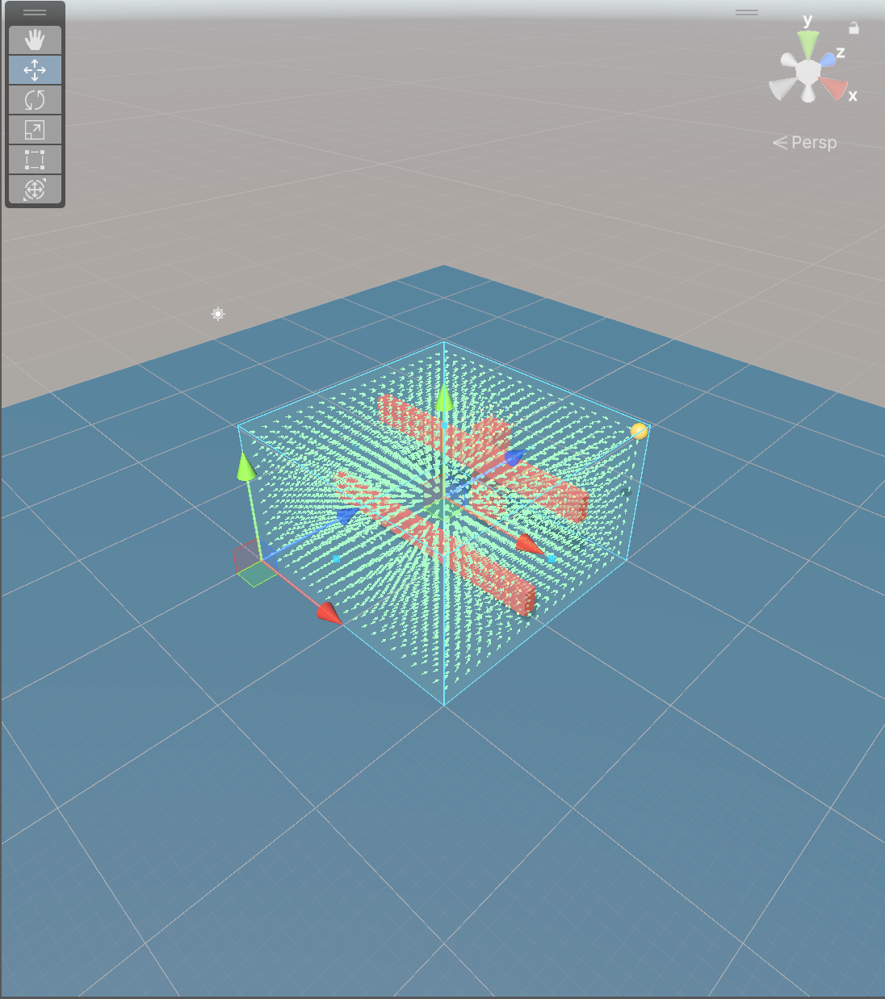

# FlowField

씬의 Goal과 장애물로 셀마다 방향과 속도 배율을 계산하는 방향장 시스템입니다. 이동 주체는 자기 업데이트에서 결과를 조회해 이동에 씁니다.

| 항목 | 내용 |
| --- | --- |
| 개발 | 유원석 (You Won Sock) · [GitHub](https://github.com/youwonsock) · qazwsx233434@gmail.com |
| 환경 | Unity 2023.2.20f1, C#, Burst Job (샘플 표시는 URP 16.0.6, UGUI) |
| 공간 모드 | `Surface2D`: 바닥 표면, 8방향 · `Volume3D`: Bounds 내부 정육면체 셀, 26방향 |
| 실행 모드 | `RuntimeDynamic`: 런타임 계산 · `StaticBaked`: Editor에서 Bake한 Asset 로드 |
| 규모 | Surface2D 최대 10만 셀 · Volume3D 최대 100만 셀, Manager별 512MiB |

구현 세부는 [TechnicalNotes.md](Docs/TechnicalNotes.md)에 있습니다.

## 시작하기

1. `Samples/Scenes/FlowFieldSample.unity` 또는 `FlowFieldVolume3DTest.unity`를 실행합니다. macOS 입력 소스가 한글이면 샘플의 글자 키가 동작하지 않습니다.
2. 새 씬에서는 `FlowFieldManager`에 Bounds, CellSize, 공간 모드, Layer를 지정합니다. Manager는 회전 없이 단위 Scale로 둡니다.
3. `StaticBaked`는 Editor에서 Bake한 Asset을 연결합니다. Goal이나 장애물이 바뀌면 다시 Bake합니다.
4. 움직이는 장애물에는 `FlowFieldDynamicObstacle`, 움직이는 Goal에는 `FlowFieldGoalTarget`을 붙입니다. FlowField는 씬을 폴링하지 않으므로 알리지 않은 변화는 반영되지 않습니다.
5. 이동 주체에서 `TrySample()`을 호출합니다.

## 다른 프로젝트로 옮기기

- `Assets/_FlowField/Script/` 폴더를 `.meta`와 함께 복사합니다. 시스템(`Common.FlowField`)과 에디터(`Common.FlowField.Editor`) 어셈블리가 들어 있습니다.
- 패키지: Burst(1.8.13), Collections(1.4.0), Mathematics(1.2.6), Physics 모듈. 괄호는 이 프로젝트가 쓰는 버전입니다. Unity 2023.2.20f1 빈 프로젝트에 이 패키지만 넣고 `Script/`만 복사해 두 어셈블리가 오류 없이 컴파일되는 것을 확인했습니다.
- `Samples/`(샘플 씬·스크립트. UGUI와 레이어 8번 `FlowFieldGround`·9번 `FlowFieldObstacle`·10번 `FlowFieldAgent`가 필요하며, 씬이 레이어를 번호로 저장하므로 번호도 같아야 합니다)와 `Dev/`(측정 도구)는 옮기지 않아도 됩니다. 문서가 필요하면 이 README와 `Docs/`를 함께 옮깁니다.
- 새 Bake Asset은 씬 옆, 씬 이름의 폴더(`<씬 폴더>/<씬 이름>/`)에 저장되므로 폴더 구조와 상관없이 동작합니다.

```csharp
using Common.FlowField;
using UnityEngine;

public sealed class FlowFieldReadmeMover : MonoBehaviour
{
    [SerializeField] private FlowFieldManager _flowField = null;
    [SerializeField, Min(0f)] private float _moveSpeed = 3f;

    private void FixedUpdate()
    {
        IFlowFieldProvider provider = _flowField;
        Vector3 velocity = Vector3.zero;

        if (_flowField != null
            && provider.TrySample(transform.position, out FlowFieldSample sample)
            && sample.HasCell
            && sample.SpeedMultiplier > 0f)
        {
            velocity = sample.Direction * (_moveSpeed * sample.SpeedMultiplier);
        }

        transform.position += velocity * Time.fixedDeltaTime;
    }
}
```

`TrySample()`이 false면 결과가 아직 없거나 영역 밖이므로 정지합니다. true여도 Goal 도착, 장애물, 안전성 제한으로 속도가 0일 수 있습니다. 충돌, 높이 보정, Agent 간 회피는 이동 시스템이 맡습니다.

## 구조



<sub>PlantUML 원본: [Docs/flowfield-uml.puml](Docs/flowfield-uml.puml)</sub>


<sub>PlantUML 원본: [Docs/flowfield-structure.puml](Docs/flowfield-structure.puml)</sub>

- **Manager**는 직렬화 설정과 Unity 콜백을 맡고, 설정 스냅샷(`FlowFieldManagerConfig`)과 공개 API 호출을 Session에 넘깁니다. 호출이 계산 완료를 뜻하지는 않습니다.
- **Session**은 두 공간 모드가 같이 쓰는 파이프라인입니다. 수명, 이벤트, 빌드 루프, 실패 규칙이 한 벌이고, 모드마다 다른 계산만 Builder(`Surface`·`Volume`)가 맡습니다.
- 완성된 결과만 게시하고, 다음 계산 중에도 이전 결과를 읽게 합니다. Manager를 다시 켜거나 Fault를 재시도한 뒤, 또는 Grid가 바뀐 뒤에는 새 결과가 나올 때까지 읽을 수 없습니다.
- **Scheduler**는 프로젝트 전체에서 프레임당 하나의 예산(기본 2ms)으로 작업을 나눕니다. 풀이는 워커 스레드에서 돕니다.
- **Execution Boundary**는 이벤트와 Modifier 코드를 작업이 끝난 뒤로 미룹니다.

## 주요 API

| 상황 | 호출 |
| --- | --- |
| Goal 변경 | `SetGoal()` 또는 `FlowFieldGoalTarget`. 장애물 결과를 재사용합니다 |
| Fault 재시도, Play 중 Manager 이동 | `RequestRebuild()` |
| 바닥 형상 변경 (`RuntimeDynamic`) | `NotifyCellsDirty()` |
| 장애물 영역 알림 (`RuntimeDynamic`) | `NotifyObstacleRegionDirty(bounds)`. 이전과 현재 Bounds의 합집합을 넘깁니다 |
| 움직이는 장애물 | `RegisterDynamicObstacle(collider)` → 이동할 때마다 `NotifyDynamicObstacleMoved(collider)` → `UnregisterDynamicObstacle(collider)`. `FlowFieldDynamicObstacle`이 이 셋을 대신합니다 |
| 모드 변경 | `Release()` → `SetSpaceMode()` → `Init()` 뒤 동적 장애물 재등록 |
| 결과 변화 알림 | `FieldChanged`, `StateChanged` 이벤트. 핸들러 안에서 모든 명령을 쓸 수 있습니다 |

- **통지 방식:** FlowField는 씬을 폴링하지 않습니다. 변경은 위 API와 FlowField 컴포넌트(`FlowFieldDynamicObstacle`, `FlowFieldGoalTarget`, Modifier)의 통지로만 들어옵니다. 알리지 않은 이동은 반영되지 않습니다. 통지를 받은 그 프레임부터 영향 영역은 새 결과가 게시될 때까지 속도 0입니다. 장애물 조회는 Trigger를 무시합니다.
- **Goal Transform:** Manager의 Goal Transform은 Init과 Bake 때 한 번 읽는 초기 Goal입니다. 이후 이동은 `SetGoal()`이나 `FlowFieldGoalTarget`으로 알립니다.
- **설정 변경:** Play 중 Inspector에서 설정을 바꾸면 바로 다시 빌드합니다. 값이 잘못되면 두 모드 모두 Fault가 됩니다.
- **설정 검사:** Init과 Inspector·Scene View는 같은 검사를 같은 문구로 합니다. 잘못된 설정이면 `Init()`은 처음 걸린 이유를 메시지로 담은 `InvalidOperationException`을 던지고, Inspector는 그 문구를 그대로 보여 줍니다.
- **Modifier:** 영향 영역 Collider(Trigger, MeshCollider는 Convex)에 `FlowFieldSpeedModifier`나 `FlowFieldNoiseModifier`를 두고 Manager를 지정합니다. 같은 Manager 안에서는 Priority를 서로 다르게 두며, 낮은 값부터 합성합니다.
- **Fault 복구:** 원인을 고친 뒤 `RequestRebuild()`를 부릅니다. Modifier 자체의 Fault는 Modifier를 껐다가 `Release()` → 값 수정 → `Init()` 순서로 풉니다. 직접 구현한 Modifier 안에서 쓸 수 있는 호출은 TechnicalNotes에 있습니다.

### 실패 규칙

두 공간 모드가 같은 규칙을 따릅니다.

| 상황 | `TrySample` | `Sample` / `ClampPositionToGrid` | 명령 API |
| --- | --- | --- | --- |
| 초기화 전, `Release()` 뒤 | false | `InvalidOperationException` (not initialized) | `InvalidOperationException` |
| Faulted | false | `InvalidOperationException` (InnerException = 원인) | `InvalidOperationException`. 해제(`Unregister*`)는 받고 bool을 돌려줍니다 |
| 결과 없음 (첫 빌드, 비활성화 뒤, Grid 변경 뒤) | false | `Sample`: `InvalidOperationException` (not ready) · `Clamp`: 최신 Grid로 동작 | 받습니다 |
| 좌표 NaN·무한대, 격자 밖 | false | `ArgumentOutOfRangeException` | — |
| `StaticBaked` | 정상 | 정상 | `SetGoal`, `NotifyCellsDirty`, `NotifyObstacleRegionDirty`, `RegisterDynamicObstacle`, `NotifyDynamicObstacleMoved`는 `InvalidOperationException`, `UnregisterDynamicObstacle`은 false |

- `TrySample()`은 어떤 상태에서도 예외를 던지지 않습니다. `IsReady`가 true면 격자 안 좌표의 `TrySample()`이 성공할 수 있습니다.
- `Revision`과 `FieldChanged`는 두 모드 모두 게시 내용이 실제로 바뀔 때만 바뀝니다.
- Surface2D의 `ClampPositionToGrid()`는 X·Z만 맞춥니다.
- 좌표가 NaN·무한대이면 `Sample()`과 `ClampPositionToGrid()` 모두 같은 메시지(`Position must be finite.`)의 `ArgumentOutOfRangeException`입니다.
- 비활성 상태에서 `Init()`하면 빌드는 활성화될 때 시작하지만 요청은 바로 제출합니다. 그래서 두 모드 모두 그 사이에도 최신 Grid로 `ClampPositionToGrid()`하고 장애물 통지를 받습니다.
- Faulted 상태에서도 `UnregisterDynamicObstacle()`은 Modifier 해제처럼 받고 bool을 돌려줍니다. `FlowFieldDynamicObstacle`을 그동안 끄면 재시도한 결과에 그 장애물이 남지 않습니다. Modifier 코드 안에서 미룬 해제는 그 작업이 Fault로 끝나도 실행됩니다.
- 샘플을 덮어쓰는 안전 규칙은 두 모드와 두 Bake 모드에서 같습니다(TechnicalNotes "샘플 안전 규칙"). Surface2D도 Default Direction을 따라 막힌 칸이나 격자 밖으로 가는 칸에서 멈추고, 막힌 칸에서 빠져나갈 곳이 격자 밖이거나 통지된 영역이면 멈춥니다. Volume3D도 Surface2D처럼 장애물 깊은 곳(탈출 방향 다음 칸도 막힌 칸)에서 멈추지 않고 탈출 방향으로 빠져나옵니다. StaticBaked도 구운 막힘을 기준으로 같은 검사를 합니다.
- Grid를 바꾼 직후 새 Grid가 빌드되기 전에도 `ClampPositionToGrid()`는 새 Grid(마지막 요청의 Grid)로 맞춥니다. 두 모드가 같습니다.
- 코드 메시지는 모두 영어입니다(예외, 로그, Inspector 검증 문구·Tooltip·HelpBox, 코드 주석, 샘플 화면 문구).

## 기능

**베이킹:** 씬을 미리 계산해 v6 Asset으로 저장하고, 런타임은 Physics와 BFS 없이 로드합니다. Default Direction과 Modifier는 로드 뒤 합성합니다. Clear Bake는 참조만 지우며, 다시 Bake하면 이 Manager의 기존 Asset(씬 옆 고정 경로)을 덮어씁니다. 씬을 옮기거나 씬·Manager 이름을 바꾼 뒤 Clear Bake하고 다시 Bake하면 새 경로에 Asset을 만들고 예전 Asset은 남으므로, 필요 없으면 직접 지웁니다. Asset이 연결된 동안에는 그 Asset에 그대로 씁니다.

<p align="center">
  
  
</p>

**Surface2D:** 바닥 Raycast로 높이와 법선을 얻고, 경사·단차·장애물 조건을 반영해 Goal로 향하는 흐름을 만듭니다. 오른쪽은 Goal과 장애물을 바꾼 화면입니다.

<p align="center">
  
  
</p>

**Volume3D:** Bounds 전체를 정육면체 셀로 나눠 비행 주체가 장애물을 입체적으로 우회하게 합니다. 코너가 막힌 대각선 이동은 막습니다. 오른쪽은 Gate와 Goal 높이를 바꾼 화면입니다.

<p align="center">
  
  
</p>

**Editor 시각화:** Scene View에서 방향장을 확인합니다. 표시 표본을 줄여도 계산 해상도는 바뀌지 않습니다.

<p align="center">
  
  
</p>
