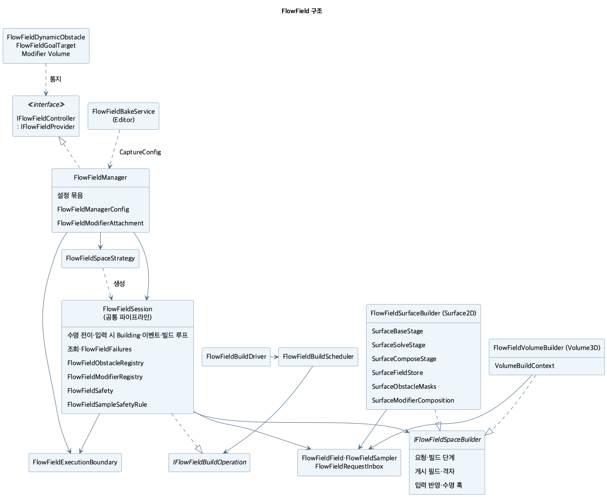
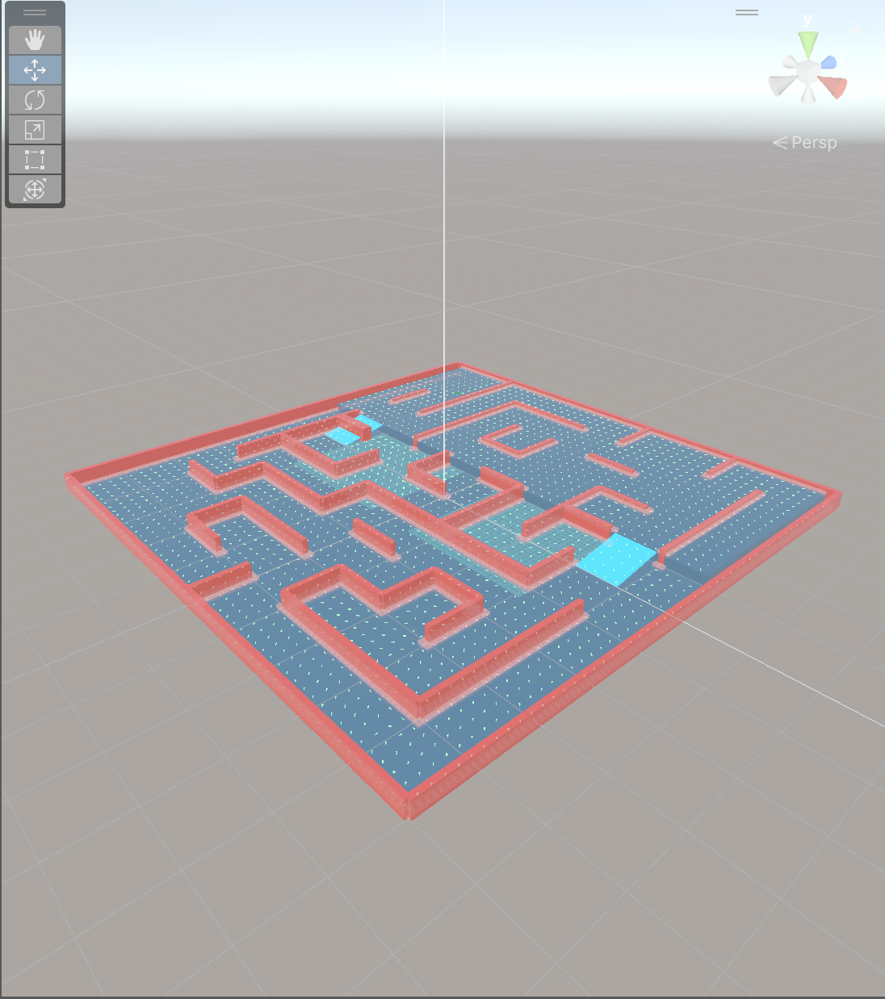

# FlowField

씬의 Goal과 장애물로 셀마다 방향과 속도 배율을 계산하는 방향장 시스템입니다. 이동 주체는 자기 업데이트에서 결과를 조회해 이동에 씁니다.

| 항목 | 내용 |
| --- | --- |
| 개발 | 유원석 (You Won Sock) · [GitHub](https://github.com/youwonsock) · qazwsx233434@gmail.com |
| 환경 | Unity 2023.2.20f1, C#, Burst Job (샘플 표시는 URP 16.0.6, UGUI) |
| 공간 모드 | `Surface2D`: 바닥 표면, 8방향 · `Volume3D`: Bounds 내부 정육면체 셀, 26방향 |
| 실행 모드 | `RuntimeDynamic`: 런타임 계산 · `StaticBaked`: Editor에서 Bake한 Asset 로드 · `BakedBase`: Bake한 바닥과 장애물 위에서 Goal과 장애물을 런타임에 계산 |
| 규모 | Surface2D 최대 10만 셀 · Volume3D 최대 100만 셀 |

구현 세부는 [TechnicalNotes.md](Docs/TechnicalNotes.md)에 있습니다.

## 시작하기

1. `Samples/Scenes/FlowFieldSample.unity` 또는 `FlowFieldVolume3DTest.unity`를 실행합니다. macOS 입력 소스가 한글이면 샘플의 글자 키가 동작하지 않습니다.
2. 새 씬에서는 `FlowFieldManager`에 Bounds, CellSize, 공간 모드, Layer를 지정합니다. Manager는 회전 없이 단위 Scale로 둡니다.
3. `StaticBaked`는 Editor에서 Bake한 Asset을 연결합니다. Goal이나 장애물이 바뀌면 다시 Bake합니다. `BakedBase`도 같은 Asset을 연결하고, Goal과 알린 장애물 변화는 런타임에 반영합니다.
4. 움직이는 장애물에는 `FlowFieldDynamicObstacle`, 움직이는 Goal에는 `FlowFieldGoalTarget`을 붙입니다. 기본으로 FlowField는 씬을 폴링하지 않으므로 알리지 않은 변화는 반영되지 않습니다. 등록하지 않은 장애물까지 따라가려면 Obstacle 설정의 `Sweep Unregistered`를 켭니다.
5. 이동 주체에서 `TrySample()`을 호출합니다.

## 다른 프로젝트로 옮기기

- `Assets/_FlowField/Script/` 폴더를 `.meta`와 함께 복사합니다. 시스템(`Common.FlowField`)과 에디터(`Common.FlowField.Editor`) 어셈블리가 들어 있습니다.
- 패키지: Burst(1.8.13), Collections(1.4.0), Mathematics(1.2.6), Physics 모듈. 괄호는 이 프로젝트가 쓰는 버전입니다. Unity 2023.2.20f1 빈 프로젝트에 이 패키지만 넣고 `Script/`만 복사해 두 어셈블리가 오류 없이 컴파일되는 것을 확인했습니다.
- `Samples/`(샘플 씬·스크립트. UGUI와 레이어 8번 `FlowFieldGround`·9번 `FlowFieldObstacle`·10번 `FlowFieldAgent`가 필요하며, 씬이 레이어를 번호로 저장하므로 번호도 같아야 합니다)와 `Dev/`(측정 도구)는 옮기지 않아도 됩니다. 문서가 필요하면 이 README와 `Docs/`를 함께 옮깁니다.
- 새 Bake Asset은 씬 옆, 씬 이름의 폴더(`<씬 폴더>/<씬 이름>/`)에 저장되므로 폴더 구조와 상관없이 동작합니다. Bake Asset은 자기를 Bake한 Manager를 기억하므로, 복제한 Manager를 Bake하면 원래 Asset을 덮어쓰지 않고 자기 Asset을 새로 만들어 연결합니다.

```csharp
using Common.FlowField;
using UnityEngine;

public sealed class FlowFieldReadmeMover : MonoBehaviour
{
    [SerializeField] private FlowFieldManager _flowField = null;
    [SerializeField, Min(0f)] private float _moveSpeed = 3f;

    private void FixedUpdate()
    {
        IFlowFieldProvider provider = _flowField;
        Vector3 velocity = Vector3.zero;

        if (_flowField != null
            && provider.TrySample(transform.position, out FlowFieldSample sample)
            && sample.HasCell
            && sample.SpeedMultiplier > 0f)
        {
            velocity = sample.Direction * (_moveSpeed * sample.SpeedMultiplier);
        }

        transform.position += velocity * Time.fixedDeltaTime;
    }
}
```

`TrySample()`이 false면 결과가 아직 없거나 영역 밖이므로 정지합니다. true여도 Goal 도착, 장애물, 안전성 제한으로 속도가 0일 수 있습니다. 충돌, 높이 보정, Agent 간 회피는 이동 시스템이 맡습니다.

## 구조


<sub>PlantUML 원본: [Docs/flowfield-uml.puml](Docs/flowfield-uml.puml)</sub>



<sub>PlantUML 원본: [Docs/flowfield-structure.puml](Docs/flowfield-structure.puml)</sub>

- **Manager**는 직렬화 설정과 Unity 콜백을 맡고, 설정 스냅샷(`FlowFieldManagerConfig`)과 공개 API 호출을 Session에 넘깁니다. 호출이 계산 완료를 뜻하지는 않습니다.
- **Session**은 두 공간 모드가 같이 쓰는 파이프라인입니다. 수명, 이벤트, 빌드 루프, 실패 규칙이 한 벌이고, 모드마다 다른 계산만 Builder(`Surface`·`Volume`)가 맡습니다.
- 완성된 결과만 게시하고, 다음 계산 중에도 이전 결과를 읽게 합니다. Manager를 다시 켜거나 Fault를 재시도한 뒤, 또는 Grid가 바뀐 뒤에는 새 결과가 나올 때까지 읽을 수 없습니다.
- **Scheduler**는 프로젝트 전체에서 프레임당 하나의 예산(기본 2ms)으로 작업을 나눕니다. Volume3D의 모든 단계와 Surface2D의 합성은 예산에 맞춰 나뉩니다. Surface2D의 바닥·장애물·Goal·Modifier 영역 단계는 Physics 결과를 한 스냅샷으로 얻으려고 예산과 상관없이 한 프레임에 돕니다(Editor에서 100×100 샘플의 첫 빌드가 약 10ms). 풀이는 워커 스레드에서 돕니다.
- **Execution Boundary**는 이벤트와 Modifier 코드를 작업이 끝난 뒤로 미룹니다.

## 주요 API

| 상황 | 호출 |
| --- | --- |
| Goal 변경 | `SetGoal()` 또는 `FlowFieldGoalTarget`. 장애물 결과를 재사용합니다. 마지막에 정한 Goal이 쓰이고, 끈 `FlowFieldGoalTarget`은 자기 Goal이 아직 Manager의 Goal일 때만 지웁니다 |
| Fault 재시도, Play 중 Manager 이동, 알리지 않은 장애물 반영 | `RequestRebuild()`. 장애물을 모두 다시 조회하고 바닥은 그대로 둡니다. `BakedBase`는 Bake 막힘에서 다시 시작해 바뀐 영역만 다시 조회합니다(sweep이 돌면 Volume3D는 모든 셀). Bake를 쓰는 모드의 Manager는 Bake 자리에 묶이므로, 옮기면 다음 `SetGoal()`이 Fault를 내고 `RequestRebuild()`는 예외를 던집니다. 되돌린 뒤 `RequestRebuild()`로 재시도합니다 |
| 바닥 형상 변경 (`RuntimeDynamic`) | `NotifyCellsDirty()`. 바닥과 장애물을 모두 다시 조회합니다. 진행 중인 빌드는 버리지 않고, 다음 빌드가 바닥을 다시 조회합니다 |
| 장애물 영역 알림 (`RuntimeDynamic`, `BakedBase`) | `NotifyObstacleRegionDirty(bounds)`. 이전과 현재 Bounds의 합집합을 넘깁니다 |
| 움직이는 장애물 | `RegisterDynamicObstacle(collider)` → 이동할 때마다 `NotifyDynamicObstacleMoved(collider)` → `UnregisterDynamicObstacle(collider)`. `FlowFieldDynamicObstacle`이 이 셋을 대신하고, Manager나 Collider를 바꾸면 옛 등록을 해제합니다 |
| 모드 변경 | `Release()` → `SetSpaceMode()` → `Init()`. `FlowFieldDynamicObstacle`은 스스로 다시 등록하고, API로 직접 등록한 장애물은 다시 등록합니다. `SetGoal()`로 정한 Goal도 Release가 지우므로 다시 정합니다(`FlowFieldGoalTarget`은 스스로 다시 정합니다) |
| 결과 변화 알림 | `FieldChanged`, `StateChanged` 이벤트. 핸들러 안에서 모든 명령을 쓸 수 있습니다 |
| 격자 안 위치 | `ClampPositionToGrid()`. 예외 없이 쓰려면 `TryClampPositionToGrid()` |
| Bake Asset 형식 확인 | `asset.HasCurrentFormat`(false면 다시 Bake). 지원 형식은 `FlowFieldSurfaceBakeData.SupportedFormatVersion`, `FlowFieldVolumeBakeData.SupportedFormatVersion` |

- **통지 방식:** 기본으로 FlowField는 씬을 폴링하지 않습니다. 변경은 위 API와 FlowField 컴포넌트(`FlowFieldDynamicObstacle`, `FlowFieldGoalTarget`, Modifier)의 통지로만 들어옵니다. 알리지 않은 이동은 반영되지 않습니다. 통지를 받은 그 프레임부터 영향 영역은 새 결과가 게시될 때까지 속도 0입니다. Auto Sync Transforms가 꺼져 있어도 Transform을 옮긴 그 프레임에 알리면 됩니다. FlowField 컴포넌트도 프레임당 한 번 sync한 뒤 자기 Collider를 확인하므로, LateUpdate 전에 옮긴 이동은 그 프레임에 알립니다(다른 스크립트가 LateUpdate에서 옮기면 다음 프레임). 격자에 닿지 않는 변경(Bounds를 셀 크기와 Clearance만큼 넓혀도 격자 밖)은 아무것도 다시 빌드하지 않고, 등록은 그대로 유지합니다. 장애물 조회는 Trigger를 무시합니다.
- **미등록 장애물 sweep:** Obstacle 설정의 `Sweep Unregistered`를 켜면 Session이 `Sweep Interval`(unscaled 초, 0은 프레임마다 한 번)마다 Obstacle Layer를 조회해, 등록하지 않은 Collider가 생기거나 움직이거나 사라진 영역을 `NotifyObstacleRegionDirty`처럼 다시 빌드합니다. 간격마다 Bounds 전체의 `OverlapBox`와 `Physics.SyncTransforms`가 들고, 켜거나 끄면 Surface2D는 장애물 전체를 다시 scan하고(그동안 필드 전체가 속도 0), Volume3D는 지금 필드를 그대로 쓰면서 다음 빌드에서 모든 셀을 다시 조회합니다. 첫 조회는 기록만 합니다. 그래서 sweep이 도는 동안 `BakedBase` Volume3D는 Bake를 다시 읽는 빌드(첫 빌드, 다시 켠 뒤, `RequestRebuild`)마다 Bake의 장애물 대신 모든 셀을 Physics로 조회하고, Surface2D는 이때 장애물 전체를 scan합니다. 꺼져 있던 동안 옮긴 Collider도 이렇게 반영됩니다. Collider가 65,536개에 이르면 그 세션의 sweep을 끄고 경고를 한 번 남깁니다. `StaticBaked`에서는 켤 수 없고(Init이 거부), Bake와 Edit Mode 미리보기는 sweep을 돌리지 않으므로 지금처럼 정적 장애물을 담습니다.
- **Goal Transform:** Manager의 Goal Transform은 Init과 Bake 때 한 번 읽는 초기 Goal입니다. Release는 `SetGoal()`로 정한 Goal을 지우므로, 그 뒤 Init은 Goal Transform을 다시 읽습니다(없으면 Goal 없이 시작합니다). 이후 이동은 `SetGoal()`이나 `FlowFieldGoalTarget`으로 알립니다.
- **설정 변경:** Play 중 Inspector에서 설정을 바꾸면 바로 다시 빌드합니다. 값이 잘못되면 두 모드 모두 Fault가 됩니다. `SetGoal()`과 `NotifyCellsDirty()`도 지금 설정을 같은 방식으로 검사하므로, 그사이 Manager를 옮기거나 회전·확대해 설정이 잘못되었으면 예외를 던지지 않고 Fault가 됩니다. 새 Goal은 남아 재시도가 그 Goal로 빌드합니다.
- **설정 검사:** Init과 Inspector·Scene View는 같은 검사를 같은 문구로 합니다. 잘못된 설정이면 `Init()`은 처음 걸린 이유를 메시지로 담은 `InvalidOperationException`을 던지고, Inspector는 그 문구를 그대로 보여 줍니다.
- **Modifier:** 영향 영역 Collider(Trigger, MeshCollider는 Convex)에 `FlowFieldSpeedModifier`나 `FlowFieldNoiseModifier`를 두고 Manager를 지정합니다. 같은 Manager 안에서는 Priority를 서로 다르게 두며, 낮은 값부터 합성합니다. 같은 Priority는 등록에서 거부되므로, Manager와 Modifier Inspector가 같은 씬의 중복을 비활성 Modifier까지 찾아 경고합니다.
- **계약 interface:** `IFlowFieldProvider`(조회)와 `IFlowFieldController`(입력)는 Manager가 구현하는 계약입니다. 직접 구현하는 타입은 계약의 모든 멤버를 구현해야 합니다.
- **Fault 복구:** 원인을 고친 뒤 `RequestRebuild()`를 부릅니다. Modifier 자체의 Fault는 Modifier를 껐다가 `Release()` → 값 수정 → `Init()` 순서로 풉니다. 직접 구현한 Modifier 안에서 쓸 수 있는 호출은 TechnicalNotes에 있습니다.

### 실패 규칙

두 공간 모드가 같은 규칙을 따릅니다.

| 상황 | `TrySample` | `Sample` | `TryClampPositionToGrid` | `ClampPositionToGrid` | 명령 API |
| --- | --- | --- | --- | --- | --- |
| 초기화 전, `Release()` 뒤 | false | `InvalidOperationException` (not initialized) | false | `InvalidOperationException` (not initialized) | `InvalidOperationException` |
| Faulted | false | `InvalidOperationException` (InnerException = 원인) | false | `InvalidOperationException` (InnerException = 원인) | `InvalidOperationException`. 해제(`Unregister*`)는 받고 bool을 돌려줍니다 |
| 결과 없음 (첫 빌드, 비활성화 뒤, Grid 변경 뒤) | false | `InvalidOperationException` (not ready) | true, 최신 Grid로 맞춤 | 최신 Grid로 맞춤 | 받습니다 |
| 좌표 NaN·무한대 | false | `ArgumentOutOfRangeException` | false | `ArgumentOutOfRangeException` | — |
| 격자 밖 | false | `ArgumentOutOfRangeException` | true, 가장 가까운 격자 안 위치 | 가장 가까운 격자 안 위치 | — |
| `StaticBaked` | 정상 | 정상 | 정상 | 정상 | `SetGoal`, `NotifyCellsDirty`, `NotifyObstacleRegionDirty`, `RegisterDynamicObstacle`, `NotifyDynamicObstacleMoved`는 `InvalidOperationException`, `UnregisterDynamicObstacle`은 false |
| `BakedBase` | 정상 | 정상 | 정상 | 정상 | `NotifyCellsDirty`는 `InvalidOperationException`. 나머지는 `RuntimeDynamic`처럼 받습니다 |

- `TrySample()`과 `TryClampPositionToGrid()`는 어떤 상태에서도 예외를 던지지 않습니다. `IsReady`가 true면 격자 안 좌표의 `TrySample()`이 성공할 수 있습니다.
- `Revision`과 `FieldChanged`는 두 모드 모두 게시 내용이 실제로 바뀔 때만 바뀝니다. Space Mode를 바꿔도 `Revision`은 처음부터 다시 세지 않고 이어서 셉니다.
- Surface2D의 `ClampPositionToGrid()`·`TryClampPositionToGrid()`는 X·Z만 맞춥니다.
- 좌표가 NaN·무한대이면 `Sample()`과 `ClampPositionToGrid()` 모두 같은 메시지(`Position must be finite.`)의 `ArgumentOutOfRangeException`입니다.
- 비활성 상태에서 `Init()`하면 빌드는 활성화될 때 시작하지만 요청은 바로 제출합니다. 그래서 두 모드 모두 그 사이에도 최신 Grid로 `ClampPositionToGrid()`하고 장애물 통지를 받습니다.
- Faulted 상태에서도 `UnregisterDynamicObstacle()`은 Modifier 해제처럼 받고 bool을 돌려줍니다. `FlowFieldDynamicObstacle`을 그동안 끄면 재시도한 결과에 그 장애물이 남지 않습니다. `FlowFieldGoalTarget`도 그동안 끄면 그 Goal을 지우므로, 재시도는 Goal 없이 빌드합니다. Modifier 코드 안에서 미룬 해제는 그 작업이 Fault로 끝나도 실행됩니다.
- 샘플을 덮어쓰는 안전 규칙은 두 모드와 모든 Bake 모드에서 같습니다(TechnicalNotes "샘플 안전 규칙"). Surface2D도 샘플 방향(Modifier가 돌린 방향 포함)이 막힌 칸이나 격자 밖으로 가는 칸에서 멈추고, 막힌 칸에서 빠져나갈 곳이 격자 밖이거나 통지된 영역이면 멈춥니다. Volume3D도 Surface2D처럼 장애물 깊은 곳(탈출 방향 다음 칸도 막힌 칸)에서 멈추지 않고 탈출 방향으로 빠져나옵니다. StaticBaked도 구운 막힘을 기준으로 같은 검사를 합니다.
- Grid를 바꾼 직후 새 Grid가 빌드되기 전에도 `ClampPositionToGrid()`는 새 Grid(마지막 요청의 Grid)로 맞춥니다. 두 모드가 같습니다.
- 코드 메시지(예외, 로그, Inspector 문구·Tooltip·Header·HelpBox, XML·코드 주석, 샘플 화면 문구)는 모두 영어입니다. README와 TechnicalNotes 본문은 한국어이고, 인용하는 UI·로그 문구는 영어 원문 그대로 적습니다.

## 기능

**베이킹:** 씬을 미리 계산해 v6 Asset으로 저장하고, `StaticBaked` 런타임은 Physics와 BFS 없이 로드합니다. Default Direction과 Modifier는 로드 뒤 합성합니다. `BakedBase`는 같은 Asset에서 바닥과 장애물 막힘만 가져오고 Goal은 BFS로 다시 풉니다. 장애물이 바뀌면(등록·해제·이동·영역 알림) 그 영역만 Physics로 다시 조회하므로, Bake 때 막혔던 자리도 옮긴 장애물이면 풀립니다. Bake 뒤 아무도 지켜보지 않을 때 옮긴 장면 장애물(등록하기 전이나 알리지 않은 이동)은 모르므로, 그 Bake 때 자리는 막힌 채 남습니다. `Sweep Unregistered`를 켜면 새 자리는 반영되고, Volume3D는 Bake 때 자리도 풉니다. 장면 장애물을 Editor에서 옮겼다면 다시 Bake합니다. Bake는 Init과 같은 설정 검사를 먼저 하고(Bake Asset과, Asset에 들어가지 않는 StaticBaked의 `Sweep Unregistered` 금지는 제외), 통과하지 못하면 Asset을 쓰지 않습니다. Clear Bake는 참조만 지우며, 다시 Bake하면 이 Manager의 기존 Asset(씬 옆 고정 경로)을 덮어씁니다. 씬을 옮기거나 씬·Manager 이름을 바꾼 뒤 Clear Bake하고 다시 Bake하면 새 경로에 Asset을 만들고 예전 Asset은 남으므로, 필요 없으면 직접 지웁니다. Asset이 연결된 동안에는 그 Asset에 그대로 씁니다.

<p align="center">
  
  
</p>

**Surface2D:** 바닥 Raycast로 높이와 법선을 얻고, 경사·단차·장애물 조건을 반영해 Goal로 향하는 흐름을 만듭니다. 오른쪽은 Goal과 장애물을 바꾼 화면입니다.

<p align="center">
  
  
</p>

**Volume3D:** Bounds 전체를 정육면체 셀로 나눠 비행 주체가 장애물을 입체적으로 우회하게 합니다. 코너가 막힌 대각선 이동은 막습니다. 오른쪽은 Gate와 Goal 높이를 바꾼 화면입니다.

<p align="center">
  
  
</p>

**Editor 시각화:** Scene View에서 방향장을 확인합니다. 표시 표본을 줄여도 계산 해상도는 바뀌지 않습니다.

<p align="center">
  
  
</p>
