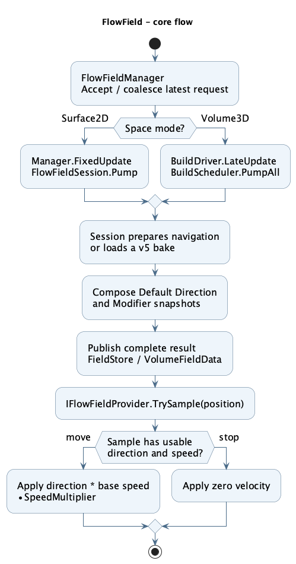
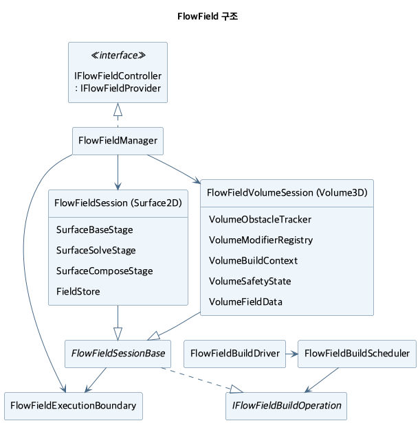
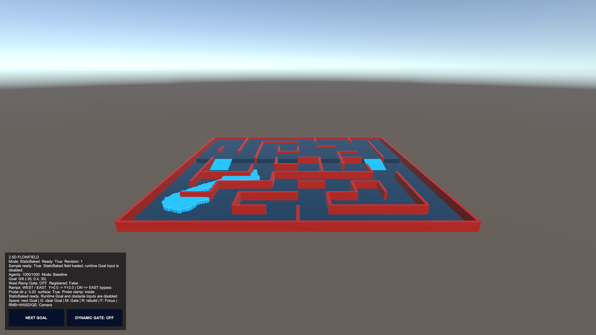
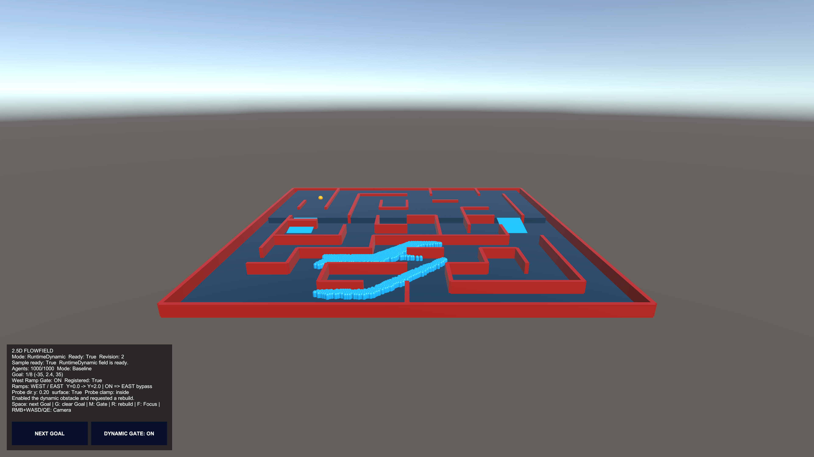
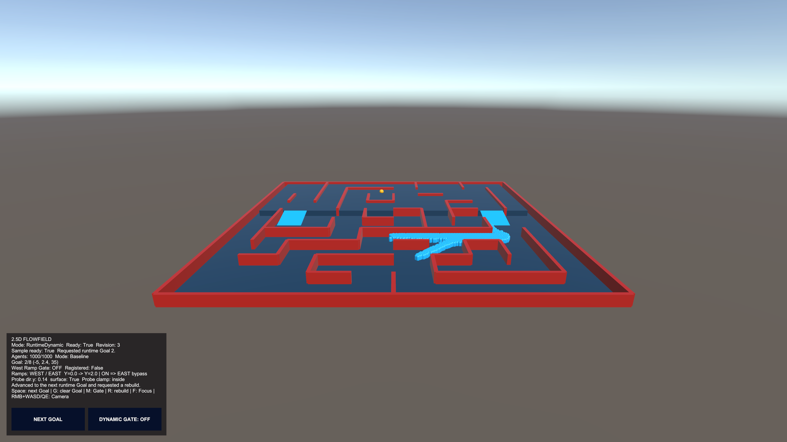
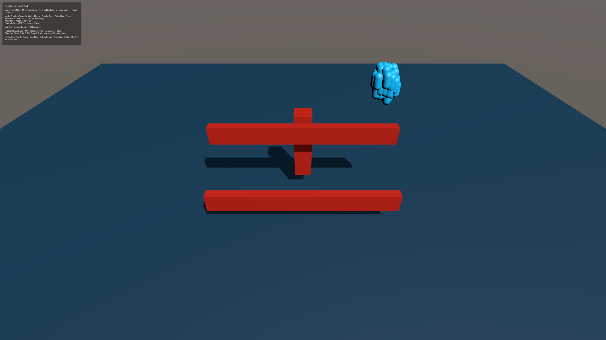
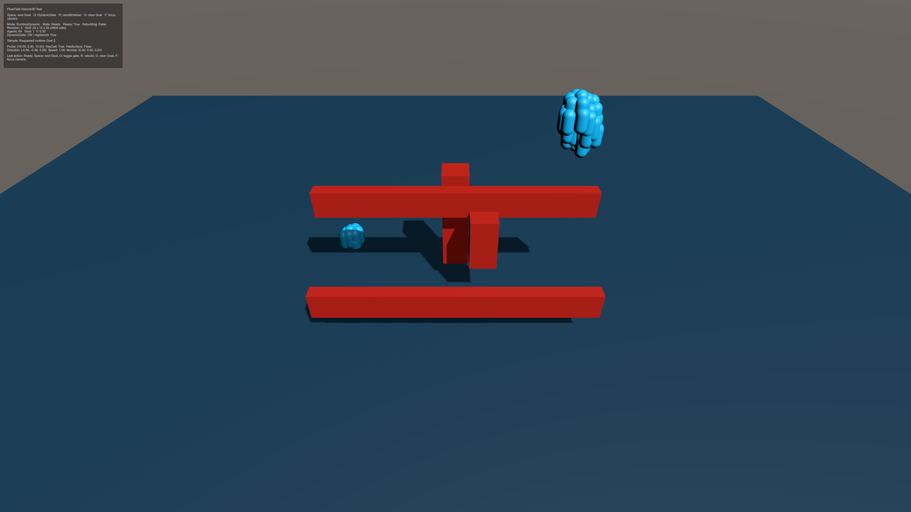
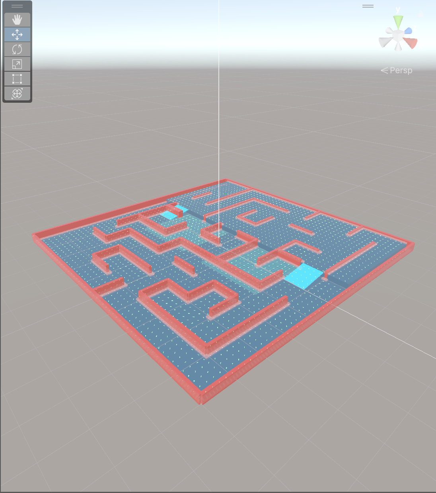
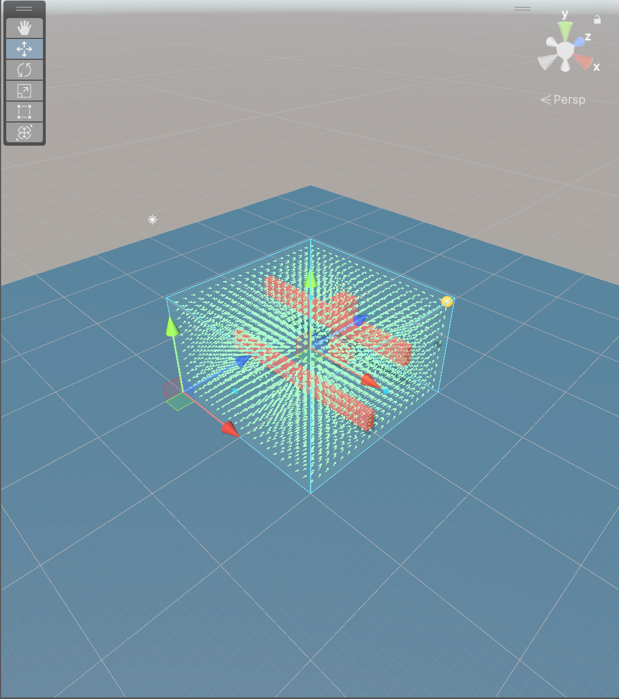

# FlowField

씬의 Goal과 장애물을 기준으로 방향과 속도 배율을 계산하는 Unity 방향장 시스템입니다. 이동 주체는 자신의 업데이트에서 결과를 조회해 이동에 적용합니다.

| 항목 | 내용 |
| --- | --- |
| 개발 | 유원석 (You Won Sock) · [GitHub](https://github.com/youwonsock) · qazwsx233434@gmail.com |
| 환경 | Unity 2023.2.20f1, C#, Burst Job (샘플 표시는 URP 16.0.6, UGUI) |
| 공간 모드 | `Surface2D`: 바닥 표면, 8방향 탐색 · `Volume3D`: Bounds 내부 정육면체 셀, 26방향 탐색 |
| 실행 모드 | `RuntimeDynamic`: 런타임 계산 · `StaticBaked`: Editor에서 만든 v6 Bake Asset 로드 |

구현 세부는 [TechnicalNotes.md](Docs/TechnicalNotes.md), 설계 결정은 [RefactoringNotes.md](Docs/RefactoringNotes.md)에 있습니다.

## 시작하기

1. `Assets/_FlowField/Scene/FlowFieldSample.unity` 또는 `FlowFieldVolume3DTest.unity`를 실행합니다. macOS 입력 소스가 한글이면 샘플의 글자 키가 동작하지 않으니 영문으로 바꿉니다.
2. 새 씬에서는 `FlowFieldManager`의 Bounds, CellSize, 공간 모드, Layer를 지정합니다. Manager는 회전 없이 단위 Scale로 둡니다. Surface2D는 바닥 Layer와 경사·단차 조건도 필요합니다.
3. `StaticBaked`는 Editor에서 Bake한 Asset을 연결합니다. Goal이나 장애물을 바꾸면 다시 Bake합니다.
4. 이동 주체에서 `TrySample()`을 호출합니다.

```csharp
using Common.FlowField;
using UnityEngine;

public sealed class FlowFieldReadmeMover : MonoBehaviour
{
    [SerializeField] private FlowFieldManager _flowField = null;
    [SerializeField, Min(0f)] private float _moveSpeed = 3f;

    private void FixedUpdate()
    {
        IFlowFieldProvider provider = _flowField;
        Vector3 velocity = Vector3.zero;

        if (_flowField != null
            && provider.TrySample(transform.position, out FlowFieldSample sample)
            && sample.HasCell
            && sample.SpeedMultiplier > 0f)
        {
            velocity = sample.Direction * (_moveSpeed * sample.SpeedMultiplier);
        }

        transform.position += velocity * Time.fixedDeltaTime;
    }
}
```

`TrySample()`이 `false`면 아직 결과가 없거나 영역 밖이므로 정지합니다. `true`여도 Goal 도착, 장애물, 안전성 제한으로 속도가 0일 수 있습니다. 충돌 처리, 표면 높이 보정, Agent 간 회피는 이동 시스템의 책임입니다.

셀 수는 Surface2D 최대 100,000개, Volume3D 최대 1,000,000개이고, Volume은 Manager별 추적 메모리 512MiB까지 허용합니다.

## 구조와 흐름





- **Manager**는 설정을 검증하고 최신 요청을 Session에 넘깁니다. 호출은 계산 완료를 보장하지 않습니다.
- **Session**은 모드별로 계산하고 완성된 결과만 게시합니다. 다음 계산 중에도 이전 결과를 계속 읽을 수 있습니다.
- **Scheduler**는 프로젝트 전체에서 하나의 예산(`FlowFieldBuildSettings.BudgetMilliseconds`, 기본 2ms)으로 작업을 진행합니다. 풀이는 워커 스레드에서 돌아 프레임을 막지 않습니다.
- **Execution Boundary**는 이벤트와 Modifier 코드를 작업 밖으로 분리합니다.

## 입력 변경 API

| 상황 | 호출 | 비고 |
| --- | --- | --- |
| Goal 변경 | `SetGoal()` | 장애물 결과를 재사용합니다. `RequestRebuild()`를 덧붙이면 이 이점을 잃습니다 |
| 설정 변경, Fault 재시도 | `RequestRebuild()` | Surface는 바닥 Raycast를 다시 한다고 보장하지 않습니다 |
| 바닥 형상 변경, `RuntimeDynamic` 전용 | `NotifyCellsDirty()` | Volume은 새 전체 작업을 예약합니다 |
| 장애물 수동 알림, `RuntimeDynamic` 전용 | `NotifyObstacleRegionDirty(bounds)` | 이전과 현재 Bounds의 합집합을 넘깁니다 |
| 모드 변경 | `Release()` → `SetSpaceMode()` → `Init()` | `Release()` 뒤 동적 장애물을 다시 등록합니다 |

Surface는 Manager가 제출한 요청만 빌드하므로, 풀이 중에 바뀐 Goal은 다음 제출에서 반영됩니다.

## 동적 장애물

움직이는 문이나 벽은 다음 중 하나로 연결해야 변경이 감지됩니다. **미등록 장애물 스윕은 기본적으로 꺼져 있습니다.**

- **등록:** `RegisterDynamicObstacle(collider)`, 해제는 `UnregisterDynamicObstacle(collider)`
- **스윕:** **Enable Unregistered Obstacle Sweep**을 켜고 Collider의 Layer를 **Obstacle Layer**에 포함

장애물 조회는 Trigger를 무시합니다. Surface2D의 정적 장애물은 Obstacle Layer에서 Rigidbody가 없고 등록하지 않은 Collider입니다. `StaticBaked`에서는 동적 등록이 거부됩니다.

## Modifier

1. 영향 영역 Collider와 `FlowFieldSpeedModifier` 또는 `FlowFieldNoiseModifier`를 배치합니다.
2. **Flow Field Manager**와 **Influence Collider**를 지정합니다. Collider는 **Is Trigger**를 켜고, MeshCollider는 **Convex**도 켭니다.
3. 같은 Manager의 Modifier마다 **Priority를 다르게** 지정합니다. 낮은 값부터 합성합니다. 기본값은 Speed 100, Noise 200입니다.
4. 런타임 값은 `SetSpeedMultiplier()`, `SetNoise()`, `SetPriority()`로 바꿉니다.

막힌 셀, Goal Anchor, 도달할 수 없는 셀, 기본 방향이 0인 셀에는 적용하지 않습니다.

직접 구현한 `IFlowFieldVectorModifier`의 `Observe()`, `CaptureSnapshot()`, `Modify()` 안에서는 호출이 다음과 같이 제한됩니다.

| 호출 | 동작 |
| --- | --- |
| `TrySample` 등 읽기 | 바로 실행 |
| Modifier·동적 장애물 등록과 해제, `NotifyModifierChanged` | 작업이 끝난 뒤 실행. 그 사이 Session이 멈추면 버려지고 등록은 경고를 남김 |
| `Init`, `RequestRebuild`, `Release`, `SetSpaceMode`, `SetGoal`, `NotifyCellsDirty`, `NotifyObstacleRegionDirty` | `InvalidOperationException` |

`FieldChanged`와 `StateChanged` 핸들러는 작업이 끝난 뒤 호출되므로 모든 명령을 쓸 수 있습니다.

## Fault 복구

- **Manager·Session Fault:** 원인을 고친 뒤 `manager.RequestRebuild()`
- **Modifier 자체 Fault:** Manager 재빌드로 풀리지 않으므로 아래 순서를 따릅니다.

```csharp
bool wasEnabled = modifier.enabled;
modifier.enabled = false;
try
{
    modifier.Release();
    modifier.SetSpeedMultiplier(1.5f); // 잘못된 값을 수정
    modifier.Init();
}
finally
{
    modifier.enabled = wasEnabled;
}
```

## 기능

### 베이킹

씬을 미리 계산해 v6 Asset으로 저장하고, 런타임은 Physics와 BFS 없이 로드합니다. Default Direction과 Modifier는 로드 뒤 합성합니다. 다른 형식은 거부하므로 다시 Bake해야 합니다.

<p align="center">
  
  
</p>

### Surface2D

바닥 Raycast로 높이와 법선을 얻고, 경사·단차·장애물 조건을 반영해 XZ 평면에서 Goal로 향하는 흐름을 만듭니다. 왼쪽은 기본 상태, 오른쪽은 Goal과 장애물 변경 후입니다.

<p align="center">
  
  
</p>

### Volume3D

Bounds 전체를 정육면체 셀로 나눠 비행 주체가 장애물을 입체적으로 우회하게 합니다. 코너가 막힌 대각선 이동은 차단합니다. 왼쪽은 기본 64 Agent, 오른쪽은 Gate와 Goal 높이를 바꾼 상태입니다.

<p align="center">
  
  
</p>

### Editor 시각화

Scene View에서 방향장을 확인합니다. 표시 표본을 줄여도 계산 해상도는 바뀌지 않습니다. 왼쪽은 Surface2D 미리보기, 오른쪽은 Volume3D FullVolume입니다.

<p align="center">
  
  
</p>
