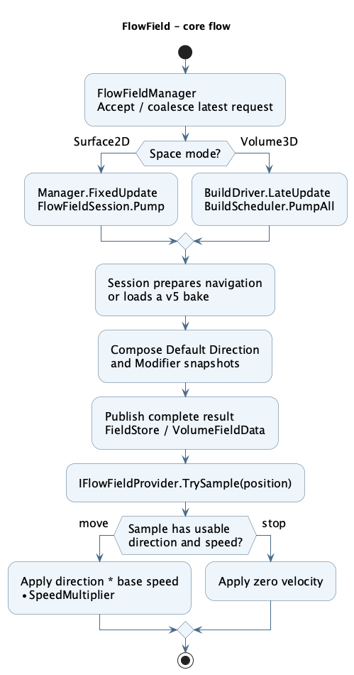
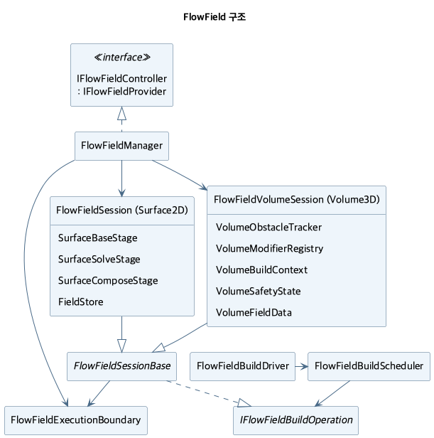
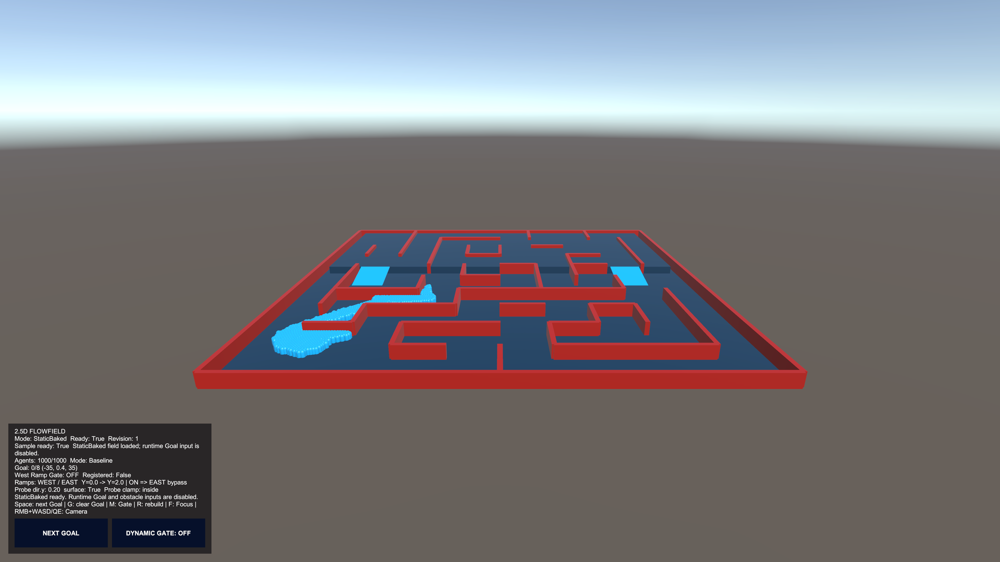
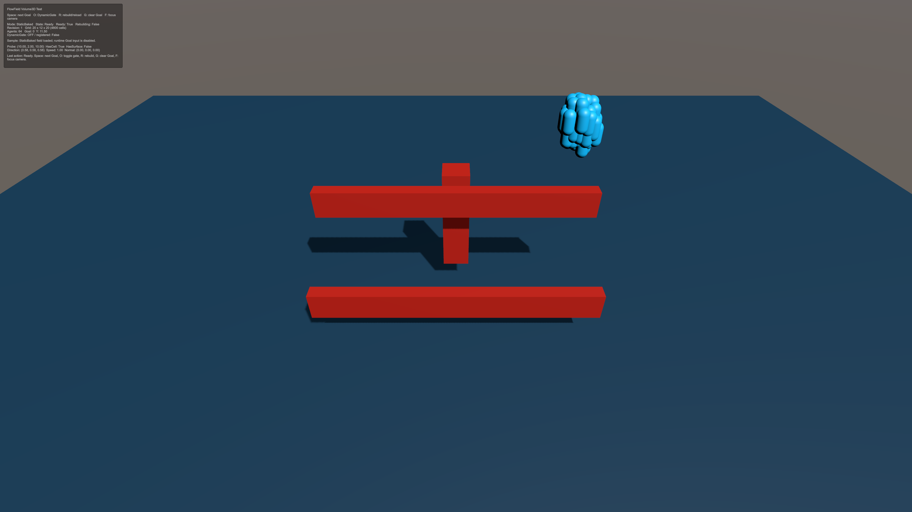
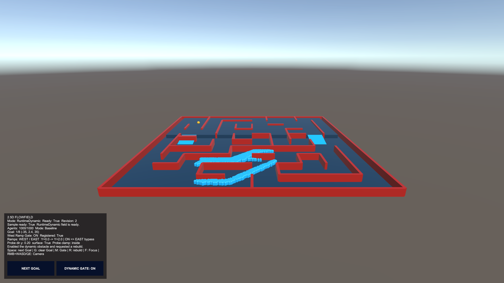
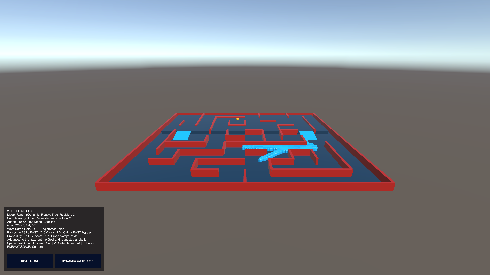
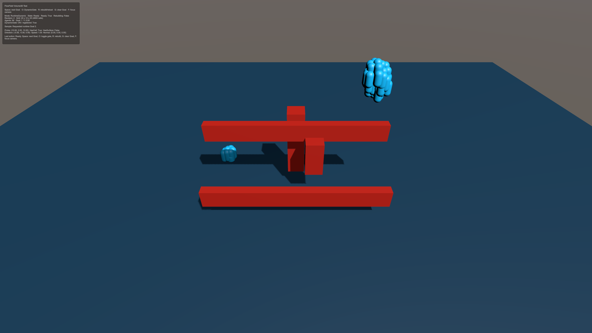
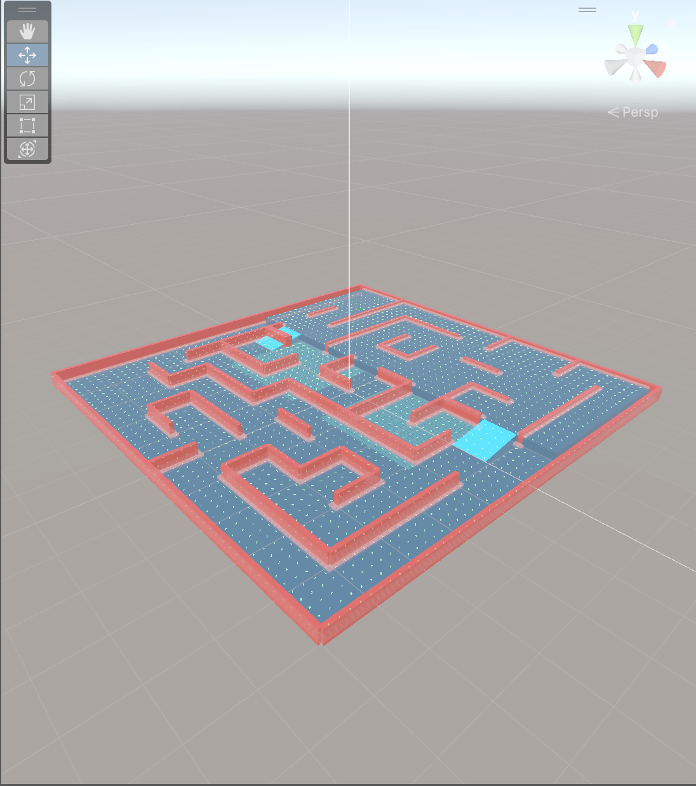
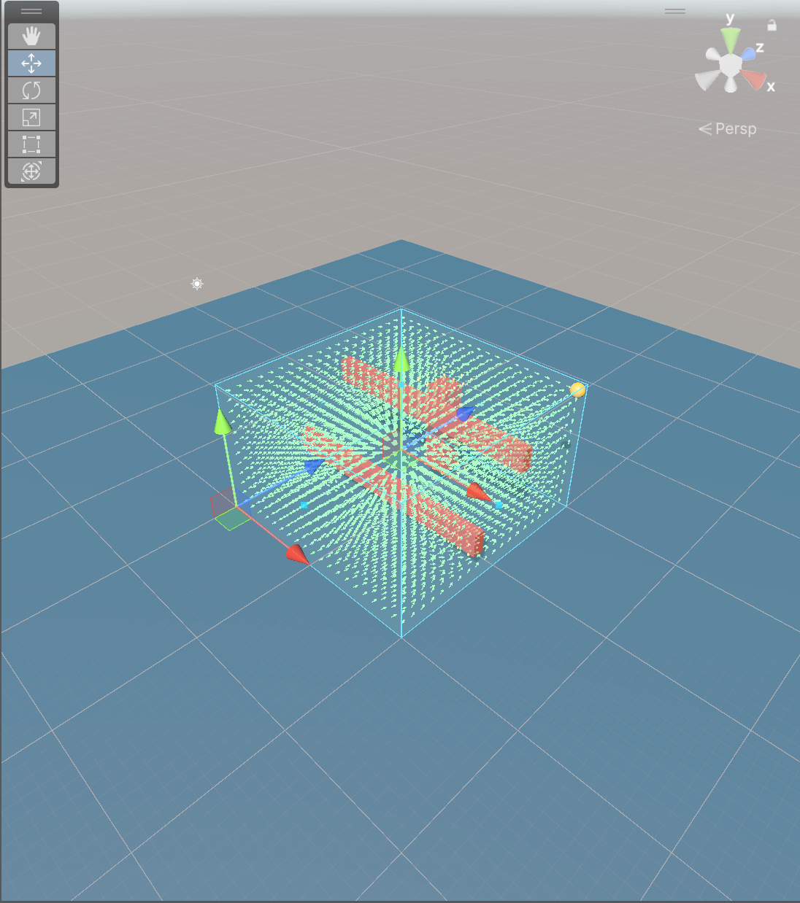

# FlowField

씬의 Goal과 장애물로 셀마다 방향과 속도 배율을 계산하는 방향장 시스템입니다. 이동 주체는 자기 업데이트에서 결과를 조회해 이동에 씁니다.

| 항목 | 내용 |
| --- | --- |
| 개발 | 유원석 (You Won Sock) · [GitHub](https://github.com/youwonsock) · qazwsx233434@gmail.com |
| 환경 | Unity 2023.2.20f1, C#, Burst Job (샘플 표시는 URP 16.0.6, UGUI) |
| 공간 모드 | `Surface2D`: 바닥 표면, 8방향 · `Volume3D`: Bounds 내부 정육면체 셀, 26방향 |
| 실행 모드 | `RuntimeDynamic`: 런타임 계산 · `StaticBaked`: Editor에서 Bake한 Asset 로드 |
| 규모 | Surface2D 최대 10만 셀 · Volume3D 최대 100만 셀, Manager별 512MiB |

구현 세부는 [TechnicalNotes.md](Docs/TechnicalNotes.md)에 있습니다.

## 시작하기

1. `Scene/FlowFieldSample.unity` 또는 `FlowFieldVolume3DTest.unity`를 실행합니다. macOS 입력 소스가 한글이면 샘플의 글자 키가 동작하지 않습니다.
2. 새 씬에서는 `FlowFieldManager`에 Bounds, CellSize, 공간 모드, Layer를 지정합니다. Manager는 회전 없이 단위 Scale로 둡니다.
3. `StaticBaked`는 Editor에서 Bake한 Asset을 연결합니다. Goal이나 장애물이 바뀌면 다시 Bake합니다.
4. 이동 주체에서 `TrySample()`을 호출합니다.

```csharp
using Common.FlowField;
using UnityEngine;

public sealed class FlowFieldReadmeMover : MonoBehaviour
{
    [SerializeField] private FlowFieldManager _flowField = null;
    [SerializeField, Min(0f)] private float _moveSpeed = 3f;

    private void FixedUpdate()
    {
        IFlowFieldProvider provider = _flowField;
        Vector3 velocity = Vector3.zero;

        if (_flowField != null
            && provider.TrySample(transform.position, out FlowFieldSample sample)
            && sample.HasCell
            && sample.SpeedMultiplier > 0f)
        {
            velocity = sample.Direction * (_moveSpeed * sample.SpeedMultiplier);
        }

        transform.position += velocity * Time.fixedDeltaTime;
    }
}
```

`TrySample()`이 false면 결과가 아직 없거나 영역 밖이므로 정지합니다. true여도 Goal 도착, 장애물, 안전성 제한으로 속도가 0일 수 있습니다. 충돌, 높이 보정, Agent 간 회피는 이동 시스템이 맡습니다.

## 구조





- **Manager**가 설정을 검증하고 최신 요청을 Session에 넘깁니다. 호출이 계산 완료를 뜻하지는 않습니다.
- **Session**은 완성된 결과만 게시하고, 다음 계산 중에도 이전 결과를 읽게 합니다. Manager를 다시 켜거나 Fault를 재시도한 뒤에는 새 결과가 나올 때까지 읽을 수 없습니다.
- **Scheduler**는 프로젝트 전체에서 프레임당 하나의 예산(기본 2ms)으로 작업을 나눕니다. 풀이는 워커 스레드에서 돕니다.
- **Execution Boundary**는 이벤트와 Modifier 코드를 작업이 끝난 뒤로 미룹니다.

## 주요 API

| 상황 | 호출 |
| --- | --- |
| Goal 변경 | `SetGoal()`. 장애물 결과를 재사용합니다 |
| 설정 변경, Fault 재시도 | `RequestRebuild()` |
| 바닥 형상 변경 (`RuntimeDynamic`) | `NotifyCellsDirty()` |
| 장애물 영역 알림 (`RuntimeDynamic`) | `NotifyObstacleRegionDirty(bounds)`. 이전과 현재 Bounds의 합집합을 넘깁니다 |
| 움직이는 장애물 | `RegisterDynamicObstacle(collider)` / `UnregisterDynamicObstacle(collider)` |
| 모드 변경 | `Release()` → `SetSpaceMode()` → `Init()` 뒤 동적 장애물 재등록 |
| 결과 변화 알림 | `FieldChanged`, `StateChanged` 이벤트. 핸들러 안에서 모든 명령을 쓸 수 있습니다 |

- **동적 장애물:** 움직이는 문이나 벽은 등록하거나, **Enable Unregistered Obstacle Sweep**을 켜고 Obstacle Layer에 넣어야 변경이 감지됩니다. 스윕은 기본으로 꺼져 있고, 장애물 조회는 Trigger를 무시합니다.
- **Modifier:** 영향 영역 Collider(Trigger, MeshCollider는 Convex)에 `FlowFieldSpeedModifier`나 `FlowFieldNoiseModifier`를 두고 Manager를 지정합니다. 같은 Manager 안에서는 Priority를 서로 다르게 두며, 낮은 값부터 합성합니다.
- **Fault 복구:** 원인을 고친 뒤 `RequestRebuild()`를 부릅니다. Modifier 자체의 Fault는 Modifier를 껐다가 `Release()` → 값 수정 → `Init()` 순서로 풉니다. 직접 구현한 Modifier 안에서 쓸 수 있는 호출은 TechnicalNotes에 있습니다.

## 기능

**베이킹:** 씬을 미리 계산해 v6 Asset으로 저장하고, 런타임은 Physics와 BFS 없이 로드합니다. Default Direction과 Modifier는 로드 뒤 합성합니다. Clear Bake는 참조만 지우며, 다시 Bake하면 이 Manager의 기존 Asset을 덮어씁니다.

<p align="center">
  
  
</p>

**Surface2D:** 바닥 Raycast로 높이와 법선을 얻고, 경사·단차·장애물 조건을 반영해 Goal로 향하는 흐름을 만듭니다. 오른쪽은 Goal과 장애물을 바꾼 화면입니다.

<p align="center">
  
  
</p>

**Volume3D:** Bounds 전체를 정육면체 셀로 나눠 비행 주체가 장애물을 입체적으로 우회하게 합니다. 코너가 막힌 대각선 이동은 막습니다. 오른쪽은 Gate와 Goal 높이를 바꾼 화면입니다.

<p align="center">
  
  
</p>

**Editor 시각화:** Scene View에서 방향장을 확인합니다. 표시 표본을 줄여도 계산 해상도는 바뀌지 않습니다.

<p align="center">
  
  
</p>
