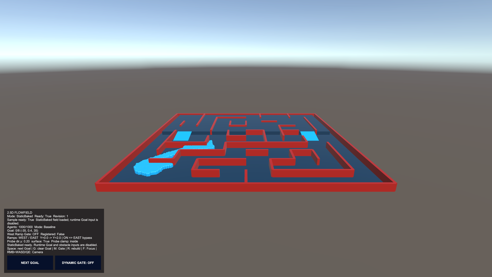

# FlowField

씬의 Goal과 장애물로 셀마다 방향과 속도 배율을 계산하는 방향장 시스템입니다. 이동 주체는 자기 업데이트에서 결과를 조회해 이동에 씁니다.

| 항목 | 내용 |
| --- | --- |
| 개발 | 유원석 (You Won Sock) · [GitHub](https://github.com/youwonsock) · qazwsx233434@gmail.com |
| 환경 | Unity 2023.2.20f1, C#, Burst Job (샘플 표시는 URP 16.0.6, UGUI) |
| 공간 모드 | `Surface2D`: 바닥 표면, 8방향 · `Volume3D`: Bounds 내부 정육면체 셀, 26방향 |
| 실행 모드 | `RuntimeDynamic`: 런타임 계산 · `StaticBaked`: Editor에서 Bake한 Asset 로드 · `BakedBase`: Bake한 바닥과 장애물 위에서 Goal과 장애물을 런타임에 계산 |
| 규모 | Surface2D 최대 10만 셀 · Volume3D 최대 100만 셀 |

구현 세부는 [TechnicalNotes.md](Docs/TechnicalNotes.md)에 있습니다.

## 빠른 시작

1. `Samples/Scenes/FlowFieldSample.unity`(Surface2D) 또는 `FlowFieldVolume3DTest.unity`(Volume3D)를 실행합니다. 조작법은 화면에 나옵니다. macOS 입력 소스가 한글이면 샘플의 글자 키가 동작하지 않습니다.
2. 새 씬에서는 GameObject에 `FlowFieldManager`를 붙이고 Space Mode, Bake Bounds Local, Cell Size, Ground Layer(Surface2D), 장애물 Layer를 정합니다([Manager 설정](#manager-설정)). Manager는 회전 없이 단위 Scale로 둡니다.
3. Scene View에서 방향장을 보려면 같은 GameObject에 `FlowFieldDisplaySettings`를 붙입니다. Manager Inspector의 "Add Display Settings" 버튼이 붙여 줍니다.
4. Play Mode에서는 Manager가 `Awake`에서 스스로 `Init()`합니다. 설정이 잘못되면 처음 걸린 이유를 메시지로 담은 `InvalidOperationException`을 던집니다. Inspector는 같은 검사를 같은 문구로 미리 보여 줍니다.
5. 움직이는 장애물에는 `FlowFieldDynamicObstacle`, 움직이는 Goal에는 `FlowFieldGoalTarget`을 붙입니다. FlowField는 씬을 폴링하지 않으므로 알리지 않은 변화는 반영되지 않습니다.
6. 이동 주체에서 `TrySample()`을 호출합니다.

```csharp
using Common.FlowField;
using UnityEngine;

public sealed class FlowFieldReadmeMover : MonoBehaviour
{
    [SerializeField] private FlowFieldManager _flowField = null;
    [SerializeField, Min(0f)] private float _moveSpeed = 3f;

    private void FixedUpdate()
    {
        IFlowFieldProvider provider = _flowField;
        Vector3 velocity = Vector3.zero;

        if (_flowField != null
            && provider.TrySample(transform.position, out FlowFieldSample sample)
            && sample.HasCell
            && sample.SpeedMultiplier > 0f)
        {
            velocity = sample.Direction * (_moveSpeed * sample.SpeedMultiplier);
        }

        transform.position += velocity * Time.fixedDeltaTime;
    }
}
```

`TrySample()`이 false면 결과가 아직 없거나 격자 밖이므로 멈춥니다. true여도 Goal 도착, 장애물, 안전 규칙 때문에 속도 배율이 0일 수 있습니다. 충돌, 높이 보정, Agent 간 회피는 이동 시스템이 맡습니다.

## 컴포넌트

| 컴포넌트 | 하는 일 |
| --- | --- |
| `FlowFieldManager` | 설정을 직렬화하고 계산 세션 하나를 가집니다. 조회(`IFlowFieldProvider`)와 입력(`IFlowFieldController`) API를 구현합니다. 끄면 결과를 버리고 멈추며(Suspended), 다시 켜면 처음부터 빌드합니다. |
| `FlowFieldDynamicObstacle` | 켜져 있는 동안 지정한 Collider를 Manager에 등록하고, Bounds가 바뀌면 프레임당 한 번 이동을 알립니다. 끄거나 파괴하면 해제합니다. Manager나 Collider를 바꾸거나 Collider만 파괴되면 옛 등록을 해제하고, Release 뒤 다시 Init하면 스스로 다시 등록합니다. |
| `FlowFieldGoalTarget` | 켜져 있는 동안 자기 위치를 Manager의 Goal로 정하고(Influence Radius 포함), 움직이거나 반경이 바뀌면 다시 정합니다. 끄면 자기가 정한 Goal이 아직 Manager의 Goal일 때만 지웁니다. 여러 target이 한 Manager를 가리키면 마지막에 알린 target의 Goal이 쓰입니다. |
| `FlowFieldSpeedModifier` | 영향 영역 안 셀의 속도 배율에 Speed Multiplier를 곱합니다. 기본 Priority는 100입니다. |
| `FlowFieldNoiseModifier` | 영향 영역 안 셀의 방향을 위치마다 고정된 각도(최대 Max Angle Degrees, Spatial Frequency, Seed)만큼 돌립니다. 기본 Priority는 200입니다. |
| `FlowFieldDisplaySettings` | Manager와 같은 GameObject에 두는 Scene View 표시 옵션입니다(Show Field, Volume3D의 FullVolume·Slice 표시). 계산은 바꾸지 않고, 없으면 Scene View에 방향장을 그리지 않습니다. |

- `FlowFieldDynamicObstacle`과 `FlowFieldGoalTarget`은 `StaticBaked` Manager에서 아무것도 하지 않습니다. 장애물과 Goal이 Bake한 그대로이기 때문입니다.
- 두 Modifier는 Flow Field Manager, Influence Collider, Priority를 지정합니다. Influence Collider는 Trigger여야 하고 MeshCollider면 Convex여야 합니다. 같은 Manager 안에서 Priority는 서로 달라야 하며(같으면 등록이 거부되고 Inspector가 경고합니다), 낮은 값부터 합성합니다.

## Manager 설정

Inspector는 그룹마다 제목을 달고, 지금 Space Mode가 읽지 않는 그룹은 숨깁니다.

| 그룹 | 필드 | 내용 |
| --- | --- | --- |
| Grid | Bake Bounds Local | Manager 위치 기준의 월드 축 정렬 영역입니다. Surface2D는 XZ가 격자, Y가 바닥 ray 범위이고, Volume3D는 전체를 셀로 채웁니다. Scene View 핸들로 셀 단위에 맞춰 옮기거나 크기를 바꿉니다. |
| | Cell Size | 셀 한 변의 길이입니다. Inspector가 계산한 격자 크기와 셀 수를 보여 줍니다. |
| Surface (Surface2D만) | Ground Layer | 바닥 ray가 맞히는 Layer입니다. |
| | Max Slope | 걸을 수 있는 최대 경사(0–89도)입니다. |
| | Max Step Height | 이웃 칸으로 오르내릴 수 있는 최대 높이 차입니다. |
| | Obstacle Check Height, Obstacle Check Center Offset | 셀 위에서 장애물을 찾는 상자의 높이와, 바닥에서 그 상자 중심까지의 높이입니다. |
| Obstacles | Layer | 장애물 Collider의 Layer입니다. Trigger는 무시합니다. |
| | Clearance | 장애물 검사를 셀 밖으로 넓히는 거리입니다. |
| | Sweep Unregistered | 등록하지 않은 장애물을 주기적으로 찾아 반영합니다([런타임 API](#런타임-api)). `StaticBaked`에서는 켤 수 없습니다. |
| | Sweep Interval | sweep 간격입니다(unscaled 초, 0은 프레임마다). |
| Flow | Default Direction | Goal이 없거나 Goal 영향 밖인 셀의 방향입니다. |
| | Goal Influence Radius | 0이면 격자 전체가 Goal로 흐르고, 양수면 Goal 중심의 그 반경 구 안만 Goal로 흐릅니다. 영향 안에서 Goal로 갈 길이 없는 셀은 멈춥니다. |
| (그룹 없음) | Goal Transform | Init과 Bake가 한 번 읽는 초기 Goal입니다. 이후 이동은 `SetGoal()`이나 `FlowFieldGoalTarget`으로 알립니다. |
| Mode | Space Mode | `Surface2D` 또는 `Volume3D`입니다. Play 중 세션이 초기화돼 있거나 Faulted인 동안 잠기므로 `Release()` 뒤에 바꿉니다. |
| | Bake Mode | `RuntimeDynamic`, `StaticBaked`, `BakedBase` 중 하나입니다. Play 중에는 잠깁니다. |
| | Surface / Volume | Bake Mode가 Asset을 쓸 때만 보이는 Bake Asset 칸입니다. [Bake](#bake)가 채웁니다. |

- Play 중 Inspector에서 값을 바꾸면 바로 다시 빌드하고, 값이 잘못되면 세션이 Fault가 됩니다.
- Goal Influence Radius를 Play 중 바꾸면 Goal Transform에서 온 Goal에만 반영됩니다. `SetGoal()`로 정한 반경은 그 Goal에만 쓰이고 이 값을 바꾸지 않습니다.
- Release는 `SetGoal()`로 정한 Goal을 지우므로, 다음 Init은 Goal Transform을 다시 읽습니다(없으면 Goal 없이 시작합니다).

## Bake

`StaticBaked`와 `BakedBase`는 Editor에서 미리 계산한 Bake Asset을 읽습니다. `StaticBaked`는 Physics와 BFS 없이 필드 전체를 로드하고, `BakedBase`는 바닥과 장애물 막힘만 가져와 Goal과 장애물 변화를 런타임에 계산합니다.

1. 씬을 저장합니다. 저장하지 않은 씬에서는 "Save the scene before baking."으로 실패합니다.
2. Manager의 Bake Mode를 `StaticBaked`나 `BakedBase`로 둡니다. `RuntimeDynamic`에는 Bake 버튼이 없습니다.
3. Edit Mode에서 Manager Inspector의 "Bake / ReBake FlowField"를 누릅니다. 메뉴 "Tools/FlowField/Bake All Managers In Open Scenes"는 열린 씬에서 Bake Asset을 쓰는 Manager를 차례로 모두 Bake합니다. 진행 중에는 Inspector의 "Cancel Static Bake"나 진행 창으로 취소합니다.
4. Bake는 Asset을 씬 옆, 씬 이름의 폴더(`<씬 폴더>/<씬 이름>/`)에 만들고 Manager의 Surface 또는 Volume 칸에 연결합니다. 이 Manager가 Bake한 Asset이 이미 연결돼 있으면 그 Asset을 덮어씁니다.

- Bake는 시작 전에 Init과 같은 설정 검사를 합니다. Bake Asset 자체와 `StaticBaked`의 `Sweep Unregistered` 금지만 빼고 검사하며, 통과하지 못하면 버튼이 꺼지고 Asset을 쓰지 않습니다.
- Bake 도중 설정이 바뀌거나 Play Mode에 들어가면 Bake를 멈추고 기존 Asset을 그대로 둡니다.
- Bake에 들어가는 설정(격자, Manager 위치, Surface 설정, Obstacle Layer·Clearance)이나 장면의 바닥·장애물을 바꾸면 다시 Bake합니다. `StaticBaked`는 Goal(Goal Transform 위치, Goal Influence Radius)을 바꿔도 다시 Bake합니다. 맞지 않는 Asset은 Inspector와 `Init()`이 같은 문구로 거부합니다.
- Asset의 `HasCurrentFormat`이 false면 지금 코드가 읽지 않는 형식이므로 다시 Bake합니다.
- Clear Bake는 Manager의 참조만 지우고 Asset 파일은 남깁니다. 씬을 옮기거나 씬·Manager 이름을 바꾼 뒤 참조가 빈 채로 Bake하면 새 경로에 Asset을 만들고 원래 경로의 Asset은 남으므로, 필요 없으면 직접 지웁니다.
- Asset은 자기를 Bake한 Manager를 기억합니다. 복제한 Manager를 Bake하면 원래 Asset을 덮어쓰지 않고 자기 Asset을 새로 만들어 연결합니다.
- `BakedBase`는 장애물 변화(등록·해제·이동·영역 알림)가 닿은 영역만 Physics로 다시 조회하므로, Bake 때 막혔던 자리도 옮긴 장애물이면 풀립니다. 그러나 Bake 뒤 아무도 지켜보지 않을 때 옮긴 장면 장애물(등록 전이나 알리지 않은 이동)은 모르므로 Bake 때 자리가 막힌 채 남습니다. `Sweep Unregistered`를 켜면 새 자리는 반영되고, Volume3D는 Bake 때 자리도 풉니다. 장면 장애물을 Editor에서 옮겼다면 다시 Bake합니다.

## 런타임 API

`FlowFieldManager`가 `IFlowFieldController`(입력)와 그 기반인 `IFlowFieldProvider`(조회)를 구현합니다. 이동 시스템은 `IFlowFieldProvider`만 받으면 됩니다. 명령이 돌아와도 계산이 끝난 것은 아닙니다.

| 상황 | 호출 |
| --- | --- |
| 결과 읽기 | `TrySample(position, out sample)`. `sample`은 `Direction`, `SpeedMultiplier`, `SurfaceNormal`, `HasSurface`, `HasCell`을 줍니다. 예외로 받으려면 `Sample()`. 상태는 `State`, `IsReady`, `IsRebuilding`, `IsFaulted`, `LastError`, `TryGetFieldInfo()`로 봅니다 |
| 결과 변화 알림 | `FieldChanged`, `StateChanged`. `FieldChanged`와 `Revision`은 게시 내용이 실제로 바뀔 때만 바뀌고, Space Mode를 바꿔도 `Revision`은 이어서 셉니다. 핸들러 안에서 모든 명령을 쓸 수 있습니다 |
| Goal 변경 | `SetGoal(FlowFieldGoalRequest.Position(position, radius))` 또는 `FlowFieldGoalRequest.Target(transform, radius)`, 지우기는 `FlowFieldGoalRequest.None`. 또는 `FlowFieldGoalTarget`. 장애물 결과를 재사용하고, 마지막에 정한 Goal이 쓰입니다 |
| 움직이는 장애물 | `RegisterDynamicObstacle(collider)` → 움직일 때마다 `NotifyDynamicObstacleMoved(collider)` → `UnregisterDynamicObstacle(collider)`. `FlowFieldDynamicObstacle`이 이 셋을 대신합니다. 파괴된 Collider 등록은 "Cannot register a destroyed Collider." |
| 장애물 영역 알림 (`RuntimeDynamic`, `BakedBase`) | `NotifyObstacleRegionDirty(bounds)`. 이전과 현재 Bounds의 합집합을 넘깁니다. 유한하지 않은 Bounds는 `ArgumentOutOfRangeException`("Bounds must be finite.") |
| 바닥 형상 변경 (`RuntimeDynamic`) | `NotifyCellsDirty()`. 바닥(Volume3D는 모든 셀)과 장애물을 모두 다시 조회합니다. 진행 중인 빌드는 버리지 않고, 다음 빌드가 바닥을 다시 조회합니다 |
| 다시 빌드 | `RequestRebuild()`. 실행 중인 세션은 장애물을 모두 다시 조회하고, 격자와 Surface 설정이 그대로면 Surface2D 바닥은 다시 scan하지 않습니다. `RuntimeDynamic`에서 Play 중 Manager를 옮긴 뒤 부르면 새 격자로 처음부터 다시 만듭니다. `BakedBase`는 Bake 막힘에서 다시 시작해 Init 뒤 바뀐 영역과 등록 장애물 영역만 다시 조회합니다. 꺼 둔 Manager에서는 검사만 하고 켤 때 빌드합니다. Faulted 세션에서는 바닥까지 처음부터 다시 빌드하는 재시도입니다([실패 규칙](#실패-규칙)) |
| 모드 변경 | `Release()` → `SetSpaceMode()` → `Init()`. Release는 등록과 `SetGoal()`의 Goal을 지웁니다. `FlowFieldDynamicObstacle`, `FlowFieldGoalTarget`, Modifier 컴포넌트는 스스로 다시 붙지만, `RegisterDynamicObstacle()`·`RegisterVectorModifier()`로 직접 등록한 것과 `SetGoal()`의 Goal은 다시 등록하고 정합니다 |
| 직접 구현한 Modifier | `RegisterVectorModifier()`, 값·Priority·영역이 바뀔 때 `NotifyModifierChanged()`, `UnregisterVectorModifier()`. 구현 규칙은 [TechnicalNotes](Docs/TechnicalNotes.md#modifier) |
| 격자 안 위치 | `ClampPositionToGrid()`, 예외 없이 쓰려면 `TryClampPositionToGrid()`. 마지막 요청의 Grid로 맞추며, Surface2D는 X·Z만 맞춥니다 |
| 빌드 예산 | `FlowFieldBuildSettings.BudgetMilliseconds`. 프로젝트 전체가 프레임마다 나눠 쓰는 메인 스레드 시간(기본 2ms)이고, Play 세션이 시작할 때 기본값으로 돌아갑니다. 0 이하·NaN·무한대는 `ArgumentOutOfRangeException` |
| Bake Asset 형식 | `asset.HasCurrentFormat`. 지원 형식은 `FlowFieldSurfaceBakeData.SupportedFormatVersion`, `FlowFieldVolumeBakeData.SupportedFormatVersion` |

- **알리기:** 기본으로 FlowField는 씬을 폴링하지 않습니다. 변경은 위 API와 FlowField 컴포넌트의 통지로만 들어옵니다. 알린 그 프레임부터 영향 영역(Bounds를 셀 크기와 Clearance만큼 넓힌 곳)은 새 결과가 게시될 때까지 속도 0입니다. 격자에 닿지 않는 변경은 다시 빌드하지 않고 등록만 유지합니다. Auto Sync Transforms가 꺼져 있어도 Transform을 옮긴 프레임에 알리면 됩니다.
- **Sweep Unregistered:** 켜면 Session이 Sweep Interval마다 Obstacle Layer를 조회해, 등록하지 않은 Collider가 생기거나 움직이거나 사라진 영역을 `NotifyObstacleRegionDirty()`처럼 다시 빌드합니다. 조회마다 Bounds 전체의 `OverlapBox`와 `Physics.SyncTransforms` 비용이 듭니다. Bake와 Edit Mode 미리보기는 sweep하지 않습니다.
- **sweep 켜고 끄기:** Surface2D는 장애물 전체를 다시 scan하고(그동안 필드 전체가 속도 0), Volume3D는 지금 필드를 그대로 쓰면서 다음 빌드에서 모든 셀을 다시 조회합니다. Collider가 65,536개에 이르면 경고를 남기고, sweep 설정(켜기, 조회 범위, Layer)이 바뀌거나 Release할 때까지 그 세션의 sweep을 멈춥니다.

## 실패 규칙

두 공간 모드가 같은 규칙을 따릅니다. 아래 표의 "명령"은 `SetGoal`, `NotifyCellsDirty`, `NotifyObstacleRegionDirty`, `RegisterDynamicObstacle`, `UnregisterDynamicObstacle`, `NotifyDynamicObstacleMoved`, `RegisterVectorModifier`, `UnregisterVectorModifier`, `NotifyModifierChanged`, `RequestRebuild`입니다. `Init`, `Release`, `SetSpaceMode`는 표 아래에 적습니다.

| 상태 | `TrySample` | `Sample` | `TryClampPositionToGrid` | `ClampPositionToGrid` | 명령 |
| --- | --- | --- | --- | --- | --- |
| 초기화 전, `Release()` 뒤 | false | `InvalidOperationException` ① | false | `InvalidOperationException` ① | `InvalidOperationException` ① |
| Faulted | false | `InvalidOperationException` ② | false | `InvalidOperationException` ② | `InvalidOperationException` ②. `Unregister*`는 받고 bool을 돌려주며, `RequestRebuild`는 재시도합니다 |
| 결과 없음 (첫 빌드, 다시 켠 뒤, 재시도 뒤, Grid 변경 뒤, 비활성) | false | `InvalidOperationException` ③ | true, 최신 Grid로 맞춤 | 최신 Grid로 맞춤 | 받습니다 |
| 좌표 NaN·무한대 | false | `ArgumentOutOfRangeException` ④ | false | `ArgumentOutOfRangeException` ④ | — |
| 격자 밖 | false | `ArgumentOutOfRangeException` ⑤ | true, 가장 가까운 격자 안 위치 | 가장 가까운 격자 안 위치 | — |

메시지: ① "FlowFieldManager is not initialized." ② "FlowFieldManager is faulted. Call RequestRebuild() to retry."(InnerException = 원인) ③ "FlowField session is not ready." ④ "Position must be finite." ⑤ "Position is outside the FlowField grid."

- **판정 순서:** `Sample()`은 수명(초기화 전·Faulted) → 결과 없음 → 좌표 NaN·무한대 → 격자 밖 순서로, `ClampPositionToGrid()`는 수명 → 좌표 NaN·무한대 순서로 봅니다. 그래서 초기화했지만 결과가 없을 때 NaN을 넘기면 `Sample()`은 ③, `ClampPositionToGrid()`는 ④를 던집니다. `TrySample()`과 `TryClampPositionToGrid()`는 어떤 상태에서도 예외를 던지지 않고, `IsReady`가 true면 격자 안 유한 좌표의 `TrySample()`은 성공합니다.
- **`Init()`:** Play Mode에서만 받습니다(Edit Mode에서는 "FlowFieldManager.Init runs only in Play Mode. In Edit Mode, use Bake and the Scene View preview."). 같은 모드로 이미 초기화됐으면 아무것도 하지 않고, Faulted면 ②를 던집니다.
- **`Release()`, `SetSpaceMode()`:** `Release()`는 초기화 전이나 이미 Release한 뒤에 부르면 조용히 돌아옵니다. `SetSpaceMode()`는 초기화 전과 `Release()` 뒤에만 받고, 초기화됐거나 Faulted면 "FlowField Space Mode can only change after Release and before Init."을 던집니다. Inspector에서 Space Mode를 바꿔 둔 채 초기화된 세션에 `Init()`을 불러도 같은 예외입니다.
- **잘못된 설정:** `Init()`과 실행 중인 세션의 `RequestRebuild()`는 처음 걸린 이유를 담은 `InvalidOperationException`을 호출자에게 던지고 세션을 바꾸지 않습니다. Play 중 Inspector 편집, `SetGoal()`, `NotifyCellsDirty()`는 예외 대신 세션을 Fault로 만듭니다. 이때 새 Goal은 남아 재시도가 그 Goal로 빌드합니다.
- **Fault 재시도:** 원인을 고친 뒤 `RequestRebuild()`를 부르면 세션을 처음부터(Surface2D 바닥 포함) 다시 빌드하고, 등록한 장애물과 Modifier는 유지합니다. Fault 중에 Space Mode를 바꿔 두었으면 세션을 건드리지 않고 Space Mode 잠금 예외를 던집니다. 재시도가 다시 실패하면 세션은 다시 Fault가 되고 그 예외를 호출자에게 던집니다. 꺼 둔 Manager는 Fault만 풀고 켤 때 빌드합니다. Fault 중에 끈 `FlowFieldDynamicObstacle`과 `FlowFieldGoalTarget`은 재시도 결과에 남지 않습니다. `Release()`도 Fault 세션을 받습니다.
- **Bake 모드:** `StaticBaked`에서 `SetGoal`, `NotifyCellsDirty`, `NotifyObstacleRegionDirty`, `RegisterDynamicObstacle`, `NotifyDynamicObstacleMoved`는 `InvalidOperationException`("... is not allowed in StaticBaked mode.")을 던지고, `UnregisterDynamicObstacle`은 false를 돌려줍니다. `BakedBase`는 `NotifyCellsDirty`만 거부합니다.
- **Bake 자리:** Bake Asset을 쓰는 Manager는 Bake 자리에 묶이므로, 옮기면 `RequestRebuild()`가 예외를 던지고 `BakedBase`는 다음 `SetGoal()`도 Fault를 냅니다. 되돌린 뒤 `RequestRebuild()`로 재시도합니다.
- **Modifier의 Fault:** Modifier 컴포넌트 자체가 Fault면 Manager 재빌드로 풀리지 않습니다. Modifier를 끈 채 그 컴포넌트의 `Release()` → 값 수정 → `Init()` 순서로 복구한 뒤 다시 켭니다.

## 다른 프로젝트로 옮기기

- `Assets/_FlowField/Script/` 폴더를 `.meta`와 함께 복사합니다. 시스템(`Common.FlowField`)과 에디터(`Common.FlowField.Editor`) 어셈블리가 들어 있습니다.
- 패키지: Burst(1.8.13), Collections(1.4.0), Mathematics(1.2.6), Physics 모듈. 괄호는 이 프로젝트가 쓰는 버전입니다.
- `Samples/`(샘플 씬·스크립트)와 `Dev/`(측정 도구)는 옮기지 않아도 됩니다. 샘플을 옮기면 URP, UGUI와 레이어 8번 `FlowFieldGround`, 9번 `FlowFieldObstacle`, 10번 `FlowFieldAgent`가 필요합니다. 씬이 레이어를 번호로 저장하므로 번호도 같아야 합니다.
- 시스템은 폴더 위치에 기대지 않습니다. Bake Asset은 씬 옆에 만들어집니다.

## 구조


<sub>PlantUML 원본: [Docs/flowfield-uml.puml](Docs/flowfield-uml.puml)</sub>


<sub>PlantUML 원본: [Docs/flowfield-structure.puml](Docs/flowfield-structure.puml)</sub>

- **Manager**는 직렬화 설정과 Unity 콜백을 맡고, 설정 스냅샷(`FlowFieldManagerConfig`)과 공개 API 호출을 Session에 넘깁니다.
- **Session**(`FlowFieldSession`)은 두 공간 모드가 같이 쓰는 파이프라인입니다. 수명, 이벤트, 빌드 루프, 등록부, 실패 규칙이 한 벌이고, 모드마다 다른 계산만 Builder(`FlowFieldSurfaceBuilder`, `FlowFieldVolumeBuilder`)가 맡습니다. 완성된 결과만 게시하므로 다음 빌드 중에도 이전 결과를 읽습니다.
- **Scheduler**(`FlowFieldBuildScheduler`)는 프로젝트 전체에서 프레임당 하나의 예산으로 세션들을 돌아가며 진행합니다. Volume3D의 모든 단계와 Surface2D의 합성은 예산에 맞춰 나뉘고, 풀이(BFS)는 워커 스레드에서 돕니다. Surface2D의 바닥·장애물·Goal·Modifier 영역 단계는 Physics 결과를 한 스냅샷으로 얻으려고 예산과 상관없이 한 프레임에 돌므로, 그 프레임은 예산을 넘을 수 있습니다.
- **Execution Boundary**(`FlowFieldExecutionBoundary`)는 이벤트를 가장 바깥 작업이 끝난 뒤 전달합니다. Modifier 코드(`Observe`, `CaptureSnapshot`, `Modify`)는 작업 안에서 실행되고, 그 안에서 부른 등록·해제·`NotifyModifierChanged`만 작업 뒤로 미루며 다른 명령은 예외를 던집니다.

## 기능

**베이킹:** 씬을 미리 계산해 Asset으로 저장합니다. `StaticBaked` 런타임은 Physics와 BFS 없이 로드하고 Default Direction과 Modifier만 로드 뒤 합성합니다. `BakedBase`는 같은 Asset에서 바닥과 장애물 막힘만 가져오고 Goal은 BFS로 다시 풉니다.

<p align="center">
  
  
</p>

**Surface2D:** 바닥 Raycast로 높이와 법선을 얻고, 경사·단차·장애물 조건을 반영해 Goal로 향하는 흐름을 만듭니다. 오른쪽은 Goal과 장애물을 바꾼 화면입니다.

<p align="center">
  
  
</p>

**Volume3D:** Bounds 전체를 정육면체 셀로 나눠 비행 주체가 장애물을 입체적으로 우회하게 합니다. 코너가 막힌 대각선 이동은 막습니다. 오른쪽은 Gate와 Goal 높이를 바꾼 화면입니다.

<p align="center">
  
  
</p>

**Editor 시각화:** Scene View에서 방향장을 확인합니다. 표시 표본을 줄여도 계산 해상도는 바뀌지 않습니다.

<p align="center">
  
  
</p>
