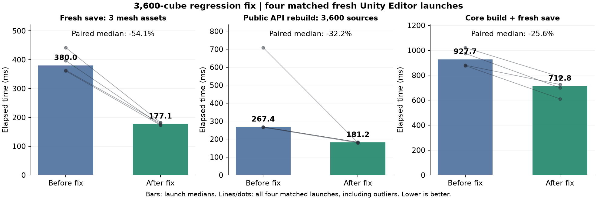
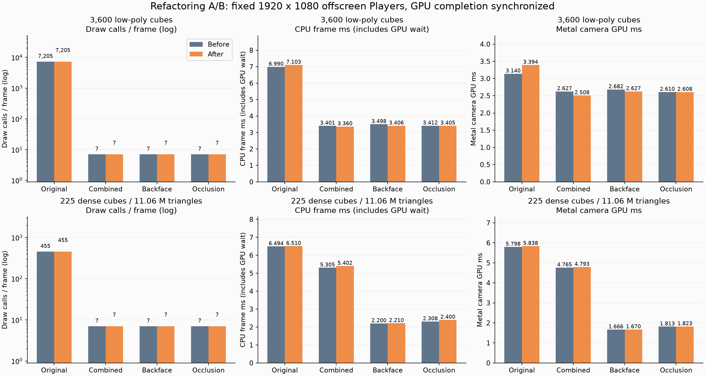
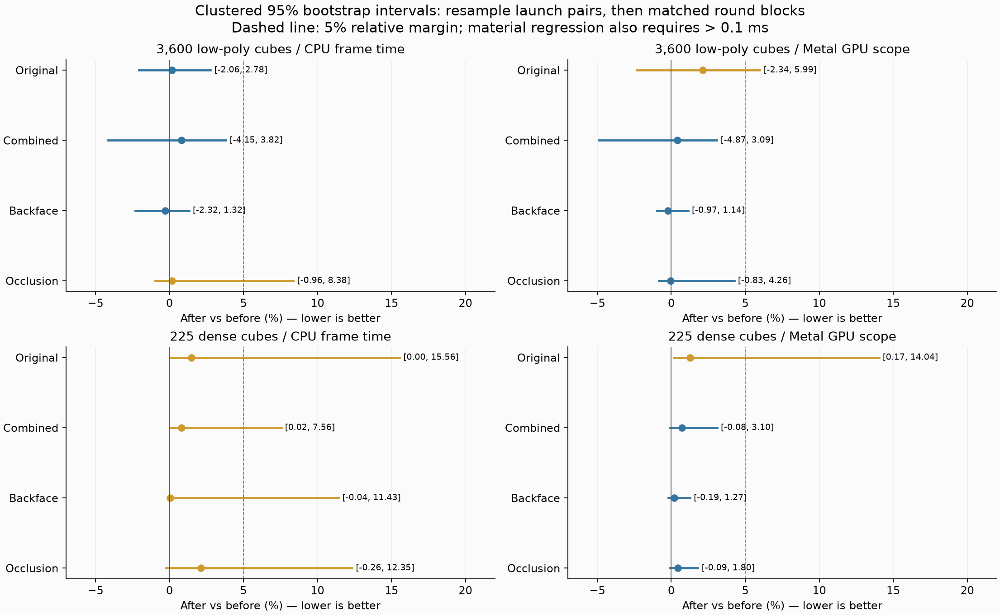
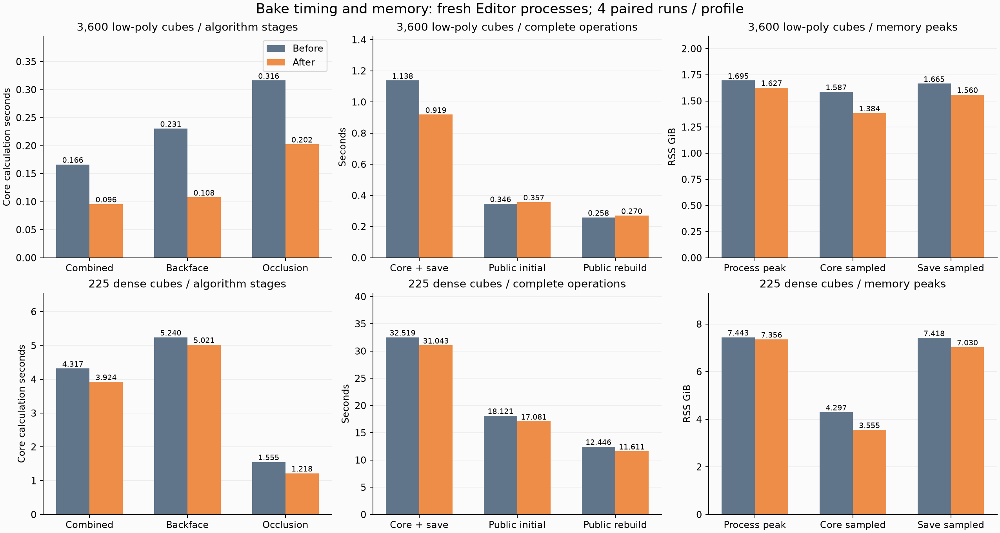
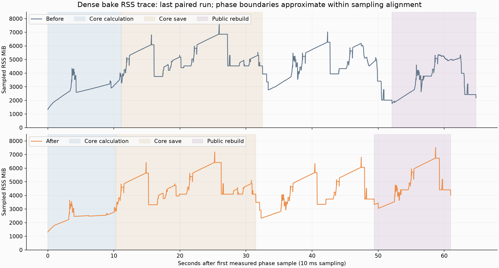
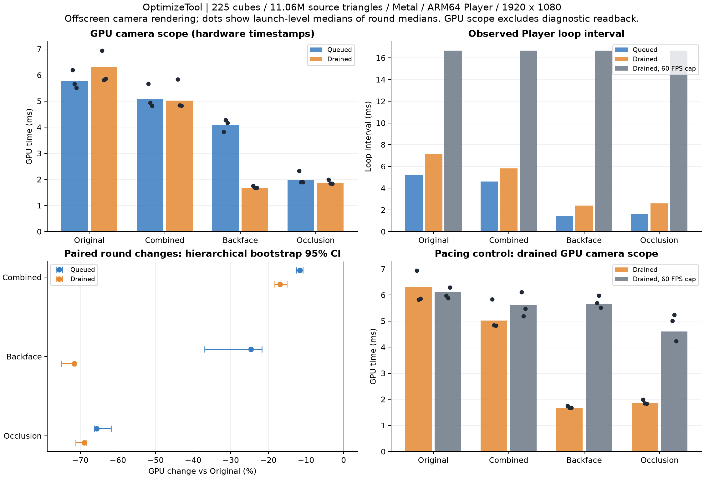
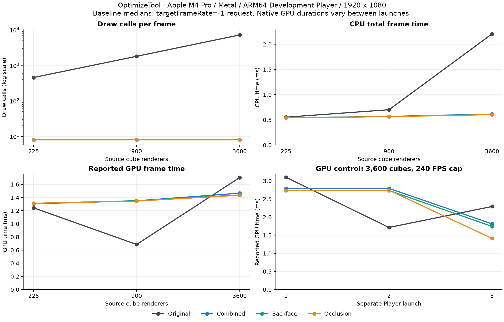

# OptimizeTool 3,600개 저장·재빌드 회귀 수정 — 2026-10-24

**신규 Mesh 저장의 중복 직렬화와 재빌드의 중복 Renderer 변경을 제거했습니다.** 수정 직전 스냅샷과 수정본을 같은 3,600개 입력으로 교차 실행한 결과, 대응 실행 기준 저장은 **54.05%**, 공개 API 재빌드는 **32.17%**, 코어 계산+저장은 **25.56%** 단축됐습니다. 아래는 이번 수정의 새 측정이며, 이전 리팩터링/Player 비교는 하단에 그대로 보존했습니다.

## 확인한 원인과 수정

1. **재빌드가 유지되는 원본까지 복원한 뒤 다시 비활성화했습니다.** 동일 입력 3,600개에서 `Renderer.enabled`를 실제로 **7,200번** 변경하고 같은 수의 Renderer Undo 기록과 Prefab 변경 기록을 만들었습니다. 이전 원본 상태를 Renderer별로 조회하고 다음 입력 집합과 비교해, 유지되는 원본은 원래 상태 기록을 이어받고 제거된 원본만 복원하도록 바꿨습니다. 값이 같으면 Renderer Undo와 대입을 생략합니다. 원래 비활성인 원본, 새로 추가된 원본, 사용자가 다시 켠 원본은 각각 기존 복원 계약을 유지합니다.
2. **새 Mesh를 `CreateAsset`에서 저장한 뒤 메타데이터 변경으로 다시 저장했습니다.** 진단에서 최초 생성만으로 형상 약 **15.82 MB**가 이미 파일에 기록됐고, 뒤의 `SaveAssetIfDirty`에서 다시 전체 형상 저장 비용이 발생했습니다. 복제 Mesh의 최종 이름·읽기 설정을 생성 전에 적용해, 적용 콜백이 없는 신규 저장은 최초 기록으로 끝내도록 수정했습니다. 같은 출력 폴더 확인도 트랜잭션마다 한 번만 수행합니다.
3. **공개 적용 콜백과 롤백 계약은 유지했습니다.** 콜백은 디스크에도 완전한 형상이 있는 Mesh를 받으며, 콜백의 Mesh 변경은 마지막 저장에서 반영됩니다. 콜백이 있으면 강제 dirty 및 최종 저장을 유지합니다. 기존 에셋 덮어쓰기도 Undo·백업·최종 저장을 유지합니다. 임시로 빈 Mesh 파일을 노출하거나 읽기 가능한 입력 Mesh를 변경하지 않습니다. 소유자의 이전 상태 목록은 씬 작업이 모두 끝날 때까지 유지하므로 Undo/Redo 중 직렬화되는 상태도 보존합니다.

별도 진단 실행의 세부 구간은 다음과 같습니다. **진단용 코드가 들어간 실행은 아래 최종 성능 통계에서 제외**했습니다.

| 진단 구간 | 수정 전 | 수정 후 |
|---|---:|---:|
| 신규 Mesh 3개 `CreateAsset` | 178.98 ms | 179.96 ms |
| 신규 Mesh 3개 최종 `SaveAssetIfDirty` | 198.19 ms | 0.20 ms |
| 공개 API 재빌드 씬 적용 | 99.58 ms | 2.32 ms |
| 재빌드의 실제 원본 Renderer 변경 | 7,200회 | 0회 |
| 첫 호출의 실제 원본 Renderer 변경 | 3,600회 | 3,600회 |

이전 보고서의 저장 **+11.92%**는 저장 구현이 바뀌지 않은 상태에서 관측된 증가였습니다. 이번 진단은 저장의 지배적인 중복 비용을 확인했지만, 이전 증가분 전체를 GC·캐시·I/O 중 어느 하나에 배분해 입증한 것은 아닙니다. 재빌드에서는 새 복원 경로가 추가한 중복 변경을 코드와 실제 호출 수로 확인했습니다.

## 동일 조건 재측정

Apple M4 Pro / 24 GB, macOS 26.6.2, Unity 2023.2.20f1, `-batchmode -nographics -job-worker-count 4` 조건입니다. 이전 보고서와 **동일한 절차적 3,600개 큐브·공유 Material·카메라·옵션·예열·베이크 하네스**를 사용했습니다. Combined / Backface / Occlusion 결과를 모두 유지한 뒤 새 에셋 3개를 저장하고, 정리 후 `MeshCombiner.CombineAndSaveMeshes()`의 씬 출력·원본 비활성화를 포함한 첫 호출과 같은 입력 덮어쓰기 재빌드를 측정했습니다.

- 수정 전/후 각각 **새 Editor 프로세스 4회**, 순서는 A/B, B/A, B/A, A/B입니다. 동일 격리 프로젝트에서 두 제작용 소스 파일만 전환했습니다. 두 조건 모두 같은 테스트 어셈블리를 로드하되 테스트를 실행하지 않았습니다. 컴파일·시작·입력 생성·정리 시간은 구간 시간에서 제외했습니다.
- 초기 수집 중 다른 Unity 테스트/컴파일 프로세스가 관측되어 그 수집 전체를 제외·보존했습니다. 이후에는 다른 batch Editor가 끝나기를 기다리고 실행 중에도 1초마다 동시 batch 여부를 기록했습니다. 추가로 감지된 한 쌍도 **성능값과 무관하게 쌍 전체를 보존하고 다시 실행**했습니다. 최종 8개 실행에는 관측된 동시 batch Editor가 없습니다. 모두 AC 전원이며 `pmset`의 열·성능 경고 기록도 없습니다. 상호작용 중인 기본 Editor와 일반 OS/다른 앱의 부하·CPU 클럭까지 고정한 실험은 아닙니다.
- 절대값은 실행별 시간의 중앙값입니다. 변화율은 **대응 실행 비율의 중앙값**이므로 절대 중앙값의 단순 나눗셈과 다를 수 있습니다. 95% 구간은 대응 실행 쌍을 10,000회 재표집한 percentile bootstrap이며 seed는 20261024입니다. 4개 쌍의 불확실성 추정으로, 시스템 편향이나 모든 작은 회귀를 배제하지는 않습니다. 느린 실행도 최종 표본에 모두 포함했습니다.

| 구간 | 수정 전 ms | 수정 후 ms | 대응 변화율 | 95% 구간 |
|---|---:|---:|---:|---:|
| 신규 Mesh 3개 저장 | 380.04 | 177.07 | **−54.05%** | [−58.65, −50.52] |
| 공개 API 재빌드 | 267.42 | 181.23 | **−32.17%** | [−74.60, −31.53] |
| 코어 계산+저장 | 927.67 | 712.75 | **−25.56%** | [−30.33, −17.54] |
| 공개 API 첫 호출 | 319.78 | 303.38 | −6.56% | [−40.86, +66.33] |
| 코어 계산만 | 481.29 | 498.20 | +0.86% | [−15.76, +18.60] |

**저장·재빌드와 계산+저장 전체의 감소는 네 쌍 모두에서 반복됐습니다.** 반면 첫 호출은 양쪽 모두 지연 실행이 있었고, 계산 시간도 편차가 있어 개선·동등성을 확정하지 않았습니다. 이번 수정은 계산 알고리즘을 변경하지 않습니다. 세션이 다른 이전 보고서의 절대 시간과 차감해 추가 개선율을 계산하지 않았습니다.



Editor 프로세스 생애 최대 RSS 중앙값은 **1,690.38→1,682.66 MiB**, 대응 변화율 **−0.83% [−1.30, +1.47]**였습니다. 최악 실행은 1,716.77→1,694.45 MiB입니다. 전체 RSS의 확실한 감소를 주장하지 않습니다. `/usr/bin/time -l`의 프로세스 최대값에는 시작부터 정리까지 포함되며, 별도 10 ms RSS 표본도 보존했습니다. GPU 전용 메모리나 시스템 전체 메모리 수치가 아닙니다.

## 호환성과 회귀 검증

- **EditMode 99/99, PlayMode 38/38, Python 계측 무결성 8/8 통과.** 새 회귀 사례 5개는 반복 재빌드·Undo/Redo 중 원래 활성/비활성 상태, 수동 재활성화, 유지/제거/신규 입력이 섞인 재빌드의 예외 롤백과 재시도, 신규 저장의 동기 재임포트 및 콜백 변경 영속화를 검사합니다. 기존 프리팹 인스턴스 참조·GUID·덮어쓰기·동반 프리팹 저장 실패 복구 테스트도 통과했습니다. 여기서 중단 복구는 주입한 예외의 롤백이며 OS 강제 종료/전원 장애 복구를 측정한 것은 아닙니다.
- 별도 **3,600개 검증 프로세스**에서 양쪽 모두 첫 베이크/재빌드 Undo와 Redo를 수행했습니다. 최초 Undo는 3,600개 원본을 다시 켜고, Redo 후에는 원본 3,600개가 꺼지며 결과 Renderer 1개 및 원래 상태 기록 3,600개가 유지됐습니다.
- 같은 검증 실행에서 저장한 **Combined / Backface / Occlusion 3개 Mesh 파일 SHA-256이 수정 전후 완전히 동일**했습니다. 재임포트 후 삼각형은 각각 43,200 / 7,200 / 14,400개입니다.
- 컴파일된 제작용 4개 어셈블리의 **공개 API 357개·직렬화 필드 170개가 동일**하며, 추가·삭제 0개입니다. 비교용 하네스 타입은 집계에서 제외했습니다. 이 수치는 **고정한 측정 스냅샷**의 비교이며, 이번 두 파일의 수정은 API·직렬화 필드·GUID·씬/프리팹 YAML을 변경하지 않습니다. 측정 직후 보호 파일 791개가 모두 같은 것을 확인했습니다. 이후 최종 검사에서는 외부 동시 작업이 Showcase 프리팹의 비활성 레거시 비교 컴포넌트를 제거하고 `OptimizeToolComparisonController.cs` 및 메타를 삭제했습니다. 해당 변경과 Showcase 빌더/문서 변경은 덮어쓰지 않았습니다. 보호 파일 중 나머지 **789개**는 같으며, [스냅샷 범위](SaveRebuildFix-2026-10-24/snapshot-scope.json)에 구분했습니다. 이 외부 API 제거는 위 357개 동일성 비교에 포함되지 않습니다. 현재 스크립트·프리팹을 반영한 추가 통합 검사도 **EditMode 99/99·PlayMode 38/38** 통과했으며, `Integration*.xml` 및 별도 소스/프리팹 ZIP을 보존했습니다.
- 제작용 수정은 `MeshAssetTransaction.cs`, `MeshSceneOutput.cs`의 **Editor 전용 코드 두 파일**입니다. 이번 단계의 새 실측은 Editor 저장·재빌드이며, 별도 Player 재빌드나 새 Draw Call·CPU/GPU 프레임 시간 수치는 포함하지 않습니다. 이전 Player 측정 자료는 아래에 유지했습니다.

## 근거와 재현

- [전체 통계](SaveRebuildFix-2026-10-24/summary.json), [실행 조건](SaveRebuildFix-2026-10-24/config.json), [테스트·호환성 검증](SaveRebuildFix-2026-10-24/validation.json), [보호 파일 해시](SaveRebuildFix-2026-10-24/preservation.json).
- [코드 변경 패치](SaveRebuildFix-2026-10-24/changes.patch), [수정 전 소스](SaveRebuildFix-2026-10-24/source-baseline.zip), [수정 후 소스](SaveRebuildFix-2026-10-24/source-fixed.zip), [실행·분석 재현 안내](SaveRebuildFix-2026-10-24/README.md).
- `data/bake`에 모든 최종 타이밍·명령·소스 해시·프로세스 자원 기록·RSS 표본·압축 로그를 보존했습니다. `diagnostic-*`에는 구간별 비용과 GC 횟수, `verify-*`에는 전체 규모 Undo/Redo 및 저장 Mesh 동등성 결과가 있습니다. 제외한 초기 수집과 동시 실행 쌍은 `data/excluded-*`와 [제외 사유](SaveRebuildFix-2026-10-24/excluded.json)에 남겼습니다.
- 상태 원본을 계속 공유하는 렌더러의 Undo 기록을 줄인 결과이므로, 모든 입력이 매번 바뀌는 작업에서는 같은 재빌드 감소율을 기대하지 않습니다. 콜백 및 기존 에셋 덮어쓰기의 형상 저장·Undo 백업 비용은 다음 분석 대상으로 남아 있습니다.

---

# 이전 리팩터링 전후 Player·베이크 비교 (보존)

# OptimizeTool 리팩터링 전후 성능 비교 — 2026-10-24

**코어 베이크 계산은 개선됐지만 모든 경로가 빨라지지는 않았습니다.** 3,600개 샘플의 계산은 대응 실행 기준 **42.38%**, 계산+저장은 **18.82%** 단축됐습니다. 고밀도 225개 샘플은 각각 **8.35%**, **4.43%** 단축됐습니다. 반면 3,600개 샘플의 저장 구간은 **11.92% 증가**, 공개 API 재빌드는 **3.80% 증가(중앙값 약 12 ms)**가 관측됐습니다.

**추가 런타임 개선은 확인하지 못했습니다.** 전후 Draw Call은 동일합니다. 최적화 세 모드의 Metal GPU 구간은 두 프로파일 모두 선언한 회귀 여유 안에 들어왔지만, 일부 CPU 전체 프레임 시간과 고밀도 전체 RSS 피크는 불확실성이 커서 동등성을 입증하지 못했습니다. “전체 경로에 회귀가 없다”는 결론은 내리지 않습니다.

## 비교 범위와 검증

- 최근 복원·무결성 리팩터링 직전 해시 매니페스트에 맞춰 **제작용 소스/메타 98개를 완전히 복원**했습니다. 테스트는 두 측정 프로젝트에서 제외했고, 전후 소스 ZIP과 해시를 보존했습니다. 현재 작업공간의 소스·씬을 되돌려 측정하지 않았습니다.
- 같은 원본 Material, 절차적 큐브 생성, 카메라와 옵션으로 양쪽에서 다시 베이크했습니다. **새로 생성된 6개 결과 Mesh 에셋이 바이트 단위로 동일**합니다. 전후 PNG 8쌍과 각 버전의 Original/최적화 PNG 12쌍도 픽셀 단위로 동일합니다.
- Apple M4 Pro / 24 GB, macOS 26.6.2, Unity 2023.2.20f1, ARM64 Development Player, Metal, URP-HighFidelity, 1920×1080, MSAA 4×. Instancing·Dynamic Batching·그림자·Probe·샘플 UI·이동·Player Collider를 끈 동일 조건입니다.
- CPU 부하용 **3,600개 / 43,200 triangles**, GPU 부하용 **225개 / 11,059,200 triangles**를 각각 별도 Player로 빌드했습니다. 한 Material과 공유 원본 Mesh를 반복 배치한 고정 시점 조건이며 서로 다른 원본 Mesh가 많은 일반 씬으로 개선율을 일반화하지 않습니다.
- 프로파일마다 독립 Player **전 4회 + 후 4회**를 A/B, B/A, B/A, A/B로 교차했습니다. 실행별 4라운드×4모드×240표본, 총 **61,440 프레임**입니다. 정·역방향 8개 모드 순서는 시작 오프셋 0/4/0/4로 균형을 맞췄습니다.
- 각 모드 최초 및 전환 시 최소 2초와 90프레임을 모두 예열하고, Original 사전 부하 10초·시작 안정화 3초·실행 사이 5초를 적용했습니다. CPU 양수 유효율은 모든 실행에서 **100%**, Metal GPU 식별자·시간 산식도 모두 유효했습니다.
- Player는 그래픽이 활성화된 batch/offscreen 경로이며 GPU 완료를 한 픽셀 readback으로 동기화했습니다. CPU는 **GPU 완료 대기를 포함한 FrameTimingManager 전체 시간**, GPU는 **동일 Metal command buffer의 카메라 렌더 구간**입니다. GPU 값은 표시 프레임 전체나 순수 활성 셰이더 시간과 같지 않습니다. CSV 한 행의 CPU/GPU가 동일 프레임 쌍이라는 가정도 하지 않았습니다.
- 창 모드 초기화/포커스 실패 2개와 자원 로그를 캡처 폴더 안에 둬 새 무결성 검사가 거부한 기술 검증 1쌍은 보존하고 제외했습니다. 후자는 측정 로그를 폴더 밖으로 옮긴 뒤 **전후 쌍 전체를 다시 실행**했습니다. 성능값을 기준으로 표본을 삭제하지 않았습니다.
- 원시 프레임을 독립 표본으로 세지 않고, 대응 라운드 중앙값을 구한 뒤 **실행 쌍과 그 안의 라운드를 재표집하는 10,000회 bootstrap**으로 95% 구간을 계산했습니다. 실질적인 시간 회귀 기준은 **5%와 0.1 ms를 모두 초과**하는 증가입니다. 4개 실행 쌍만으로 모든 작은 차이를 배제할 수는 없습니다. 구간은 항목별 추정이며 다중 비교 전체에 대한 동시 보장은 아닙니다.

## 런타임 실측

절대값은 각 모드의 전체 유효 프레임 중앙값입니다. 대응 변화율은 라운드/실행 쌍의 비율로 따로 계산하므로 절대 중앙값의 단순 나눗셈과 일치하지 않을 수 있습니다. 기존 Original→최적화 모드의 Draw Call 감소를 이번 리팩터링의 성과로 계산하지 않았습니다.

| 프로파일 | 모드 | Draw Call 전→후 | CPU 전체 ms 전→후 | Metal GPU ms 전→후 |
|---|---|---:|---:|---:|
| 3,600개 | Original | 7,205 → 7,205 | 6.990 → 7.103 | 3.140 → 3.394 |
| 3,600개 | Combined | 7 → 7 | 3.401 → 3.360 | 2.627 → 2.508 |
| 3,600개 | Backface | 7 → 7 | 3.498 → 3.406 | 2.682 → 2.627 |
| 3,600개 | Occlusion | 7 → 7 | 3.412 → 3.405 | 2.610 → 2.608 |
| 225개 고밀도 | Original | 455 → 455 | 6.494 → 6.510 | 5.798 → 5.838 |
| 225개 고밀도 | Combined | 7 → 7 | 5.305 → 5.402 | 4.765 → 4.793 |
| 225개 고밀도 | Backface | 7 → 7 | 2.200 → 2.210 | 1.666 → 1.670 |
| 225개 고밀도 | Occlusion | 7 → 7 | 2.308 → 2.400 | 1.813 → 1.823 |



| 프로파일 | 모드 | CPU 대응 변화율 및 95% 구간 | GPU 대응 변화율 및 95% 구간 |
|---|---|---:|---:|
| 3,600개 | Original | +0.17% [-2.06, +2.78] | +2.12% [-2.34, +5.99] |
| 3,600개 | Combined | +0.82% [-4.15, +3.82] | +0.40% [-4.87, +3.09] |
| 3,600개 | Backface | -0.28% [-2.32, +1.32] | -0.23% [-0.97, +1.14] |
| 3,600개 | Occlusion | +0.15% [-0.96, +8.38] | -0.03% [-0.83, +4.26] |
| 225개 고밀도 | Original | +1.50% [+0.00, +15.56] | +1.27% [+0.17, +14.04] |
| 225개 고밀도 | Combined | +0.80% [+0.02, +7.56] | +0.71% [-0.08, +3.10] |
| 225개 고밀도 | Backface | +0.05% [-0.04, +11.43] | +0.19% [-0.19, +1.27] |
| 225개 고밀도 | Occlusion | +2.11% [-0.26, +12.35] | +0.44% [-0.09, +1.80] |

최적화 세 모드의 GPU 구간은 모든 비교에서 95% 상한이 +5% 이내입니다. 그러나 3,600개 Occlusion의 CPU 상한은 +8.38%, 고밀도 CPU 상한은 모드별 +7.56~+15.56%여서 CPU 회귀를 일괄 배제할 수 없습니다. Original 대조군의 GPU도 흔들렸습니다. GPU 주파수·다른 GPU 클라이언트·OS 스케줄링 기여도를 별도로 고정/분해하지 않았으므로 이 변동을 코드 회귀나 특정 전력 정책 탓으로 단정하지 않았습니다.



## 베이크 시간

각 측정은 새 headless Unity Editor 프로세스에서 수행했습니다. 입력 생성·프로세스 시작은 시간값에서 제외하고 원본 하나의 Combine 호출로 기본 초기화를 예열했습니다. 코어는 Combined·Backface·Occlusion 결과를 모두 유지한 뒤 새 에셋 3개를 배치 저장합니다. 공개 API 첫 호출은 코어 측정/정리 후 `MeshCombiner.CombineAndSaveMeshes()`로 씬 출력과 원본 비활성화까지 수행하고, 재빌드는 같은 입력을 덮어쓰며 이전 씬 출력을 교체합니다. 따라서 첫 API 호출 수치는 완전히 차가운 Editor 최초 작업 시간은 아닙니다.

절대값은 실행별 시간의 중앙값, 변화율은 대응 실행 비율의 중앙값입니다.

| 프로파일 | 구간 | 전 ms | 후 ms | 대응 변화율 | 95% 구간 |
|---|---|---:|---:|---:|---:|
| 3,600개 | Combined 계산 | 166.34 | 95.65 | -42.46% | [-44.06, -39.65] |
| 3,600개 | Backface 계산 | 230.51 | 107.74 | -50.36% | [-55.26, -33.01] |
| 3,600개 | Occlusion 계산 | 316.17 | 202.47 | -36.52% | [-39.86, -31.58] |
| 3,600개 | 계산 합계 | 721.07 | 406.42 | -42.38% | [-44.49, -35.11] |
| 3,600개 | 3개 에셋 저장 | 353.50 | 398.00 | +11.92% | [+10.56, +35.42] |
| 3,600개 | 계산+저장 전체 | 1,137.72 | 918.82 | -18.82% | [-24.58, -13.40] |
| 3,600개 | 공개 API 첫 호출 | 345.96 | 357.15 | +2.76% | [-13.01, +7.10] |
| 3,600개 | 공개 API 재빌드 | 258.20 | 269.86 | +3.80% | [+2.82, +10.75] |
| 225개 고밀도 | Combined 계산 | 4,316.95 | 3,923.70 | -8.21% | [-10.46, -7.75] |
| 225개 고밀도 | Backface 계산 | 5,240.45 | 5,020.76 | -4.72% | [-5.82, -3.13] |
| 225개 고밀도 | Occlusion 계산 | 1,554.74 | 1,217.89 | -21.09% | [-22.24, -19.62] |
| 225개 고밀도 | 계산 합계 | 11,093.13 | 10,170.10 | -8.35% | [-9.54, -7.65] |
| 225개 고밀도 | 3개 에셋 저장 | 21,361.37 | 20,830.56 | -2.76% | [-5.78, +0.91] |
| 225개 고밀도 | 계산+저장 전체 | 32,519.00 | 31,043.17 | -4.43% | [-6.87, -2.73] |
| 225개 고밀도 | 공개 API 첫 호출 | 18,121.23 | 17,080.81 | -5.12% | [-8.66, -2.31] |
| 225개 고밀도 | 공개 API 재빌드 | 12,446.49 | 11,610.75 | -6.67% | [-14.91, -3.81] |

**확인된 개선:** 두 프로파일의 코어 계산 및 계산+저장 전체 시간은 감소 구간이 0을 넘지 않았습니다. 같은 원본 Mesh의 읽기용 복사 재사용, 정점 레이아웃이 같을 때의 추가 복제 생략, 임시 메시 조기 해제가 적용됐고 결과 에셋은 동일합니다.

**관측된 회귀:** 3,600개 저장 구간은 +11.92% [10.56, 35.42], 공개 재빌드는 +3.80% [2.82, 10.75]입니다. 재빌드는 약 12 ms 증가했고 새 원본 상태 복원·추적 작업을 포함합니다. 세부 Native 호출별 원인을 계측한 것은 아닙니다. 저장 구현 `MeshAssetTransaction` 자체는 전후 동일하므로 저장 구간 증가를 저장 코드 변경의 회귀로 단정할 수는 없습니다. 할당/GC 시점·캐시·직렬화·I/O 비용의 이동 여부는 추가 프로파일링이 필요합니다. 계산 단축이 Inspector의 전체 작업 단축을 항상 보장하지 않는다는 결과입니다.



## 최대 메모리

Player와 Editor의 **프로세스 생애 최대 RSS**는 macOS `/usr/bin/time -l`로 읽었습니다. Editor 전체 피크에는 시작·입력 생성·계산·저장·공개 API 첫 호출/재빌드·정리가 포함됩니다. Player에는 측정 하네스와 마지막 반복의 PNG 검증 비용도 포함되며 기본 샘플 단독 실행의 메모리량과 동일하지 않습니다. RSS는 전체 시스템 메모리나 GPU 전용 메모리 총량이 아닙니다.

구간별 RSS는 `proc_pidinfo`를 약 10 ms 간격으로 읽은 표본 피크이며 순간적인 진짜 최대값보다 낮을 수 있습니다. 아래 “중앙값”은 각 실행 최대값들의 중앙값입니다.

| 측정 | 전 MiB | 후 MiB | 대응 변화율 | 95% 구간 |
|---|---:|---:|---:|---:|
| Player 3,600개 최대 RSS 중앙값 | 308.77 | 309.37 | +0.10% | [-0.08, +0.44] |
| 3,600개 Editor 전체 최대 RSS 중앙값 | 1,735.86 | 1,665.91 | -3.89% | [-4.37, -2.11] |
| 3,600개 계산 구간 표본 피크 | 1,625.32 | 1,417.02 | -11.42% | [-13.59, -6.02] |
| 3,600개 계산 완료 시점 Unity 할당량 | 249.40 | 242.16 | -3.29% | [-3.43, -2.40] |
| Player 225개 고밀도 최대 RSS 중앙값 | 876.39 | 876.63 | +0.03% | [-0.01, +0.03] |
| 225개 고밀도 Editor 전체 최대 RSS 중앙값 | 7,621.60 | 7,532.44 | -1.33% | [-9.14, +7.55] |
| 225개 고밀도 계산 구간 표본 피크 | 4,399.95 | 3,640.30 | -16.69% | [-18.26, -16.24] |
| 225개 고밀도 계산 완료 시점 Unity 할당량 | 1,878.90 | 1,281.38 | -31.81% | [-32.28, -31.63] |

관측한 전체 Editor 최대값의 최악 실행은 3,600개에서 **1,749.50→1,712.66 MiB**, 고밀도에서 **8,297.73→7,539.08 MiB**였습니다. 다만 고밀도 피크의 대응 95% 구간은 **−9.14~+7.55%**이므로 이 최악값 한 쌍만으로 일반적인 피크 감소를 주장하지 않습니다.

고밀도 계산 완료 시점의 Unity 할당량은 약 **1,879→1,281 MiB**, 계산 구간 표본 RSS 피크는 약 **4,400→3,640 MiB**로 줄었습니다. 반면 전체 피크는 저장/재빌드 쪽에서 발생해 계산 복사 감소만큼 줄지 않았습니다. 이는 관측된 구간 위치이며, 직렬화 버퍼·Undo·할당기 예약을 원인별로 분해해 확정한 결과는 아닙니다.



## 판단과 다음 개선 순서

1. 코어 계산과 임시 메모리 축소는 실제 개선입니다. 베이크 전체 개선율은 저장 비용 때문에 더 작습니다.
2. Draw Call·기하·고정 시점 화면은 유지됐고, 이번 리팩터링의 추가 GPU 이득은 확인되지 않았습니다. 최적화 모드 GPU의 선언한 회귀 여유는 배제됐지만 CPU 시간까지 포함한 전체 무회귀를 선언하지 않습니다.
3. 다음 성능 개선은 동일 입력 재빌드에서 이미 꺼진 원본을 불필요하게 켰다가 다시 끄는 작업과 소유 상태 직렬화 비용을 줄이는 순서가 적절합니다. 제거된 입력 복원·원래 비활성 상태·Undo/Redo 계약은 유지해야 합니다.
4. 대형 Mesh의 저장·Undo·덮어쓰기 구간을 더 잘게 계측해 전체 RSS 피크와 CPU 저장 구간 증가를 다루는 것이 다음 우선순위입니다. 이번 작업에서는 비교 중 구현을 수정해 유리한 버전으로 바꾸지 않았습니다.

## 원시 근거와 재현

- [전체 통계](RefactoringComparison-2026-10-24/summary.json), [실행 계획](RefactoringComparison-2026-10-24/config.json), [메모리 단계 추적](RefactoringComparison-2026-10-24/memory-stage-analysis.json), [제외 기록](RefactoringComparison-2026-10-24/excluded.json).
- [전 소스 ZIP](RefactoringComparison-2026-10-24/builds/before/production-source.zip), [후 소스 ZIP](RefactoringComparison-2026-10-24/builds/after/production-source.zip), [기준 버전 복원 검증](RefactoringComparison-2026-10-24/baseline-reconstruction.json).
- `data/runtime`에 압축 CSV·메타데이터·완료 기록·실행 검증·PNG를, `data/bake`에 타이밍·RSS 표본·OS 자원 기록을 보존했습니다. 기존 형식은 공통 검증기로 다시 검사하고 외부 아카이브 SHA-256도 보존했습니다.
- 측정 후 작업공간에는 물리 데모/Overview/UI의 null 처리·reload 정리 변경 3개가 추가되어 있었습니다. 이들은 측정한 두 Scale 씬에 참조되지 않으며 Mesh 빌드·계측 핵심 해시는 그대로입니다. 해당 변경을 덮어쓰지 않았고, 이 보고서는 보존한 시작 시점 after 스냅샷을 대상으로 합니다. [범위 확인](RefactoringComparison-2026-10-24/snapshot-scope.json).
- 원본 프로젝트 보호 파일 **476개**는 측정 전후 해시가 같고 제작용 소스를 수정하지 않았습니다. 전후 앱 4개는 모두 빌드 오류·경고 0개입니다. [보존 검사](RefactoringComparison-2026-10-24/preservation.json).
- 재현 도구: `RefactoringComparisonHarness.cs.txt`를 격리 프로젝트의 `Script/Samples/Editor`에 복사한 뒤 `BuildPlayers`/`Bake`를 batch 실행합니다. Player·베이크 교차 실행은 `run_refactoring_comparison.py --work <격리 작업 폴더> --output <새 결과 폴더>`, 분석은 `analyze_refactoring_comparison.py <작업 폴더 또는 보존 폴더> --output <새 통계 JSON>`입니다. 이는 macOS 전용 계측 절차입니다.

---

# 이전 GPU 최적화 검증 보고서 (보존)

아래 수치는 이전 Original/최적화 모드 비교이며 위 리팩터링 전후 비교와 구분합니다.

# OptimizeTool GPU 구간 재검증 — 2026-10-24

**고밀도 샘플과 Metal 타임스탬프 계측으로 GPU 최적화 효과를 확인했습니다.** GPU 완료를 동기화한 연속 렌더링 조건에서 Backface는 대응 구간 기준 **71.63%**, Occlusion은 **68.93%** GPU 시간이 감소했습니다. 비동기 조건에서도 두 모드의 GPU 구간 감소가 반복됐습니다. **60 FPS 제한에서는 같은 개선율을 확인하지 못했으며, GPU 절대 시간의 실행 간 편차도 완전히 사라지지 않았습니다.**

측정 대상은 화면 표시와 분리한 별도 ARM64 Development Player의 **1920×1080 카메라 렌더 구간**입니다. 아래 GPU 값은 CPU stopwatch나 표시 FPS를 GPU 시간으로 바꾼 값이 아닙니다. Metal이 보고한 실제 커맨드 버퍼 `GPUStartTime`·`GPUEndTime`의 차이입니다. 기존 창 모드 전체 프레임 수치와 측정 범위가 달라 절대값을 직접 비교하지 않습니다. 이전 규모 확장 Player·Editor 보고서와 원시 데이터는 아래에 보존했습니다.

## 편차 원인: 확인한 사실과 남은 가설

1. **이전 샘플은 GPU보다 Renderer 제출 비용을 보기 좋은 조건이었습니다.** 3,600개여도 원본 에셋은 43,200개 삼각형이었고, 같은 Material·그림자 없는 정적 큐브였습니다. GPU가 이미 수행하는 backface/early-depth 제거와 중복되는 부분도 있습니다. 이 조건의 Draw Call 감소가 추가 GPU 이득을 보장하지는 않습니다.
2. **GPU 구간 길이와 프레임 처리 간격을 혼동할 수 있습니다.** 이전 로그의 최적화 모드는 GPU 약 1.4 ms, 관측 루프 약 0.6 ms로 GPU 구간이 루프의 약 2.3배였습니다. 이번 새 계측의 비동기 Backface도 GPU 4.070 ms, 루프 1.401 ms였습니다. 완료 동기화를 넣으면 같은 기하의 GPU 구간은 1.677 ms, 루프는 2.394 ms가 됩니다. 비동기 프레임 중첩·단계 간 간격의 영향을 분리해야 한다는 근거입니다. Unity도 [Metal 타일 GPU의 단계 사이 간격이 GPU 프레임 시간에 포함될 수 있음](https://docs.unity3d.com/2023.2/Documentation/Manual/frame-timing-manager.html)을 설명합니다. 이 현상을 Unity 타이머 버그로 단정하지 않았습니다.
3. **플랫폼에서 쓸 수 있는 계측 범위가 제한됩니다.** Unity 2023.2의 [macOS Metal GPU Profiler는 미지원](https://docs.unity3d.com/2023.2/Documentation/Manual/ProfilerGPU.html)이고 실제 `SystemInfo.supportsGpuRecorder`도 false였습니다. 이번 오프스크린 경로에서 FrameTimingManager GPU 양수 유효율은 약 3.1%뿐이었습니다. 이 값은 원시에 그대로 남기고 최종 GPU 통계에는 사용하지 않았습니다. 새 Metal GPU 구간은 최종 51,840개 표본 모두 유효했습니다.
4. **클럭·전력 정책과 다른 프로세스 부하의 기여도는 확정하지 못했습니다.** 모든 최종 실행은 AC 전원이었고 `pmset`에는 성능·열 경고 기록이 없었습니다. 이것은 GPU 주파수가 고정됐다는 증거가 아닙니다. GPU 주파수·활성 사이클과 모든 다른 GPU 클라이언트를 측정·고정하지 않았습니다. 특히 60 FPS 제한에서 GPU 시간이 달라진 이유를 DVFS 하나로 단정할 수 없습니다. 작업 중인 Editor의 상태도 조작하지 않았습니다.

따라서 **측정 범위·프레임 중첩의 영향은 확인했지만, 이전 실행 간 변동을 각 원인별 비율로 분해한 것은 아닙니다.**

## 샘플·수집기를 바꾼 내용

- `OptimizeToolGpuBenchmark.unity`를 별도로 생성합니다. 큐브 면마다 **64×64** 실제 삼각형 격자를 사용하고, 9·36·225개 케이스를 제공합니다. 기존 9개 큐브·225/900/3,600개 규모 샘플·프리팹 참조는 유지했습니다.
- 225개 원본은 **11,059,200개 삼각형**입니다. Combined는 동일, Backface는 1,843,200개, Occlusion은 3,686,400개입니다. 원본 Renderer 225개, 최적화 모드 각 1개이며 실제 `MeshBuildPipeline`의 출력 에셋을 사용합니다. Player 실행 중 베이크하지 않습니다.
- 같은 카메라·화면 점유율·URP/Lit Material을 사용합니다. Instancing·Dynamic Batching·그림자·Light/Reflection Probe를 끄고 베이크 Collider를 제거합니다. 단일 Material과 정렬된 3개 깊이 층으로 만든 **기하/vertex 부하 검증용 조건**입니다. 일반 게임 씬을 대표하지 않으며 시점 의존 culling의 시각 보존도 고정 카메라에 한정됩니다.
- Player를 `-batchmode`로 실행하되 **`-nographics`를 사용하지 않습니다.** 실제 Metal GPU와 1920×1080, ARGB32, MSAA 4× RenderTexture를 사용합니다. 배치 모드의 자동 카메라 렌더 생략으로 빈 화면을 측정하지 않도록 카메라를 자동 렌더에서 빼고 매 LateUpdate에 **명시적으로 1회 렌더**합니다. 데스크톱 포커스·표시 swap chain과 분리했습니다.
- Objective-C++ 플러그인이 Unity의 Metal 인터페이스로 카메라 시작·종료의 **동일 커맨드 버퍼**를 검증하고, 종료 시 명시적으로 commit합니다. 완료 handler 안에서 GPU 시작·종료 타임스탬프를 읽습니다. 다른 버퍼, 0/역전 시간, 큐 overflow는 전체 수집을 거부합니다. [Apple API 설명](https://developer.apple.com/documentation/metal/mtlcommandbuffer/gpustarttime)에 따른 사용이며 GPU 활성 셰이더 사이클 합계를 측정하는 도구는 아닙니다. 같은 버퍼 안의 단계 간 간격·선점도 남을 수 있습니다.
- 완료 동기화 조건은 **측정 버퍼 종료 뒤** 한 픽셀을 CPU로 읽어 이전 GPU 작업 완료를 기다립니다. [ReadPixels의 동기화 동작](https://docs.unity3d.com/cn/2022.3/ScriptReference/Texture2D.ReadPixels.html)을 의도적으로 사용하는 진단입니다. Readback 복사 비용 자체는 GPU 타임스탬프 구간 밖에 있지만 CPU 루프·스케줄링은 달라집니다. 기본 샘플 실행에는 적용하지 않습니다.
- GPU 시간이 느리거나 빠르다는 이유로 프레임을 고르지 않습니다. 완료 FIFO에서 최초 유효 표본을 읽으며 GPU 시퀀스 ID 중복·타임스탬프 산식·구간 수를 검사합니다. CPU FrameTimingManager 기록과 GPU 시퀀스의 프레임 지연이 다르므로 **안정된 모드 구간 단위**로 비교합니다.
- 전처리 Original 15초, 초기 각 모드 예열 및 전환별 예열 **2초와 90프레임 모두 충족**, 시작 안정화 3초를 적용합니다. 8개 정·역방향 순서를 모두 쓰고 실행마다 시작 순서를 바꿉니다. 비동기와 동기화 실행을 Q0/D0/D1/Q1/Q2/D2 순으로 교차했습니다.
- 수집기·실행기에 파일 잠금을 넣어 자체 벤치마크의 중복 실행을 막았습니다. 진단 중단 뒤 대기 중 콜백이 정리한 자원을 다시 사용하는 경로도 수정하고 회귀 테스트를 추가했습니다. 실패·중단·초기 기술 검증 수집은 최종 통계에서 제외했습니다.

## GPU 완료 동기화 조건의 결과

각 모드 5,760개 유효 프레임을 합친 중앙값입니다. CPU 전체 시간에는 GPU 완료 대기가 포함됩니다. 관측 루프 간격도 표시 FPS와 다릅니다. Draw Call은 `ProfilerRecorder`의 실제 프레임 전체 값이며 카메라 패스를 포함합니다. 이전 창 모드와 1회 차이 나는 기본 패스 수를 맞춰서 보정하지 않았습니다.

| 모드 | 실측 Draw Call | GPU 카메라 구간 중앙값 (ms) | GPU p95 (ms) | CPU 전체 중앙값 (ms) | 관측 루프 간격 (ms) |
| --- | --- | --- | --- | --- | --- |
| Original | 455 | 6.316 | 7.148 | 7.102 | 7.101 |
| Combined | 7 | 5.019 | 6.457 | 5.808 | 5.808 |
| Backface | 7 | 1.677 | 2.866 | 2.393 | 2.394 |
| Occlusion | 7 | 1.852 | 3.058 | 2.598 | 2.599 |

Draw Call은 455→7회로 **98.46% 감소**했습니다. Combined는 기하 수를 유지하며 제출·GPU 처리 구조가 달라지고, Backface·Occlusion은 실제 GPU 입력 기하를 줄입니다. 감소한 삼각형 비율과 GPU 시간 감소율이 선형으로 같다고 가정하지 않습니다.



## 비동기·동기화·프레임 제한의 차이

| 모드 | 비동기 GPU (ms) | 동기화 GPU (ms) | 60 FPS 동기화 GPU (ms) | 비동기 루프 (ms) | 60 FPS 루프 (ms) |
| --- | --- | --- | --- | --- | --- |
| Original | 5.769 | 6.316 | 6.120 | 5.199 | 16.667 |
| Combined | 5.080 | 5.019 | 5.603 | 4.601 | 16.667 |
| Backface | 4.070 | 1.677 | 5.659 | 1.401 | 16.667 |
| Occlusion | 1.961 | 1.852 | 4.597 | 1.609 | 16.667 |

동기화는 GPU 지연을 프레임 사이 중첩과 분리하는 진단이며 실제 게임의 기본 실행 방식이 아닙니다. 60 FPS 제한의 관측 루프는 모든 모드 약 16.67 ms였지만, GPU 구간은 루프 전체와 같지 않았습니다. 제한 조건에서 줄어든 기하가 동일한 GPU 시간 감소율로 나타나지는 않았습니다.

각 실행·라운드의 Original 중앙값과 최적화 모드 중앙값을 대응시켜 변화율을 계산했습니다. 아래 값은 대응 변화율의 중앙값으로, 위 전체 표본 중앙값을 단순히 나눈 값과 계산 순서가 다릅니다. 95% 구간은 **실행을 먼저, 그 안의 라운드를 다음으로 재표집하는 계층 bootstrap 10,000회**입니다. 연속 프레임을 독립 실험으로 취급하지 않았습니다.

| 조건 | 모드 | Original 대비 GPU 변화율 | 계층 bootstrap 95% 구간 |
| --- | --- | --- | --- |
| 비동기 | Combined | -11.68% | -12.58% ~ -10.81% |
| 비동기 | Backface | -24.61% | -36.96% ~ -21.69% |
| 비동기 | Occlusion | -65.64% | -66.25% ~ -61.78% |
| 완료 동기화 | Combined | -16.90% | -18.31% ~ -15.08% |
| 완료 동기화 | Backface | -71.63% | -75.03% ~ -71.17% |
| 완료 동기화 | Occlusion | -68.93% | -71.20% ~ -68.30% |
| 완료 동기화 + 60 FPS 제한 | Combined | -9.31% | -18.19% ~ +4.12% |
| 완료 동기화 + 60 FPS 제한 | Backface | -5.10% | -19.97% ~ +5.65% |
| 완료 동기화 + 60 FPS 제한 | Occlusion | -24.08% | -46.34% ~ +4.35% |

연속 렌더링의 비동기·동기화 조건에서는 세 최적화 모드 모두 구간이 0 미만입니다. 완료 동기화 Backface의 감소율 71.63%는 **71.17% ~ 75.03%**, Occlusion 68.93%는 **68.30% ~ 71.20%** 구간입니다. **60 FPS 제한에서는 세 모드 모두 구간에 0이 포함되므로 GPU 시간 개선을 확정하지 않았습니다.** 실행은 각 조건 3회이며, 제한 대조는 2라운드씩 6쌍이어서 일반화에 특히 제한이 있습니다.

## 측정 환경·검증

- Apple M4 Pro, CPU 12코어, 메모리 24 GiB, macOS 26.6.2, Metal, Unity 2023.2.20f1 / URP 16.0.6 High Fidelity.
- 별도 OSX Development Player, 네이티브 Arm64 실행. 실행 파일과 네이티브 플러그인은 Universal Mach-O입니다. Render Scale 1, MSAA 4×, SRP Batcher 켜짐. 실제 카메라/RT 1920×1080을 검사했습니다.
- 최종 빌드 GUID **`b3c44117ef5d4bb9945b9234535cce3c`**. 두 연속 렌더링 조건 각 3실행 × 8라운드 × 4모드 × 240 = 23,040개씩, 60 FPS 제한 3 × 2 × 4 × 240 = 5,760개. 총 **51,840개** 성능 표본입니다.
- 9·36·225개 별도 시각 검증에서 Original 대비 세 최적화 모드 모두 **변경 픽셀 0개·RGB 오차 0**입니다. 전경 픽셀 수 조건도 검사해 빈 화면 일치를 성공으로 처리하지 않았습니다. 이 확인용 2,880개 타이밍은 성능 통계에서 제외했습니다.
- EditMode **72/72**, PlayMode **25/25**, 총 **97개 통과**. 범위는 `Common.OptimizeTool.Tests`와 `Common.OptimizeTool.PlayModeTests`입니다. 기하/법선·삼각형 winding, 베이크·저장 참조, 세 GPU 케이스 렌더 결과, 취소된 GPU 대기 콜백을 검증했습니다. 전체 저장소 테스트 결과를 뜻하지 않습니다.
- 작업 전 기존 씬·프리팹·메타 **258개 파일 모두 바이트 동일**합니다. 원래 씬·프리팹을 수정하거나 Editor의 Play Mode를 조작하지 않았습니다.
- 빌드 성공, 오류·경고 0. 원래 작업 프로젝트에 통합한 뒤에도 재컴파일 완료·Console 오류 0개를 확인했습니다. 압축 원시 자료로 세 조건의 요약을 다시 생성해 저장된 JSON과 정확히 일치함을 확인했습니다. 원시 GPU 시퀀스 고유성·완료 후 타임스탬프·같은 버퍼 범위·GPU 양수 유효율 100%를 검사했습니다. CPU와 GPU를 더하거나 GPU 값 하나로 표시 FPS를 역산하지 않습니다.
- GPU 클럭을 고정한 전용 장치 실험이 아닙니다. 정확한 GPU 활성 사이클·주파수·전력과 다른 GPU 클라이언트 부하의 분리는 남아 있습니다. 이번 결과는 이 정적 고밀도 샘플의 조건별 렌더링 비용 검증입니다.

## 재현·원시 데이터

[실행/집계 스크립트](run_gpu_benchmark_suite.py)는 각 조건을 별도 Player로 교차 실행합니다. 준비된 실행 파일은 이 컴퓨터의 `ToyProject/Builds/OptimizeToolGpuBenchmark-20261024/OptimizeToolBenchmark.app`에 있으며 Git 제외 경로입니다. 인자 없이 열면 일반 창에서 `Q/E`로 9·36·225개, `1–4`로 모드를 바꿀 수 있습니다.

- `Tools > OptimizeTool > Benchmark > Build GPU Benchmark Scene`: 실제 베이크로 GPU 샘플 생성.
- `Tools > OptimizeTool > Benchmark > Build macOS GPU Benchmark Player`: GPU 샘플과 네이티브 계측 플러그인을 빌드합니다. macOS Command Line Tools의 `xcrun clang++`와 설치한 Unity의 PluginAPI 헤더를 사용합니다.
- 신규 GPU 씬·고밀도 Mesh(약 1.4 GiB)·네이티브 바이너리는 **재생성 가능한 로컬 산출물로 Git 제외**했습니다. 생성 후 씬 경로는 `Assets/_OptimizeTool/Scene/OptimizeToolGpuBenchmark.unity`입니다. 테스트의 GPU 씬 준비 단계도 누락된 씬을 생성합니다.

저장소 루트에서 새 폴더로 재현합니다.

```sh
python3 ToyProject/Assets/_OptimizeTool/Docs/Performance/run_gpu_benchmark_suite.py \
  --app ToyProject/Builds/OptimizeToolGpuBenchmark-20261024/OptimizeToolBenchmark.app \
  --output /tmp/optimizetool-gpu-recheck

python3 ToyProject/Assets/_OptimizeTool/Docs/Performance/summarize_player_benchmark.py \
  ToyProject/Assets/_OptimizeTool/Docs/Performance/GpuValidation-2026-10-24/drained \
  --output /tmp/optimizetool-gpu-summary.json
```

- [비동기 요약](GpuValidation-2026-10-24/queued-summary.json), [동기화 요약](GpuValidation-2026-10-24/drained-summary.json), [60 FPS 요약](GpuValidation-2026-10-24/paced-summary.json): 전체 분포·구간 중앙값·계층 bootstrap.
- [비동기 실행 목록](GpuValidation-2026-10-24/queued/launch-manifest.json), [동기화 실행 목록](GpuValidation-2026-10-24/drained/launch-manifest.json), [60 FPS 실행 목록](GpuValidation-2026-10-24/paced-60/launch-manifest.json). `folder`는 수집 당시 경로, `archivedFolder`는 목록 기준 상대 경로입니다. 각 실행의 `frames.csv.gz`, `metadata.json`, `complete.json`, `player.log.gz`를 보관했습니다.
- CSV의 **`metal_frame_id`, `metal_gpu_start_seconds`, `metal_gpu_end_seconds`, `metal_gpu_ms`**가 실제 GPU 구간입니다. GPU ID는 네이티브 scope 순번이고 `observed_frame`과 CPU FrameTimingManager 타임스탬프는 별도입니다. `gpu_frame_ms`는 사용하지 않은 기존 FrameTimingManager 값입니다. 0/미지원 값을 빠른 GPU 시간으로 처리하지 않았습니다.
- [이미지 비교](GpuValidation-2026-10-24/visuals/comparison.json), [검증 요약](GpuValidation-2026-10-24/validation.json), [EditMode XML](GpuValidation-2026-10-24/EditMode.xml), [PlayMode XML](GpuValidation-2026-10-24/PlayMode.xml), [빌드 상태](GpuValidation-2026-10-24/build-status.json).
- [측정/배포 앱 전체 SHA-256](GpuValidation-2026-10-24/build-sha256.json), [검증한 소스·설정·기하 SHA-256](GpuValidation-2026-10-24/source-sha256.json), [그래프 PNG](GpuValidation-2026-10-24/gpu-validation.png)·[SVG](GpuValidation-2026-10-24/gpu-validation.svg). 배포용 앱의 모든 파일이 측정 앱과 동일함을 확인했습니다.

---

## 이전 규모 확장 Player 및 Editor 기록

## OptimizeTool 실제 성능 비교 — 2026-10-24

**225·900·3,600개 큐브로 확장한 별도 macOS Development Player에서 실제로 측정했습니다. 3,600개에서 Draw Call은 7,206→8회(99.89% 감소), CPU 전체 프레임 시간은 약 72% 감소했습니다. GPU 개선은 반복 실행에서 일관되게 확인되지 않았습니다.**

이하 Player 결과는 기존 9개 큐브 Editor 측정과 구분됩니다. 이전 Editor 기록은 문서 아래에 보존했습니다. Player·측정 데이터·검증은 동일한 빌드 GUID `b202b34b528a44918ff1b7a98e6d0e9b`를 사용합니다.

### 확장한 샘플

`Assets/_OptimizeTool/Scene/OptimizeToolScaleBenchmark.unity`에 규모별 Original / Combined / Backface / Occlusion을 추가했습니다. 기존 샘플 씬·프리팹은 유지했습니다. `Q/E`로 규모, `1–4`로 모드를 바꿀 수 있습니다. 결과 Mesh는 실제 `MeshBuildPipeline`으로 생성한 에셋이며 Player 실행 중 베이크하지 않습니다.

| 원본 큐브·Renderer | Original 에셋 삼각형 | Combined 에셋 삼각형 | Backface 에셋 삼각형 | Occlusion 에셋 삼각형 | 최적화 후 Renderer |
| --- | ---: | ---: | ---: | ---: | ---: |
| 225 | 2,700 | 2,700 | 450 | 900 | 각 1 |
| 900 | 10,800 | 10,800 | 1,800 | 3,600 | 각 1 |
| 3,600 | 43,200 | 43,200 | 7,200 | 14,400 | 각 1 |

같은 Material의 정적 큐브를 직교 카메라 앞 3개 깊이 층으로 정렬했습니다. Occlusion은 가려진 두 층을 제거하고, Backface는 고정 카메라에서 보이지 않는 면을 제거합니다. 그림자·Light/Reflection Probe·GPU Instancing·Dynamic Batching을 끄고, 베이크용 Collider는 저장 전에 제거합니다. 모든 큐브의 투영 영역이 카메라 안에 있습니다. 규모가 커지면 직교 크기를 늘려 비슷한 화면 점유율을 유지하며, 비교는 같은 규모 안에서 수행합니다.

**단일 Material을 합치기 좋은 조건과 고정 시점의 가려진 기하를 검증하는 샘플입니다.** 여러 Material, 이동 카메라, 그림자, LOD, 게임플레이가 있는 일반 씬 전체의 성능을 대표하지 않습니다. Backface/Occlusion 결과의 시각적 보존도 이 고정 카메라 조건에 한정됩니다.

### 별도 Player 측정 결과

기본 조건은 `targetFrameRate=-1`, `vSyncCount=0` 요청입니다. 실제 네이티브 `syncInterval`은 모두 1이므로 무제한 표시 속도가 보장됐다고 해석하지 않습니다. 아래는 각 규모·모드당 유효 표본 5,760개의 합산 중앙값과 p95입니다. Draw Call은 Renderer 개수에서 추정하지 않고 `ProfilerRecorder`의 `Draw Calls Count`로 읽은 **프레임 전체 값**입니다. 렌더 파이프라인 패스도 포함하며 샘플 UI는 제외했습니다.

| 원본 큐브 | 모드 | Draw Call | CPU 전체 중앙값 (ms) | GPU 보고 중앙값 (ms) | CPU p95 (ms) | GPU p95 (ms) |
| --- | --- | --- | --- | --- | --- | --- |
| 225 | Original | 456 | 0.553 | 1.243 | 6.700 | 7.693 |
| 225 | Combined | 8 | 0.541 | 1.305 | 4.075 | 7.616 |
| 225 | Backface | 8 | 0.542 | 1.311 | 4.123 | 7.598 |
| 225 | Occlusion | 8 | 0.541 | 1.313 | 6.547 | 7.628 |
| 900 | Original | 1,806 | 0.701 | 0.686 | 3.542 | 3.783 |
| 900 | Combined | 8 | 0.568 | 1.350 | 2.559 | 3.944 |
| 900 | Backface | 8 | 0.565 | 1.351 | 2.565 | 4.003 |
| 900 | Occlusion | 8 | 0.564 | 1.346 | 2.589 | 4.060 |
| 3,600 | Original | 7,206 | 2.206 | 1.703 | 2.880 | 3.966 |
| 3,600 | Combined | 8 | 0.615 | 1.466 | 4.038 | 7.347 |
| 3,600 | Backface | 8 | 0.606 | 1.438 | 3.885 | 6.983 |
| 3,600 | Occlusion | 8 | 0.604 | 1.435 | 3.884 | 4.883 |

- Draw Call은 모든 유효 표본에서 규모별 Original 456 / 1,806 / 7,206회, 최적화 모드 각 8회로 일정했습니다.
- CPU 전체 시간 감소는 900개에서 약 19%, 3,600개에서 약 72%로 반복됐습니다. 225개에서는 약 2%의 작은 차이이며 Combined·Backface의 신뢰구간에 0이 포함됩니다.
- GPU 보고값은 225·900개에서 증가했습니다. 3,600개의 합산 중앙값은 줄었지만 실행별 증감 방향이 바뀌며 신뢰구간에 0이 포함됩니다. 삼각형 감소가 추가적인 GPU 성능 향상으로 이어졌다고 결론내릴 근거는 확보하지 못했습니다.



### 실행과 라운드를 대응시킨 변화율

한 실행·한 라운드 안에서 각 모드 중앙값을 Original 중앙값과 대응시킨 24개 변화율의 중앙값입니다. 위 표의 전체 프레임 중앙값을 단순히 나눈 값과 계산 순서가 다릅니다. 95% 구간은 **Player 실행을 먼저 재표집하고 그 안의 라운드를 재표집하는 계층 bootstrap 10,000회** 결과입니다. 수천 개의 연속 프레임을 독립 실험으로 취급하지 않았습니다. 음수는 시간 감소, 양수는 증가입니다. 실행 3회로 구한 구간이므로 다른 환경으로 일반화하기에는 제한이 있습니다.

| 원본 큐브 | 모드 | CPU 변화율 | CPU 95% 구간 | GPU 보고값 변화율 | GPU 95% 구간 |
| --- | --- | --- | --- | --- | --- |
| 225 | Combined | -2.05% | -2.32% ~ +0.17% | +3.40% | +0.25% ~ +7.35% |
| 225 | Backface | -2.17% | -2.27% ~ +5.31% | +4.21% | +1.57% ~ +8.35% |
| 225 | Occlusion | -2.10% | -2.55% ~ -0.45% | +4.78% | +1.12% ~ +7.53% |
| 900 | Combined | -19.13% | -19.65% ~ -18.98% | +104.74% | +90.13% ~ +117.58% |
| 900 | Backface | -19.38% | -20.17% ~ -18.94% | +101.37% | +92.87% ~ +116.77% |
| 900 | Occlusion | -19.61% | -20.11% ~ -19.02% | +102.17% | +87.27% ~ +117.64% |
| 3,600 | Combined | -72.31% | -72.36% ~ -65.51% | -8.66% | -16.40% ~ +100.47% |
| 3,600 | Backface | -72.62% | -72.69% ~ -66.87% | -10.51% | -17.58% ~ +86.71% |
| 3,600 | Occlusion | -72.72% | -72.79% ~ -64.08% | -12.14% | -17.67% ~ +94.88% |

3,600개 Combined의 CPU 감소율은 -72.31%, 95% 구간 -72.36% ~ -65.51%입니다. 같은 조건의 GPU 변화율은 -8.66%이나 구간은 -16.40% ~ +100.47%로 넓습니다. CPU 개선과 GPU 개선의 근거 수준을 구분했습니다.

### 240 FPS 제한 대조

3,600개를 동일한 Player로 3회 더 실행하고 `targetFrameRate=240`을 요청했습니다. 실제 `wall_delta_ms`의 실행별 중앙값은 모두 약 4.167 ms였습니다. CPU 전체 중앙값도 모든 모드 약 4.167 ms로, 제한 속도를 맞추는 대기가 포함됩니다. 따라서 이 조건의 CPU 전체 값만으로 렌더 제출 비용 차이가 사라졌다고 해석하지 않습니다.

GPU의 실행별 중앙값은 다음과 같습니다. 기본 조건과 제한 조건의 절대값을 서로 직접적인 최적화 효과로 비교하지 않습니다.

| 조건 | Player 실행 | Original GPU (ms) | Combined GPU (ms) | Backface GPU (ms) | Occlusion GPU (ms) |
| --- | --- | --- | --- | --- | --- |
| 기본 요청 | 1 | 1.706 | 1.423 | 1.409 | 1.412 |
| 기본 요청 | 2 | 1.707 | 1.457 | 1.422 | 1.409 |
| 기본 요청 | 3 | 1.287 | 2.116 | 1.989 | 2.152 |
| 240 FPS 제한 | 1 | 3.100 | 2.787 | 2.742 | 2.732 |
| 240 FPS 제한 | 2 | 1.714 | 2.793 | 2.735 | 2.743 |
| 240 FPS 제한 | 3 | 2.294 | 1.814 | 1.744 | 1.413 |

| 모드 | 240 FPS GPU 보고값 변화율 | 95% 구간 |
| --- | --- | --- |
| Combined | -9.90% | -39.45% ~ +146.37% |
| Backface | -11.34% | -26.21% ~ +164.60% |
| Occlusion | -11.82% | -28.65% ~ +165.83% |

프레임 제한을 고정해도 GPU 보고값의 반복 편차가 크고 세 모드의 구간에 모두 0이 포함됩니다. **이번 측정으로 확실히 입증한 것은 큰 규모의 Draw Call·CPU 시간 감소이며, GPU 속도 향상이나 실제 표시 FPS 상승을 주장하지 않습니다.**

Unity의 [FrameTimingManager 설명](https://docs.unity3d.com/2023.2/Documentation/Manual/frame-timing-manager.html)에 따르면 CPU 전체 시간에는 대기·오버헤드가 포함되고, Metal의 타일 기반 렌더링에서는 단계 사이 간격 때문에 GPU 시간이 전체 프레임 시간보다 크게 보고될 수 있습니다. 이 자료는 해당 네이티브 보고값이며 순수 GPU 셰이더 실행 시간과 같다고 가정하지 않습니다. 이 한계가 이번 편차의 유일한 원인임을 입증한 것은 아닙니다. CPU·GPU 값을 더하거나 단일 값으로 표시 FPS를 역산하지 않습니다.

### 측정·검증 조건

- Apple M4 Pro, CPU 12코어, 메모리 24 GiB, macOS 26.6.2, Metal.
- Unity 2023.2.20f1, URP 16.0.6 High Fidelity, **OSXPlayer / Development Build / 네이티브 Arm64 프로세스**. 실행 파일은 x86_64·arm64 Universal Mach-O이며 실행 아키텍처를 별도로 확인했습니다. Editor 수치와 섞지 않았습니다.
- 카메라·창 1920×1080, Render Scale 1, MSAA 4×, SRP Batcher 켜짐, Dynamic Batching·측정 Material Instancing 꺼짐. 셰이더는 Universal Render Pipeline/Lit.
- 기본 조건: 3규모 × 별도 Player 실행 3회 × 8라운드 × 4모드 × 240개 = **69,120개**. 240 FPS 대조: 1규모 × 3회 × 8 × 4 × 240 = **23,040개**. 최종 성능 표본 총 **92,160개**.
- 규모 실행 순서를 반복마다 순환하고, 모드 순서는 정방향·역방향과 시작 모드를 바꾼 8개 순서를 사용했습니다. 실행 1회당 각 모드 1,920개, 조건별 모드 5,760개입니다.
- Player 시작 화면 완료와 포커스를 확인한 뒤 실제 시간 3초를 기다립니다. 초기 모드별 예열과 전환별 예열은 **90프레임과 0.25초를 모두 충족**합니다. 초기 예열이 짧아 시작 화면 페이드가 섞인 예비 수집은 최종 통계에서 제외했습니다.
- CPU·GPU는 `FrameTimingManager`, Draw Call은 `ProfilerRecorder`. 32개 타이밍 기록 중 **17번째 최신 기록을 고정적으로 선택**하고 고유 타임스탬프를 수집했습니다. GPU 값에 따라 빠른 기록을 고르는 방식은 사용하지 않았습니다. Draw Call은 현재 관측, 네이티브 타이밍은 이전 프레임이므로 안정된 모드 구간 단위로 비교합니다.
- 최종 표본의 CPU·GPU 양수 유효율, 포커스 비율 모두 100%. 폭·높이 스케일 모두 1, 타임스탬프 중복 0개. 기본 조건·제한 조건에서 각 1회씩 포커스를 잃은 실행은 **실행 전체를 제외**하고 재수집했습니다. 성능 수치가 느리다는 이유로 제외한 실행은 없습니다.
- 측정 구간에는 파일 저장·스크린샷·샘플 UI·입력 처리·스크립트 이동·물리 데모·베이크가 없습니다. 구간 사이에만 진행 상황을 기록합니다. Development 측정 도구의 비용은 각 모드에 공통으로 포함됩니다.
- 독립 프로젝트 복제본으로 빌드·테스트해 작업 중인 Editor의 씬·Play Mode를 조작하지 않았습니다. 공유 워크스테이션이며 다른 프로세스의 모든 부하나 온도·전력 상태를 고정한 전용 장치 실험은 아닙니다.

검증 결과:

- 빌드 성공, 오류 0·경고 0. 최종 Player 측정 로그에도 오류·경고가 없습니다.
- EditMode **62/62**, PlayMode **16/16** 통과. 베이크 기하 수, 독립 authoring physics, 모드 전환 시 카메라 보존, 실제 렌더 결과, 기존 씬 보존을 검증했습니다. 검증 대상은 복제본의 `Common.OptimizeTool.Tests`·`Common.OptimizeTool.PlayModeTests` 어셈블리입니다.
- 같은 최종 Player의 별도 시각 검증 실행에서 3규모 × 4모드를 1920×1080 PNG로 캡처했습니다. Original 대비 세 최적화 모드 모두 **변경 픽셀 0개**, RGB 오차 0입니다. 이 확인용 2,880개 타이밍은 최종 성능 통계에 포함하지 않았습니다.
- 작업 시작 시 해시를 기록한 기존 씬·프리팹·메타 **120개 파일 모두 바이트 동일**합니다. 신규 규모 샘플·출력 에셋의 `.meta`도 보관했습니다.

### 실행 파일·원시 데이터·재현

이 컴퓨터의 실행 파일은 `ToyProject/Builds/OptimizeToolScaleBenchmark-20261024/OptimizeToolBenchmark.app`입니다. `Builds`는 Git 제외 경로입니다. 인자 없이 실행하면 규모·모드 전환 UI가 나타납니다. 버전 관리할 원시 CSV는 gzip으로 압축했습니다.

- [기본 조건 요약](PlayerScale-2026-10-24/uncapped-summary.json), [240 FPS 요약](PlayerScale-2026-10-24/paced-summary.json): 모든 지표의 분포, 구간 중앙값, 대응 변화율·두 수준 bootstrap.
- [기본 실행 목록](PlayerScale-2026-10-24/uncapped/launch-manifest.json), [240 FPS 실행 목록](PlayerScale-2026-10-24/paced-240/launch-manifest.json): 빌드·실행 순서·각 실행 중앙값. 각 `cubes-*/run-*`의 `frames.csv.gz`, `metadata.json`, `complete.json`, `player.log.gz`가 원시 자료입니다. `folder`는 수집 당시 경로, `archivedFolder`는 해당 목록 기준 상대 경로입니다.
- [Player 이미지 비교](PlayerScale-2026-10-24/visuals/comparison.json): 12장 원본 PNG와 세 규모의 픽셀 비교.
- [검증 요약](PlayerScale-2026-10-24/validation.json), [EditMode XML](PlayerScale-2026-10-24/EditMode.xml), [PlayMode XML](PlayerScale-2026-10-24/PlayMode.xml), [빌드 상태](PlayerScale-2026-10-24/build-status.json).
- [빌드 파일 SHA-256](PlayerScale-2026-10-24/build-files-sha256-final.json), [빌드·테스트 복제본 소스 및 설정 SHA-256](PlayerScale-2026-10-24/source-sha256.json). 최종 배포용 `.app`의 모든 파일이 측정한 `.app`과 일치함을 확인했습니다. 소스 목록은 빌드에 사용한 스냅샷 기준입니다.

샘플 재생성은 `Tools > OptimizeTool > Benchmark > Build Scale Benchmark Scene`, Player 빌드는 `Tools > OptimizeTool > Benchmark > Build macOS Development Player`입니다. 자동 수집 중에는 Player 창을 전면에 유지해야 합니다. 포커스를 잃으면 실행 전체가 검증에서 거부됩니다. 중단 후 `--resume`으로 같은 실행 파일의 검증된 수집을 재사용할 수 있습니다.

저장소 루트에서 새 출력 폴더로 측정합니다.

```sh
python3 ToyProject/Assets/_OptimizeTool/Docs/Performance/run_player_benchmark.py \
  --app ToyProject/Builds/OptimizeToolScaleBenchmark-20261024/OptimizeToolBenchmark.app \
  --output /tmp/optimizetool-scale-recheck --cubes 225 900 3600 --rounds 8 --repeats 3

python3 ToyProject/Assets/_OptimizeTool/Docs/Performance/run_player_benchmark.py \
  --app ToyProject/Builds/OptimizeToolScaleBenchmark-20261024/OptimizeToolBenchmark.app \
  --output /tmp/optimizetool-scale-recheck-240 --cubes 3600 --rounds 8 --repeats 3 --fps 240

python3 ToyProject/Assets/_OptimizeTool/Docs/Performance/summarize_player_benchmark.py \
  ToyProject/Assets/_OptimizeTool/Docs/Performance/PlayerScale-2026-10-24/uncapped \
  --output /tmp/optimizetool-player-summary.json
```

수집·분석 스크립트는 Python 표준 라이브러리만 사용합니다. PNG 검증은 Pillow·NumPy, 그래프 재생성은 matplotlib이 필요합니다. 그래프는 [PNG](PlayerScale-2026-10-24/player-scale-summary.png)·[SVG](PlayerScale-2026-10-24/player-scale-summary.svg)로 저장했습니다.

---

### 이전 기록: Editor Play Mode — 2026-10-23

**이 샘플에서는 Draw Call 감소를 확인했지만, CPU·GPU 프레임 시간 개선은 확인하지 못했습니다.**

측정 대상은 9개 큐브로 구성된 원본과 Combined / Backface / Occlusion 결과입니다. 별도 Development Player 빌드는 디스크 여유 공간이 약 125 MiB인 상태에서 중단했고, 이번 작업의 임시 프로젝트와 빌드만 정리했습니다. 아래 수치는 **Unity Editor Play Mode** 측정값입니다. Standalone Player나 모바일 기기 결과는 포함하지 않습니다.

#### 측정 결과

각 모드의 유효 프레임 5,760개를 합친 중앙값입니다. Draw Call은 Renderer 개수에서 추정하지 않고 `ProfilerRecorder`의 `Draw Calls Count`로 읽었습니다. 바닥·하늘·렌더 파이프라인 패스가 포함된 프레임 전체 값이며 샘플 UI는 제외했습니다.

| 모드 | Draw Call | CPU 전체 프레임 중앙값 (ms) | GPU 프레임 중앙값 (ms) | CPU p95 (ms) | GPU p95 (ms) |
| --- | ---: | ---: | ---: | ---: | ---: |
| Original | 26 | 1.396 | 3.973 | 2.108 | 4.751 |
| Combined | 10 | 1.388 | 3.916 | 2.202 | 4.701 |
| Backface | 10 | 1.394 | 3.934 | 2.116 | 4.696 |
| Occlusion | 10 | 1.393 | 3.924 | 2.196 | 4.706 |

- Draw Call은 원본 26회에서 세 최적화 모드 모두 10회로 **61.5% 감소**했습니다. 모든 최종 측정 프레임에서 동일한 값이 관측됐습니다.
- SetPass는 모든 모드에서 8회였습니다. Draw Call과 Material 상태 전환은 서로 다른 지표입니다.
- CPU·GPU 시간은 반복 측정 변동 범위 안에 있었습니다. Backface와 Occlusion의 삼각형 감소가 추가적인 프레임 시간 개선으로 이어졌다는 근거는 확보하지 못했습니다.
- 이 결과는 작은 샘플과 현재 Editor 환경에 한정됩니다. CPU 전체 프레임 시간에는 대기가 포함됩니다.

#### 반복 구간을 대응시킨 비교

각 실행·라운드에서 원본 구간과 최적화 구간의 중앙값을 먼저 비교했습니다. 아래 변화율은 그 24개 대응 변화율의 중앙값입니다. 첫 표의 전체 프레임 중앙값을 단순히 나눈 값과 계산 순서가 다릅니다. 95% 구간은 프레임을 독립 표본으로 취급하지 않고 대응 구간 단위로 10,000회 bootstrap했습니다. 음수는 시간 감소, 양수는 증가입니다.

| 모드 | CPU 변화율 | CPU bootstrap 95% 구간 | GPU 변화율 | GPU bootstrap 95% 구간 |
| --- | ---: | --- | ---: | --- |
| Combined | -0.10% | -1.71% ~ +0.49% | +0.06% | -0.28% ~ +0.34% |
| Backface | -0.14% | -0.72% ~ +1.17% | +0.06% | -0.53% ~ +0.70% |
| Occlusion | -0.13% | -1.73% ~ +0.27% | +0.02% | -0.20% ~ +0.22% |

CPU와 GPU의 모든 구간에 0이 포함됩니다. 따라서 이 데이터로 CPU·GPU가 빨라졌다고 결론내리지 않았습니다.

#### 측정 조건

- Apple M4 Pro, CPU 12코어, 메모리 24 GiB, Metal, macOS 26.6.2.
- Unity 2023.2.20f1 Editor, URP High Fidelity, 카메라 1920×1080, Render Scale 1, MSAA 4×.
- SRP Batcher 켜짐, Dynamic Batching 꺼짐, 측정 Material의 GPU Instancing 꺼짐. Shader: Universal Render Pipeline/Lit.
- 동일한 BAKE VIEW 사용. 측정 중 샘플 UI·OverviewController 갱신·자유 카메라 입력·Physics 데모 스크립트를 일시 중지했습니다. 정상 종료 후 원래 활성 상태를 복원했습니다.
- 3회 실행 × 8라운드 × 4모드. 모드 순서는 정방향·역방향과 시작 모드를 바꾼 8개 순서를 사용했습니다.
- 모든 모드를 먼저 예열하고, 모드 전환 때마다 90프레임을 제외한 뒤 고유 타임스탬프 240개를 수집했습니다. 최종 표본은 모드별 5,760개, 전체 23,040개입니다.
- `QualitySettings.vSyncCount=0`, `Application.targetFrameRate=-1`을 요청했습니다. 실제 FrameTiming의 `syncInterval`은 모든 프레임에서 1로 관측됐으므로 무제한 FPS 조건이 보장됐다고 해석하지 않습니다.
- CPU·GPU는 `FrameTimingManager`의 네이티브 타이밍입니다. 최신 기록에는 GPU 완료값이 0인 경우가 있어, 32개 기록을 타임스탬프로 정렬한 뒤 17번째 최신 기록을 고정적으로 읽었습니다. GPU 값에 따라 기록을 골라내는 방식은 사용하지 않았습니다.
- 최종 CPU·GPU 표본 유효율은 모든 모드에서 100%, Game View 포커스 비율도 100%였습니다. 폭·높이 스케일은 모두 1이었습니다.
- 공유 워크스테이션의 Editor 측정이며 별도 프로세스의 부하까지 통제한 장치 벤치마크는 아닙니다.

Unity의 [FrameTimingManager 문서](https://docs.unity3d.com/2023.2/Documentation/Manual/frame-timing-manager.html)는 CPU 전체 시간에 프레임 간 대기·오버헤드가 포함됨을 설명합니다. 또한 Metal의 타일 기반 렌더링에서는 GPU 시간이 전체 프레임 시간보다 크게 보고될 수 있습니다. 이 표의 CPU와 GPU 값을 더하거나, 하나의 값으로 실제 FPS를 역산하지 않습니다.

#### 재실행

1. `Assets/_OptimizeTool/Scene/OptimizeToolSample.unity`를 열고 Play합니다.
2. `Tools > OptimizeTool > Benchmark > Capture Editor Play Mode`를 실행합니다. Game View를 1920×1080으로 맞추고 최대화해 수집하며, 종료 시 이전 해상도 선택·최대화 상태·VSync·프레임 제한을 복원합니다. 결과 폴더는 Console에 표시됩니다.
3. 디스크 공간을 확보한 뒤 `Tools > OptimizeTool > Benchmark > Build macOS Development Player`로 별도 Player를 만들 수 있습니다. 실행 파일에 `--optimize-benchmark /absolute/output/directory`를 전달하면 자동 측정 후 종료합니다. 이 경로의 실제 성능 수치는 이번 보고서에 포함하지 않았습니다.

#### 원시 데이터와 검증

- [요약 JSON](summary.json): 전체 분포, 구간별 중앙값, 대응 변화율과 bootstrap 구간.
- [run-01](run-01/metadata.json), [run-02](run-02/metadata.json), [run-03](run-03/metadata.json): 실행 조건. 각 폴더의 `frames.csv.gz`에 원시 타임스탬프·CPU·GPU·Draw Call·SetPass·포커스·동기화 간격을 보관했습니다.
- [분석 스크립트](analyze_benchmark.py)는 Python 표준 라이브러리만 사용합니다. 측정 조건·구간 표본 수·타임스탬프 중복을 검사합니다.
- 최종 코드로 1라운드(960프레임) 정상 완료를 추가 확인했습니다. 수집 중 컴포넌트를 제거한 중단 검사에서는 VSync·targetFrameRate·runInBackground·renderFrameInterval이 모두 이전 값으로 돌아왔고 수집 컴포넌트가 남지 않았습니다. 두 확인용 수집은 성능 통계에 포함하지 않았습니다.
- Console 오류·경고 없이 측정과 중단 복구 검사를 완료했습니다.

저장된 원시 데이터에서 표를 다시 생성하려면 저장소 루트에서 실행합니다.

```sh
python3 ToyProject/Assets/_OptimizeTool/Docs/Performance/analyze_benchmark.py \
  ToyProject/Assets/_OptimizeTool/Docs/Performance/run-01 \
  ToyProject/Assets/_OptimizeTool/Docs/Performance/run-02 \
  ToyProject/Assets/_OptimizeTool/Docs/Performance/run-03 \
  --output /tmp/optimizetool-performance-summary.json
```
