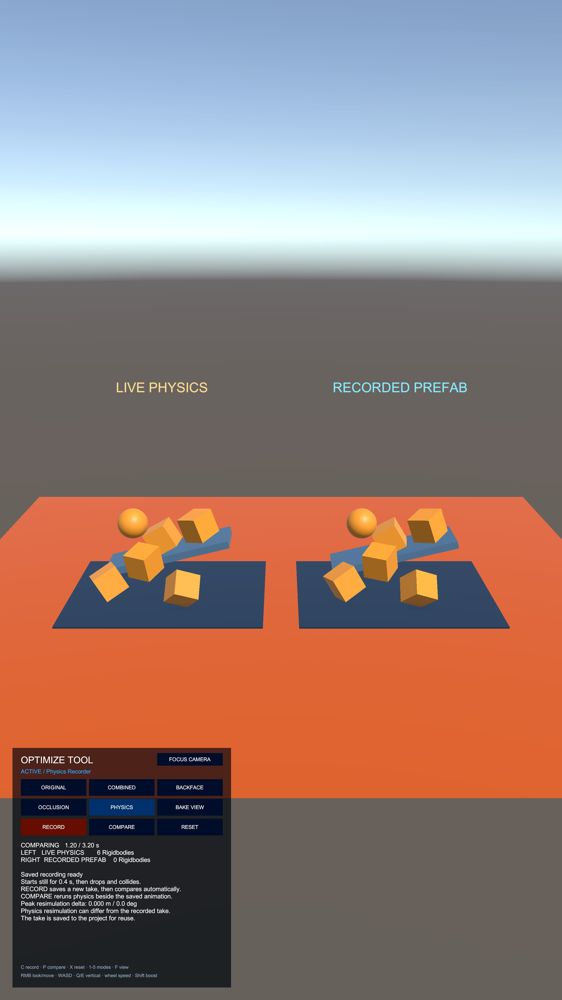

# PhysicsRecorder 리팩터링 후 재검토·실제 씬 검증

검증일: 2026-10-24. Unity 2023.2.20f1 Editor 기준이다. PhysicsRecorder 관련 소스는 리팩터링 최종 검증본과 같았으며 이번 재검토에서 추가 회귀 결함은 재현되지 않았다. 제품 코드는 수정하지 않았다.

## 코드 검토와 회귀 검사

녹화기 수명주기·완료 결과, 읽기 전용 녹화 데이터, 정지 구간·종료 보간, 동기 저장과 실패 복원, Prefab 재생 소유권과 데모 연결을 다시 확인했다.

- EditMode: **61/61 통과**.
- PlayMode: **15/15 통과**.
- 전체 OptimizeTool 테스트 어셈블리를 별도 프로젝트 복사본에서 실행했다. 실제 물리 녹화, 시작·종료·정지 보존, GUID·Clip 참조 유지, 실패 복원, 비활성화·재녹화·Reset·모드 전환·0.53초 종료 보간과 기존 메시 비교 검사를 포함한다.
- 테스트 이후 다른 작업으로 변경된 `OptimizeToolPerformanceBenchmark.cs`와 `OptimizeToolBenchmarkEditor.cs`는 이 실행 결과의 소스 스냅샷에 포함되지 않는다. PhysicsRecorder 리팩터링 대상 소스는 최종 대조 시에도 동일했다.

## OptimizeToolSample에서 실제 실행

Unity Editor의 실제 `OptimizeToolSample` 씬에서 PHYSICS 모드를 선택하고 RECORD·RESET·COMPARE 버튼 이벤트를 실행했다. 기본 저장 경로와 3.2초 설정을 사용했다.

| 항목 | 관찰 결과 |
| --- | --- |
| 물리 원본 | Rigidbody 6개, FixedUpdate 시뮬레이션 |
| 시작 정지 | 약 0.15초 관찰에서 모두 Kinematic, 위치 변화 0.001m 미만 |
| 실제 움직임 | 약 0.80초에 동적 Rigidbody의 낙하·충돌 움직임 관찰 |
| 저장 | 실제 길이 3.2초, 종료 이유 DurationReached, 기본 `.anim`·`.prefab` 저장·연결 성공 |
| 출력 데이터 | Legacy 커브 49개, 모든 커브의 시작 0초·종료 3.2초 키 및 0.2초 정지 구간 확인 |
| 참조 보존 | AnimationClip·Prefab GUID 유지, Prefab의 기본 클립 연결 유지 |
| Prefab 구성 | Rigidbody 0개, Collider 0개, MonoBehaviour 0개 |
| 단독 재생 | 별도 위치에 생성한 Prefab이 자동 재생하며 정지→움직임→종료 자세를 재현 |
| 단독 재생 종료 | 저장 클립을 종료 시각에 샘플링한 기준과 위치·회전 차이 0 |
| Reset·Compare | 정상 완료, 저장 파일 바이트 변경 없음 |
| 기존 메시 모드 | Renderer 9/1/1/1, Triangle 108/108/30/36으로 전환 확인 |
| Play 재진입 | Play 종료·강제 재임포트 후 재진입해 재녹화 없이 저장 Prefab을 불러와 비교 완료 |
| 콘솔 | 오류·경고 0개 |

아래 화면은 실제 Game View에서 비교 재생 1.20초에 캡처했다.

## 물리 재실행 차이와 변경 범위

물리 원본을 다시 시뮬레이션하는 비교는 기록된 클립과 항상 일치하는 동작을 보장하지 않는다. 첫 비교와 Play 재진입 비교에서 관찰한 최대 위치 차이는 약 0.000882m였고, 다른 반복에서는 약 0.108m·12.92도의 최대 차이가 관찰됐다. 이는 단독 Prefab 재생의 저장 클립 일치 검사와 구분해 기록했다.

검증을 위해 기본 녹화 에셋을 실제로 다시 저장했다. 기존 녹화는 로그 폴더에 백업했고, 새 녹화로 `.anim` 내용이 갱신됐다. Prefab은 동일한 초기 구조와 동일한 Clip GUID를 참조하므로 파일 바이트도 같았다. 씬·쇼케이스 Prefab·설정·기존 메타 파일은 변경되지 않았다. 검증 후 Play를 종료했으며 씬은 저장되지 않은 변경 없이 복원했다.

원시 관찰값·C# 검증 코드·스크린샷·XML·소스 해시는 `ToyProject/Logs/PhysicsRecorderPostRefactorReview/`에 있다. 별도 Player·디바이스 실행, 장시간 녹화와 모든 사용자 계층 조합에 대한 검증은 포함하지 않는다.
