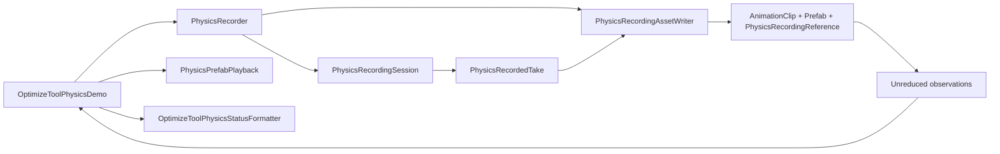

# PhysicsRecorder 책임 분리와 검증

2026-10-24 기준. 기존 `PhysicsRecorder` 및 `OptimizeToolPhysicsDemo` MonoBehaviour의 파일·GUID·직렬화 필드와 공개 API를 유지했다. 기존 asmdef는 변경하지 않았다.

## 책임과 실행 순서

- `PhysicsRecorder`: 설정과 Transform 계층 검증, Unity 수명주기, 물리 스텝 후 관찰, 저장 실행과 결과 공개를 담당한다. 초기화·오류 상태와 별도로 `Idle / Recording / Saving` 단계를 관리한다.
- `PhysicsRecordingSession`: 전달받은 로컬 자세와 시간만 사용해 정지 구간 압축, 표본 간격, 종료 자세를 결정한다. 완료 후 읽기 전용 `PhysicsRecordedTake`를 공개하며 추가 관찰·중단 요청은 거부한다. Transform, AssetDatabase, 코루틴에 의존하지 않는다.
- `PhysicsPoseSample`: 위치·회전·시각을 함께 보관한다. 녹화와 비교 재생이 같은 종료 보간 함수를 사용한다.
- `PhysicsRecordingAssetWriter`: 커브 생성, 비활성 Preview Scene 복제, 물리·게임 스크립트 제거, 에셋 저장·연결 확인과 실패 복원을 담당한다.
- `PhysicsRecordingResult`: 실제 길이, 종료 이유, Clip, Prefab, 예외 및 측정값을 보관한다. 기존 `IsSaveCompleted / ResultClip / ResultPrefab`은 이 결과를 읽는다. 성공 결과는 Release 후에도 유지하고 다음 녹화 시작 때 비운다. `LastError`는 기존처럼 Release에서 초기화한다. Release 후 Init에 실패하면 저장 완료 상태는 실패로 바뀌지만 이전 Clip·Prefab 참조는 기존 API와 동일하게 유지한다.
- `OptimizeToolPhysicsDemo`: 물리 시나리오와 녹화·비교 진행을 제어한다. 정상 종료와 비활성화는 동일한 결과 반영 함수를 사용한다. 첫 물리 틱 전 취소와 이전 오류 해제 후 취소도 지원한다.
- `PhysicsPrefabPlayback`: 검증된 재생 인스턴스와 Animation을 소유한다. 생성 도중 검증 실패 시 인스턴스를 비활성화·폐기하며, 외부에서 인스턴스를 삭제한 뒤 Reset해도 복구할 수 있다.
- `OptimizeToolPhysicsStatusFormatter`: 기존 상태 문구를 생성한다. 공개 `GetStatusText()`는 호환성을 위해 유지한다.

## 보존한 저장 계약

`StopRecording()`은 AnimationClip·Prefab·PhysicsRecordingReference가 모두 저장·연결 확인된 뒤 반환한다. 시작·종료 자세, 정지 구간, Legacy 자동 재생과 원본 계층 보존을 유지했다. 덮어쓰기는 기존 GUID와 Clip 참조를 유지하며, 실패하면 세 에셋과 메타를 복원하거나 불완전한 새 출력을 제거한다. 비활성화·Release 중 녹화도 동기로 마무리한다. 자동 비동기 저장이나 Editor 어셈블리로의 이동은 적용하지 않았다.

`Stopped`는 공개 StopRecording 호출, `Disabled`는 녹화기 자신의 OnDisable, `Released`는 Release, `DurationReached`는 지정 길이 도달을 뜻한다. 데모가 비활성화되면서 공개 StopRecording을 먼저 호출한 경우에는 `Stopped`로 남는다.

## 단계별 검증

| 단계 | EditMode | PlayMode | 검증 내용 |
| --- | ---: | ---: | --- |
| 1 | 33/33 | 12/12 | 완료 결과·중단 이유, 정상 종료와 비활성화의 결과 반영 통합 |
| 2 | 40/40 | 12/12 | 순수 샘플링 세션, 정지·시간·Quaternion·완료 데이터 보호 |
| 3 | 57/57 | 13/13 | 저장 분리, 기존 API·직렬화 필드·실제 Prefab 연결, GUID·실패 복원 |
| 4 | 57/57 | 14/14 | 재생·표시 분리, 검증 실패 인스턴스 정리 |
| 5 | 59/59 | 14/14 | 단계별 비용·키 수·덮어쓰기 백업 크기 측정 |
| 최종 | 61/61 | 15/15 | 진행 단계 단일화, 이전 오류 해제 후 취소, 재생 객체 외부 삭제 후 Reset, 초기화 실패의 기존 결과 참조 유지 |

표는 각 시점의 OptimizeTool 테스트 어셈블리 전체 결과다. 공유 작업 공간에 추가된 다른 OptimizeTool 테스트도 포함하므로 모든 증가분이 이번 리팩터링에서 추가된 것은 아니다. 최종 소스에 대한 추가 회귀 검사 결과와 각 단계 XML·로그·소스 해시는 `ToyProject/Logs/PhysicsRecorderRefactor/`에 보관한다.

매 단계 원래 씬·Prefab·Settings와 두 기존 MonoBehaviour 메타 파일 35개의 SHA-256이 같음을 확인했다. 실제 Prefab에 포함된 여러 녹화기 중 데모의 `_recorder`가 연결한 컴포넌트를 기준으로 직렬화 참조를 검증한다.

## 비용 측정

성능 측정은 Editor EditMode에서 로컬 Transform 16개·128개, 0.4초 구간의 21회 관찰을 공급해 실제 Clip·Prefab을 생성하는 검사다. 물리 시뮬레이션·Player·디바이스 성능 측정은 아니다. 정상 완료 결과의 `Result.Metrics`에서 다음 값을 읽을 수 있다.

- Transform 수, 초기 자세를 포함한 관찰 횟수, 저장된 자세 키 수
- 계층 검증·자세 수집/샘플링 누적 시간
- 커브 생성·Prefab 준비·에셋 저장·전체 내보내기 시간
- 덮어쓰기 전에 백업한 기존 `.anim`·`.prefab`의 실제 바이트 수

5단계의 단일 실행 관측값:

| Transform | 저장 자세 키 | 계층 검사 ms | 샘플링 ms | 커브 생성 ms | 에셋 저장 ms | 전체 내보내기 ms |
| ---: | ---: | ---: | ---: | ---: | ---: | ---: |
| 16 | 317 | 0.129 | 0.114 | 2.092 | 46.725 | 49.123 |
| 128 | 2,669 | 0.993 | 0.804 | 19.622 | 104.132 | 124.518 |

실행 환경·캐시·동시 작업에 따라 달라지는 관측값이며 속도 개선이나 처리 시간 상한을 보장하지 않는다. 이 구간에서는 에셋 저장 비용이 컸다. 추가 최적화는 저장 크기와 임포트 비용을 더 측정한 뒤 판단할 수 있다. 실제 관리/네이티브 피크 메모리, 대량 게임 스크립트 의존성 제거, 장시간 녹화는 별도 측정이 필요하다.

## 2026-10-24 수명주기·검증·복구 보강

- `OptimizeToolShowcaseUI`는 패널 생성과 버튼 연결을 분리한다. OnEnable에서 기존 패널·버튼·Text를 다시 찾고 자신이 소유한 콜백만 연결/해제한다. 재컴파일 후 readonly 캐시와 런타임 리스너가 사라져도 패널을 중복 생성하지 않으며 다른 코드가 연결한 리스너는 제거하지 않는다.
- `OptimizeToolPhysicsDemo`의 상태·오류·월드 라벨 전환은 `SetState`로 모았다. 비교 시작 및 매 스텝의 예외는 ERROR로 전환하고 재생 인스턴스와 코루틴 참조를 정리한다. 관찰 검사 개수는 해당 프레임 전체의 비교가 끝난 뒤 증가한다. 컴포넌트 비활성화로 비교가 취소되면 READY로 돌아간다.
- Editor의 `beforeAssemblyReload`에서 기존 비활성화 경로로 작업을 마무리하고, 관리 객체 소유권이 사라지기 전에 재생 인스턴스를 제거한다. 재컴파일 시 녹화의 동기 저장을 시도하지만 Unity 임포트 단계에서 Prefab 임포트 결과를 받을 수 없는 경우에는 기존 실패 계약을 따른다. 이전 파일·메타를 복원하고 ERROR를 표시하며 재로드 후 Compare/Record로 복구할 수 있다. 재컴파일을 넘겨 녹화를 자동으로 계속하거나 저장을 비동기로 넘기지 않는다.
- `PhysicsPlaybackPolicy`가 출력에서 제거하고 입력에서 거부할 물리 컴포넌트 정책을 공유한다. 재생 복제본은 비활성 부모 아래에서 검증하며, 게임 스크립트·누락 스크립트·2D 물리·Cloth·Animator·물리 ParticleSystem 등은 재생 전에 거부한다. 초기 자세를 적용하고 검증한 뒤 활성화한다. 샘플이 사용하지 않던 Body 접근자와 트랙 배열 소유권은 제거했다.
- `PhysicsRecordingReference`는 Clip 연결·길이, 트랙 경로, 배열 크기, 관찰 시각의 정렬, 위치·회전의 유효성을 비교 시작 전에 검사한다. 기준이 없는 기존 Prefab의 재생과 손상된 기준 데이터의 오류 처리를 구분한다. 이미 알고 있는 관찰 인덱스는 직접 조회하고, 화면 표시용 보간 구간은 프레임마다 한 번만 찾는다. 기존 공개 Sample API와 직렬화 형식은 유지한다.
- `PhysicsRecordingAssetWriter`는 기존 `AssetFileSnapshot`을 재사용한다. 스냅샷은 본문과 메타를 보관하고 복구 실패를 함께 보고한다. `BackupBytes`는 호환성을 위해 기존처럼 에셋 본문 바이트 합을 의미한다. 저장 순서, GUID 유지, Clip 연결 검사와 동기 결과 발행은 유지한다.
- Settings는 불변 값으로 보관한다. Recorder.Release는 작업 버퍼의 참조도 비우지만 이미 발행한 Result는 유지한다. 같은 예외가 안팎의 실패 경계를 통과할 때 Fault 결과를 중복 발행하지 않는다.

기존 MonoBehaviour·ScriptableObject와 공개 API를 유지한다. Board의 공개 수명주기와 직렬화 참조도 보존했으며, 구현이 하나인 각 클래스에 새 인터페이스를 추가하지 않았다. 전체 관찰값의 메모리 사용량은 여전히 트랙 수×관찰 수에 비례한다. 이번 개선은 디바이스 성능이나 장시간 녹화의 메모리 상한을 검증한 결과가 아니다. 단계별 검사와 실제 클릭 증거는 PhysicsRecorderRegressionValidation.md의 마지막 절을 참조한다.

### 비활성 데모의 재로드 정리 보완 (2026-10-24 재검토)

데모를 비활성화하면 정지된 재생 인스턴스를 계속 소유할 수 있으므로, 재컴파일 정리 콜백은 OnDestroy까지 유지한다. OnEnable과 CreatePlayback에서 중복 없이 등록하고 파괴 시 해제한다. CreatePlayback의 등록은 비활성 상태에서도 호출 가능한 기존 ResetDemo 계약을 지원한다. 기존에는 비활성화 → 재컴파일 후 관리 소유권을 잃은 인스턴스 1개가 남고 COMPARE 재시작 시 2개가 됐다. 실제 두 번의 재컴파일에서 잔여 인스턴스 0개, 이후 정상 재생에서 1개를 확인했다. 공개 API·직렬화 필드·저장 구현은 변경하지 않았다.

### 소유자 파괴 후 UI 바인딩 정리와 자동 검사

OverviewController는 데모 존재 여부가 바뀌면 PresentationChanged를 발행한다. 파괴된 데모의 관리 참조도 비우며, 없는 데모의 메서드·상태·뷰를 읽지 않는다. UI는 이 갱신에서 물리 버튼 3개의 소유 콜백을 해제하고 버튼을 비활성화한다. 공통 모드·카메라 버튼은 유지한다. 재로드 후 UI를 다시 바인딩할 때에도 없는 데모에 콜백을 연결하지 않는다. 이 경계는 PhysicsDemoReloadLifecycleTests와 PhysicsDemoDestroyTests에서 실제 재컴파일, 반복 RESET, 활성/비활성 컴포넌트 파괴, 재생 및 이벤트 호출 목록을 함께 검사한다.
