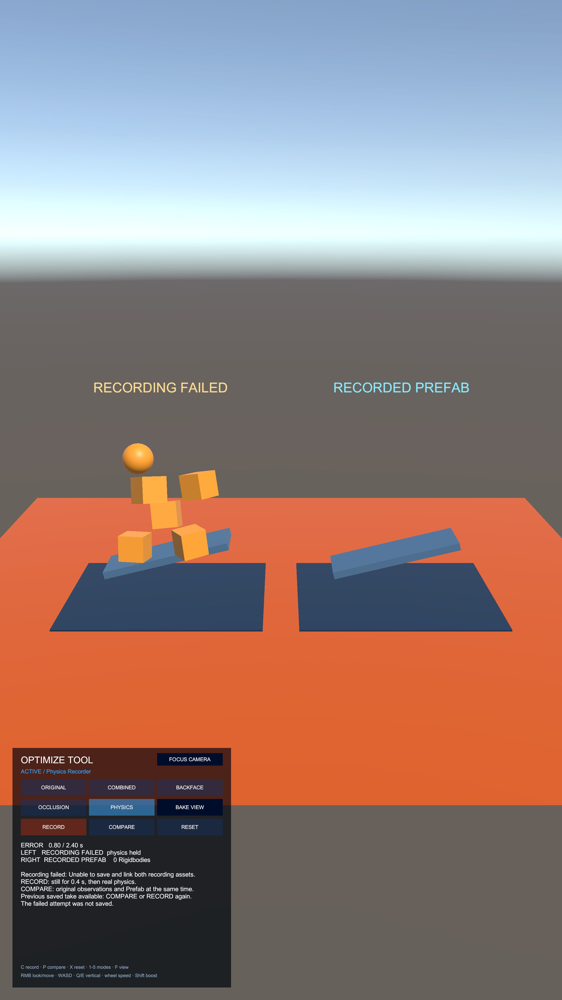
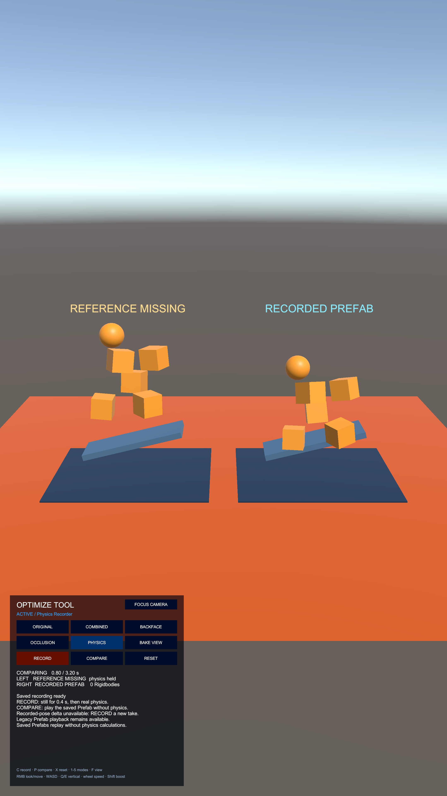

# PhysicsRecorder 재녹화·저장 실패·기존 Prefab 회귀 검증

검증일: 2026-10-24. Unity 2023.2.20f1의 `OptimizeToolSample`과 전체 OptimizeTool 테스트 어셈블리를 대상으로 확인했다.

## 재검토에서 발견해 수정한 표시 문제

- 새 녹화 중에도 이전 기준 데이터의 길이를 표시했다. 실제 Editor에서 새 길이를 0.87초로 바꿔 RECORD를 누르면 `RECORDING 0.00 / 3.20 s`가 나왔다. 녹화 중에는 현재 설정 길이를 사용하고, 이전 오차·검사 개수를 초기화하며 `Capturing original physics observations`를 표시하도록 수정했다.
- 기준 데이터가 없는 기존 Prefab은 클립 길이 대신 현재 녹화 설정 길이를 표시할 수 있었다. 재생 중에는 실제 클립 길이를 사용하도록 수정했다. 0.65초 녹화 설정에서 3.2초의 기존 클립을 재생했을 때 `3.20 / 3.20 s`를 확인했다.

제품 코드 변경은 `OptimizeToolPhysicsDemo.Record()`의 비교 수치 초기화와 `OptimizeToolPhysicsStatusFormatter`의 상태 표시로 한정했다. 저장·복원 코드, 공개 API, 직렬화 필드와 참조는 그대로다.

## 자동 회귀 검사

별도 프로젝트 복사본에서 그래픽을 활성화한 Unity batchmode로 실행했다.

| 어셈블리 | 결과 |
| --- | --- |
| Common.OptimizeTool.Tests / EditMode | **65/65 통과** |
| Common.OptimizeTool.PlayModeTests / PlayMode | **23/23 통과** |

이번에는 아래 PlayMode 테스트 4개를 추가했다. 기존 물리·커브 보존·참조·메시 비교 검사도 함께 실행했다.

- 길이가 다른 두 번의 녹화에서 세 에셋 GUID 유지, Clip·기준 데이터 갱신, 재녹화 상태 초기화.
- 신규 저장 실패에서 부분 파일·메타 제거, 실패 결과 미발행, 후속 재녹화 복구.
- 덮어쓰기 실패에서 세 파일·메타 복원, 복원한 녹화의 Compare, 후속 재녹화 복구.
- 기준 데이터가 없는 녹화의 재생·Reset·모드 전환과, 재녹화 시 기존 Clip·Prefab GUID를 유지한 기준 데이터 추가.

## 실제 OptimizeToolSample 실행

실제 씬의 RECORD·COMPARE·RESET 버튼 이벤트를 사용했다. 기본 녹화 에셋을 보존하기 위해 출력 폴더만 임시 Assets 폴더로 지정했다. 실패는 `AssetDatabase.StartAssetEditing()` 안에서 동기 저장을 호출해 Prefab 임포트 결과를 받을 수 없도록 주입했다. 임포트 중단 상태는 같은 호출의 finally에서 복원했고 프레임을 넘기지 않았다.

| 시나리오 | 실제 관찰 |
| --- | --- |
| 첫 저장 실패 | `.anim`·`.prefab`·`.reference.asset`과 각 `.meta`가 모두 제거됨. 성공 결과 미발행, 원본 Rigidbody 정지, 재녹화 가능 |
| 첫 실패 후 복구 | 0.53초 실제 녹화·저장·원본 기준 비교 완료, Fault 해제 |
| 재녹화 | 0.53→0.87초 갱신, 세 GUID 유지, Clip·기준 데이터 내용 갱신, 기준의 Clip 연결·길이·전체 관찰 검사 확인 |
| 재녹화 UI | 0.87초 설정과 검사 개수 0으로 시작, 이전 녹화의 검사 결과를 표시하지 않음 |
| 덮어쓰기 실패 | 이전 세 파일과 세 메타의 SHA-256 모두 일치. 실패 상태에서 Compare·Record 사용 가능 |
| 복원한 녹화 재생 | 이전 0.87초 기준 데이터로 전체 검사 완료, 파일 내용 변경 없음 |
| 실패 후 재녹화 | 0.65초 저장·비교 완료, Fault·LastError 해제 |
| 실제 이전 Prefab | 기준 데이터 추가 전 백업의 3.2초 Clip·Prefab을 사용. 복사본의 Clip GUID 연결만 맞추고 물리 기록 내용은 유지 |
| 기준 없는 재생 | 오른쪽 Prefab 움직임 확인. Rigidbody·Collider·MonoBehaviour 0개, 왼쪽 원본은 Kinematic 유지 |
| 기준 없는 오차 | `unavailable` 표시, 오차 API는 NaN, 검사 개수 0. 기준 없는 재생을 오차 0인 비교로 표시하지 않음 |
| Reset·모드 전환 | 기존 Prefab 재생 재시작 성공, 기존 두 파일·메타 바이트 유지 |
| 기존 Prefab 재녹화 | Clip·Prefab GUID를 유지하며 0.77초 녹화와 기준 에셋 생성·비교 완료 |
| 콘솔 | 의도한 저장 실패 예외 2건. 그 외 오류·경고 0건 |

이번 짧은 녹화에서는 0.87초의 관찰 45개, 0.77초의 관찰 40개를 모두 검사했다. 관찰한 최대 위치·회전 오차는 약 0.001962m·0.000309°였다. 이는 해당 녹화의 표본 간격·임계값에 따른 커브 오차를 그대로 측정한 값이며, 기준이 없는 기존 Prefab에는 이 수치를 적용하지 않는다. 이전에 검증한 기본 3.2초 녹화 파일은 이번 작업에서 갱신하지 않았다.

## 보존과 증거

최종 소스가 테스트 스냅샷과 같은지 대조했다. 검증 전후 씬·쇼케이스 Prefab·기본 녹화·설정·기존 메타 파일의 해시가 모두 같았다. Play를 종료하고 씬 dirty=false 상태로 복원했다. 임시 Assets 폴더와 별도 테스트 프로젝트도 제거했다.

증거는 `ToyProject/Logs/PhysicsRecorderRegressionReview/`에 보관했다. `editmode.xml`, `playmode.xml`, `native-results.json`, `ui-before-fix.json`, 검증 C# 코드·스크린샷·생성 에셋 사본을 포함한다. 첫 native 검증 복사본의 파일명과 내부 이름이 달라 발생했던 경고도 `native-attempt1/`에 보존했으며, 원래 파일명을 유지한 최종 검증에서는 해당 경고가 없었다.

이 결과는 위 저장 실패 주입과 Editor 실행에 대한 검증이며 Player·디바이스 검증은 포함하지 않는다.

## 최종 실제 UI 검토 (2026-10-24)

Game 뷰의 실제 입력과 렌더링까지 추가로 확인하면서 저장 실패 표시의 불일치를 발견했다. 패널은 `ERROR`였지만 왼쪽 월드 라벨에는 `LIVE RECORDING`이 남았다. 또한 실패한 새 녹화의 경과 시간 옆에 이전 클립 길이가 표시됐고, 기준 없는 기존 Prefab에도 기준 데이터를 함께 비교한다는 공통 안내가 나왔다.

- 실패 전환 시 패널과 월드 라벨을 `RECORDING FAILED`로 맞추고, 시간 분모에는 실패한 녹화의 설정 길이를 사용한다.
- 실패 화면은 이전 녹화의 유무에 따라 Compare 가능 또는 Record 재시도를 안내한다. 실패한 시도의 오차를 성공한 비교처럼 표시하지 않는다.
- 컴포넌트 비활성화로 중단 저장한 경우도 저장을 수락할 때 월드 라벨을 갱신한다.
- 기준 없는 Prefab에는 물리 없는 재생 안내를 표시하고, 기준 데이터가 저장돼 있다는 공통 문구를 제거했다.

공개 API, 직렬화 필드, 저장·복원 구현은 변경하지 않았다. 기존 PlayMode 테스트에 실패 화면·버튼 활성 상태·중단 저장 라벨·기존 Prefab 안내 검사를 추가했다. 전체 **EditMode 65/65**, **PlayMode 23/23**이 통과했으며, 마지막 안내 문구 변경 후에도 PlayMode **23/23**을 다시 통과했다.

### 실제 UI 입력과 결과

Unity 2023.2.20f1의 열린 `OptimizeToolSample`에서 9:16 Game 뷰(2160×3840)를 사용했다. RECORD·COMPARE 버튼은 EventSystem으로 선택한 뒤 네이티브 Enter 입력으로 Submit했고, `C/P/X/1/5` 키로 녹화·재생·Reset·모드 전환을 실행했다. 상태 관찰 코드는 화면 텍스트와 버튼 상태를 읽고 스크린샷을 저장했으며 데모 실행 메서드를 호출하지 않았다. 실패 주입과 임시 출력 경로·녹화 길이·기존 Prefab 지정만 MCP로 설정했다.

| 시나리오 | 실제 UI 및 저장 결과 |
| --- | --- |
| 재녹화 | 3.7→1.7초로 변경. 새 길이·`Capturing` 표시, 이전 검사 수치 초기화, 녹화 중 Record·Compare·Reset·모드 버튼 비활성. 세 메타 유지, Clip·기준 데이터 갱신 |
| 덮어쓰기 실패 | `ERROR 0.80 / 2.40 s`, `RECORDING FAILED`, 이전 녹화 재생 안내. 세 파일·메타 해시 복원 확인 |
| 실패 복구 | COMPARE 버튼 Submit으로 이전 1.7초 녹화 재생, 87/87 관찰 검사. 이후 C 입력으로 0.95초 저장·49/49 검사 완료, 오류 해제 |
| 첫 저장 실패 | `ERROR 0.50 / 1.40 s`, 저장된 녹화 없음 안내, Compare 비활성·Record/Reset 활성. 부분 파일·메타 없음. 재시도 후 1.4초 저장·72/72 검사 완료 |
| 실제 이전 Prefab | 기준 추가 전 백업의 3.2초 클립을 사용. 설정 1.4초와 무관하게 재생 시간은 `/ 3.20 s`. 오른쪽 움직임, 왼쪽 정지, `REFERENCE MISSING`·`unavailable` 표시 |
| Reset·모드 전환 | X→1→5→P 입력 후 기존 Prefab 재생 재시작. 기존 두 에셋·메타 해시 유지 |
| 표시 영역 | 상태 전환 34개 스냅샷에서 버튼 상태·월드 라벨·실제 UGUI Text 확인. 상태 텍스트 필요 높이 최대 139.5, 영역 높이 216으로 잘림 없음 |
| 콘솔 | 수정 후 실패 주입 예외 2건, 그 외 예상하지 못한 오류·경고 없음 |

검증 증거는 `Logs/PhysicsRecorderFinalUIReview/`의 `ui-timeline.json`, `ui-checks.json`, `error-before-fix.json`, `legacy-final-ui.json`, `editmode.xml`, `playmode-final.xml`, 스크린샷 및 임시 생성 에셋 사본에 있다. 데스크톱 자동화의 좌표 클릭에서는 게임 내 동작이 확인되지 않아 입력 검증은 버튼 Submit과 단축키로 수행했다. 따라서 물리 마우스 클릭 경로를 검증했다고 주장하지 않는다. 실패 주입은 동기 임포트 결과 실패이며 실제 디스크 장애나 Player·디바이스 테스트는 포함하지 않는다.

마지막으로 씬·Prefab·설정에 속한 기존 파일 58개의 해시가 모두 유지됐고, 테스트한 소스와 최종 소스가 일치함을 확인했다. 임시 Assets 폴더와 테스트 프로젝트를 제거하고 Play 종료·씬 dirty=false·기존 Game 뷰 레이아웃으로 복원했다. 최종 콘솔 오류·경고는 0건이다.

## 실제 마우스 클릭 경로 검증 (2026-10-24)

앞 절의 미확인 항목인 마우스 입력 경로를 추가로 검증했다. 사용자 승인 후 macOS CGEvent로 실제 포인터를 이동하고 좌클릭했다. `onClick.Invoke`, 데모 실행 메서드 호출, 키보드 Submit은 이 검증의 실행 경로로 사용하지 않았다. 버튼에 붙인 임시 관찰자는 PointerDown·PointerUp·PointerClick과 기존 버튼 콜백 이후 상태를 기록했다. MCP는 출력 경로·기간·기존 Prefab 설정, 실패 주입, 상태 관찰에 사용했다.

기존 화면 자동화 도구에서는 클릭 신호와 Unity의 실제 포인터 좌표가 불일치했다. CGEvent를 사용한 뒤 버튼 위치와 PointerDown·Up·Click 연결을 확인했다. 검증 중 다른 모듈의 동시 수정으로 Play 중 어셈블리가 다시 로드되어 런타임 리스너가 소실된 세션도 있었다. 이 세션은 최종 성공 증거에서 제외했다. 마지막 재검증에서는 자동 새로고침과 어셈블리 재로드를 잠시 보류했고, 종료 후 모두 해제했다. Play 중 스크립트 재컴파일의 UI 복구까지 보장하는 검증은 아니다.

### 추가 수정

`LastError`가 빈 문자열일 때 정상 READY 화면에도 내용 없는 `Recording failed:`가 표시됐다. 상태 포맷터에서 null과 빈 문자열을 모두 오류 없음으로 처리한다. 공개 API·씬·Prefab 참조와 저장 구현은 변경하지 않았다. 빈 오류 문자열을 설정한 실제 패널에서 `Saved recording ready`를 확인했고, 저장 결과가 없는 READY 패널도 PlayMode 회귀 테스트로 검사했다.

수정된 소스로 **EditMode 65/65**, **PlayMode 24/24**를 통과했다. 테스트용 프로젝트 복사본을 사용했고, 최종 OptimizeTool 소스 해시가 테스트한 소스와 일치했다.

### 클릭 결과

| 실제 클릭 경로 | 확인 결과 |
| --- | --- |
| PHYSICS → RECORD → RECORD | 3.7초 187개 관찰 → 1.7초 87개 관찰로 재녹화. 세 에셋 내용 갱신, 세 메타와 GUID 유지 |
| 녹화 중 COMPARE·RESET·ORIGINAL·RECORD | PointerClick은 들어오지만 비활성 버튼 콜백은 실행되지 않음. 녹화 중단·중복 시작·모드 전환 없음 |
| 덮어쓰기 실패 → COMPARE | 실패한 세 파일과 메타가 모두 이전 바이트로 복원. ERROR·RECORDING FAILED·이전 녹화 안내 표시. 1.7초 기존 녹화의 87개 관찰 전체 비교 |
| 실패 후 RESET → RECORD | READY·검사 개수 0으로 초기화하고 새 녹화·저장·비교 완료. 오류 해제 |
| 첫 저장 실패 → COMPARE → RECORD | 부분 에셋·메타 없음. 비활성 COMPARE 클릭은 실행되지 않음. RECORD 재시도로 1.4초·72개 관찰 저장 및 비교 |
| ORIGINAL·COMBINED·BACKFACE·OCCLUSION·PHYSICS | 각 버튼의 포인터 이벤트와 실제 모드 0·1·2·3·4 전환 확인. BAKE VIEW·FOCUS CAMERA 버튼 콜백도 확인 |
| 기준 없는 기존 Prefab → COMPARE | 기준 추가 전의 3.2초 클립 재생 완료. 원본 정지, Prefab 움직임, Rigidbody·Collider·MonoBehaviour 0개, `REFERENCE MISSING`·`unavailable`·NaN 오차 유지 |
| 기존 Prefab → RESET → 모드 전환 → COMPARE | 재생 재시작 및 종료 확인. 기존 Clip·Prefab·메타 해시 유지 |
| 수정 후 반복 | 1.4→0.95초 재녹화, 덮어쓰기 실패 복원, COMPARE 49/49, RESET 후 재녹화 72/72, 전체 모드 전환과 기존 Prefab 재생 재확인 |

두 유효 세션에서 **PointerClick 42건, ButtonAction 37건**을 기록했다. 차이 5건은 의도한 비활성 버튼 클릭이다. 10개 버튼 모두 실제 클릭 콜백이 확인됐다. 상태 스냅샷은 66개이며 별도 결과 검사 **28/28**을 통과했다. 최초 3.7초 녹화의 최대 관찰 오차는 약 **0.00000768m / 0.000934°**였다. 실패 주입 예외는 첫 세션 2건, 수정 후 세션 1건이며 그 외 오류·경고는 없었다.

증거는 `Logs/PhysicsRecorderMouseReview/`에 보관했다. `mouse-events.json`, `timeline.json`, `checks.json`, `postfix/`, `editmode.xml`, `playmode.xml`, 화면 캡처와 `generated-assets/`가 포함된다. `interrupted-postfix/`는 동시 재컴파일로 중단된 진단 자료이며 성공 집계에 포함하지 않았다. 실패 주입은 동기 임포트 실패이고, 디스크 장애·Player·디바이스 검증은 포함하지 않는다.

검증 시작 시점의 OptimizeTool 파일 471개 중 이번 수정 파일 3개를 제외한 468개가 그대로 유지됐다. 씬·Prefab·기본 녹화·설정의 기존 참조와 메타는 변경하지 않았다. 임시 Assets 폴더와 테스트 프로젝트를 제거했고, Play 종료·씬 dirty=false·Game 뷰 최대화 해제 상태로 복원했다.

## 우선순위 개선 후 재컴파일·예외·실제 클릭 검증 (2026-10-24)

이번 작업은 UI 복구와 비교 예외 처리를 먼저 적용한 뒤, 재생 입력 검증·메타 복원·작업 상태 정리를 진행했다. 기존 공개 API, 직렬화 필드, MonoBehaviour/ScriptableObject GUID, 세 에셋의 동기 저장과 덮어쓰기 계약을 유지했다. 구현별 책임은 PhysicsRecorderRefactoring.md의 마지막 절에 정리했다.

### 단계별 자동 검사

Unity 2023.2.20f1에서 별도 프로젝트 복사본을 사용했다. 현재 저장소에는 다른 OptimizeTool 작업도 동시에 반영돼 전체 테스트 수가 이전 검증보다 증가했다.

| 단계 | 범위 | 결과 |
| --- | --- | --- |
| 1: UI 재연결·비교 실패 정리 | 물리 PlayMode | **23/23** |
| 2: 입력 검증·복구 공통화·버퍼 정리 | 물리 EditMode / PlayMode | **36/36 / 25/25** |
| 최종: 최신 공통 소스 통합 | 전체 Common.OptimizeTool.Tests / Common.OptimizeTool.PlayModeTests | **92/92 / 36/36** |

추가 검사는 패널 재연결과 외부 리스너 보존, 비교 도중 재생 인스턴스 삭제 후 재시도, 첫 비교 틱 전 비활성화, 복제된 게임 스크립트의 Awake 차단, 2D 물리와 손상된 기준 데이터 거부, 관찰 인덱스/프레임 샘플링, Release의 버퍼 정리와 결과 유지, 메타 복원 및 메타만 남은 부분 출력 제거를 다룬다. 기존 API·직렬화 참조·세 GUID·정지 구간·종료 자세·신규 저장 실패·덮어쓰기 실패·기존 Prefab 재생 테스트도 통과했다.

중간 전체 검사에서는 동시 작업 중인 벤치마크 소스의 컴파일 불일치와 메시 Undo/Redo 검사 1건 실패가 있었다. 메시 실패는 이번 변경 전 소스로 복원한 대조용 복사본에서도 재현했다. 최신 공통 소스를 반영한 최종 통합 검사에서는 모두 통과했다. 중간 실패 기록과 대조 실험은 성공 결과와 별도로 보관했다.

### 실제 Game View 입력

이전에 승인된 macOS CGEvent로 실제 포인터를 이동하고 좌클릭했다. 제품 동작을 시작할 때 데모 메서드나 onClick.Invoke, 키보드 Submit을 호출하지 않았다. MCP는 임시 출력 경로·길이·이전 Prefab 지정, 실패/재컴파일 조건 설정, 상태 관찰에 사용했다. 각 버튼의 PointerDown/Up/Click과 버튼 콜백 이후 상태를 별도로 기록했다.

| 실제 클릭·상황 | 관찰 결과 |
| --- | --- |
| 비교 중 재컴파일 → COMPARE | 0.14초 비교 시점에서 컴파일을 요청하고 실제 도메인 재로드 확인. READY, 재생 인스턴스·고아 인스턴스 0개. 재로드 후 COMPARE 클릭으로 기존 1.4초·72개 관찰의 비교 완료 |
| 재컴파일 후 RESET → RECORD | RESET의 검사 수치 초기화, 0.95초 재녹화·저장·49/49 관찰 비교 완료. 세 메타/GUID 유지 |
| COMPARE 도중 인스턴스 삭제 → COMPARE | ERROR와 PLAYBACK FAILED 표시, 재생 정리·원본 정지. 실제 COMPARE 재시도로 49/49 비교 완료 |
| RECORD 덮어쓰기 실패 → COMPARE → RESET | 이전 Clip·Prefab·Reference와 세 메타가 모두 바이트 단위로 복원. 기존 0.95초·49개 관찰 비교, RESET 복구 |
| 녹화 중 재컴파일 → COMPARE → RECORD | 0.65초에 컴파일 요청. Unity 임포트 단계에서 동기 Prefab 저장 결과를 받을 수 없어 ERROR로 전환하고 이전 여섯 파일을 복원. 재로드 후 실제 COMPARE로 이전 49개 관찰 비교, RECORD로 3.7초·187개 관찰 저장·비교 완료 |
| 녹화 중 COMPARE·RESET·ORIGINAL·RECORD | 포인터 이벤트가 발생해도 비활성 버튼 콜백은 실행되지 않음. 녹화·모드 유지 |
| 최초 저장 실패 → 비활성 COMPARE → RECORD | 부분 에셋과 메타 없음. COMPARE 클릭 차단. RECORD 재시도로 1.4초·72개 관찰 저장·비교 완료 |
| 기준 없는 실제 이전 Prefab → COMPARE | 기준 데이터 도입 전 백업의 3.2초 Clip·Prefab 사용. 왼쪽 원본 자세는 유지하고 오른쪽만 움직임. Rigidbody·Collider·MonoBehaviour 0개, NaN 오차·검사 수 0·unavailable 표시 |
| 기존 Prefab → 전체 모드 → RESET → COMPARE | ORIGINAL/COMBINED/BACKFACE/OCCLUSION/PHYSICS 각각 전환. BAKE VIEW/FOCUS CAMERA도 클릭 확인. 기존 Prefab 재생 재시작·완료와 네 파일의 바이트 보존 확인 |

유효한 두 관찰 구간에서 **PointerClick 30건**, 같은 프레임·버튼의 포인터와 연결된 **ButtonAction 25건**을 확인했다. 차이 5건은 의도한 비활성 클릭이다. 별도로 포인터와 연결되지 않은 RESET 콜백 1건은 실제 클릭 성공 집계에서 제외했다. 상태 스냅샷 44개에서 텍스트가 표시 영역 안에 들어갔다. 실제 클릭한 버튼은 총 10종이다.

재컴파일 요청 순간의 상태를 확정하기 위해 해당 틱에서 Time.timeScale을 잠시 0으로 고정하고, 도메인 재로드 이후 1로 복원했다. 다른 작업의 예고 없는 자동 리로드가 관찰 콜백을 없애는 것을 피하려고 자동 새로고침만 잠시 보류했다. 의도한 RequestScriptCompilation과 도메인 재로드는 허용했으며, 재컴파일을 막는 어셈블리 잠금은 사용하지 않았다. 종료 시 자동 새로고침 보류를 해제했다. 최초 관찰자가 소실된 구간과 관찰 도구의 대기 조건 오류는 성공 집계에 사용하지 않았다.

### 결과 보존과 범위

- 최종 테스트 스냅샷과 현재 OptimizeTool 스크립트 해시가 일치했다. 실제 Editor의 관련 어셈블리도 해당 소스가 수정된 이후 컴파일됐다.
- 시작 시점의 기존 씬·Prefab·Settings 파일 및 기존 메타 **425개**의 해시가 모두 유지됐다. 다른 작업의 소스 변경은 이번 작업의 수정으로 집계하지 않았다.
- 임시 Assets 폴더와 별도 테스트 프로젝트를 제거했다. Play 종료, 씬 dirty=false, Game View 최대화 해제, Time.timeScale=1, 자동 새로고침 보류 해제를 확인했다.
- 녹화 중 재컴파일을 넘겨 자동으로 녹화를 계속하거나, Unity가 임포트를 제한하는 시점의 저장 성공을 보장하지 않는다. 이때 동기 저장 실패를 표시하고 이전 녹화 복원 및 UI 재시도를 보장하는 경로를 검증했다.
- 실패 주입은 동기 임포트 실패와 재생 오브젝트 삭제다. 실제 디스크 장애·Player·디바이스·장시간 메모리 상한 시험은 포함하지 않는다.

증거는 `ToyProject/Logs/PhysicsRecorderHardening/`에 있다. `stage1/`, `stage2/`, `final-current/`의 NUnit XML·로그·소스 해시, `native/`의 포인터/상태 로그·화면 캡처·재컴파일 요청/저장 결과·에셋 사본, `mesh-baseline.xml`, `protected-files.json`, `editor-restored.json`, `summary.json`을 포함한다.

## 개선 후 재검토와 추가 회귀 검증 (2026-10-24)

재컴파일·비교 예외·저장 복원·기존 Prefab 재생 코드를 다시 검토하면서 추가 수명주기 결함을 발견했다. 데모 컴포넌트를 비활성화하면 beforeAssemblyReload 등록이 해제되지만, 정지된 재생 인스턴스는 남았다. 이 상태에서 실제 재컴파일 후 관리 객체는 사라지고 인스턴스 1개가 남았으며, COMPARE를 클릭하면 2개가 됐다.

수정은 OptimizeToolPhysicsDemo에 한정했다. 재로드 정리 등록을 소유자 파괴 시점까지 유지하고, OnEnable과 재생 인스턴스 생성 시 중복 없이 등록한다. 비활성 상태에서 기존 RESET 버튼으로 새 인스턴스를 만들더라도 다음 재컴파일에서 정리한다. OnDestroy에서 등록과 재생 인스턴스를 해제한다. 공개 API·직렬화 필드·씬/Prefab 참조와 동기 저장 구현은 유지했다.

### 자동 검사와 실제 씬 결과

수정한 소스의 별도 프로젝트 복사본에서 전체 **EditMode 92/92**, **PlayMode 36/36**이 통과했다. 기존 API·참조·커브·정지 구간·종료 자세·저장 복원·재생·비활성화 테스트를 포함한다. 이번에 추가한 비활성 재컴파일 경계는 아래 실제 도메인 재로드와 관찰 자료의 사후 검사로 검증했으며, 새 NUnit 테스트를 추가했다고 집계하지 않는다.

| OptimizeToolSample 경로 | 수정 후 실제 관찰 |
| --- | --- |
| 데모 비활성화 → 재컴파일 | 잔여 재생 인스턴스 0개. 활성화 후 COMPARE 완료 시 인스턴스 1개, 패널 1개 |
| 비활성 상태 유지 → RESET 클릭 → 재컴파일 | RESET으로 생성된 인스턴스 1개를 두 번째 재컴파일에서도 제거. 잔여 0개 |
| 비교 중 재컴파일 → COMPARE | READY 및 인스턴스 0개로 복구. 이후 버튼 재연결·재생 동작 확인 |
| 비교 중 인스턴스 삭제 → COMPARE 재시도 | PLAYBACK FAILED·ERROR, 원본 정지·재생 정리. 파일 내용 유지, 재시도 후 72/72 관찰 검사 완료 |
| 덮어쓰기 저장 실패 → COMPARE → RESET → RECORD | Clip·Prefab·Reference와 메타 여섯 파일을 바이트 단위로 복원. 이전 1.4초·72개 관찰 비교, RESET 초기화, 0.87초·45개 관찰 재녹화·비교. 세 메타/GUID 유지 |
| 최초 저장 실패 → 비활성 COMPARE → RECORD | 부분 파일·메타 없음, COMPARE 클릭 차단, 재시도로 1.2초·62개 관찰 저장·비교 완료 |
| 녹화 중 재컴파일 → 실패 복원 → 재녹화 | Unity 임포트 제한으로 동기 저장이 실패한 경우 이전 여섯 파일 복원. 0.95초 재녹화·49/49 관찰 비교 완료 |
| 기준 없는 실제 이전 Prefab → RESET·전체 모드 전환 → COMPARE | 3.2초 재생 완료. 원본 자세 유지·Prefab 움직임, 물리/게임 스크립트 0개, unavailable·NaN 오차·검사 수 0. 기존 네 파일 보존 |

사용자가 앞서 승인한 CGEvent 실제 포인터 이동·클릭을 사용했다. MCP는 임시 경로·기간·기존 Prefab 지정, 컴포넌트 비활성화, 예외·재컴파일 조건 설정과 관찰에 사용했다. 제품의 Record/Compare/Reset을 직접 호출하거나 onClick.Invoke·키보드 Submit으로 버튼을 대신 실행하지 않았다. 실패 주입 중 Recorder.StopRecording 호출은 저장 실패 조건을 만드는 데만 사용했다.

수정 후 유효 구간의 실제 **PointerClick 27건**, 포인터와 연결된 **ButtonAction 26건**을 확인했다. 차이 1건은 저장된 녹화가 없을 때의 비활성 COMPARE 클릭이다. 상태 스냅샷 49개 모두 표시 영역 안에 들어갔다. 별도 관찰 결과 검사 **21/21**도 통과했다. 수정 전의 고아/중복 인스턴스 재현 자료는 성공 집계와 분리했다.

재컴파일 중간 상태를 고정할 때 Time.timeScale을 0으로 설정하고 이후 1로 복원했다. 관찰 도구의 완료 대기 두 건은 각각 의도한 인스턴스 삭제로 ERROR가 된 경우와, 재컴파일 후 일시정지 상태의 COMPARE를 기다린 경우에 시간 초과했다. 이 대기 결과는 제품의 재생 완료 증거로 사용하지 않았다. 예외 처리·파일 복원·실제 후속 재시도 결과와 화면 상태를 별도로 검사했다. 녹화 재컴파일 직후의 일시정지 COMPARE는 완료했다고 집계하지 않으며, 이후 RESET·재녹화로 복구한 결과를 사용한다.

테스트한 OptimizeTool 스크립트 해시와 최종 소스가 일치했고 기존 씬·Prefab·Settings·메타 **447개**를 보존했다. 임시 Assets와 테스트 프로젝트를 제거하고 Play 종료·씬 dirty=false·Game View 최대화 해제·Time.timeScale=1·자동 새로고침 보류 해제로 복원했다. 마지막 콘솔의 오류·경고는 0건이다. 재컴파일 시 Unity가 임포트를 제한하는 구간의 저장 성공이나 녹화 자동 재개, 실제 디스크 장애·Player·디바이스 동작은 검증 범위에 포함하지 않는다.

증거는 `ToyProject/Logs/PhysicsRecorderFollowupReview/`에 보관했다. `before/`와 `native/before-fix-*`는 수정 전 재현, `native/fixed-*`는 수정 후 인스턴스·패널 수, `final-all/`은 NUnit 결과와 테스트 소스 해시다. 포인터·상태 로그, 실패 복원/기존 Prefab 검사, 생성 에셋 사본과 화면 캡처, `verify_native.py`·`checks.json`·`protected-files.json`·`editor-restored.json`·`summary.json`을 포함한다.

## 비활성화·재컴파일·파괴의 자동 회귀 테스트 (2026-10-24)

앞 절에서 실제 씬으로 검증한 경계를 지속 실행할 수 있도록 NUnit 테스트 4개를 추가했다. 테스트 대상은 실제 OptimizeToolSample이며 기존 저장 녹화를 읽는다. 녹화를 새로 저장하거나 씬·Prefab을 수정하지 않는다.

| 테스트 | 자동으로 검사하는 동작 |
| --- | --- |
| PhysicsDemoReloadLifecycleTests.DisabledResetAndRepeatedRecompilationDoNotLeavePreviewsOrDuplicateListeners | 비활성 데모에서 RESET 4회 → 실제 재컴파일을 3회 반복. RESET 뒤 인스턴스·재로드 콜백 각 1개, 재로드 뒤 각 0개. 다시 활성화하고 RESET 3회·COMPARE 후 각 1개 유지 |
| PhysicsDemoReloadLifecycleTests.DestroyedDisabledOwnerLeavesNoPreviewOrListenersAfterRecompilation | 비활성 RESET 3회 후 컴포넌트만 파괴. 인스턴스·재로드 콜백·물리 버튼 콜백 0개. 실제 재컴파일과 모드 전환 후에도 0개 유지 |
| PhysicsDemoDestroyTests.DestroyingComparingDemoDetachesPlaybackAndAllOwnedCallbacks | RESET 5회 후 실제 비교 중인 컴포넌트를 파괴. 다음 물리 스텝과 UI 재활성화·모드 전환 뒤에도 인스턴스·소유 콜백 0개 |
| PhysicsDemoDestroyTests.DestroyingDisabledDemoDetachesPlaybackAndAllOwnedCallbacks | RESET 5회 후 비활성 컴포넌트를 파괴하고 같은 정리 조건 검사 |

두 EditMode 테스트는 EnterPlayMode로 실제 Play Mode에 들어간다. Unity Test Framework의 IEditModeTestYieldInstruction으로 Play Mode를 유지한 재컴파일을 요청하며 CleanBuildCache 옵션을 사용한다. 매 재컴파일에서 compilationStarted 발생, 관리 도메인 식별 토큰 변경, 컴파일 성공, Play Mode 유지까지 검사한다. 등록 콜백을 직접 호출해 재컴파일을 흉내 내지 않는다. 전체 실행 로그에도 명시적인 재컴파일 요청 **4회**가 남았다.

테스트는 Unity의 파괴된 Object를 `== null`로 걸러 콜백 누수를 놓치지 않도록 Delegate.Target을 참조 동일성 또는 CLR 타입으로 검사한다. 물리 버튼 3개의 소유 바인딩 목록과 실제 UnityEvent 호출 목록도 비었는지 검사한다. Unity에는 구독자 조회용 공개 API가 없으므로 테스트에만 Unity 2023.2의 이벤트 조회용 읽기 어댑터를 두었다. 향후 Unity가 관련 내부 구조를 바꾸면 명시적으로 실패하며 어댑터를 갱신해야 한다. 제품 코드는 이 내부 API에 의존하지 않는다.

초기 자동 실행에서 데모 컴포넌트만 파괴했을 때 OverviewController와 UI가 파괴된 데모를 계속 읽어 MissingReferenceException이 발생하고 버튼 바인딩도 남는 문제가 드러났다. 런타임에서 데모가 사라지는 전환을 감지해 상태를 갱신하고 RECORD·COMPARE·RESET의 소유 콜백을 해제하도록 수정했다. 세 버튼은 비활성화되고, 데모가 없는 상태의 UI 재활성화·모드 전환·카메라 전환도 안전하게 처리한다. 처음부터 잘못 구성된 씬을 거부하는 Init 검증은 유지했다. 기존 공개 API·직렬화 필드·저장 동작은 바꾸지 않았다.

### 결과와 대조 실행

- 새 자동 테스트 4개와 기존 검사를 포함해 **EditMode 94/94**, **PlayMode 38/38** 통과.
- 기존 비활성화 구독 해제 동작을 복원한 복사본에서는 반복 RESET 테스트가 예상 콜백 1개·실제 0개로 실패.
- OnDestroy의 구독 해제를 제거한 복사본에서는 파괴 후 콜백이 1개 남아 테스트 실패.
- 비활성 RESET의 정리 등록을 제거한 복사본에서는 첫 재컴파일 이후 다음 RESET에서 콜백 0개를 탐지해 실패.

세 의도한 회귀를 테스트가 모두 탐지했으며, 변형은 별도 테스트 프로젝트에만 적용하고 매번 복원했다. 최초 테스트 구현에서 재컴파일이 캐시된 어셈블리를 재사용하는 경우와 테스트 재개 시 SetUp이 다시 실행되는 경우도 구분했다. 최종 테스트는 강제 재컴파일 및 직렬화한 실행 상태 복원으로 이 두 조건을 처리한다. 중간 실패 기록은 최종 통과 기록과 분리했다.

기존 씬·Prefab·Settings·메타 447개는 그대로이며 기존 asmdef도 변경하지 않았다. 테스트용 프로젝트를 제거했고, 실제 Editor는 OptimizeToolSample·Play 종료·씬 dirty=false·콘솔 오류/경고 0 상태다. 최종 테스트 소스와 작업본 스크립트 해시도 대조했다.

증거: `ToyProject/Logs/PhysicsRecorderAutomatedReload/`의 `targeted.xml`, `destroy-targeted.xml`, `negative-*.xml`, `mutation-results.json`, `final-all/editmode.xml`, `final-all/playmode.xml`, `final-all/tested-source.json`, `summary.json`, `protected-files.json`. UI 포인터 입력은 이 자동 테스트의 실행 방식이 아니며, 앞 절의 실제 클릭 검증과 구분한다.

Test Runner에서 위 클래스들을 실행하거나, 분리한 프로젝트에서 `-runTests -testPlatform EditMode -testFilter Common.OptimizeTool.Tests.PhysicsDemoReloadLifecycleTests` 및 `-runTests -testPlatform PlayMode -testFilter Common.OptimizeTool.Tests.PhysicsDemoDestroyTests`로 실행할 수 있다. 이 테스트들은 재컴파일 및 Play Mode 전환을 수행하고 종료 시 기존 Enter Play Mode 옵션을 복원한다. 최초 옵션을 SessionState에도 독립적으로 보관해 도메인 재로드 후 복원한 테스트 필드 및 실제 옵션 값과 대조한다. Unity Test Runner가 분리 프로젝트의 다른 EditorSettings 항목을 바꿀 수 있으므로 전체 EditorSettings 파일이 실제 사용자 프로젝트와 같은지는 이 옵션 복원 판정에 사용하지 않는다.

## 컴포넌트 파괴 후 실제 클릭 경로 재검토 (2026-10-24)

추가한 자동 테스트 4개와 PhysicsDemo·OverviewController·ShowcaseUI의 정리 경로를 다시 검토했다. OnDestroy의 재생 인스턴스/재로드 구독 해제, Overview의 데모 소멸 감지, UI의 정확한 소유 콜백 해제 및 재활성화 시 재바인딩이 연결돼 있다. 테스트는 파괴된 Unity 객체의 CLR 참조를 포함해 구독자를 검사하고, 버튼의 소유 바인딩 목록뿐 아니라 실제 UnityEvent 호출 목록도 검사한다. 추가 제품 코드 수정이 필요한 문제는 발견하지 않았다.

실제 OptimizeToolSample과 기존 저장 Prefab으로 두 Play 세션을 실행했다. 마우스는 사용자가 허용한 macOS CGEvent로 이동·누름·놓음을 전달했다. EventTrigger의 PointerDown/Up/Click과 일반 버튼의 ButtonAction을 함께 기록했다. RECORD·COMPARE·RESET에는 관찰용 onClick 리스너를 추가하지 않아, 제품 콜백이 실제로 0개가 되는지도 검사했다. 컴포넌트 비활성화·파괴 및 재컴파일 요청만 MCP로 주입했고, 아래 버튼 조작에는 onClick.Invoke나 SelectFeature 직접 호출을 사용하지 않았다.

| 상황 | 실제 버튼 조작 | 결과 |
| --- | --- | --- |
| 비교 중 파괴 | PHYSICS → RESET → COMPARE. Comparing 상태·Elapsed > 0.2에서 데모 컴포넌트만 파괴 | 재생 인스턴스·데모 재로드 콜백 0개. 다음 UI 갱신 후 물리 버튼 3개 비활성화·소유/실제 콜백 0개, unavailable 상태 표시 |
| 비활성 상태에서 파괴 | PHYSICS → 데모 비활성화 → RESET 3회 → 컴포넌트만 파괴 | RESET마다 재생 인스턴스·정리 콜백 각 1개 유지. 파괴 후 각 0개 및 물리 버튼 비활성화 |
| 두 상황의 재컴파일 전·후 | ORIGINAL·COMBINED·BACKFACE·OCCLUSION·PHYSICS·BAKE VIEW·FOCUS CAMERA, 이어서 비활성 RECORD·COMPARE·RESET | 일반 버튼은 실제 콜백/모드 전환 정상. 비활성 물리 버튼을 눌러도 녹화·비교·프리뷰 생성 없음. 패널 1개, 재생 인스턴스/데모 콜백/물리 버튼 콜백 0개 유지 |

두 상황에서 각각 CleanBuildCache 재컴파일을 실행했다. compilationStarted/Finished와 Editor의 실제 어셈블리 재로드 로그를 보관했으며 Play Mode가 유지되고 컴파일 실패가 없음을 확인했다. 두 번째 재로드에서는 재컴파일 전에 만든 동적 관찰 어셈블리가 도메인에서 제거됐다는 점도 확인했다. AppDomain.Id는 Unity에서 재로드 후에도 1이어서 재로드 판정에는 사용하지 않았다. 관찰 코드를 다시 설치한 후 같은 클릭 검사를 반복했다.

총 **실제 PointerClick 51회**, 그중 데모 파괴 후 **44회**를 확인했다. 파괴와 다음 UI 갱신 사이 관찰 스냅샷 1개에는 이전 버튼 바인딩이 보였고, 다음 UI 갱신부터 해제됐다. 이 과도 상태를 정리 완료로 판정하지 않았으며 이후 모든 안정 상태와 클릭 결과를 검사했다. 일반 버튼에는 관찰 콜백 1개가 추가되므로 기록의 호출 수 2는 제품 1개+관찰 1개다. 물리 버튼은 관찰 콜백 없이 실제 0개다.

입력 중 마우스 놓음이 누락된 시도 1회와 Play 재진입 시 Game View 최대화가 풀린 상태의 시도 1회는 완료 클릭에 포함하지 않고 재검증했다. 첫 재컴파일 뒤 Unity의 디스크 공간 1GB 미만 경고창을 닫고 검증을 계속했다. 사용자 파일은 삭제하지 않았다. 최종 콘솔 오류·경고는 0개다.

이번 검토에서는 NUnit을 새로 실행하지 않았다. 앞 절의 EditMode 94/94·PlayMode 38/38 결과와 관련 소스 해시를 대조했으며 PhysicsRecorder·샘플·테스트 소스는 동일하다. 전체 스냅샷 149개 중 147개가 동일하고, 검증 도중 별도 작업의 MeshSceneOutput.cs·MeshAssetTransaction.cs 변경 2개가 감지돼 그대로 보존했다. 따라서 이전 전체 테스트 결과를 이 두 변경까지 포함한 새 실행 결과로 간주하지 않는다. 기존 씬·Prefab·asmdef·Settings·메타 **762개**는 이번 검토 시작 시점과 동일하다.

Editor는 Play 종료·씬 dirty=false·Game View 최대화 해제·기존 Enter Play Mode 옵션 유지 상태로 복구했고, 관찰 콜백을 제거하고 원본 씬을 다시 열어 데모 컴포넌트를 복원했다. 검증 도구와 증거는 `ToyProject/Logs/PhysicsRecorderDestroyedUIClickReview/`의 `observer.cs`, `click.py`, `modes.py`, `verify.py`, `native/*/mouse-events.json`, `timeline.json`, `console-events.json`, 재컴파일 기록과 화면 캡처, `compilation-proof.json`, `protected-files.json`, `editor-restored.json`, `summary.json`에 있다.

## 현재 작업본 자동 테스트 재실행 및 최종 회귀 결과 (2026-10-24)

앞 절 이후 현재 작업본의 OptimizeTool 전체 EditMode·PlayMode 테스트를 새로 실행했다. Unity 2023.2.20f1에서 현재 Assets·Packages·ProjectSettings 및 Library를 독립된 APFS 복사본으로 준비하고, `Common.OptimizeTool.Tests`와 `Common.OptimizeTool.PlayModeTests` 어셈블리를 각각 배치 실행했다. 공유 하드링크 없이 변경된 파일은 복사본에만 기록되며 원래 Editor는 계속 유지했다.

| 검증 | 이번 결과 |
| --- | --- |
| EditMode 전체 | **99/99 통과**, 실패·건너뛰기·미결정 0개, Unity 종료 코드 0 |
| PlayMode 전체 | **38/38 통과**, 실패·건너뛰기·미결정 0개, Unity 종료 코드 0 |
| 추가한 수명주기 테스트 4개 | 반복 RESET·비활성 재컴파일·비교 중 파괴·비활성 파괴 모두 통과 |
| 실제 재컴파일 및 설정 복원 | EditMode 수명주기 검사에서 강제 재컴파일 요청 4회, 도메인 변경 및 컴파일 시작 검사 통과. 두 테스트 모두 최초 Enter Play Mode 옵션 복원 확인 |
| 현재 작업본 일치 | 테스트 복사본 및 현재 작업본의 OptimizeTool 스크립트·테스트·asmdef·메타 **149개 모두 동일** |
| 참조 및 설정 보존 | 기존 씬·Prefab·asset·asmdef·메타와 Packages·ProjectSettings **781개 변경 없음** |

이전 94개 결과에 없던 MeshRefactoringTests의 저장 완료·실패 복원·반복 Undo/Redo 검사 5개도 이번 99개에 포함해 통과했다. 따라서 앞 절에서 별도 작업 중 변경이 감지됐던 MeshSceneOutput.cs·MeshAssetTransaction.cs까지 현재 작업본으로 검증한 결과다. 실패가 없어 제품 코드 수정은 추가하지 않았다.

자동 검사는 시작·종료 자세와 정지 구간, 물리 컴포넌트가 제거된 Prefab 재생, 저장 실패 복원, 기존 Prefab 호환, 비교 및 UI/수명주기 경계를 함께 다룬다. 특히 재컴파일 테스트는 실제 컴파일 시작과 관리 도메인 변경을 확인하며, 파괴 테스트는 재생 인스턴스뿐 아니라 파괴된 CLR 대상이 남은 이벤트 구독과 물리 버튼의 실제 UnityEvent 목록까지 검사한다.

실제 클릭 결과는 앞 절의 **51회(컴포넌트 파괴 후 44회)** 및 수동 세션의 재컴파일 **2회** 결과를 합쳤다. 비교 중 파괴와 비활성 RESET 후 파괴 각각에서 재컴파일 전·후 다섯 모드·카메라 버튼이 정상 동작했고, RECORD·COMPARE·RESET은 비활성 및 콜백 0개를 유지했다. 재생 인스턴스·데모 재로드 콜백 0개, 패널 1개와 unavailable 표시도 확인했다. 이번 자동 테스트 실행에서 마우스 검증을 새로 수행한 것은 아니며, 해당 클릭 증거의 PhysicsRecorder 및 샘플 관련 소스 **43개**가 현재 작업본과 그대로 일치함을 확인했다.

최종 실제 Editor는 OptimizeToolSample·Play 종료·컴파일 중 아님·씬 dirty=false·Game View 최대화 해제 상태이며 콘솔 오류·경고는 0개다. Enter Play Mode 옵션은 최초의 활성/DisableDomainReload·DisableSceneReload 상태를 유지했다. 테스트용 복사본은 결과와 해시를 보관한 후 제거했다.

이번 실행 증거는 `ToyProject/Logs/PhysicsRecorderCurrentRegression/`의 `editmode.xml`, `playmode.xml`, 각 실행 로그와 `*-command.json`, `test-results.json`, `tested-source.json`, `protected-files.json`, `editor-before.json`, `editor-after.json`, `summary.json`, `prepare.py`, `run_suite.py`, `verify.py`에 있다. 실제 클릭 증거는 앞 절의 `PhysicsRecorderDestroyedUIClickReview/`를 참조한다. 이 결과의 범위는 OptimizeTool 회귀 검사와 OptimizeToolSample UI이며 다른 모듈 전체나 기기 성능 측정 결과를 뜻하지 않는다.

## README 갱신 및 레거시 코드 정리 후 검증 (2026-10-24)

실행 가능한 소스와 직렬화 참조를 조사해 Showcase Prefab에 비활성 상태로만 남아 있던 구형 2모드 OptimizeToolComparisonController를 제거했다. 해당 클래스·메타와 Prefab 컴포넌트를 함께 삭제해 Missing Script가 남지 않도록 했다. 현재 다섯 모드의 OverviewController를 사용하며, 구형 PhysicsRecordedMeshes를 별도로 비활성화하던 빌더 분기도 제거했다. PhysicsRecorder·Mesh 도구의 API나 Unity Legacy Animation 출력은 제거 대상이 아니다. 기존 녹화의 기준 데이터가 없을 때 Prefab만 재생하는 경로와 관련 회귀 검사는 유지했다. 별도 일회성 마이그레이션 실행을 추가하지 않았다.

Prefab 텍스트를 작업 시작본과 오브젝트별로 대조했다. 구형 컴포넌트 fileID 6026250854491901124와 루트의 해당 컴포넌트 참조만 제거됐으며, 나머지 직렬화 오브젝트 167개는 동일하다. Prefab GUID와 현재 다섯 모드의 참조를 유지했고 누락 컴포넌트는 0개다. 씬·설정·저장 에셋, 스크립트 메타·asmdef 및 프로젝트/패키지 설정 194개도 동일하다. 실행 소스·씬·Prefab·Settings에서 삭제한 클래스명/GUID의 남은 참조는 없다. 별도 성능 문서 작업의 산출물은 보존 검사 범위와 분리했다.

정리 후 독립 복사본에서 **EditMode 99/99·PlayMode 38/38**을 새로 실행해 실패·건너뛰기 0개, 종료 코드 0을 확인했다. 테스트한 스크립트·테스트·메타·asmdef 147개는 현재 작업본과 모두 동일하며, 반복 재컴파일·파괴 후 정리·저장 실패 복원·기존 Prefab 검사를 포함한다. 삭제 전 149개와의 차이는 구형 클래스 및 메타 2개다.

실제 Editor에서도 CGEvent 마우스로 ORIGINAL·COMBINED·BACKFACE·OCCLUSION·PHYSICS·BAKE VIEW·FOCUS CAMERA·COMPARE·RESET의 **9회** 클릭을 확인했다. COMPARE는 Finished에 도달하고 원본 관찰값 162/162개를 검사했다. RESET 후 Ready이며 인스턴스·정리 콜백은 각 1개, UI 패널은 1개다. 처음 포인터 이벤트가 전달되지 않은 시도는 완료 클릭에서 제외하고 다시 검증했다. 이번에는 RECORD로 저장 에셋을 새로 쓰지 않았다.

루트와 기능 README에 현재 책임 분리, 세 에셋 동기 저장·실패 복원, 정확한 녹화 기준 비교, 재컴파일·파괴 UI 처리 및 테스트 실행 방법을 반영했다. 로컬 문서·이미지 링크의 누락은 없다. 최종 Editor는 Play 종료·씬 dirty=false·컴파일 중 아님·Game View 최대화 해제·콘솔 오류/경고 0개이며 기존 Enter Play Mode 옵션을 유지한다.

증거는 `ToyProject/Logs/OptimizeToolLegacyCleanup/`의 삭제 전 사본·`reference-audit.json`·`mouse-summary.json`·`native/cleaned/`·`editor-restored.json`, `ToyProject/Logs/OptimizeToolLegacyCleanupValidation/`의 NUnit XML·로그·명령·`tested-source.json`·`summary.json`·`verify.py`에 보관한다. 테스트 복사본은 소스 대조 후 제거했다.
