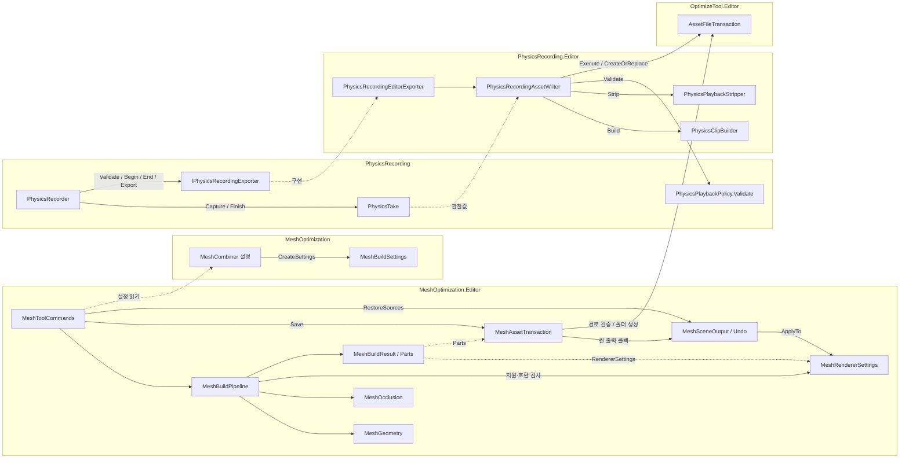

# OptimizeTool 기술 참고

[README](../README.md)를 보완하는 구현 요약입니다.

## 처리 흐름

```text
Mesh 처리 (Editor)
MeshFilter 수집 → 설정·입력 검증 → Readable·Normal 처리
  → 선택적 Occlusion / Backface 처리 → Material별 SubMesh 결합
  → 설정된 Assets/ 하위 출력 폴더에 Mesh 에셋 저장

물리 기록 (Play Mode 캡처는 Runtime, 저장은 Editor)
설정·계층 검증 → 시작 자세 → 물리 스텝별 localPosition / localRotation 관찰
  → 보간 오차 기준 키 축약 → AnimationClip 커브 생성
  → 물리·게임플레이 컴포넌트를 제거한 Prefab 생성
  → .anim / .prefab (+ 선택한 경우 .reference.asset) 동기 저장 또는 실패 복원 → Result 게시

샘플 비교
원본 기준 데이터 + 저장된 Prefab → 같은 시각의 자세 재현·오차 검사
  → 상태 표시 → RESET / 모드 전환 / 비활성화·재컴파일·파괴 시 정리
```

## 어셈블리

| 어셈블리 | 위치 | 플랫폼 | 참조 |
| --- | --- | --- | --- |
| `Common.OptimizeTool.Editor` | `Script/Shared/Editor` | Editor | 없음 |
| `Common.OptimizeTool.MeshOptimization` | `Script/MeshOptimization` | 모두 | 없음 |
| `Common.OptimizeTool.MeshOptimization.Editor` | `Script/MeshOptimization/Editor` | Editor | MeshOptimization, OptimizeTool.Editor |
| `Common.OptimizeTool.PhysicsRecording` | `Script/PhysicsRecording` | 모두 | 없음 |
| `Common.OptimizeTool.PhysicsRecording.Editor` | `Script/PhysicsRecording/Editor` | Editor | PhysicsRecording, OptimizeTool.Editor |
| `Common.OptimizeTool.Samples` / `.Samples.Editor` | `Samples/Scripts`, `Samples/Scripts/Editor` | 모두 / Editor | 위 시스템과 UGUI·URP |

- Mesh 최적화와 Physics Recorder는 서로 참조하지 않습니다. 둘이 함께 쓰는 것은 Editor 전용 저장 규칙 `AssetFileTransaction` 하나입니다.
- Runtime 어셈블리는 `UnityEditor`를 쓰지 않으므로 `#if UNITY_EDITOR`가 없습니다. 직렬화 필드도 Editor와 Player에서 같습니다.
- `InternalsVisibleTo`는 각 Runtime 어셈블리가 자기 시스템의 Editor 어셈블리에만 엽니다. 공용 Editor 어셈블리는 public API만 두며, 샘플은 public API만 씁니다.
- **Mesh 컴포넌트**는 설정과 씬 출력 상태(`_generatedRoot`, `_sourceRendererStates`)만 갖습니다. 결합·베이크는 Editor 어셈블리의 확장 메서드 `MeshToolCommands`가 수행합니다.
- **`PhysicsRecorder`**는 캡처(`PhysicsTake`, 코루틴, fixed time)를 Runtime에서 합니다. 저장과 리로드 잠금은 `IPhysicsRecordingExporter`에 맡기고, Editor 어셈블리의 `PhysicsRecordingEditorExporter`가 `[InitializeOnLoad]`로 자신을 등록합니다. Exporter가 없는 Player에서는 `StartRecording`이 예외를 던집니다.

## 클래스와 호출 관계



실선은 호출·생성, 점선은 결과 데이터 전달이나 인터페이스 구현입니다.
- `PhysicsRecorder`는 `PhysicsTake`를 채워 Exporter에 넘기며, Take는 Writer를 호출하지 않습니다.
- `AssetFileTransaction`의 규칙은 쓰는 곳마다 다릅니다. Mesh 명령은 경로·이름 검증, 출력 자리 검사, 폴더 생성, Play Mode 전환 중 거부(`RequireStablePlayMode`)를 씁니다. Physics Recorder는 여기에 GUID를 유지하는 `CreateOrReplace`와 파일 복원 `Execute`를 더 씁니다. 샘플 빌더는 Edit Mode 확인(`RequireEditMode`)과 `Execute`를 씁니다.
- 출력 자리 검사(`ValidateOutputTarget`)는 폴더, 인식할 수 없는 파일, 다른 타입의 에셋이 있으면 덮어쓰기 설정과 관계없이 거부합니다. 같은 타입의 에셋은 덮어쓰기를 허용한 경우에만 교체합니다.
- `MeshAssetTransaction.Save`는 Mesh를 저장한 뒤 저장된 Mesh를 `apply` 콜백에 넘깁니다. `CombineAndSaveMeshes`는 이 콜백에서 씬 출력을 만들고, `_createSceneOutput`을 끄면 콜백을 넘기지 않습니다. 샘플 빌더는 콜백에서 저장된 Mesh를 결과 MeshFilter에 할당하고 Prefab이나 씬을 저장합니다. 콜백은 트랜잭션의 최종 저장 완료 전에 실행되며, 실패하면 Mesh 에셋을 복원합니다. Edit Mode에서는 `Save` 전체가 Undo 한 단계이고 콜백의 Undo 기록도 함께 되돌립니다. Play Mode에서는 Undo를 쓰지 않으므로 콜백이 바꾼 씬은 호출자가 되돌립니다.
- 콜백이 Mesh 말고 다른 에셋 파일도 쓰면 호출자가 `Save` 호출을 `AssetFileTransaction.Execute(그 파일들, ...)`로 감쌉니다. 실패하면 `Save`가 먼저 Mesh를 되돌리고, 그 뒤 `Execute`가 파일과 `.meta`를 복원합니다.

메시 작업은 요청마다 검증·계산·저장하며 초기화 상태를 유지하지 않습니다. 물리 기록은 여러 물리 틱에 걸친 take를 소유하므로 `StartRecording`부터 `StopRecording`·`CancelRecording`·비활성화까지가 한 take의 수명입니다.

| 어셈블리 | 클래스 | 역할 |
| --- | --- | --- |
| MeshOptimization | `MeshCombiner` / `MeshBuildSettings` / `MeshSourceRendererState` | Inspector 설정, 그 설정에서 만든 빌드 옵션(직렬화하지 않음), 결합 씬 출력과 원본 Renderer 상태 |
| MeshOptimization | `BackfaceCullMeshBaker` / `BakedMeshOriginal` | 제자리 Backface 베이크 설정, MeshFilter별 원본·출력 Mesh 기록(`_originalMeshes`)과 이 Baker가 저장한 Mesh 목록(`_bakedMeshes`) |
| MeshOptimization.Editor | `MeshToolCommands` | `BuildMeshes`·`CombineAndSaveMeshes`·`RestoreSources`·`BakeBackfaces`·`RestoreOriginalMeshes` 확장 메서드. 입력 수집, 출력 경로 생성(`_meshName.asset` 또는 `_meshName_0.asset`부터), 남은 이전 출력 경고 |
| MeshOptimization.Editor | `MeshBuildPipeline` | `Build(sources, destinationWorldToLocal, settings)`. 저장 경로와 분리된 입력 검증, 컬링·변환·Material별 결합. 기하 연산은 `MeshGeometry`, 씬 Physics 조회는 `MeshOcclusion` |
| MeshOptimization.Editor | `MeshBuildResult` | Mesh와 Material 매핑을 항목별로 묶고 임시 Mesh만 소유. `Dispose()`는 원본을 파괴하지 않음 |
| MeshOptimization.Editor | `MeshRendererSettings` | 입력 Renderer가 지원하지 않는 데이터(PropertyBlock, Lightmap, LOD 등)를 쓰는지 검사하고, 병합 입력끼리 같아야 하는 Renderer 설정을 비교. `ApplyTo`로 결과 Renderer에 Material과 설정을 적용 |
| MeshOptimization.Editor | `MeshGeometry` | 원본 Mesh와 importer를 바꾸지 않는 기하 연산: Readable 복사, 원시 정점 버퍼를 옮기는 SubMesh 추출, Backface 제거, 변환, 정점 채널을 맞춘 결합, 라이트맵 UV 배치 |
| MeshOptimization.Editor | `MeshOcclusion` | 카메라에서 표본 점(Vertex와 삼각형 중심)으로 Raycast해 보이는 비율로 가림 판정. 대상 자신과 표본 점을 품은 조상 Collider는 제외 |
| MeshOptimization.Editor | `MeshProcessing` | 공개 메시 연산 facade. 인자(null, Readable, 삼각형 토폴로지, 유한 값, 각도·Occlusion 범위, 씬 소속)를 검사한 뒤 internal `MeshGeometry`·`MeshOcclusion`에 넘김. `TransformMesh`는 저장된 에셋을 거부하고, `IsOccluded`는 조회 전에 `Physics.SyncTransforms`를 부름 |
| MeshOptimization.Editor | `MeshAssetTransaction` | 모든 Mesh 출력 경로와 출력 자리를 쓰기 전에 검증하고, GUID를 유지해 저장(Edit Mode에서는 Undo 한 단계). 실패하면 메모리 안 백업으로 기존 Mesh를 되돌리고 새로 만든 에셋을 지움. 콜백이 쓰는 다른 파일은 호출자가 `AssetFileTransaction.Execute`로 감쌈 |
| MeshOptimization.Editor | `MeshSceneOutput` | `MeshSceneEdit`를 거쳐 결과 Renderer를 만들고 원본 Renderer를 비활성화. 끈 원본의 기록과 `Restore`, Prefab 인스턴스 안의 결과 거부 |
| MeshOptimization.Editor | `MeshSceneEdit` | 씬 변경 방식을 Editor 모드로 한 곳에서 정함. Edit Mode는 Undo와 Prefab 오버라이드 기록, Play Mode는 기록 없이 바꾼 값을 들고 있다가 실패하면 직접 되돌리고 성공하면 숨겨 둔 이전 결과를 지움 |
| OptimizeTool.Editor | `AssetFileTransaction` | 공용 출력 규칙: Edit Mode 확인, Play Mode 전환 중 거부, `Assets/` 아래 경로·이름 검증(`ValidateAssetPath`, 같은 에셋을 두 번 적은 목록을 거부하는 `ValidateAssetPaths`), 출력 자리 검사(`ValidateOutputTarget`), 폴더 생성, GUID를 유지하는 `CreateOrReplace`, 선언한 파일의 백업과 실패 시 복원(`Execute`) |
| PhysicsRecording | `PhysicsRecorder` / `PhysicsTakeSettings` / `PhysicsRecordingResult` | take 시작·종료·취소, 설정 스냅샷과 경로, fixed time 기준, 저장 직전 계층 검증, 결과 게시 |
| PhysicsRecording | `PhysicsTake` | 물리 스텝마다 쌓는 frame-major 원본 관찰값, 회전 부호 연속성, 요청한 종료 시각의 보간 |
| PhysicsRecording | `IPhysicsRecordingExporter` | Runtime 녹화가 Editor 저장을 부르는 경계: 검증, 리로드 잠금, 저장 |
| PhysicsRecording | `PhysicsRecordingReference` | 축약 전 원본 관찰값, Transform 경로, 클립·계층 검증. Player에서도 읽음 |
| PhysicsRecording | `PhysicsPoseMath` | 원본 보간(Slerp)과 커브 재생 보간(성분별 선형 + 정규화), 회전 차이 |
| PhysicsRecording | `PhysicsPlaybackPolicy` | 출력 시 제거하고 재생 시 거부하는 물리·게임플레이 컴포넌트 규칙과 재생 검증 |
| PhysicsRecording.Editor | `PhysicsRecordingEditorExporter` | `[InitializeOnLoad]` 등록, 경로 규칙 검증, `LockReloadAssemblies` |
| PhysicsRecording.Editor | `PhysicsClipBuilder` | 보간 오차 기준 키 축약과 선형 커브·Legacy 클립 생성, 정지한 루트 커브 생략 |
| PhysicsRecording.Editor | `PhysicsRecordingAssetWriter` / `PhysicsPlaybackStripper` | 재생용 복제본의 의존성 순서 제거, 에셋을 한 트랜잭션으로 저장하고 서로 연결됐는지 확인 |
| Samples | `PhysicsPrefabPlayback` | 검증한 Prefab 인스턴스 1개와 Animation 표본 재생·파괴 |
| Samples | `OptimizeToolPhysicsDemo` | 녹화·비교 상태, 원본 Rigidbody 정지, 코루틴과 재컴파일 정리 |
| Samples | `OptimizeToolOverviewController` / `OptimizeToolShowcaseUI` | 다섯 모드 선택, 상태 갱신, 버튼 상태와 소유 리스너 관리 |
| Samples | `OptimizeToolPhysicsStatusFormatter` | 녹화·재생 실패, 기준 데이터 유무와 오차 검사 상태의 표시 문자열 |

## Mesh 결합

- `_targetMeshFilterArray`로 대상을 직접 지정하거나 `_collectChildMeshes`로 자식 계층을 수집합니다. 둘 중 정확히 하나를 써야 하며, 둘 다 쓰거나 둘 다 비우면 서로 다른 오류로 알립니다. 직접 지정한 MeshFilter는 Renderer 활성 여부와 관계없이 입력이고, 자식 수집은 사용자가 끈 Renderer를 경고와 함께 제외하되 이전 베이크가 끈 원본은 포함합니다.
- 빌드 옵션(각도, 카메라, Occlusion 표본 설정)은 `MeshBuildSettings.Validate()`가 검증합니다. 각도와 Occlusion 표본 규칙은 `MeshBuildSettings`의 internal 검사 하나를 `Validate`와 `MeshProcessing`이 함께 씁니다. 입력 MeshFilter, MeshRenderer, Material, SubMesh, Triangle 인덱스는 처리 전에 검증합니다. Normal 데이터가 불완전하면 `_allowNormalRecalculation`이 켜진 경우에만 재계산합니다.
- Read/Write가 꺼진 입력은 `_allowReadableCopy`가 켜진 경우 `UnityEditor.MeshUtility.AcquireReadOnlyMeshData`로 복사합니다. 원본 importer와 Mesh는 바꾸지 않습니다.
- SubMesh 추출과 Backface 제거는 원시 정점 레이아웃을 복사해 Tangent·Color·UV0~UV7을 보존합니다. 정점 65,535개를 넘으면 UInt32 인덱스를 씁니다. Skinned/BlendShape 메시와 삼각형 이외 토폴로지는 거부합니다.
- 같은 Material의 SubMesh를 `CombineInstance`로 묶고, `_combineAllIntoSingleMesh`가 켜지면 하나의 Mesh로 다시 결합합니다. `_optimizeMesh`는 정점·인덱스 재정렬이며 폴리곤 단순화가 아닙니다.
- 병합 입력은 Layer·그림자·Probe·정렬·Rendering Layer·Motion Vector·Static Flag·Receive GI·Ray Tracing Mode·Renderer Priority·Static Shadow Caster·Stitch Seams·Lightmap Parameters·Scale In Lightmap 설정이 같아야 하며, 지원하는 설정은 출력 Renderer에 복사합니다. PropertyBlock, Additional Vertex Streams, 할당된 Lightmap, LODGroup, forceRenderingOff는 저장 전에 거부합니다.
- `_createSceneOutput`은 결과 MeshFilter·MeshRenderer와 Material 배열을 만들고, `_disableSourceRenderers`는 원본 Renderer만 끕니다(Collider 유지). 재실행 시 도구가 만든 결과는 자식 수집에서 제외합니다.
- 재빌드에서는 다음 입력에도 남는 원본 Renderer를 계속 끄고, 제거된 원본만 기록해 둔 활성 상태로 복원합니다. 이 기록은 컴포넌트에 직렬화되어 Undo/Redo와 Prefab 인스턴스에도 유지됩니다. Combiner는 결과 오브젝트를 만든 뒤 한 번 더 Undo에 기록하므로 Redo도 결과 오브젝트 참조를 되찾습니다.
- `RestoreSources()`(Inspector의 **Restore Sources**)는 결과 오브젝트를 지우고 기록한 모든 원본을 원래 활성 상태로 되돌린 뒤 기록을 비웁니다. Edit Mode에서는 Undo 한 단계이며 저장한 Mesh 에셋은 지우지 않습니다. 결과 오브젝트가 Prefab 인스턴스의 일부(추가 오버라이드가 아닌 것)이면 다시 굽기와 복원 모두 아무것도 바꾸기 전에 거부합니다.
- 출력 좌표는 Combiner의 로컬 공간입니다. 조명은 결합한 결과 Renderer를 대상으로 베이크합니다.
- 입력이 Lightmap Static(Contribute GI)이고 Receive GI가 Lightmaps이면, `_packLightmapUvs`(기본 켬)가 소스마다 라이트맵 UV(UV2, 없으면 UV0)를 [0,1] 안의 같은 크기 칸으로 옮겨 결합 결과의 라이트맵이 겹치지 않게 합니다. 정점 수는 그대로이고 결과는 결정적입니다. 칸 크기가 같아서 소스 크기가 다르면 라이트맵 해상도가 고르지 않습니다. UV2가 없는 소스는 UV0이 자기 자신과 겹칠 수 있어 경고합니다. 끄면 UV를 그대로 두고 겹침을 경고합니다.
- 저장한 Mesh는 기본으로 Read/Write를 끄므로 Player에서 CPU 사본이 해제됩니다. 실행 중 Mesh를 읽는 스크립트나 Collider가 있으면 `_keepReadable`을 켭니다.
- 결과 이름은 `_combineAllIntoSingleMesh`를 켜면 `_meshName.asset`이고, 끄면 Material별로 `_meshName_0.asset`, `_meshName_1.asset`, ...입니다. Material이 하나여도 `_0`이 붙습니다. 기존 에셋은 `_overwriteExistingAssets`가 켜진 경우에만 GUID를 유지해 갱신합니다. 이번 저장이 쓰지 않은 같은 이름의 이전 출력(예: 결과가 3개에서 2개로 줄어 남은 `_meshName_2.asset`)이 폴더에 있으면 지우지 않고 경고로 알립니다.
- 저장에 실패하면 Mesh 에셋과 씬 변경을 복원하고, 복구 오류가 나도 나머지 복구를 계속한 뒤 원래 오류와 함께 보고합니다. Undo 시 새로 만든 에셋 파일은 남습니다.
- **Play Mode:** 결합, Restore Sources, Backface 베이크와 복원은 Editor Play Mode에서도 동작합니다. `MeshSceneEdit`가 `EditorApplication.isPlaying`으로 모드를 정하고, `isPlaying`과 `isPlayingOrWillChangePlaymode`가 다르면(Play Mode에 들어가거나 나가는 중) 거부합니다. Play Mode에서는 Undo와 Prefab 오버라이드를 기록하지 않고, 이전 결과 오브젝트를 비활성으로만 두었다가 저장이 성공한 뒤 지웁니다. 실패하면 새 결과를 지우고 이전 결과, Renderer 활성 상태, Combiner·Baker 기록을 직접 되돌립니다. 덮어쓴 Mesh 에셋은 Edit Mode와 같이 메모리 백업으로 되돌립니다. 장면 변경은 Play Mode를 나가면 사라지고 저장한 에셋은 남습니다.
- Play Mode에서 지금 결과 오브젝트(Baker는 대상 MeshFilter)가 보여 주는 Mesh 에셋 경로에는 쓰지 않습니다. 그 에셋은 저장된 씬이 참조하는 Edit Mode 결과라서, 덮으면 저장된 씬이 조용히 바뀌기 때문입니다. 같은 규칙으로 Play Mode에서 방금 만든 결과 경로에 다시 쓰는 것도 거부되므로, 다시 결합하려면 다른 폴더나 이름을 고릅니다. `isPartOfStaticBatch`인 Renderer는 Play Mode에서 sharedMesh가 배치 Mesh이므로 입력에서 거부합니다.
- `MeshBuildResult.Warnings`와 Inspector 진단은 Collider 기반 Occlusion, 투명·양면 재질, 다른 카메라·그림자·반사와 Probe 샘플 위치의 한계를 설명합니다. `using` 범위를 벗어난 결과의 `Parts[i].Mesh`를 보관하거나 MeshFilter에 할당하면 안 됩니다. 결과 Renderer에는 `RendererSettings.ApplyTo(renderer, part.Materials)`로 Material과 설정을 적용하고, 메시는 저장된 에셋을 직접 할당합니다. 완전히 제거된 입력은 `RemovedSources`에 있습니다.

## Occlusion과 Backface

- **Occlusion:** 입력이 속한 PhysicsScene에서 `_cullingLayerMask`의 Collider로 Raycast합니다. 대상 자신과 자식의 Collider, Trigger는 제외하고, 결과 버퍼가 가득 차면 확장합니다. 조상의 Box·Sphere·Capsule·볼록 Mesh Collider는 표본 점을 안에 품을 때만 제외합니다(자식 비주얼을 감싼 부모 Collider처럼 대상 자신의 프록시로 봄). 표면 위의 점도 안으로 보므로 지오메트리를 남기는 쪽으로 기웁니다. 오목한 Mesh Collider나 Terrain인 조상, 그리고 대상 밖에서 앞을 막는 조상 Collider는 가림물로 남습니다. Orthographic 카메라는 평행 광선을 씁니다.
- 표본 후보는 모든 Vertex와 퇴화하지 않은 삼각형의 중심점입니다. 그래서 Vertex가 적은 큰 면도 안쪽을 검사합니다. 후보 수가 `_occlusionSampleCount` 이하이면 모두를, 더 많으면 균등 간격 표본을 검사합니다(결정적). 보이는 비율이 `_visibilityThreshold`보다 작으면 MeshFilter 전체를 뺍니다. Camera, 양수 샘플 수, `0..1` 임계값, 유효한 LayerMask가 필요합니다.
- **Backface:** 판정은 `MeshGeometry.CullBackfaces` 하나가 합니다. 삼각형마다 World-space Normal과 관찰자 쪽 방향의 각도를 보고, 각도 이내인 삼각형만 원시 정점 레이아웃 그대로 남깁니다. `MeshBuildPipeline`은 결합 중 `_enableBackfaceCulling`과 `_backfaceCullingAngle`로, `BackfaceCullMeshBaker`는 MeshFilter마다, `MeshProcessing.CullBackfaces`는 호출자가 준 값으로 이 판정을 부릅니다.
- 관찰자 쪽 방향은 카메라 overload에서 Perspective면 삼각형 중심에서 카메라 위치로, Orthographic이면 `-camera.forward`입니다. 방향 overload는 `-viewDirection.normalized`를 모든 삼각형에 씁니다. 방향은 유한하고 0이 아니어야 합니다. 비균일·음수 Scale은 법선 역전치 변환과 winding 보정으로 처리합니다.
- **제자리 베이크:** `BakeBackfaces`는 폴더, 각도, 카메라 또는 방향을 먼저 검증하고, 모든 MeshFilter의 결과를 계산한 뒤 한 번에 저장·교체합니다. 원본은 MeshFilter가 아직 이 Baker의 출력을 쓰고 있을 때만 기록(`_originalMeshes`)에서 가져오고, 아니면 지금 Mesh를 새 원본으로 씁니다. 그래서 다시 베이크해도 이미 깎은 Mesh를 또 깎지 않습니다. 모든 삼각형이 제거되는 입력, 겹치는 출력 이름, 이 Baker가 쓰지 않은 기존 출력(덮어쓰기 꺼짐)은 바꾸기 전에 거부합니다. Mesh 교체와 기록은 Undo와 Prefab 인스턴스 오버라이드로 남습니다.
- `RestoreOriginalMeshes`는 출력을 아직 쓰는 MeshFilter에만 원본을 돌려주고 기록을 비우며, Undo 한 단계입니다. 손으로 바꾼 Mesh는 그대로 둡니다. 저장한 출력은 `_bakedMeshes`에 남아 다음 베이크가 덮어쓰기 설정 없이 다시 씁니다.
- Target Camera가 비어 있고 컬링이 켜져 있으면 `MeshToolCommands`가 Combiner의 씬에서 대체 카메라를 고릅니다. 켜진 `MainCamera` 태그 카메라가 먼저이고, 없으면 루트부터 깊이 우선으로 훑어 처음 만난 켜진 카메라입니다. `FindObjectsByType`는 순서를 보장하지 않으므로 쓰지 않습니다. 고른 카메라 이름은 `LastBuildWarnings`에 남습니다. `MeshBuildPipeline.Build`와 `MeshBuildSettings`는 대체하지 않고 카메라를 요구합니다.

## PhysicsRecorder

- `_root` 계층에는 Rigidbody가 하나 이상 필요합니다. 비활성 자식과 Rigidbody가 없는 부모의 움직임도 보존하도록 계층 전체 Transform의 `localPosition`·`localRotation`을 기록합니다.
- 트랙 경로는 `Root` 아래 이름을 `/`로 이은 값이며 `AnimationUtility.CalculateTransformPath`와 같습니다. Runtime에서 계산하므로 녹화 코드에 Editor API가 없습니다.
- `_saveReference`(기본 꺼짐)를 켜야 `.reference.asset`을 저장하고 `Result.Reference`가 채워집니다. 끄면 트랜잭션은 clip과 prefab을 다루고, 덮어쓰는 clip을 가리키는 이전 Reference가 같은 경로에 있으면 같은 트랜잭션에서 지웁니다(실패하면 GUID와 함께 복원).
- 시간은 `Time.fixedTimeAsDouble` 기준입니다. 시작 자세를 마지막 물리 스텝 시각 `t=0`에 저장하고, 물리 스텝이 끝날 때마다 표본을 모읍니다. Update에서 시작해도 첫 표본은 `fixedDeltaTime`에 놓입니다. `FixedUpdate`에서 시작하면 그 스텝의 물리 계산 직후 자세가 `t=0`이 되므로 표본 간격이 한 스텝씩 유지됩니다. 요청한 종료 시각이 스텝 사이에 있으면 양쪽 표본을 보간합니다. 누적된 스텝 시각이 종료 시각보다 아주 조금(스텝의 1% 이내) 모자라면 그 표본을 종료 표본으로 씁니다. `StopRecording`은 마지막으로 끝난 물리 스텝까지를 저장합니다. Rigidbody 보간을 켜도 물리 스텝 직후의 Transform은 물리 자세와 같습니다.
- `Physics.simulationMode`가 `FixedUpdate`여야 합니다. 다른 모드에서는 `StartRecording`이 예외를 던집니다.
- 회전은 트랙마다 직전 표본과 같은 반구로 부호를 맞춰 저장하므로, 기준 데이터의 회전 부호가 원래 값과 다를 수 있습니다. 비교는 부호와 무관한 각도를 씁니다.
- 키 축약은 첫·끝 표본을 남긴 뒤, 구간 안 모든 물리 스텝의 재생 오차를 재고 허용치를 가장 많이 넘는 스텝에서 구간을 나눕니다. 재생 오차는 Legacy 재생과 같은 성분별 선형 보간 + 정규화로 계산하므로, 저장된 클립은 모든 관찰 시각에서 허용치 이내입니다. 스텝 사이 렌더 프레임의 오차는 보장하지 않습니다.
- 키의 tangent는 이웃 키로의 기울기를 직접 넣어 선형으로 재생하므로, 편집기용 커브(`m_EditorCurves`·`m_EulerEditorCurves`)를 따로 저장하지 않습니다.
- `StartRecording`은 설정을 스냅샷으로 고정하고 중복 시작·중복 계층 경로를 거부합니다. 추가·삭제, 이름·부모·스케일 변경은 저장 직전에 한 번 검사해 실패로 처리하므로, 기록 중 바뀌었다가 되돌아온 변경은 잡지 못합니다. 기록 중 Transform이 파괴되면 `StopReason.Failed`로 즉시 끝납니다. 활성 상태 변화는 기록하지 않습니다.
- 실패는 그 take의 `Result.Error`로만 남고 다음 `StartRecording`은 그대로 동작합니다. 실패한 take의 `Result`는 이전 녹화의 에셋을 게시하지 않습니다.
- Prefab은 비활성 임시 계층에서 복제해 원본 스크립트의 Awake/OnEnable 실행을 막고, MonoBehaviour(누락 스크립트 포함), Rigidbody·Rigidbody2D·ArticulationBody, Collider·Collider2D, Joint·Joint2D, ConstantForce·ConstantForce2D, Cloth, 기존 Animator/Animation을 `RequireComponent`가 막지 않는 순서로 제거하고, ParticleSystem의 Collision·Trigger 모듈을 끕니다.
- 클립은 Legacy Animation 형식이며 재생용 Animation의 기본 클립과 자동 재생을 설정합니다. `_overwriteExistingAssets`를 허용하면 기존 GUID를 유지하고, 실패하면 기존 파일을 복원하거나 불완전한 새 파일을 지웁니다.
- 기록 중 비활성화·파괴·Play 종료가 일어나면 그때까지를 동기로 저장합니다. 스크립트 리로드 중에는 Prefab을 저장할 수 없으므로, 기록하는 동안 `LockReloadAssemblies`로 재컴파일을 take 저장 뒤로 미룹니다. 기록을 시작하는 Inspector 버튼은 없습니다.
- 출력 이름과 폴더는 `AssetFileTransaction` 규칙을 따릅니다. 앞뒤 공백, `.`로 끝나는 이름, `..`, 경로 금지 문자를 거부하며, 이 규칙은 Mesh 도구에도 같이 적용됩니다.

## 샘플

- 메시 비교 결과는 `Build Showcase Assets`가 격리된 Preview Scene에서 `MeshBuildPipeline.Build()`로 다시 계산합니다. Backface와 Occlusion은 각각 원본 입력에서 독립적으로 계산하고, 기존 GUID를 유지해 갱신합니다. 쇼케이스의 Combiner는 씬 출력 생성을 끈 상태로 저장합니다.
- 녹화는 `Samples/Settings/Generated/PhysicsRecordings/OptimizeToolPhysicsTake`에 저장하고(데모 Recorder는 `_saveReference`를 켬), 다음 Play에서도 마지막 기록으로 비교할 수 있습니다. 녹화 중에는 모드 변경과 Reset을 막고, Rigidbody는 0.4초 정지 뒤 낙하합니다. 비교 중 왼쪽 Rigidbody는 Kinematic으로 둡니다.
- 비교는 같은 재생 시각을 쓰며, 프레임이 건너뛰어도 시작·종료를 포함한 모든 원본 관찰 시각에서 오차를 검사합니다. 대응하는 Transform 경로의 로컬 위치·회전을 비교하므로 두 전시 공간의 간격은 오차에 들어가지 않습니다. 표시되는 오차는 `_positionTolerance`·`_rotationTolerance` 이내로 줄인 키 축약 오차입니다.
- 기준 데이터가 없거나 클립·계층이 맞지 않으면 재생을 중단하고 RECORD를 안내합니다. 기본 Showcase Prefab에는 녹화에 대응하는 `PhysicsRecordingReference`가 직렬화되어 있어 Player에서도 AssetDatabase 없이 씁니다.
- 녹화 중 쇼케이스나 데모를 비활성화하면 그 시점까지 저장합니다. 첫 물리 틱 전이면 녹화를 시작하지 않습니다. 녹화 중 재컴파일은 recorder가 take 저장 뒤로 미루고, 데모는 재로드 전에 재생 인스턴스를 정리하며, 재로드 후 UI가 패널과 리스너를 복구합니다.
- 데모 컴포넌트만 파괴하면 RECORD·COMPARE·RESET을 비활성화하고 `Physics Recorder demo is unavailable.`을 표시합니다. 다른 모드와 카메라 버튼은 계속 동작합니다.
- 샘플 계층은 `Tools > OptimizeTool > Build Physics Recorder Demo`로 다시 만듭니다. `Build Showcase Assets`도 이 구성을 포함합니다.
- 모드의 이름·그룹·버튼 정의는 `OptimizeToolSampleModes`에 있습니다. Mesh 통계 문자열은 캐시해 모드 변경 때 갱신하고, 물리 상태 표시는 상태 변화나 0.1초 간격으로 갱신합니다.

## 벤치마크

- 규모 샘플은 같은 Material의 정적 큐브를 직교 카메라 앞 3개 깊이 층으로 배치합니다. 규모마다 카메라와 화면 점유율을 고정하고 그림자·Light/Reflection Probe·GPU Instancing·Dynamic Batching을 끕니다. Collider는 베이크 후 제거합니다. Renderer 제출 비용과 기하 감소를 비교하는 조건이며 일반 게임 씬을 대표하지 않습니다.
- Player 인자는 `--optimize-benchmark /absolute/output --optimize-benchmark-cubes 3600 --optimize-benchmark-rounds 8`이고, `--optimize-benchmark-fps 240`으로 일정한 프레임 속도에서 대조할 수 있습니다. 기본은 `targetFrameRate=-1`입니다.
- Player는 시작 화면 완료와 포커스를 확인한 뒤 3초를 기다립니다. 모드 전환 예열은 90프레임과 0.25초를 모두 채우고, 측정 중에는 입력과 UI를 멈춥니다.
- 빌드 메뉴는 활성 타깃과 아키텍처를 자동으로 바꾸지 않습니다. 기본 출력은 `Path.GetTempPath()` 아래 `OptimizeToolBenchmark-yyyyMMdd-HHmmss/OptimizeToolBenchmark.app`이고, 같은 폴더의 `build-status.json`이 `Succeeded`인지 확인합니다.
- 실행 스크립트는 Player 포커스·ARM64·해상도·GPU 유효성·타임스탬프·표본 수를 검사하고, 분석 스크립트는 실행과 구간을 나눠 변화율·신뢰구간을 계산합니다. 중단했으면 같은 옵션과 출력 폴더로 `--resume`을 붙여 완료된 실행을 재사용합니다. `Frame Timing is unavailable` 오류는 Player Settings의 Frame Timing Stats를 켜고 다시 빌드하면 풀립니다.
- GPU 측정은 각 면을 64×64로 나눈 9·36·225개 큐브를 생성하고, Metal 계측 플러그인을 포함한 별도 Player를 빌드합니다. macOS Command Line Tools(`xcrun clang++`)가 필요합니다. 약 1.4 GiB의 고밀도 Mesh·씬·플러그인은 다시 만들 수 있으므로 Git에서 제외합니다.
- GPU 스크립트는 오프스크린 Player로 비동기·GPU 완료 동기화·60 FPS 제한 조건을 교차 수집합니다. RenderTexture를 매 프레임 렌더하고 같은 커맨드 버퍼의 GPU 시작·종료 타임스탬프를 검증합니다. 그래픽이 필요하므로 `-nographics`를 쓰지 않습니다.

## 계측 결과 형식

- 출력 폴더는 기존 결과가 없을 때 한 번만 씁니다. Player 로그만 있는 폴더는 허용하고, `capture.json`의 실행 ID로 중복 실행을 막습니다. CLI와 `StartEditorRun`이 같은 수집기를 씁니다.
- 완료 파일에는 실행 ID와 CSV·메타데이터의 SHA-256이 들어갑니다. 두 파일을 저장한 뒤 완료 파일을 원자적으로 게시하며, 실패와 중단은 완료 표시를 무효화합니다. 분석과 재개는 `schemaVersion`이 현재 형식과 같고 해시가 맞는 결과만 받습니다.
- 출력에는 실행 매니페스트와 `cubes-<수>/run-*`별 `capture.json`·`frames.csv`·`metadata.json`·`complete.json`이 생깁니다.
- 취소, 비활성화, 파괴, 출력 실패 시 모드·규모·카메라와 계측용 전역 설정·Behaviour 활성 상태를 복원합니다(`BenchmarkEnvironmentScope`, Editor Game View는 `GameViewCaptureScope`). 종료 콜백은 한 번만 전달합니다.
- CSV의 `observed_frame`, `timing_timestamp`, `metal_frame_id`는 각각 관측 프레임, 지연된 CPU 타이밍, 별도 GPU 완료 기록의 식별자입니다. 같은 행을 같은 프레임의 CPU/GPU 쌍으로 해석하지 않습니다. 비교 통계는 워밍업 이후의 모드별 블록을 기준으로 합니다.
- 내부 책임은 옵션 해석(`BenchmarkRunOptions`), 결과 게시(`BenchmarkCaptureOutput`), CSV 출력(`BenchmarkCsvWriter`), 작업·카메라 복원(`BenchmarkWorkloadScope`)으로 나뉩니다. 렌더 설정은 URP 16 API에서 직접 읽습니다.
