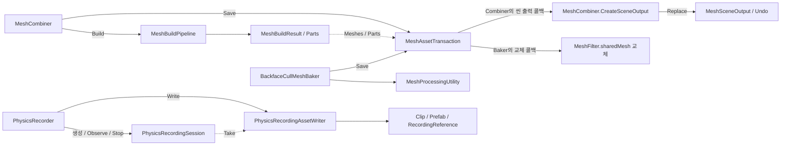

# OptimizeTool 기술 참고

[README](../README.md)를 보완하는 구현 요약입니다.

## 처리 흐름

```text
Mesh 처리
MeshFilter 수집 → 설정·입력 검증 → Readable·Normal 처리
  → 선택적 Occlusion / Backface 처리 → Material별 SubMesh 결합
  → 설정된 Assets/ 하위 출력 폴더에 Mesh 에셋 저장

물리 기록
설정·계층 검증 → 시작 자세 → 물리 스텝별 localPosition / localRotation 관찰
  → 정지 구간·종료 자세를 보존한 표본 축약 → AnimationClip 커브 생성
  → 물리·게임플레이 컴포넌트를 제거한 Prefab 생성
  → .anim / .prefab / .reference.asset 동기 저장 또는 실패 복원 → Result 게시

샘플 비교
원본 기준 데이터 + 저장된 Prefab → 같은 시각의 자세 재현·오차 검사
  → 상태 표시 → RESET / 모드 전환 / 비활성화·재컴파일·파괴 시 정리
```

## 클래스와 호출 관계



실선은 호출·생성, 점선은 결과 데이터 전달입니다. `PhysicsRecorder`가 세션의 `Take`를 받아 Writer를 호출하며, 세션은 Writer를 호출하지 않습니다. 메시의 씬 출력과 MeshFilter 교체는 각 도구가 넘긴 `apply` 콜백에서 수행합니다. 콜백은 트랜잭션의 최종 저장 완료 전에 실행되며, 실패하면 에셋과 Undo에 등록된 씬 변경을 복원합니다.

메시 작업은 요청마다 검증·계산·저장하며 초기화 상태를 유지하지 않습니다. 물리 기록은 여러 물리 틱에 걸친 세션을 소유하므로 `Init`·`StartRecording`·`StopRecording`·`Release` 수명주기를 씁니다.

| 클래스 | 역할 |
| --- | --- |
| `MeshCombiner` | Inspector 설정을 빌드 요청으로 만들고 빌드·저장·씬 적용 계층을 호출 |
| `MeshBuildRequest` / `MeshBuildPipeline` | 저장 경로와 분리된 입력·옵션 검증, 컬링·변환·Material별 결합. 씬 Physics 조회는 `MeshVisibilityQuery` |
| `MeshBuildResult` | Mesh와 Material 매핑을 항목별로 묶고 임시 Mesh만 소유. `Dispose()`는 원본을 파괴하지 않음 |
| `MeshSaveOptions` / `MeshAssetTransaction` | 출력 경로·충돌 사전 검증, GUID 유지 저장. 콜백이 쓰는 Prefab·부속 에셋 경로도 먼저 선언해야 복구 대상에 포함 |
| `MeshSceneOutput` | Undo에 등록하며 결과 Renderer를 만들고 원본 Renderer를 비활성화 |
| `BackfaceCullMeshBaker` | 방향 기반 삼각형 제거, 결과 저장, `MeshFilter.sharedMesh` 교체 |
| `PhysicsRecorder` | 기록 수명주기와 Transform 수집 연결 |
| `PhysicsRecordingSettings` / `PhysicsPoseSample` | 녹화 시작 시 고정하는 설정과 시각별 로컬 자세 |
| `PhysicsRecordingSession` | 표본 축약, 정지 경계, 요청한 종료 시각의 보간과 원본 관찰값 보존 |
| `PhysicsRecordingAssetWriter` / `AssetFileTransaction` | 커브·Prefab·기준 데이터 생성, GUID 유지 저장, 실패 시 파일 복원 |
| `PhysicsRecordingResult` / `PhysicsRecordingMetrics` | 저장 결과·종료 사유·에셋 참조와 처리량·비용 정보 |
| `PhysicsRecordingReference` | 축약 전 원본 관찰값, Transform 경로, 클립·계층 검증 |
| `PhysicsPlaybackPolicy` | 출력 시 제거하고 재생 시 거부하는 물리·게임플레이 컴포넌트 규칙 |
| `PhysicsPrefabPlayback` | 검증한 Prefab 인스턴스 1개와 Animation 표본 재생·파괴 |
| `OptimizeToolPhysicsDemo` | 녹화·비교 상태, 원본 Rigidbody 정지, 코루틴과 재컴파일 정리 |
| `OptimizeToolOverviewController` / `OptimizeToolShowcaseUI` | 다섯 모드 선택, 상태 갱신, 버튼 상태와 소유 리스너 관리 |
| `OptimizeToolPhysicsStatusFormatter` | 녹화·재생 실패, 기준 데이터 유무와 오차 검사 상태의 표시 문자열 |

## Mesh 결합

- `_targetMeshFilterArray`로 대상을 직접 지정하거나 `_collectChildMeshes`로 자식 계층을 수집합니다. 두 방식은 동시에 쓸 수 없습니다. 직접 지정한 MeshFilter는 Renderer 활성 여부와 관계없이 입력이고, 자식 수집은 사용자가 끈 Renderer를 경고와 함께 제외하되 이전 베이크가 끈 원본은 포함합니다.
- 입력 MeshFilter, MeshRenderer, Material, SubMesh, Triangle 인덱스를 처리 전에 검증합니다. Normal 데이터가 불완전하면 `_allowNormalRecalculation`이 켜진 경우에만 재계산합니다.
- Read/Write가 꺼진 입력은 `_allowReadableCopy`가 켜진 경우 `UnityEditor.MeshUtility.AcquireReadOnlyMeshData`로 복사합니다. 원본 importer와 Mesh는 바꾸지 않습니다.
- SubMesh 추출과 Backface 제거는 원시 정점 레이아웃을 복사해 Tangent·Color·UV0~UV7을 보존합니다. 정점 65,535개를 넘으면 UInt32 인덱스를 씁니다. Skinned/BlendShape 메시와 삼각형 이외 토폴로지는 거부합니다.
- 같은 Material의 SubMesh를 `CombineInstance`로 묶고, `_combineAllIntoSingleMesh`가 켜지면 하나의 Mesh로 다시 결합합니다. `_optimizeMesh`는 정점·인덱스 재정렬이며 폴리곤 단순화가 아닙니다.
- 병합 입력은 Layer·그림자·Probe·정렬·Rendering Layer·Motion Vector·Static Flag·Receive GI 설정이 같아야 하며, 지원하는 설정은 출력 Renderer에 복사합니다. PropertyBlock, Additional Vertex Streams, 할당된 Lightmap, LODGroup, forceRenderingOff는 저장 전에 거부합니다.
- `_createSceneOutput`은 결과 MeshFilter·MeshRenderer와 Material 배열을 만들고, `_disableSourceRenderers`는 원본 Renderer만 끕니다(Collider 유지). 재실행 시 도구가 만든 결과는 자식 수집에서 제외합니다.
- 재빌드에서는 다음 입력에도 남는 원본 Renderer를 계속 끄고, 제거된 원본만 기록해 둔 활성 상태로 복원합니다. 이 정보는 컴포넌트에 직렬화되어 Undo/Redo와 Prefab 인스턴스에도 유지됩니다.
- 출력 좌표는 Combiner의 로컬 공간입니다. 조명은 결합한 결과 Renderer를 대상으로 베이크합니다.
- 결과 이름은 단일 출력에서 `_meshName.asset`, 여러 출력에서 `_meshName_0.asset` 형식입니다. 기존 에셋은 `_overwriteExistingAssets`가 켜진 경우에만 GUID를 유지해 갱신합니다.
- 저장에 실패하면 Mesh 에셋·선언한 부속 에셋·Undo에 등록한 씬 변경을 복원하고, 복구 오류가 나도 나머지 복구를 계속한 뒤 원래 오류와 함께 보고합니다. Undo 시 새로 만든 에셋 파일은 남습니다.
- `MeshBuildResult.Warnings`와 Inspector 진단은 Collider 기반 Occlusion, 투명·양면 재질, 다른 카메라·그림자·반사와 Probe 샘플 위치의 한계를 설명합니다. `using` 범위를 벗어난 결과의 `Parts[i].Mesh`를 보관하거나 MeshFilter에 할당하면 안 됩니다.

## Occlusion과 Backface

- **Occlusion:** 입력이 속한 PhysicsScene에서 `_cullingLayerMask`의 Collider로 Raycast합니다. 대상 자신과 자식의 Collider, Trigger는 제외하고, 결과 버퍼가 가득 차면 확장합니다. Orthographic 카메라는 평행 광선을 씁니다.
- Vertex 수가 `_vertexSamplingCount` 이하이면 모든 Vertex를, 더 많으면 균등 간격 표본을 검사합니다. 보이는 비율이 `_visibilityThreshold`보다 작으면 MeshFilter 전체를 뺍니다. Camera, 양수 샘플 수, `0..1` 임계값, 유효한 LayerMask가 필요합니다.
- **Backface:** `MeshCombiner`는 결합 중 `_enableBackfaceCulling`과 `_backfaceCullingAngle`로, `BackfaceCullMeshBaker`는 삼각형마다 World-space Normal과 관찰 방향의 각도로 판정합니다.
- Perspective는 삼각형 중심에서 카메라로 향하는 방향, Orthographic은 `-camera.forward`를 씁니다. `_useCustomVector`는 지정한 관찰 방향의 반대 벡터를 쓰며 Camera가 필요 없습니다. 비균일·음수 Scale은 법선 역전치 변환과 winding 보정으로 처리합니다.
- Baker는 모든 입력 결과를 먼저 계산한 뒤 한 배치로 저장·교체합니다. 결과는 입력 이름에 `_BackfaceCulled`를 붙인 `.asset`이며, 출력 충돌이나 모든 삼각형이 제거되는 입력은 변경 전에 중단합니다.

## PhysicsRecorder

- `_root` 계층에는 Rigidbody가 하나 이상 필요합니다. 비활성 자식과 Rigidbody가 없는 부모의 움직임도 보존하도록 계층 전체 Transform의 `localPosition`·`localRotation`을 기록합니다.
- 시작 자세를 `t=0`에 저장하고 물리 스텝 완료 후 표본을 모읍니다. 표본 해상도는 물리 스텝으로 제한되고, 요청한 종료 시각이 스텝 사이에 있으면 양쪽 표본을 보간합니다.
- `_recordOnlyIfMoved`는 임계값 이하 표본을 줄이되, 다시 움직이기 직전의 마지막 정지 표본과 종료 표본을 유지합니다. 커브는 선형 보간하고 Quaternion 부호 연속성을 보정합니다.
- `StartRecording`은 설정을 스냅샷으로 고정하고 중복 시작·중복 계층 경로를 거부합니다. 기록 중 대상의 추가·삭제, 이름·부모·스케일 변경은 실패로 처리하고, 활성 상태 변화는 기록하지 않습니다.
- 실패한 작업의 `Result`는 이전 녹화의 에셋을 새 결과로 게시하지 않습니다. 녹화 처리나 저장에 실패하면 예외와 `LastError`를 남기고 Fault 상태가 됩니다.
- Prefab은 비활성 임시 계층에서 복제해 원본 스크립트의 Awake/OnEnable 실행을 막고, MonoBehaviour·Rigidbody·Collider·Joint·Cloth·기존 Animator/Animation을 제거합니다.
- 클립은 Legacy Animation 형식이며 재생용 Animation의 기본 클립과 자동 재생을 설정합니다. `_overwriteExistingAssets`를 허용하면 기존 GUID를 유지하고, 실패하면 기존 파일을 복원하거나 불완전한 새 파일을 지웁니다.
- 기록 중 `Release()`나 비활성화가 일어나면 남은 데이터를 동기로 저장합니다. 기록을 시작하는 Inspector 버튼은 없습니다.

## 샘플

- 메시 비교 결과는 `Build Showcase Assets`가 격리된 Preview Scene에서 `MeshCombiner.BuildMeshes()`로 다시 계산합니다. Backface와 Occlusion은 각각 원본 입력에서 독립적으로 계산하고, 기존 GUID를 유지해 갱신합니다. 쇼케이스의 Combiner는 씬 출력 생성을 끈 상태로 저장합니다.
- 녹화는 `Settings/Generated/PhysicsRecordings/OptimizeToolPhysicsTake`에 저장하고, 다음 Play에서도 마지막 기록으로 비교할 수 있습니다. 녹화 중에는 모드 변경과 Reset을 막고, Rigidbody는 0.4초 정지 뒤 낙하합니다. 비교 중 왼쪽 Rigidbody는 Kinematic으로 둡니다.
- 비교는 같은 재생 시각을 쓰며, 프레임이 건너뛰어도 시작·종료를 포함한 모든 원본 관찰 시각에서 오차를 검사합니다. 대응하는 Transform 경로의 로컬 위치·회전을 비교하므로 두 전시 공간의 간격은 오차에 들어가지 않습니다. 표본 간격·움직임 임계값에 따른 축약 오차도 그대로 표시합니다.
- 기준 데이터가 없거나 클립·계층이 맞지 않으면 재생을 중단하고 RECORD를 안내합니다. 기본 Showcase Prefab에는 녹화에 대응하는 `PhysicsRecordingReference`가 직렬화되어 있어 Player에서도 AssetDatabase 없이 씁니다.
- 녹화 중 쇼케이스나 데모를 비활성화하면 그 시점까지 저장합니다. 첫 물리 틱 전이면 녹화를 취소합니다. 재컴파일 전에는 녹화를 같은 경로로 종료하고 재생 인스턴스를 정리하며, 재로드 후 UI가 패널과 리스너를 복구합니다.
- 데모 컴포넌트만 파괴하면 RECORD·COMPARE·RESET을 비활성화하고 `Physics Recorder demo is unavailable.`을 표시합니다. 다른 모드와 카메라 버튼은 계속 동작합니다.
- 샘플 계층은 `Tools > OptimizeTool > Build Physics Recorder Demo`로 다시 만듭니다. `Build Showcase Assets`도 이 구성을 포함합니다.
- 모드의 이름·그룹·버튼 정의는 `OptimizeToolSampleModes`에 있습니다. Mesh 통계 문자열은 캐시해 모드 변경 때 갱신하고, 물리 상태 표시는 상태 변화나 0.1초 간격으로 갱신합니다.

## 벤치마크

- 규모 샘플은 같은 Material의 정적 큐브를 직교 카메라 앞 3개 깊이 층으로 배치합니다. 규모마다 카메라와 화면 점유율을 고정하고 그림자·Light/Reflection Probe·GPU Instancing·Dynamic Batching을 끕니다. Collider는 베이크 후 제거합니다. Renderer 제출 비용과 기하 감소를 비교하는 조건이며 일반 게임 씬을 대표하지 않습니다.
- Player 인자는 `--optimize-benchmark /absolute/output --optimize-benchmark-cubes 3600 --optimize-benchmark-rounds 8`이고, `--optimize-benchmark-fps 240`으로 일정한 프레임 속도에서 대조할 수 있습니다. 기본은 `targetFrameRate=-1`입니다.
- Player는 시작 화면 완료와 포커스를 확인한 뒤 3초를 기다립니다. 모드 전환 예열은 90프레임과 0.25초를 모두 채우고, 측정 중에는 입력과 UI를 멈춥니다.
- 빌드 메뉴는 활성 타깃과 아키텍처를 자동으로 바꾸지 않습니다. 기본 출력은 `Path.GetTempPath()` 아래 `OptimizeToolBenchmark-yyyyMMdd-HHmmss/OptimizeToolBenchmark.app`이고, 같은 폴더의 `build-status.json`이 `Succeeded`인지 확인합니다.
- 실행 스크립트는 Player 포커스·ARM64·해상도·GPU 유효성·타임스탬프·표본 수를 검사하고, 분석 스크립트는 실행과 구간을 나눠 변화율·신뢰구간을 계산합니다. 중단했으면 같은 옵션과 출력 폴더로 `--resume`을 붙여 완료된 실행을 재사용합니다. `Frame Timing is unavailable` 오류는 Player Settings의 Frame Timing Stats를 켜고 다시 빌드하면 풀립니다.
- GPU 측정은 각 면을 64×64로 나눈 9·36·225개 큐브를 생성하고, Metal 계측 플러그인을 포함한 별도 Player를 빌드합니다. macOS Command Line Tools(`xcrun clang++`)가 필요합니다. 약 1.4 GiB의 고밀도 Mesh·씬·플러그인은 다시 만들 수 있으므로 Git에서 제외합니다.
- GPU 스크립트는 오프스크린 Player로 비동기·GPU 완료 동기화·60 FPS 제한 조건을 교차 수집합니다. RenderTexture를 매 프레임 렌더하고 같은 커맨드 버퍼의 GPU 시작·종료 타임스탬프를 검증합니다. 그래픽이 필요하므로 `-nographics`를 쓰지 않습니다.

## 계측 결과 형식

- 출력 폴더는 기존 결과가 없을 때 한 번만 씁니다. Player 로그만 있는 폴더는 허용하고, `capture.json`의 실행 ID로 중복 실행을 막습니다. CLI와 `StartEditorRun`이 같은 수집기를 씁니다.
- 결과 형식 v2는 실행 ID와 CSV·메타데이터의 SHA-256을 완료 파일에 기록합니다. 두 파일을 저장한 뒤 완료 파일을 원자적으로 게시하며, 실패와 중단은 완료 표시를 무효화합니다. 분석과 재개는 v2 결과만 받습니다.
- 출력에는 실행 매니페스트와 `cubes-<수>/run-*`별 `capture.json`·`frames.csv`·`metadata.json`·`complete.json`이 생깁니다.
- 취소, 비활성화, 파괴, 출력 실패 시 모드·규모·카메라와 계측용 전역 설정·Behaviour 활성 상태를 복원합니다(`BenchmarkEnvironmentScope`, Editor Game View는 `GameViewCaptureScope`). 종료 콜백은 한 번만 전달합니다.
- CSV의 `observed_frame`, `timing_timestamp`, `metal_frame_id`는 각각 관측 프레임, 지연된 CPU 타이밍, 별도 GPU 완료 기록의 식별자입니다. 같은 행을 같은 프레임의 CPU/GPU 쌍으로 해석하지 않습니다. 비교 통계는 워밍업 이후의 모드별 블록을 기준으로 합니다.
- 내부 책임은 옵션 해석(`BenchmarkRunOptions`), 결과 게시(`BenchmarkCaptureOutput`), CSV 출력(`BenchmarkCsvWriter`), 작업·카메라 복원(`BenchmarkWorkloadScope`)으로 나뉩니다. 렌더 설정은 URP 16 API에서 직접 읽습니다.
