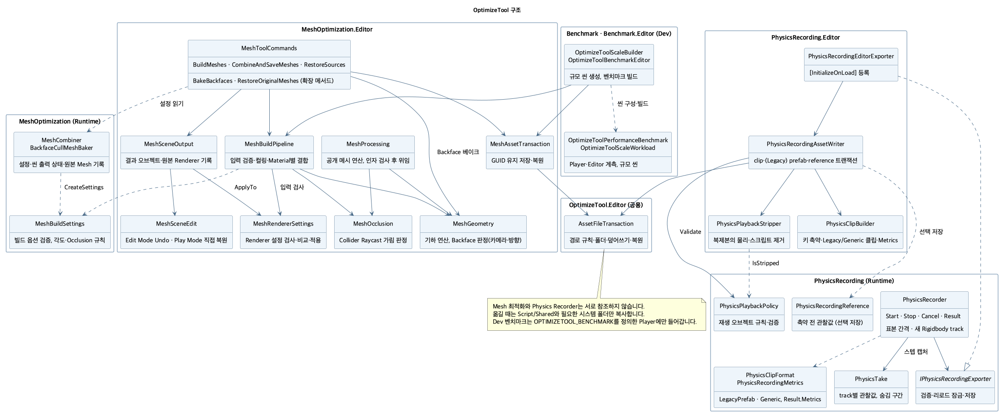
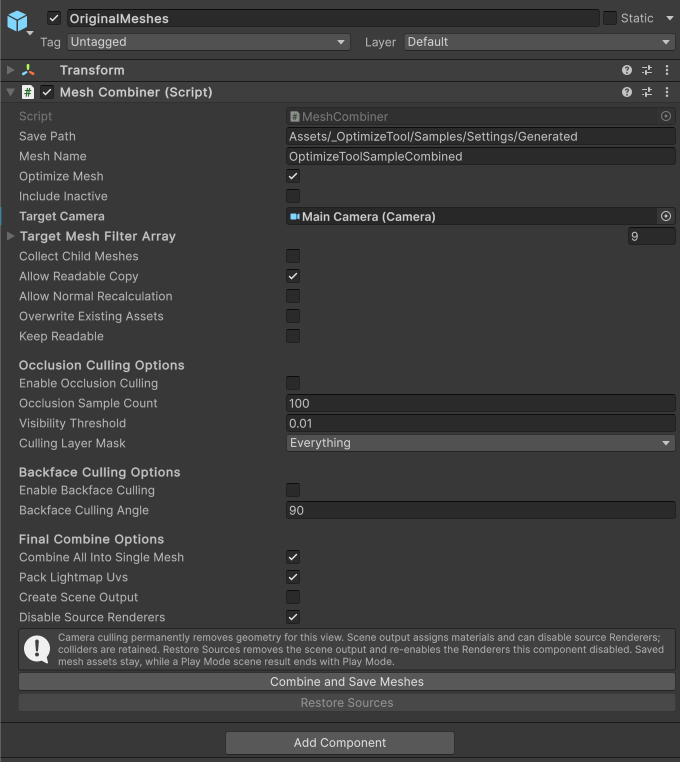
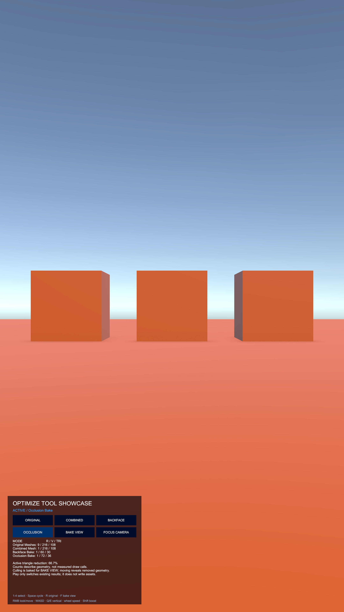
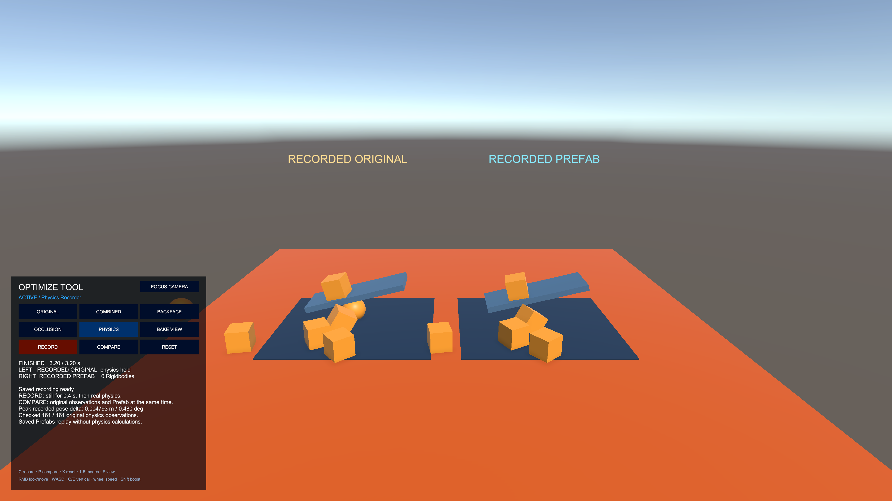

# OptimizeTool

Unity Editor에서 Mesh 결합·컬링과 물리 움직임 기록을 수행하고, 결과를 재사용 가능한 에셋으로 저장하는 도구 모음입니다. Mesh 최적화와 Physics Recorder는 서로 의존하지 않는 독립 시스템이며, 각각 Runtime과 Editor 어셈블리로 나뉩니다.

| 항목 | 내용 |
| --- | --- |
| 개발 | 유원석 (You Won Sock) · [GitHub](https://github.com/youwonsock) · qazwsx233434@gmail.com |
| 환경 | Unity 2023.2.20f1, C#, URP 16.0.6 (샘플만 URP 사용) |
| 도구 | `MeshCombiner`: Material별 Mesh 결합, Occlusion·Backface 컬링 · `BackfaceCullMeshBaker`: MeshFilter의 Mesh를 보이는 삼각형만 남긴 사본으로 제자리 교체 · `PhysicsRecorder`: 물리 움직임을 AnimationClip과 Prefab으로 기록 |
| 예제 | `Samples/Scenes/OptimizeToolSample.unity` |

구현 세부는 [TechnicalNotes.md](Docs/TechnicalNotes.md)에 있습니다.

## 시작하기

1. `Tools > OptimizeTool > Build Showcase Assets`로 비교용 결과를 만듭니다. 선택 오브젝트는 필요 없습니다.
2. `Samples/Scenes/OptimizeToolSample.unity`를 Play합니다. `1~4`로 Original / Combined / Backface / Occlusion을, `5`로 PHYSICS 모드를 봅니다.
3. `F`는 베이크 시점으로 카메라를 되돌립니다. 우클릭 자유 카메라로 다른 각도에서도 볼 수 있습니다.

## 다른 프로젝트로 옮기기

`Assets/_OptimizeTool/Script/` 아래만 `.meta`와 함께 복사합니다. 두 시스템은 서로 참조하지 않으므로 필요한 쪽만 옮길 수 있습니다.

| 옮길 시스템 | 복사할 폴더 | 패키지·모듈 |
| --- | --- | --- |
| Mesh 최적화 | `Script/Shared` + `Script/MeshOptimization` | Physics 모듈(Occlusion Raycast) |
| Physics Recorder | `Script/Shared` + `Script/PhysicsRecording` | Physics, Physics 2D, Cloth, Particle System, Animation 모듈 |
| 둘 다 | `Script/` | 위 둘의 합 |

- 세 경우 모두 Unity 2023.2.20f1 빈 프로젝트에 위 패키지만 넣고 해당 폴더만 복사해 확인했습니다. 어셈블리가 오류 없이 컴파일되고 컴포넌트를 붙일 수 있습니다.
- Runtime 어셈블리(`Common.OptimizeTool.MeshOptimization`, `Common.OptimizeTool.PhysicsRecording`)는 패키지를 참조하지 않고 `UnityEditor` 코드도 없어 Player에 그대로 들어갑니다. 결합·베이크·녹화 저장은 각 시스템의 Editor 어셈블리에서만 동작합니다.
- 공용 Editor 어셈블리 이름은 `Common.OptimizeTool.Editor`입니다. 옮길 프로젝트에 같은 이름의 어셈블리가 없어야 합니다.
- `Samples/`(샘플 스크립트, 씬, Prefab, 설정. UGUI와 URP 필요)와 `Dev/`(벤치마크 코드와 규모 씬. URP 필요)는 옮기지 않아도 됩니다. 문서가 필요하면 이 README와 `Docs/`를 함께 옮깁니다.

## 구조



<sub>PlantUML 원본: [Docs/optimizetool-structure.puml](Docs/optimizetool-structure.puml)</sub>

```
_OptimizeTool/
  Script/
    Shared/Editor/        Common.OptimizeTool.Editor                    에셋 저장 공용 규칙
    MeshOptimization/     Common.OptimizeTool.MeshOptimization          컴포넌트 설정과 씬 출력 상태
      Editor/             Common.OptimizeTool.MeshOptimization.Editor   결합·컬링·저장, Inspector
    PhysicsRecording/     Common.OptimizeTool.PhysicsRecording          녹화, 원본 관찰값, 재생 규칙
      Editor/             Common.OptimizeTool.PhysicsRecording.Editor   클립·Prefab 저장
  Samples/                Scripts, Scenes, Prefabs, Settings
  Dev/
    Benchmark/            Common.OptimizeTool.Benchmark                 성능 측정 Player 코드, 규모 씬과 생성 결과
    Editor/               Common.OptimizeTool.Benchmark.Editor          규모 씬 생성, GPU 타이머 플러그인, 벤치마크 빌드
  Docs/                   문서, 측정 Python 스크립트(Docs/Performance)
```

- **Mesh 최적화**의 컴포넌트는 설정만 갖고, 결합·베이크는 Editor 어셈블리의 `MeshToolCommands`가 수행합니다.
- **Physics Recorder**는 Play Mode 캡처를 Runtime 어셈블리에서 합니다. 저장은 Editor 어셈블리가 `[InitializeOnLoad]`로 등록하는 Exporter가 맡습니다.
- 두 시스템이 함께 쓰는 것은 공용 Editor 어셈블리의 `AssetFileTransaction` 하나입니다. Mesh 최적화는 그중 경로·이름·출력 자리 검증, 폴더 생성, Play Mode 전환 검사만 쓰고, Mesh 저장과 복원은 `MeshAssetTransaction`이 직접 합니다. Physics Recorder는 GUID를 유지하는 `CreateOrReplace`와 실패 시 파일 복원 `Execute`까지 씁니다.
- 코드 메시지(예외, 로그, Inspector 문구·Tooltip·Header·HelpBox, XML·코드 주석, 샘플 화면 문구)는 모두 영어입니다. README와 TechnicalNotes 본문은 한국어이고, 인용하는 UI·로그 문구는 영어 원문 그대로 적습니다.

## Mesh 도구

Inspector 버튼이나 아래 API로 실행합니다. Edit Mode와 Editor Play Mode에서 모두 동작하고, Play Mode가 시작되거나 끝나는 중에는 거부합니다. 별도 초기화 없이 호출하고, 설정을 고친 뒤 같은 API로 재시도합니다. 컴포넌트는 설정만 갖고, 아래 API는 `MeshOptimization.Editor` 어셈블리의 확장 메서드(`MeshToolCommands`, namespace `Common.OptimizeTool.MeshOptimization.Editor`)입니다. 그래서 Editor 어셈블리의 코드에서만 호출할 수 있습니다.

| API | 동작 |
| --- | --- |
| `MeshCombiner.BuildMeshes()` | 임시 결과만 만듭니다. 반환값은 호출자가 `Dispose()`합니다 |
| `MeshCombiner.CombineAndSaveMeshes()` | 결합 결과를 Mesh 에셋으로 저장하고 씬 출력을 적용합니다 |
| `MeshCombiner.LastBuildWarnings` | 마지막 `BuildMeshes`·`CombineAndSaveMeshes`의 경고 목록입니다. 대체 카메라, 뷰 의존 베이크, 투명 재질, Probe, 라이트맵 UV, 빼낸 자식, 남은 이전 출력 같은 한계를 알리며 Inspector가 HelpBox로 보여 줍니다 |
| `MeshCombiner.RestoreSources()` | 씬 출력을 지우고 이 컴포넌트가 끈 원본 Renderer를 원래 상태로 되돌립니다. 저장한 Mesh 에셋은 남깁니다. Inspector의 **Restore Sources** 버튼과 같습니다 |
| `BackfaceCullMeshBaker.BakeBackfaces()` | MeshFilter마다 보이는 삼각형만 남긴 사본을 `<MeshFilter 이름>_BackfaceCulled.asset`으로 저장하고 그 MeshFilter의 Mesh를 바꿉니다. 이 Baker의 출력을 아직 쓰는 MeshFilter는 기록해 둔 원본에서 다시 베이크하므로 두 번 깎이지 않고, 그 사이 손으로 바꾼 Mesh는 새 원본이 됩니다. Inspector의 **Bake and Save Backfaces** 버튼과 같습니다 |
| `BackfaceCullMeshBaker.RestoreOriginalMeshes()` | 이 Baker의 출력을 아직 쓰는 MeshFilter에 기록한 원본 Mesh를 돌려주고 기록을 비웁니다. 저장한 Mesh 에셋은 남깁니다. Inspector의 **Restore Original Meshes** 버튼과 같습니다 |
| `MeshBuildPipeline.Build(sources, destinationWorldToLocal, settings)` | 컴포넌트 없이 MeshFilter 목록과 `MeshBuildSettings`로 임시 결과를 만듭니다. 저장은 `MeshAssetTransaction.Save`로 하고, 저장 콜백이 Prefab·씬 같은 다른 에셋도 쓰면 그 호출을 `AssetFileTransaction.Execute`로 감쌉니다. 샘플 빌더가 이 방식을 씁니다 |
| `MeshProcessing.ReadableCopy` · `SelectTriangles` · `CullBackfaces` · `TransformMesh` · `Combine` · `IsOccluded` | 파이프라인이 쓰는 메시 연산을 직접 부릅니다. 인자를 먼저 검사하고 원본 Mesh와 importer를 바꾸지 않으며, 돌려준 Mesh는 호출자가 저장하거나 파괴합니다. `CullBackfaces`는 카메라 또는 관찰 방향을 받습니다. 유한 값과 각도 범위 검사는 각 메서드가 안에서 하므로 따로 열지 않습니다 |

```csharp
// Editor code: an Editor folder, or an Editor assembly that references Common.OptimizeTool.MeshOptimization.Editor
using Common.OptimizeTool.MeshOptimization;
using Common.OptimizeTool.MeshOptimization.Editor;
using UnityEngine;

public static class MeshBuildExample
{
    public static void Inspect(MeshCombiner combiner)
    {
        using (MeshBuildResult result = combiner.BuildMeshes())
        {
            foreach (MeshBuildPart part in result.Parts)
                Debug.Log($"{part.Mesh.name}: {part.Mesh.vertexCount} vertices, {part.Materials.Count} materials");
        }
    }
}
```

- **입력:** 대상을 직접 지정하거나 자식 계층에서 수집합니다(동시 사용 불가). 병합 입력은 Layer·그림자·Probe·정렬 등 Renderer 설정이 같아야 하며, PropertyBlock·할당된 Lightmap·LODGroup 같은 입력은 저장 전에 거부합니다. Lightmap Static 입력은 결합 결과의 라이트맵이 겹치지 않게 소스마다 라이트맵 UV를 따로 배치합니다.
- **Occlusion:** 카메라에서 표본 점(Vertex와 삼각형 중심)으로 Raycast해 보이는 비율이 임계값보다 낮은 MeshFilter를 결합에서 뺍니다. Collider 기반 근사이며 픽셀 단위 판정이 아닙니다.
- **Backface:** 결합하면서 삼각형 법선과 카메라 방향의 각도로 보이지 않는 면을 지웁니다. 카메라나 Transform이 바뀌면 다시 베이크합니다.
- **Backface 제자리 베이크:** `BackfaceCullMeshBaker`는 결합하지 않고 MeshFilter마다 Mesh를 바꿉니다. Target Camera 대신 `_useCustomVector`로 고정한 관찰 방향(`_customCameraVector`, 카메라가 바라보는 방향)을 쓸 수 있습니다. 출력 이름이 겹치면 저장 전에 거부하고, 다른 기존 파일은 `_overwriteExistingAssets`를 켜야 덮어씁니다. 이 Baker가 쓴 출력은 덮어쓰기 설정 없이 다시 쓰지만, 이번 베이크 대상이 아닌 MeshFilter가 그 Mesh를 보여 주면 다른 기존 파일처럼 덮어쓰기를 켜야 합니다. 복제한 Baker나 같은 Prefab의 다른 인스턴스는 원본의 출력 목록을 물려받으므로, 그대로 베이크하면 원본의 결과를 덮지 않고 거부합니다. Save Path를 바꾸면 복제본은 자기 출력을 갖고 그 뒤로는 덮어쓰기 없이 다시 베이크합니다.
- **카메라:** 컬링을 켰는데 `_targetCamera`가 비어 있으면 Combiner와 같은 씬에서 켜진 `MainCamera` 태그 카메라를, 없으면 Hierarchy 순서로 첫 번째 켜진 카메라를 쓰고 `No Target Camera; using '<name>'.` 경고를 남깁니다. 씬에 켜진 카메라가 없으면 빌드가 실패합니다.
- **출력:** `Assets/` 하위에 저장하며 덮어쓰기는 명시적으로 허용해야 합니다. 실패하면 에셋과 씬 변경을 복원합니다.
- **Edit Mode와 Play Mode:** Edit Mode의 씬 변경은 Undo 한 단계와 Prefab 인스턴스 오버라이드로 남습니다. Play Mode에서는 Undo를 남기지 않고, 씬 결과(결과 오브젝트, 끈 Renderer, 바꾼 Mesh)는 Play Mode를 나가면 사라지며 저장한 에셋은 남습니다. Play Mode에서는 Play Mode를 시작할 때 결과가 쓰던 Mesh 에셋(저장된 씬이 참조하는 Edit Mode 결과)에 쓰지 않으므로, 그 경로에는 다른 출력 폴더나 이름을 고릅니다. 같은 Play Mode 세션에서 만든 출력은 일반 출력과 같아서, 파일이 있으면 덮어쓰기를 켜고 다시 쓸 수 있습니다. 정적 배칭된 Renderer는 Play Mode에서 Mesh가 배치 Mesh로 바뀌어 있으므로 입력으로 받지 않습니다.

컬링 결과는 베이크 시점에 종속되므로 움직이는 카메라용 일반 Mesh를 대체하지 않습니다. 결합은 개별 Renderer 컬링 단위를 줄이므로 가까운 정적 오브젝트끼리 묶습니다.

<p align="center">
  
</p>

샘플의 9개 큐브(앞줄 3개가 뒷줄 6개를 가림)에서 얻은 Geometry 수량입니다. GPU 메모리나 프레임 시간이 아닙니다.

| 모드 | Renderer | 정점 | 삼각형 | 삼각형 감소 |
| --- | ---: | ---: | ---: | ---: |
| Original | 9 | 216 | 108 | 0% |
| Combined | 1 | 216 | 108 | 0% |
| Backface | 1 | 60 | 30 | 72.2% |
| Occlusion | 1 | 72 | 36 | 66.7% |

<p align="center">
  
  
</p>

## PhysicsRecorder

Rigidbody가 있는 계층의 로컬 Transform을 물리 스텝마다 기록해, 물리 계산 없이 재생할 수 있는 에셋으로 저장합니다. Play Mode 코드에서 `using Common.OptimizeTool.PhysicsRecording;`으로 호출합니다. 컴포넌트와 API는 Runtime 어셈블리에 있지만 저장은 Editor가 맡으므로, Player에서 `StartRecording`을 부르면 "PhysicsRecorder saves takes only in the Unity Editor." 예외가 납니다.

| API | 동작 |
| --- | --- |
| `StartRecording(duration, clipName)` | 설정을 고정하고 기록 시작. 다음에 끝나는 물리 스텝이 시각 0의 첫 자세입니다. `clipName`을 비우면 `_clipName`을 씀. 잘못된 호출·설정은 예외 |
| `StopRecording()` | 마지막으로 끝난 물리 스텝까지를 저장하고 결과 반환. Legacy면 `.anim`·`.prefab`, Generic이면 `.anim`만 저장하고, `_saveReference`를 켜면 `.reference.asset`도 저장. 첫 물리 스텝 전에 멈추면 "No physics step was recorded" 실패 |
| `CancelRecording()` | 에셋을 쓰지 않고 기록을 버림 |
| `IsRecording` / `Result` | 기록 여부와 마지막 결과(`Succeeded`, `Error`, `Clip`, `Prefab`, `Reference`, `Metrics`, `StopReason`, `Duration`) |
| `ClipFormat` | 다음 take를 저장할 형식(`LegacyPrefab` 또는 `Generic`) |
| `TryGetTakeStartTime(out fixedTime)` | 진행 중인 take의 첫 물리 스텝 `Time.fixedTimeAsDouble`, 즉 클립의 시각 0. 기록 중이 아니거나 첫 스텝 전이면 false. 녹화 시계에 맞춰 무언가를 시작할 때 씁니다 |
| `Result.Metrics` | 프레임 수, track 수, 키 수, 커브 없이 저장한 track 수, 저장된 클립의 최대 위치·회전 오차(`PhysicsRecordingMetrics`) |

- `_root` 아래 모든 Transform을 기록하며, 하나 이상에 Rigidbody가 있어야 합니다. 출력은 `_savePath`(Assets/ 아래 폴더)에 `_clipName` 이름의 `.anim`·`.prefab`(·`.reference.asset`)으로 저장하고, `_overwriteExistingAssets`를 켜야 같은 이름의 기존 출력을 GUID를 유지한 채 덮어씁니다.
- **표본 간격:** `_sampleInterval`(초, 기본 0)이 0이면 모든 물리 스텝을, 아니면 마지막 기록 뒤 그만큼 지난 스텝만 기록합니다. 녹화 시간에 닿는 스텝, 그리고 멈추거나 꺼질 때의 마지막 스텝은 항상 기록하므로 take는 실제 마지막 자세로 끝납니다. 허용치는 기록한 스텝에서만 보장합니다.
- **녹화 중 생긴 오브젝트:** 기록 중 `_root` 아래에 새로 켜진 Rigidbody는 그 위의 새 Transform과 함께 track이 됩니다. 이전 프레임은 처음 관찰한 자세로 채우고, 클립에서는 GameObject 활성 커브로 생긴 시각까지 숨깁니다. 처음부터 꺼져 있던 자식은 take 내내 숨깁니다. 그 밖의 활성 상태 변화는 기록하지 않습니다. 새 오브젝트의 경로는 고유해야 하므로, 같은 이름으로 여러 번 생성되면 take가 실패합니다.
- 키는 `_positionTolerance`(기본 0.005m)·`_rotationTolerance`(기본 0.5°) 이내로 줄입니다. 저장된 클립을 선형 재생했을 때 모든 물리 스텝에서 오차가 이 값 이하이고, 0이면 모든 스텝을 키로 남깁니다.
- 움직이지 않은 루트에는 커브를 쓰지 않으므로 저장한 Prefab을 어디에 두어도 그 자리에서 재생됩니다. `_omitStillTracks`(기본 꺼짐)를 켜면 모든 프레임이 첫 자세의 허용치 안에 있는 다른 track도 커브 없이 저장하고, 저장한 Prefab에 첫 자세를 넣어 오차를 허용치 안에 둡니다.
- **클립 형식:** `_clipFormat`이 `LegacyPrefab`(기본)이면 Legacy 클립과 그것을 재생하는 Prefab을, `Generic`이면 Animator Controller에 넣을 Generic 클립만(·Reference) 저장합니다. Generic으로 저장할 때 같은 이름의 Legacy Prefab이 있으면 그 Prefab이 재생할 수 없는 클립으로 덮이므로 저장 전에 실패합니다. Prefab을 지우거나 다른 이름을 씁니다.
- Legacy Prefab에서는 Rigidbody·Collider·게임 스크립트 등을 제거합니다. 원본 계층은 바꾸지 않습니다.
- `_saveReference`(기본 꺼짐)를 켜면 축약 전 원본 관찰값을 `.reference.asset`으로 함께 저장합니다. 클립 정확도를 나중에 확인할 때 쓰며, 샘플 비교가 이 파일을 읽습니다. 끈 채로 같은 클립을 덮어쓰면, 그 클립을 가리키던 이전 Reference는 새 클립과 맞지 않으므로 같은 저장에서 지웁니다(실패하면 함께 복원).
- 저장할 에셋 중 하나라도 실패하면 이전 파일을 복원하고, 실패는 예외가 아니라 `Result.Error`로 알립니다. 기록 중 비활성화되면 그때까지를 저장하고, 재컴파일은 저장이 끝날 때까지 미룹니다.

샘플의 PHYSICS 모드에서 **RECORD**(`C`)를 누르면 6개 Rigidbody의 낙하 3.2초를 기록합니다. 몸체는 녹화 시계로 0.4초에 놓이며, 데모는 Legacy Prefab을 비교하므로 Recorder의 Clip Format이 Generic이면 녹화 전에 거부합니다. 저장이 끝나면 왼쪽은 녹화 당시의 원본 자세를, 오른쪽은 저장된 Prefab의 Animation을 같은 시간축으로 재생하고 최대 위치·회전 차이를 표시합니다. Play 진입이나 모드 전환만으로는 에셋을 저장하지 않습니다.

<p align="center">
  
</p>

## 벤치마크

`Dev/Benchmark/Scenes/OptimizeToolScaleBenchmark.unity`는 225·900·3,600개 Renderer에 대한 Combined / Backface / Occlusion 결과를 제공합니다. `1–4`로 결과를, `Q/E`로 규모를 바꿉니다.

1. `Tools > OptimizeTool > Benchmark > Build Scale Benchmark Scene`, 이어서 `Build macOS Development Player`를 실행합니다. 활성 빌드 타깃은 macOS여야 하며, Apple Silicon ARM64·Metal·1920×1080이 필요합니다.
2. Console에 나온 빌드 폴더의 `OptimizeToolBenchmark.app`을 `--app`으로 넘겨 저장소 루트에서 측정하고 요약합니다.

```sh
benchmark_app="/absolute/build/folder/OptimizeToolBenchmark.app"
capture_root="/tmp/optimizetool-scale-$(date +%Y%m%d-%H%M%S)"

python3 ToyProject/Assets/_OptimizeTool/Docs/Performance/run_player_benchmark.py \
  --app "$benchmark_app" --output "$capture_root" \
  --cubes 3600 --rounds 8 --repeats 3

python3 ToyProject/Assets/_OptimizeTool/Docs/Performance/summarize_player_benchmark.py \
  "$capture_root" --output "${capture_root}-summary.json"
```

GPU 부하 측정은 `Build GPU Benchmark Scene`과 `Build macOS GPU Benchmark Player`로 빌드한 뒤 `Docs/Performance/run_gpu_benchmark_suite.py`로 수집합니다. 측정 조건과 결과 형식은 TechnicalNotes에 있습니다.

| API | 동작 |
| --- | --- |
| `OptimizeToolBenchmarkEditor.BuildBatch()` | `-executeMethod Common.OptimizeTool.Benchmark.Editor.OptimizeToolBenchmarkEditor.BuildBatch --optimize-build-output <폴더> [--optimize-gpu] [--optimize-arm64]`로 쓰는 batch 빌드 진입점입니다. 결과는 그 폴더의 `build-status.json`에 남습니다. `--optimize-arm64`는 Standalone 아키텍처 설정을 Apple Silicon으로 바꾸므로 따로 복제한 batch 프로젝트에서만 씁니다 |
| `OptimizeToolPerformanceBenchmark.StartEditorRun(folder, rounds)` | Editor Play Mode에서 수집을 시작하고 벤치마크 컴포넌트를 돌려줍니다. `Tools > OptimizeTool > Benchmark > Capture Editor Play Mode`가 이것을 부릅니다 |
| `Cancel()` | 진행 중인 수집을 멈춥니다. `error.txt`를 써서 부분 결과를 무효로 하고, 씬과 설정을 되돌린 뒤 `Completed`를 종료 코드 2로 알립니다. 이미 끝났으면 아무것도 하지 않습니다 |
| `IsCompleted` / `Completed` | 모든 구간을 수집해 완료 파일을 게시했는지와, 끝날 때 한 번 오는 종료 코드(0 완료, 1 오류, 2 취소·중단)입니다 |
