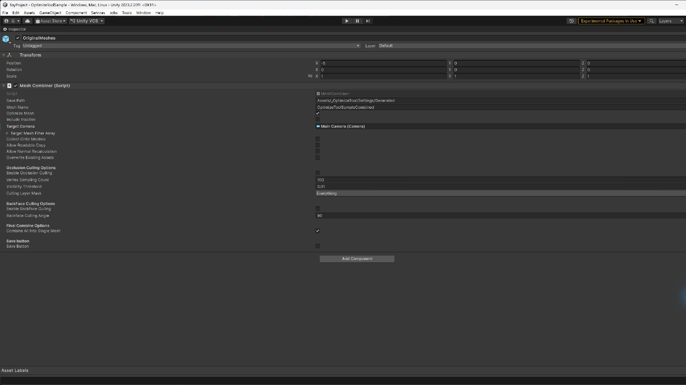
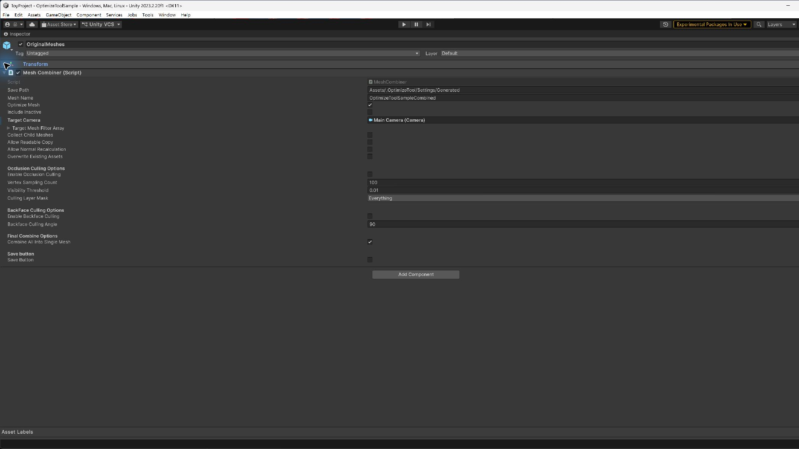
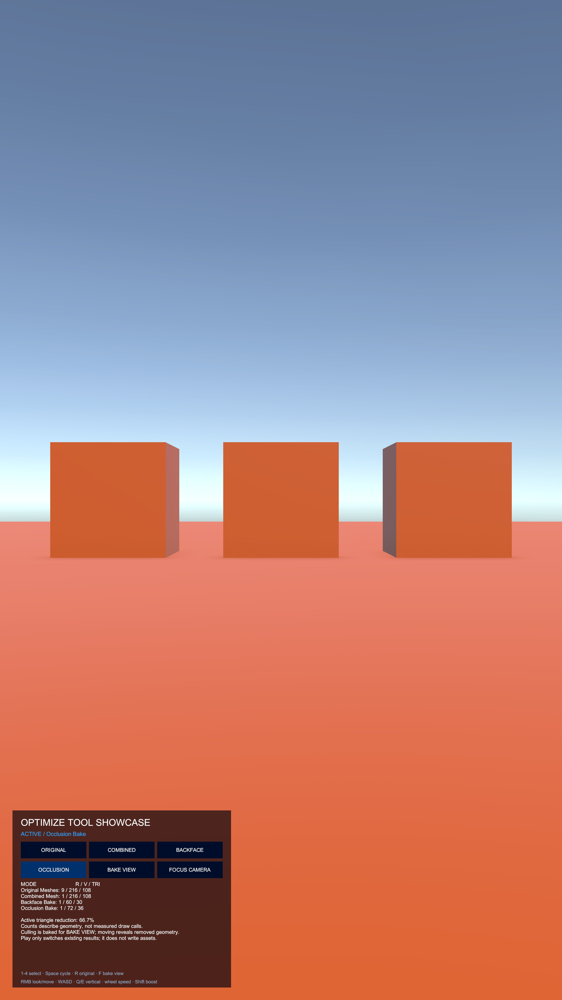
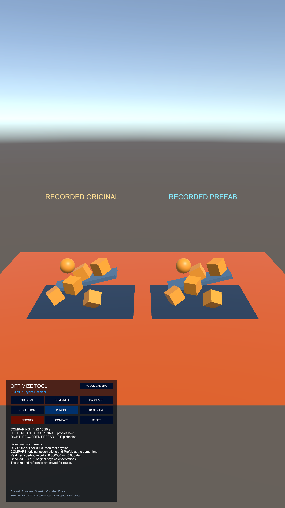
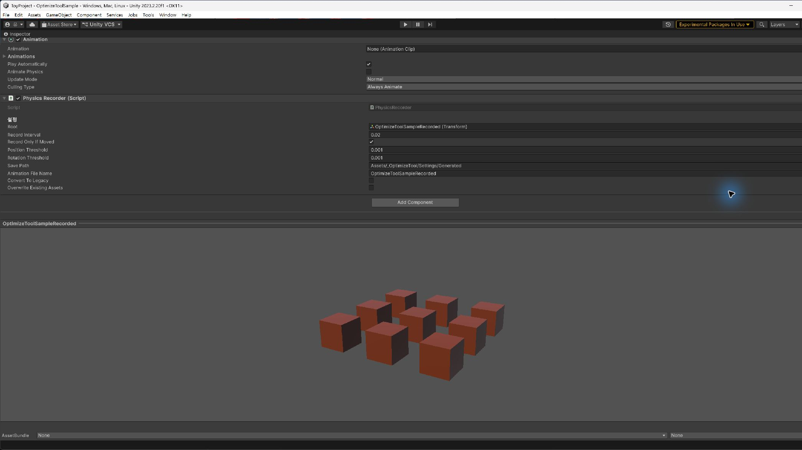

# OptimizeTool

Unity Editor에서 Mesh 결합·컬링과 물리 움직임 기록을 수행하고, 결과를 재사용 가능한 에셋으로 저장하는 도구 모음입니다. 에셋 생성 코드는 `Common.OptimizeTool` 네임스페이스의 `#if UNITY_EDITOR` 범위에 있습니다.

| 항목 | 내용 |
| --- | --- |
| 개발 | 유원석 (You Won Sock) · [GitHub](https://github.com/youwonsock) · qazwsx233434@gmail.com |
| 환경 | Unity 2023.2.20f1, C#, URP 16.0.6 |
| 도구 | `MeshCombiner`: Material별 Mesh 결합, Occlusion·Backface 컬링 · `BackfaceCullMeshBaker`: 방향 기준 삼각형 제거 베이크 · `PhysicsRecorder`: 물리 움직임을 AnimationClip과 Prefab으로 기록 |
| 예제 | `Scene/OptimizeToolSample.unity` |

구현 세부는 [TechnicalNotes.md](Docs/TechnicalNotes.md)에 있습니다.

## 시작하기

1. `Tools > OptimizeTool > Build Showcase Assets`로 비교용 결과를 만듭니다. 선택 오브젝트는 필요 없습니다.
2. `Scene/OptimizeToolSample.unity`를 Play합니다. `1~4`로 Original / Combined / Backface / Occlusion을, `5`로 PHYSICS 모드를 봅니다.
3. `F`는 베이크 시점으로 카메라를 되돌립니다. 우클릭 자유 카메라로 다른 각도에서도 볼 수 있습니다.

## Mesh 도구

Edit Mode에서 Inspector 버튼이나 아래 API로 실행합니다. 별도 초기화 없이 호출하고, 설정을 고친 뒤 같은 API로 재시도합니다.

| API | 동작 |
| --- | --- |
| `MeshCombiner.BuildMeshes()` | 임시 결과만 만듭니다. 반환값은 호출자가 `Dispose()`합니다 |
| `MeshCombiner.CombineAndSaveMeshes()` | 결합 결과를 Mesh 에셋으로 저장하고 씬 출력을 적용합니다 |
| `BackfaceCullMeshBaker.BakeBackFaceCullingMesh()` | 보이는 삼각형만 남긴 Mesh를 저장하고 `MeshFilter.sharedMesh`를 교체합니다 |

```csharp
#if UNITY_EDITOR
using Common.OptimizeTool;
using UnityEngine;

public static class MeshBuildExample
{
    public static void Inspect(MeshCombiner combiner)
    {
        using (MeshBuildResult result = combiner.BuildMeshes())
        {
            foreach (MeshBuildPart part in result.Parts)
                Debug.Log($"{part.Mesh.name}: {part.Mesh.vertexCount} vertices, {part.Materials.Length} materials");
        }
    }
}
#endif
```

- **입력:** 대상을 직접 지정하거나 자식 계층에서 수집합니다(동시 사용 불가). 병합 입력은 Layer·그림자·Probe·정렬 등 Renderer 설정이 같아야 하며, PropertyBlock·할당된 Lightmap·LODGroup 같은 입력은 저장 전에 거부합니다.
- **Occlusion:** 카메라에서 표본 Vertex로 Raycast해 보이는 비율이 임계값보다 낮은 MeshFilter를 결합에서 뺍니다. Collider 기반 근사이며 픽셀 단위 판정이 아닙니다.
- **Backface:** 삼각형 법선과 카메라 방향(또는 지정 벡터)의 각도로 보이지 않는 면을 지웁니다. 카메라나 Transform이 바뀌면 다시 베이크합니다.
- **출력:** `Assets/` 하위에 저장하며 덮어쓰기는 명시적으로 허용해야 합니다. 실패하면 에셋과 Undo에 등록한 씬 변경을 복원합니다.

컬링 결과는 베이크 시점에 종속되므로 움직이는 카메라용 일반 Mesh를 대체하지 않습니다. 결합은 개별 Renderer 컬링 단위를 줄이므로 가까운 정적 오브젝트끼리 묶습니다.

<p align="center">
  
  
</p>

샘플의 9개 큐브(앞줄 3개가 뒷줄 6개를 가림)에서 얻은 Geometry 수량입니다. GPU 메모리나 프레임 시간이 아닙니다.

| 모드 | Renderer | 정점 | 삼각형 | 삼각형 감소 |
| --- | ---: | ---: | ---: | ---: |
| Original | 9 | 216 | 108 | 0% |
| Combined | 1 | 216 | 108 | 0% |
| Backface | 1 | 60 | 30 | 72.2% |
| Occlusion | 1 | 72 | 36 | 66.7% |

<p align="center">
  
  
</p>

## PhysicsRecorder

Rigidbody가 있는 계층의 로컬 Transform을 물리 스텝마다 기록해, 물리 계산 없이 재생할 수 있는 에셋으로 저장합니다. Play Mode 코드에서 호출합니다.

| API | 동작 |
| --- | --- |
| `Init()` / `Release()` | 기록 세션의 수명. Fault 뒤에는 `Release()` 후 다시 `Init()` |
| `StartRecording(duration, animName)` | 설정을 고정하고 기록 시작 |
| `StopRecording()` | `.anim`·`.prefab`·`.reference.asset`을 저장하고 반환 |
| `Result` | `Succeeded`, `Clip`, `Prefab`, `Reference`, `StopReason`, `Metrics` |

- 정지 구간과 종료 자세를 보존하며 표본을 줄이고, Legacy Animation 형식의 클립으로 저장합니다.
- Prefab에서는 Rigidbody·Collider·게임 스크립트 등을 제거합니다. 원본 계층은 바꾸지 않습니다.
- 세 에셋 중 하나라도 저장에 실패하면 이전 파일을 복원합니다. 기록 중 `Release()`나 비활성화가 일어나면 그때까지를 동기로 저장합니다.

샘플의 PHYSICS 모드에서 **RECORD**(`C`)를 누르면 6개 Rigidbody의 낙하 3.2초를 기록합니다. 저장이 끝나면 왼쪽은 녹화 당시의 원본 자세를, 오른쪽은 저장된 Prefab의 Animation을 같은 시간축으로 재생하고 최대 위치·회전 차이를 표시합니다. Play 진입이나 모드 전환만으로는 에셋을 저장하지 않습니다.

<p align="center">
  
  
</p>

## 벤치마크

`Scene/OptimizeToolScaleBenchmark.unity`는 225·900·3,600개 Renderer에 대한 Combined / Backface / Occlusion 결과를 제공합니다. `1–4`로 결과를, `Q/E`로 규모를 바꿉니다.

1. `Tools > OptimizeTool > Benchmark > Build Scale Benchmark Scene`, 이어서 `Build macOS Development Player`를 실행합니다. 활성 빌드 타깃은 macOS여야 하며, Apple Silicon ARM64·Metal·1920×1080이 필요합니다.
2. Console에 나온 앱 경로로 저장소 루트에서 측정하고 요약합니다.

```sh
benchmark_app="/absolute/build/folder/OptimizeToolBenchmark.app"
capture_root="/tmp/optimizetool-scale-$(date +%Y%m%d-%H%M%S)"

python3 ToyProject/Assets/_OptimizeTool/Docs/Performance/run_player_benchmark.py \
  --app "$benchmark_app" --output "$capture_root" \
  --cubes 3600 --rounds 8 --repeats 3

python3 ToyProject/Assets/_OptimizeTool/Docs/Performance/summarize_player_benchmark.py \
  "$capture_root" --output "${capture_root}-summary.json"
```

GPU 부하 측정은 `Build GPU Benchmark Scene`과 `Build macOS GPU Benchmark Player`로 빌드한 뒤 `Docs/Performance/run_gpu_benchmark_suite.py`로 수집합니다. 측정 조건과 결과 형식은 TechnicalNotes에 있습니다.
