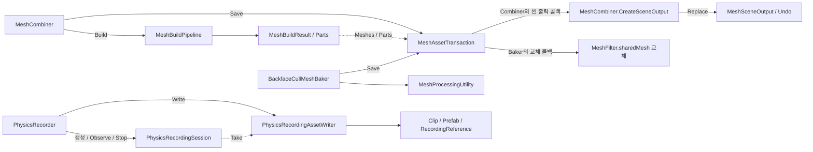
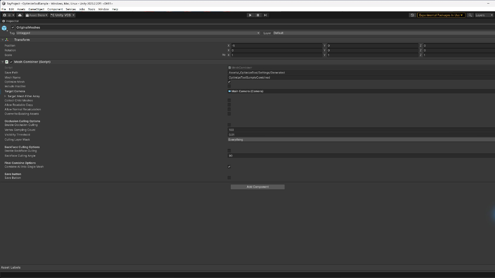
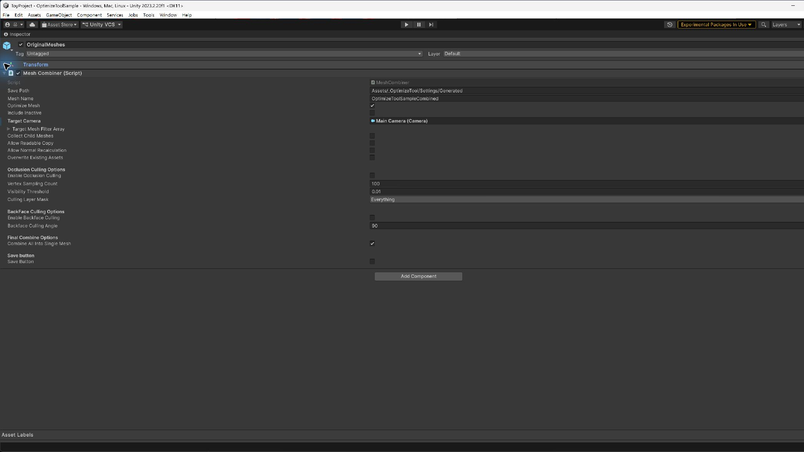
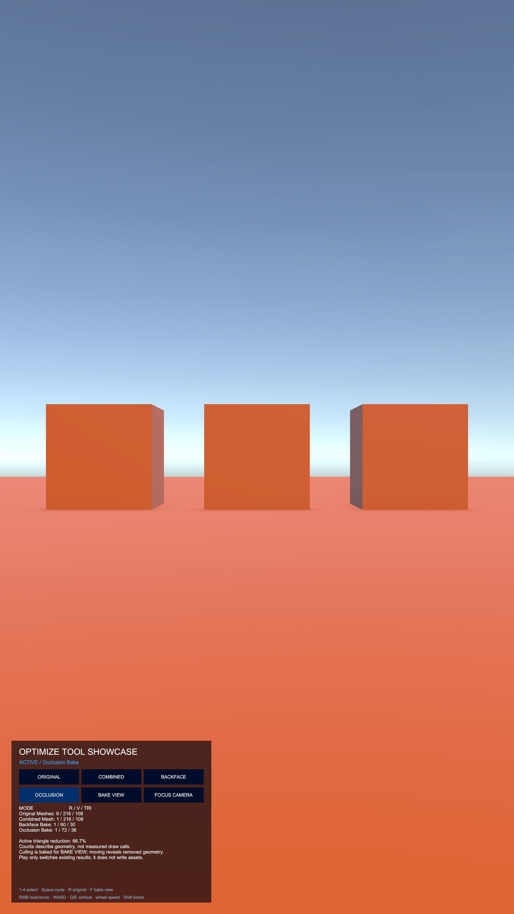
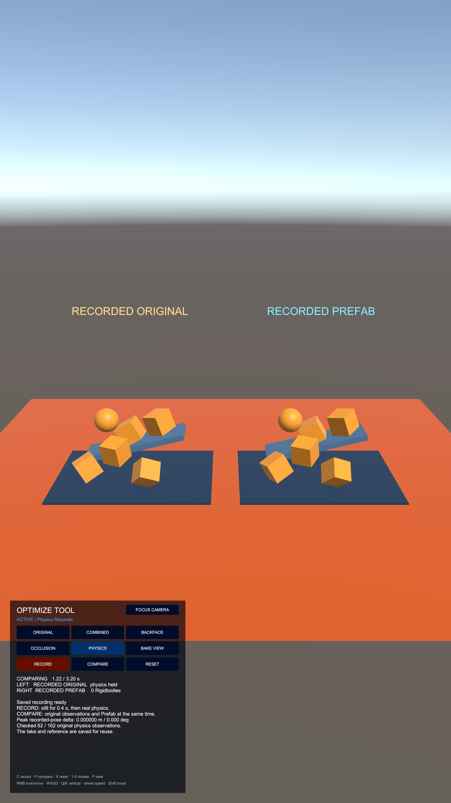
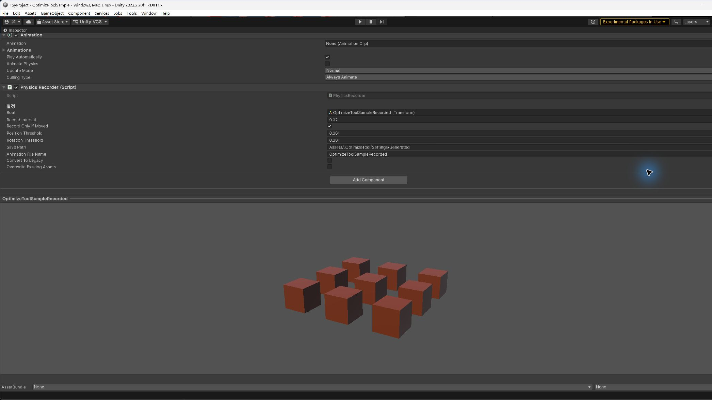

# OptimizeTool

Unity Editor에서 Mesh 결합·컬링·물리 움직임 기록을 수행하고, 결과를 재사용 가능한 Unity 에셋으로 저장하는 도구 모음입니다. 핵심 에셋 생성 로직은 `Common.OptimizeTool` 네임스페이스와 `#if UNITY_EDITOR` 범위에 포함됩니다.

## 목차

- [프로젝트 개요](#프로젝트-개요)
- [프로젝트 요약](#프로젝트-요약)
- [클래스와 호출 관계](#클래스와-호출-관계)
- [기능 상세](#기능-상세)
- [자동 테스트와 회귀 검증](#자동-테스트와-회귀-검증)

## 프로젝트 개요

| 항목 | 내용 |
| --- | --- |
| 개발 인원 | 1명 — 유원석 (You Won Sock) |
| GitHub | [youwonsock](https://github.com/youwonsock) |
| 이메일 | qazwsx233434@gmail.com |
| 프로젝트 목적 | Mesh 결합·컬링·물리 움직임을 Unity 에셋으로 생성하는 에디터 도구 구현 |
| 개발 언어 | C# |
| 개발 도구 | Unity 2023.2.20f1, Visual Studio 또는 Rider |
| 실행 환경 | Universal Render Pipeline 16.0.6, Unity Editor |
| 핵심 네임스페이스 | `Common.OptimizeTool` |

## 프로젝트 요약

OptimizeTool은 MeshFilter와 Rigidbody를 입력으로 받아 설정을 검증하고, Mesh·AnimationClip·Prefab을 에셋으로 저장하는 에디터 도구 모음입니다.

1. `MeshCombiner`가 직접 지정된 `MeshFilter` 또는 자식 계층에서 대상을 수집하고 입력·출력 설정을 검증합니다.
2. Readable Mesh와 Normal 데이터를 준비하고, 허용된 설정에 따라 임시 복사 또는 Normal 재계산을 수행합니다.
3. 선택적으로 Vertex Raycast 기반 Occlusion Culling과 각도 기반 Backface Culling을 적용한 뒤 Material·SubMesh별로 Geometry를 결합합니다.
4. `BackfaceCullMeshBaker`가 개별 Mesh의 삼각형을 카메라 방향 또는 사용자 지정 벡터 기준으로 검사해 별도 Mesh 에셋을 저장합니다.
5. `PhysicsRecorder`가 Rigidbody를 포함한 계층의 로컬 Transform을 기록하고, 재생용 Prefab·AnimationClip·원본 관찰값인 PhysicsRecordingReference를 함께 저장합니다.

핵심 처리 흐름

```text
Mesh 처리
MeshFilter 수집 → 설정·입력 검증 → Readable·Normal 처리
  → 선택적 Occlusion / Backface 처리 → Material별 SubMesh 결합
  → 설정된 Assets/ 하위 출력 폴더에 Mesh 에셋 저장

물리 기록
설정·계층 검증 → 시작 자세 → 물리 스텝별 localPosition / localRotation 관찰
  → 정지 구간·종료 자세를 보존한 표본 축약 → AnimationClip 커브 생성
  → 물리·게임플레이 컴포넌트를 제거한 Prefab 생성
  → .anim / .prefab / .reference.asset 동기 저장 또는 실패 복원 → Result 게시

샘플 비교
원본 기준 데이터 + 저장된 Prefab → 같은 시각의 자세 재현·오차 검사
  → 상태 표시 → RESET / 모드 전환 / 비활성화·재컴파일·파괴 시 정리
```

메시 도구는 Edit Mode의 Inspector 버튼에서 실행합니다. `BuildMeshes()`는 임시 결과만 만들고 `CombineAndSaveMeshes()`·`BakeBackFaceCullingMesh()`는 전체 결과 검증 후 에셋과 씬을 적용합니다. 메시 작업은 별도 초기화 없이 호출하며, 설정을 고친 뒤 같은 API로 재시도합니다. 출력은 `Assets/` 하위이며, 덮어쓰기는 명시적으로 허용해야 합니다. 실패하면 Mesh 에셋·명시적으로 선언한 부속 에셋·Undo에 등록한 씬 변경을 복원하고, 성공한 씬 변경과 기존 Mesh 에셋 변경은 Undo할 수 있습니다. Undo 시 새로 만든 에셋 파일은 남습니다. `PhysicsRecorder`의 기록·저장 수명주기는 아래 별도 설명을 따릅니다.

## 클래스와 호출 관계



실선은 호출·생성 관계, 점선은 결과 데이터 전달을 나타냅니다. `PhysicsRecorder`가 세션의 `Take`를 받아 Writer를 직접 호출하며, 세션은 Writer를 호출하지 않습니다. 메시의 씬 출력과 MeshFilter 교체는 각 도구가 전달한 `apply` 콜백에서 수행합니다. 콜백은 트랜잭션의 최종 저장 완료 전에 실행되며, 실패하면 에셋과 Undo에 등록된 씬 변경을 복원합니다.

메시 작업은 요청마다 검증·계산·저장하며 초기화 상태를 유지하지 않습니다. 물리 기록은 여러 물리 틱에 걸친 세션을 소유하므로 `Init`·`StartRecording`·`StopRecording`·`Release` 수명주기를 사용합니다.

핵심 관계

- `MeshCombiner`는 `MeshFilter` 입력을 검증하고 Material·SubMesh 단위로 `Mesh`를 결합·저장하며, 설정에 따라 Camera를 컬링 기준으로 사용합니다.
- `BackfaceCullMeshBaker`는 `MeshFilter`의 삼각형을 Camera 방향 또는 사용자 지정 벡터 기준으로 베이크하고 결과 Mesh로 교체합니다.
- `PhysicsRecorder`는 Rigidbody 자식의 Transform 로컬 위치·회전을 기록해 `AnimationClip`과 기록용 `GameObject` Prefab을 저장합니다.

### 클래스별 역할

- `MeshCombiner`: Inspector의 직렬화 설정을 빌드 요청으로 만드는 컴포넌트입니다. 입력 수집 후 빌드·저장·씬 적용 계층을 호출합니다.
- `MeshBuildRequest` / `MeshBuildPipeline`: 저장 경로와 분리된 빌드 입력·옵션을 검증하고 컬링·변환·Material별 결합을 실행합니다. `MeshVisibilityQuery`가 씬의 Physics 조회를 담당합니다.
- `MeshBuildResult`: Mesh와 Material 매핑을 항목별로 묶고 임시 Mesh만 소유합니다. 컬렉션은 읽기 전용이며 `Dispose()`는 원본 Mesh·Material·Renderer를 파괴하지 않습니다.
- `MeshSaveOptions` / `MeshAssetTransaction`: 출력 경로·충돌을 사전 검증하고 GUID를 유지해 저장합니다. 콜백이 쓰는 Prefab·부속 에셋 경로도 먼저 선언해야 복구 대상에 포함됩니다. 복구 오류가 나도 나머지 복구를 계속하며 원래 오류와 함께 보고합니다.
- `MeshSceneOutput`: Undo에 등록하면서 결과 Renderer를 생성하고 원본 Renderer를 비활성화합니다.
- `BackfaceCullMeshBaker`: 방향 기반 삼각형 제거, 결과 Mesh 저장, 입력 `MeshFilter.sharedMesh` 교체를 담당합니다.
- `PhysicsRecorder`: 기록 수명주기와 Transform 수집을 연결하는 컴포넌트입니다. 표본 축약·종료 시각 처리는 `PhysicsRecordingSession`, 커브 생성·물리 제거·에셋 저장은 `PhysicsRecordingAssetWriter`로 분리되어 있습니다.

물리 기록과 샘플 재생의 세부 책임은 다음과 같습니다. Showcase의 모드 선택은 `OptimizeToolOverviewController`를 통해 실행합니다.

| 클래스 | 역할과 소유 범위 |
| --- | --- |
| `PhysicsRecordingSettings` / `PhysicsPoseSample` | 녹화 시작 시 고정하는 설정과 시각별 로컬 자세 |
| `PhysicsRecordingSession` | 표본 축약, 정지 경계, 요청한 종료 시각의 보간과 원본 관찰값 보존 |
| `PhysicsRecordingAssetWriter` / `AssetFileTransaction` | 커브·Prefab·기준 데이터 생성, GUID 유지 저장, 실패 시 파일 복원 |
| `PhysicsRecordingResult` / `PhysicsRecordingMetrics` | 저장 결과·종료 사유·에셋 참조와 처리량·비용 정보 |
| `PhysicsRecordingReference` | 축약 전 원본 관찰값, Transform 경로, 클립·계층 검증 |
| `PhysicsPlaybackPolicy` | 출력 시 제거하고 재생 시 거부하는 물리·게임플레이 컴포넌트의 공통 규칙 |
| `PhysicsPrefabPlayback` | 검증한 Prefab 인스턴스 1개와 Animation 표본 재생·파괴 |
| `OptimizeToolPhysicsDemo` | 녹화·비교 상태, 원본 Rigidbody 정지, 코루틴과 재컴파일 정리 |
| `OptimizeToolOverviewController` / `OptimizeToolShowcaseUI` | 다섯 모드 선택, 상태 갱신, 버튼 활성 상태와 소유 리스너 관리 |
| `OptimizeToolPhysicsStatusFormatter` | 녹화·재생 실패, 기준 데이터 유무와 오차 검사 상태의 표시 문자열 |

재빌드에서는 다음 입력에도 남아 있는 원본 Renderer를 계속 비활성으로 유지하고, 제거된 원본만 기록해 둔 활성 상태로 복원합니다. 원본 비활성화 옵션을 끄면 소유한 원본 상태를 복원합니다. 이 정보는 컴포넌트에 직렬화되며 Undo/Redo와 Prefab 인스턴스에도 유지됩니다. 직접 지정한 MeshFilter는 Renderer 활성 여부와 관계없이 명시적인 베이크 입력입니다. 자식 수집은 사용자가 끈 Renderer를 제외하고 경고를 남기며, 이전 베이크가 끈 원본은 계속 포함합니다.

메시 도구의 실행 API는 `BuildMeshes()`·`CombineAndSaveMeshes()`·`BakeBackFaceCullingMesh()`입니다. 메모리 결과만 만들 때 저장 경로·파일명이 필요하지 않으며, 결과의 Mesh·Material 매핑은 `Parts`에서 조회합니다. `MeshBuildResult.Warnings`와 Inspector 진단은 Collider 기반 Occlusion, 투명·양면 재질, 다른 카메라·그림자·반사 및 Probe 샘플 위치의 한계를 설명합니다. 샘플 빌더도 같은 `MeshBuildRequest` API를 사용합니다.

`BuildMeshes()`의 반환값은 호출자가 소유하며 반드시 `Dispose()`해야 합니다. 다음은 입력과 옵션을 Inspector에서 설정한 `MeshCombiner`를 Editor 코드에서 조회하는 예제입니다. `using`은 정상 종료와 예외 발생 모두에서 임시 Mesh를 해제합니다.

```csharp
#if UNITY_EDITOR
using Common.OptimizeTool;
using UnityEngine;

public static class MeshBuildExample
{
    public static void Inspect(MeshCombiner combiner)
    {
        using (MeshBuildResult result = combiner.BuildMeshes())
        {
            foreach (MeshBuildPart part in result.Parts)
                Debug.Log($"{part.Mesh.name}: {part.Mesh.vertexCount} vertices, {part.Materials.Length} materials");
        }
    }
}
#endif
```

`using` 범위를 벗어나면 결과의 임시 Mesh가 파괴됩니다. `Parts[i].Mesh`를 외부에 보관하거나 MeshFilter에 할당한 채 이후에 사용하면 안 됩니다. 원본 Mesh·Material·Renderer는 해제하지 않습니다. 에셋과 씬 출력을 저장하려면 `CombineAndSaveMeshes()`를 사용합니다. 이 메서드는 내부 임시 결과를 정리하고 저장된 Mesh 에셋을 반환합니다.

병합 입력은 Layer·그림자·Probe·정렬·Rendering Layer·Motion Vector·Static Flag·Receive GI 설정이 같아야 합니다. 지원하는 설정은 출력 Renderer에 복사합니다. PropertyBlock, Additional Vertex Streams, 할당된 Lightmap, LODGroup, forceRenderingOff는 개별 Renderer의 동작을 보존할 수 없어 저장 전에 거부합니다. 카메라 기준 컬링은 해당 시점에 기하를 제거하는 베이크이며, 정점 Raycast 표본으로 판단하는 Occlusion은 Collider 기반 근사입니다.

샘플 모드의 이름·그룹·버튼 정의는 `OptimizeToolSampleModes`에 모았습니다. 기존 배열 순서와 직렬화 필드는 유지하고, Mesh 통계 문자열을 캐시해 모드 변경 때 갱신합니다. 물리 상태 표시는 상태 변화 또는 0.1초 간격으로 갱신합니다. 벤치마크의 전역 설정·Behaviour 활성 상태는 `BenchmarkEnvironmentScope`, Editor Game View 설정은 `GameViewCaptureScope`가 복원합니다. 진단 파일 기록이 실패해도 복원은 실행합니다.

초기 리팩터링 당시의 회귀 결과와 참조 보존 해시는 [RefactoringValidation.json](Docs/RefactoringValidation.json)에 보관합니다. 현재 계약의 검증 결과는 마지막 절에서 확인할 수 있습니다. 이전 성능 보고서의 CPU·GPU 수치를 이번 코드 정리의 성능 향상으로 해석하지 않습니다.

## 기능 상세

### Mesh 결합과 출력 에셋 생성

**목적**

여러 MeshFilter의 Geometry를 Material별로 결합해 Renderer와 Mesh 관리 단위를 줄이고, 결과를 재사용 가능한 Unity Mesh 에셋으로 저장합니다.

**핵심 구현**

- `_targetMeshFilterArray`로 대상을 직접 지정하거나 `_collectChildMeshes`로 자식 계층을 수집할 수 있으며, 두 입력 방식을 동시에 사용할 수는 없습니다.
- 입력 MeshFilter, MeshRenderer, Material, SubMesh, Triangle 인덱스를 처리 전에 검증합니다. Normal 데이터가 불완전하면 `_allowNormalRecalculation`이 켜진 경우에만 필요한 범위를 재계산합니다.
- Read/Write가 비활성화된 입력은 `_allowReadableCopy`가 켜진 경우 `UnityEditor.MeshUtility.AcquireReadOnlyMeshData`로 복사합니다. 원본 importer와 Mesh는 변경하지 않으며 임시 데이터는 작업 후 정리합니다.
- SubMesh 추출·Backface 제거는 원시 정점 레이아웃을 복사해 Tangent·Color·UV0~UV7을 보존합니다. 정점 65,535개를 초과하는 입력과 결과는 UInt32 인덱스를 사용합니다. Skinned/BlendShape 메시와 삼각형 이외 토폴로지는 명시적으로 거부합니다.
- 같은 Material의 SubMesh를 `CombineInstance`로 그룹화해 Material별 결과를 유지하고, `_combineAllIntoSingleMesh`가 켜지면 최종적으로 하나의 Mesh로 다시 결합합니다.
- `_optimizeMesh`는 단일 Material 출력과 다중 Material 출력 모두에 적용됩니다. 이는 정점·인덱스 재정렬이며 폴리곤 단순화가 아닙니다.
- `_createSceneOutput`은 결과 MeshFilter·MeshRenderer와 Material 배열을 생성합니다. `_disableSourceRenderers`는 원본 Renderer만 끄며 Collider는 유지합니다. 재실행 시 도구가 만든 결과는 자식 수집에서 제외합니다.
- 출력 좌표는 Combiner의 로컬 공간입니다. Lightmap이 이미 할당된 입력은 저장 전에 거부합니다. 메시를 결합한 뒤 결과 Renderer를 대상으로 조명을 베이크합니다.
- 결과 이름은 단일 출력에서 `_meshName.asset`, 여러 출력에서 `_meshName_0.asset` 형식으로 검증하며, 기존 에셋은 `_overwriteExistingAssets`가 켜진 경우에만 갱신합니다.

<p align="center">
  
</p>

### Vertex Raycast 기반 Occlusion Culling

**목적**

카메라에서 Mesh의 표본 Vertex로 Raycast를 보내 가시 표본 비율이 설정 임계값보다 작은 MeshFilter를 결합 대상에서 제외합니다. 픽셀 단위의 완전한 가시성 판정은 아닙니다.

**핵심 구현**

- 입력이 속한 PhysicsScene에서 Raycast하고 `_cullingLayerMask`에 지정된 Collider를 사용합니다. 대상 자신과 자식의 Collider, Trigger는 제외하며, 충돌 결과 버퍼가 가득 차면 확장해 누락을 막습니다. Orthographic 카메라는 평행 광선을 사용합니다.
- Vertex 수가 `_vertexSamplingCount` 이하이면 모든 Vertex를 검사하고, 더 많으면 균등한 간격으로 표본을 추출합니다.
- 보이는 표본 비율이 `_visibilityThreshold`보다 작으면 MeshFilter 전체를 결합 입력에서 제외합니다. 삼각형을 개별 삭제하는 방식은 아닙니다.
- Occlusion을 활성화하려면 Camera, 양수 샘플 수, `0..1` 범위의 visibility threshold, 유효한 LayerMask가 필요합니다.
- Occlusion 설정은 MeshCombiner의 선택적 입력 필터 단계에서 적용되며, 별도의 Occlusion Mesh 에셋을 베이크하는 기능이 아닙니다.

<p align="center">
  
</p>

### Backface Culling과 Mesh 베이크

**목적**

특정 카메라 방향에서 보이지 않는 삼각형을 제거한 Mesh를 새 에셋으로 베이크해 렌더링할 Geometry를 줄입니다.

**핵심 구현**

- `MeshCombiner`는 결합 과정에서 `_enableBackfaceCulling`과 `_backfaceCullingAngle`을 사용해 카메라 기준 Backface 옵션을 적용할 수 있습니다.
- 별도 `BackfaceCullMeshBaker`는 각 삼각형의 World-space Normal과 카메라 방향의 각도를 비교해 보이는 삼각형만 새 Mesh에 복사합니다.
- Perspective는 삼각형 중심에서 카메라 위치로 향하는 방향, Orthographic은 `-camera.forward`를 사용합니다. `_useCustomVector`는 지정한 관찰 방향의 반대 벡터를 사용하며 Camera가 필요 없습니다. 비균일·음수 Scale은 법선 역전치 변환과 결합 시 winding 보정으로 처리합니다.
- 카메라, Transform의 위치·회전·스케일 또는 각도 설정이 바뀌면 다시 베이크합니다. 모든 입력 결과를 먼저 계산한 뒤 한 배치로 저장·교체합니다.
- 입력 Mesh의 Normal이 없으면 `_allowNormalRecalculation`이 켜진 경우에만 삼각형을 기준으로 Normal을 재계산합니다.
- 결과는 입력 MeshFilter 이름에 `_BackfaceCulled`를 붙인 `.asset`으로 저장하고 성공하면 해당 `MeshFilter.sharedMesh`를 교체합니다. 출력 충돌이나 모든 삼각형이 제거되는 입력은 변경 전에 중단합니다.

<p align="center">
  
</p>


### 실제 메시 결과 비교 샘플

1. `Tools > OptimizeTool > Build Showcase Assets`를 실행합니다. 선택 오브젝트는 필요하지 않습니다. 기존 쇼케이스 Prefab을 격리된 Preview Scene에서 열고 동일한 `MeshCombiner.BuildMeshes()` 경로로 세 결과를 다시 계산합니다.
2. `Scene/OptimizeToolSample.unity`를 열고 Play합니다. `1~4` 또는 버튼으로 Original / Combined / Backface / Occlusion을 전환합니다.
3. `F` 또는 **BAKE VIEW**로 베이크 시점을 복원합니다. 우클릭 자유 카메라와 **FOCUS CAMERA**로 다른 각도에서 제거된 면도 확인할 수 있습니다.

| 모드 | Renderer | 정점 합계 | 삼각형 | 원본 대비 삼각형 감소 |
| --- | ---: | ---: | ---: | ---: |
| Original | 9 | 216 | 108 | 0% |
| Combined | 1 | 216 | 108 | 0% |
| Backface | 1 | 60 | 30 | 72.2% |
| Occlusion | 1 | 72 | 36 | 66.7% |

9개 큐브 중 앞줄 3개가 뒷줄 6개를 가리는 원근 배치입니다. Backface와 Occlusion은 각각 원본 입력에서 독립적으로 계산하며, 결합 메시를 복제하지 않습니다. 결과는 기존 GUID를 유지해 갱신되고 각 모드는 서로 다른 에셋을 참조합니다. 이 메시 비교 모드들은 Play 중 에셋을 생성하거나 저장하지 않습니다. PHYSICS 모드의 명시적인 RECORD 동작은 아래 설명처럼 녹화 에셋을 저장합니다. 쇼케이스의 Combiner는 별도 결과 그룹을 유지하도록 씬 출력 생성을 끈 상태로 저장합니다.

<p align="center">
  
  
</p>

UI의 수치는 Geometry 수량이며 GPU 메모리나 실제 Draw Call·프레임 시간 측정값이 아닙니다. 컬링 결과는 베이크 시점에 종속되므로 이동 카메라용 일반 메시를 대체하지 않습니다. 메시 결합은 개별 Renderer 컬링 단위를 줄이므로 가까운 정적 오브젝트 단위로 사용해야 합니다.

### 샘플 씬에서 실제 물리 기록과 비교

1. `Scene/OptimizeToolSample.unity`를 열고 Play한 뒤 **PHYSICS** 또는 `5`를 누릅니다. 기존 메시 비교는 `1~4`로 그대로 사용할 수 있습니다.
2. **RECORD** 또는 `C`를 누르면 6개의 Rigidbody가 0.4초간 정지한 뒤 중력으로 낙하해 경사면과 바닥에 충돌합니다. 총 3.2초를 `PhysicsRecorder`로 기록합니다. 녹화 중에는 모드 변경과 Reset을 잠시 막아 기록 대상을 유지합니다.
3. 저장이 완료되면 왼쪽은 녹화 당시의 물리 스텝별 원본 자세를 재현하고, 오른쪽은 방금 저장된 Prefab의 Animation을 같은 시간축으로 재생합니다. 비교 중 왼쪽 Rigidbody는 Kinematic으로 유지하고, 오른쪽 재생 오브젝트에는 Rigidbody·Collider·게임 스크립트가 없습니다.
4. **COMPARE** 또는 `P`는 비교를 다시 시작하고, **RESET** 또는 `X`는 양쪽을 초기 자세로 돌립니다. **BAKE VIEW** 또는 `F`는 현재 모드에 맞는 비교 시점을 복원하며 자유 카메라도 사용할 수 있습니다.

실제 기록 결과는 `Settings/Generated/PhysicsRecordings/OptimizeToolPhysicsTake.anim`과 `.prefab`에 저장됩니다. 커브 축약 전 원본 관찰값은 `.reference.asset`에 함께 저장되며, 세 에셋 중 저장이 실패하면 이전 파일들을 복원합니다. 다시 녹화하면 이 샘플 전용 에셋을 기존 GUID를 유지한 채 갱신합니다. Play 진입이나 메시 모드 전환만으로는 기록 에셋을 쓰지 않습니다. 다음 Play에서도 마지막 기록을 불러와 Compare할 수 있습니다.

녹화 중 쇼케이스나 데모 컴포넌트를 비활성화하면 그 시점까지 동기로 저장합니다. 저장에 성공하면 Ready로 돌아가고, 실패하면 기존 에셋 복원을 시도한 뒤 Error를 표시합니다. 다시 활성화한 뒤 저장된 부분 녹화를 Compare하거나 새로 Record할 수 있습니다. 첫 물리 틱 전에 비활성화하면 녹화 시작을 취소합니다.

재컴파일 전에는 진행 중 녹화를 같은 저장 경로로 종료하고 재생 인스턴스를 정리합니다. 재로드 후 UI는 기존 패널을 찾아 참조와 리스너를 복구합니다. 비활성 상태의 반복 RESET도 이전 재생 인스턴스를 교체하고 재컴파일 정리 등록을 유지합니다. 비교 도중 예외가 나면 물리를 정지하고 실패한 재생 인스턴스를 제거합니다. 클립과 기준 데이터가 유효한 저장 결과로 COMPARE하거나, RECORD로 새 녹화를 만들 수 있습니다. 기준 데이터가 없으면 RECORD를 안내합니다.

데모 컴포넌트만 파괴하면 다음 UI 갱신에서 RECORD·COMPARE·RESET을 비활성화하고 세 버튼의 소유 콜백을 제거합니다. 상태는 `Physics Recorder demo is unavailable.`로 표시하며, 나머지 모드·카메라 버튼은 계속 사용할 수 있습니다. 재생 인스턴스와 데모 재로드 콜백도 파괴 시 해제합니다.

클립 종료 시각이 물리 틱 사이에 있으면 원본 기준 데이터에도 보간한 종료 자세를 보존합니다. 양쪽의 화면은 같은 재생 시각을 사용하며, 오차는 프레임이 건너뛴 경우에도 시작·종료를 포함한 모든 원본 관찰 시각에서 검사합니다. 수치는 대응되는 Transform 경로의 로컬 위치·회전을 비교하므로 두 전시 공간의 배치 간격은 오차에 포함되지 않습니다.

패널의 Peak recorded-pose delta는 녹화 당시 원본 관찰값과 저장된 Prefab의 커브 재생 사이의 최대 위치·회전 차이입니다. 설정된 표본 간격·움직임 임계값에 따른 축약 오차도 그대로 표시합니다. 비교에는 같은 녹화에서 저장한 `.anim`·`.prefab`·`.reference.asset`이 필요합니다. 기준 데이터가 없거나 클립·계층이 맞지 않으면 재생을 중단하고 오류를 표시합니다. RECORD로 새 녹화를 만들면 다시 비교할 수 있습니다. 원인 분석과 검증 결과는 [녹화 기준 비교 개선 기록](Docs/PhysicsRecordedComparison.md)을 참고하세요. 샘플 계층을 다시 만들려면 `Tools > OptimizeTool > Build Physics Recorder Demo`를 사용합니다. `Build Showcase Assets`도 이 데모 구성을 포함합니다.

기본 Showcase Prefab에는 저장된 녹화와 대응하는 `PhysicsRecordingReference`가 직렬화돼 있습니다. Player에서도 이 참조를 사용하며 Editor 전용 AssetDatabase 조회에 의존하지 않습니다. 직접 샘플을 구성할 때도 두 참조를 함께 지정해야 합니다.

<p align="center">
  
</p>

### 규모 확장 Player 샘플

`Assets/_OptimizeTool/Scene/OptimizeToolScaleBenchmark.unity`는 225·900·3,600개 원본 Renderer와 실제 Combined / Backface / Occlusion 베이크를 제공합니다. `1–4`로 결과를 전환하고 `Q/E`로 규모를 바꿉니다. 기존 9개 큐브·물리 녹화 쇼케이스는 유지됩니다.

동일 Material의 정적 큐브를 직교 카메라 앞 3개 깊이 층으로 배치했습니다. 각 규모에서 카메라와 화면 점유율을 고정하고, 그림자·Light/Reflection Probe·GPU Instancing·Dynamic Batching을 끕니다. Collider는 베이크 후 제거하므로 Player 측정 중 물리·메시 생성 비용이 없습니다. 이 조건은 Renderer 제출 비용과 기하 감소를 비교하기 위한 것이며 일반 게임 씬 전체를 대표하지 않습니다.

- `Tools > OptimizeTool > Benchmark > Build Scale Benchmark Scene`: 실제 빌드 파이프라인으로 샘플 재생성.
- `Tools > OptimizeTool > Benchmark > Build macOS Development Player`: 확장 샘플만 포함하는 Player 빌드.
- Player 인자 `--optimize-benchmark /absolute/output --optimize-benchmark-cubes 3600 --optimize-benchmark-rounds 8`: 같은 모드들을 예열·반복 측정.
- 선택 인자 `--optimize-benchmark-fps 240`: 일정한 프레임 처리 속도에서 GPU 타이밍 대조. 기본은 `targetFrameRate=-1`입니다.
- Player 시작 화면 완료·포커스를 확인하고 실제 시간 3초를 기다립니다. 모드 전환 예열은 90프레임과 0.25초를 모두 충족하며, 측정 중에는 입력·UI를 중지합니다.
- [실행 스크립트](Docs/Performance/run_player_benchmark.py)는 Player 포커스·ARM64 실행·해상도·GPU 유효성·타임스탬프·표본 수를 검사합니다. [분석 스크립트](Docs/Performance/summarize_player_benchmark.py)는 실행과 구간을 나눠 변화율·신뢰구간을 계산합니다.

#### macOS Player 빌드와 측정 절차

1. Unity 2023.2.20f1에서 `ToyProject`를 열고 Play를 종료한 뒤 컴파일 완료를 기다립니다. `File > Build Settings`에서 `PC, Mac & Linux Standalone`을 선택하고 Target Platform을 macOS로 지정해 `Switch Platform`을 실행합니다. 빌드 메뉴는 활성 타깃이 `StandaloneOSX`인지 검사하며 자동으로 전환하지 않습니다.
2. 현재 측정 스크립트는 **Apple Silicon에서 네이티브 ARM64 실행·Metal·1920×1080**을 요구합니다. Player Settings의 아키텍처는 ARM64 또는 arm64를 포함한 Universal로 준비하고 Rosetta로 실행하지 않습니다. 빌드 메뉴는 기존 Player 설정을 유지하므로 아키텍처도 자동으로 바꾸지 않습니다. Python 3를 준비합니다.
3. `Tools > OptimizeTool > Benchmark > Build Scale Benchmark Scene`으로 입력을 생성한 뒤 `Build macOS Development Player`를 실행합니다. 생성된 Player는 Development Build이며 확장 샘플 씬만 포함합니다.
4. Console의 `OptimizeTool benchmark build succeeded at ...` 메시지에서 출력 폴더를 확인합니다. 메뉴 빌드의 기본 출력은 `Path.GetTempPath()` 아래 `OptimizeToolBenchmark-yyyyMMdd-HHmmss`이며, 앱은 그 안의 `OptimizeToolBenchmark.app`입니다. 같은 폴더의 `build-status.json`이 `Succeeded`인지 확인한 뒤 측정합니다. 결과를 보존하려면 임시 폴더의 앱을 별도 위치로 복사합니다.
5. 저장소 루트에서 아래 명령을 실행합니다. `benchmark_app`은 Console에서 확인한 실제 앱 경로로 바꿉니다. 수집은 새 출력 폴더를 사용하며, 창 모드 실행 중에는 Player 포커스를 유지합니다.

```sh
benchmark_app="/absolute/build/folder/OptimizeToolBenchmark.app"
capture_root="/tmp/optimizetool-scale-$(date +%Y%m%d-%H%M%S)"

python3 ToyProject/Assets/_OptimizeTool/Docs/Performance/run_player_benchmark.py \
  --app "$benchmark_app" --output "$capture_root" \
  --cubes 3600 --rounds 8 --repeats 3

python3 ToyProject/Assets/_OptimizeTool/Docs/Performance/summarize_player_benchmark.py \
  "$capture_root" --output "${capture_root}-summary.json"
```

출력에는 실행 매니페스트와 `cubes-3600/run-*`별 `capture.json`·`frames.csv`·`metadata.json`·`complete.json`이 생성됩니다. 분석기는 v2 실행 ID·해시·완료 상태와 표본 구성을 검사합니다.

수집을 중단한 경우 같은 앱·옵션·`capture_root`로 실행 명령에 `--resume`을 추가하면 검증된 완료 실행을 재사용합니다. 실패한 수집은 따로 보존하고 다시 실행합니다. `Frame Timing is unavailable` 오류가 나면 Player Settings의 Frame Timing Stats를 활성화하고 재빌드합니다. GPU 오프스크린 측정은 아래 별도 GPU Player 빌드와 실행 스크립트를 사용하며, 그래픽이 필요한 경로이므로 `-nographics`를 사용하지 않습니다.

### GPU 부하와 구간 검증

`Tools > OptimizeTool > Benchmark > Build GPU Benchmark Scene`은 각 면을 64×64로 분할한 9·36·225개 큐브와 실제 최적화 Mesh를 생성합니다. `Build macOS GPU Benchmark Player`는 이 샘플의 별도 Player와 Metal 계측 플러그인을 빌드합니다. macOS Command Line Tools(`xcrun clang++`)가 필요합니다. 약 1.4 GiB의 고밀도 Mesh·GPU 씬·플러그인 바이너리는 재생성 가능한 로컬 산출물로 Git에서 제외했습니다.

[GPU 실행 스크립트](Docs/Performance/run_gpu_benchmark_suite.py)는 실제 Metal GPU를 사용하는 오프스크린 Player로 비동기·GPU 완료 동기화·60 FPS 제한 조건을 교차 수집합니다. RenderTexture를 매 프레임 명시적으로 렌더하고, 같은 커맨드 버퍼의 GPU 시작·종료 타임스탬프를 검증합니다. 한 픽셀 완료 readback은 측정 GPU 구간 밖의 진단이며 기본 샘플 실행에는 적용하지 않습니다. 표시 FPS를 GPU 시간으로 환산하지 않습니다.

225개·1,106만 삼각형의 연속 렌더링 완료 동기화 조건에서 GPU 구간 중앙값은 Original 6.316 ms, Combined 5.019 ms, Backface 1.677 ms, Occlusion 1.852 ms였습니다. 대응 구간 기준 Backface 71.63%, Occlusion 68.93% 감소를 확인했지만, 60 FPS 제한에서는 GPU 개선을 확정하지 못했습니다. 유효 성능 표본 51,840개·원시 타임스탬프·신뢰구간·한계는 [GPU 검증 보고서](Docs/Performance/PerformanceReport.md)에 있습니다.

### Draw Call · CPU · GPU 실측

앞선 저밀도 규모 샘플은 Apple M4 Pro / Metal / ARM64의 별도 Development Player(1920×1080)에서 225·900·3,600개 큐브를 반복 측정했습니다. 3,600개에서는 Draw Call 7,206→8회(99.89% 감소), CPU 전체 중앙값 2.206→0.615 ms(Combined)로 줄었습니다. GPU 보고값은 실행별 변동이 커 일관된 개선을 확인하지 못했습니다. 기본 조건과 240 FPS 대조 총 92,160개 유효 표본, 원시 데이터·신뢰구간·Player 재실행 방법은 [실제 성능 비교 보고서](Docs/Performance/PerformanceReport.md)에 있습니다. 기존 9개 큐브 Editor 측정 기록도 별도로 보존했습니다.

### 3,600개 저장·재빌드 개선

동일 입력을 전후 각각 별도 Editor 4회로 교차 측정한 저장·재빌드 수정 결과입니다. 신규 Mesh의 이름·읽기 설정을 생성 전에 확정해 중복 형상 저장을 없앴고, 재빌드는 유지되는 원본의 7,200회 불필요한 Renderer 변경을 생략했습니다. 콜백이 있는 저장과 기존 Mesh 덮어쓰기는 최종 저장·Undo·실패 복원을 유지합니다.

| 구간 | 수정 전 → 후 중앙값 | 대응 실행 기준 감소 |
| --- | ---: | ---: |
| 신규 Mesh 3개 저장 | 380.04 → 177.07 ms | 54.05% |
| 공개 API 재빌드 | 267.42 → 181.23 ms | 32.17% |
| 코어 계산+저장 | 927.67 → 712.75 ms | 25.56% |

첫 호출 시간과 전체 RSS의 확실한 개선은 확인하지 못했습니다. 위 값은 저장·재빌드 수정 당시의 Editor 실측이며, 아래 호환 코드 정리 후 새 성능 측정을 수행한 값은 아닙니다. 표본·신뢰구간·저장 결과 동등성은 [성능 보고서](Docs/Performance/PerformanceReport.md)와 [원시 자료](Docs/Performance/SaveRebuildFix-2026-10-24/README.md)에 있습니다.

### PhysicsRecorder 움직임 기록

책임 분리 과정, 저장 계약, 단계별 검증과 비용 측정의 이력은 [PhysicsRecorder 리팩터링 기록](Docs/PhysicsRecorderRefactoring.md)을 참고하세요.

**목적**

물리 시뮬레이션으로 움직인 Rigidbody 계층을 AnimationClip으로 변환해 런타임 물리 계산 없이 재생할 수 있는 출력 에셋으로 보관합니다.

**핵심 구현**

- `_root` 계층에는 Rigidbody가 하나 이상 필요합니다. 비활성 자식과 Rigidbody가 없는 부모의 움직임도 보존하도록 계층 전체 Transform의 `localPosition`·`localRotation`을 기록합니다.
- 시작 자세를 `t=0`에 저장하고 물리 스텝 완료 후 표본을 수집합니다. 기록 간격은 시작 시간에 고정하며, 실제 표본 해상도는 물리 스텝으로 제한됩니다. 요청한 종료 시각이 스텝 사이에 있으면 양쪽 표본을 보간합니다.
- `_recordOnlyIfMoved`는 임계값 이하 표본을 줄이되, 다시 움직이기 직전의 마지막 정지 표본과 종료 표본을 유지합니다. 커브는 선형 보간하고 Quaternion 부호 연속성을 보정합니다.
- `StartRecording(float duration, string animName = null)`은 설정을 스냅샷으로 고정하며 중복 시작·중복 계층 경로를 거부합니다. 기록 중 대상의 추가·삭제, 이름·부모·스케일 변경은 실패로 처리합니다. 활성 상태 변화는 애니메이션으로 기록하지 않습니다.
- `StopRecording()`은 녹화 중에 호출합니다. `<이름>.anim`·`<이름>.prefab`·`<이름>.reference.asset`을 저장하고 연결을 확인한 뒤 반환합니다. 성공은 `Result?.Succeeded == true`, 에셋과 종료 정보는 `Result`의 `Clip`·`Prefab`·`Reference`·`StopReason`·`Metrics`로 확인합니다. 실패한 작업의 Result는 이전 녹화의 에셋을 새 결과로 게시하지 않습니다. 진행 중인 녹화 처리나 에셋 저장에 실패하면 예외와 `LastError`를 제공하고 fault 상태가 되며, `Release()` 후 다시 초기화할 수 있습니다.
- Prefab은 비활성 임시 계층에서 복제해 원본 게임플레이 스크립트의 Awake/OnEnable 실행을 막고, MonoBehaviour·Rigidbody·Collider·Joint·Cloth·기존 Animator/Animation 등을 제거합니다. 원본 계층은 수정하지 않습니다.
- 클립은 Unity의 Legacy Animation 형식으로 저장하며 재생용 Animation의 기본 클립·자동 재생을 설정합니다. 이 형식은 현재의 물리 없는 재생에 사용하는 출력 계약입니다.
- `_overwriteExistingAssets`로 덮어쓰기를 허용하면 기존 에셋의 GUID를 유지합니다. 저장 실패 시 기존 파일을 복원하거나 새로 생성한 불완전한 파일을 제거합니다.
- 기록 중 `Release()` 또는 비활성화가 발생하면 남은 데이터를 동기로 저장합니다. 저장 완료를 기다리는 코루틴은 없습니다. 기록을 시작하는 전용 Inspector 버튼은 없으며 Play Mode 코드에서 API를 호출합니다.

<p align="center">
  
</p>

### 계측 결과의 실행 구분과 중단 복구

- 계측은 기존 결과가 없는 출력 폴더를 한 번만 사용합니다. Player 로그 파일만 있는 폴더는 허용하며, `capture.json`의 실행 ID로 중복 실행을 차단합니다. CLI와 `StartEditorRun`이 같은 수집기를 사용합니다.
- 결과 형식 v2는 실행 ID와 CSV·메타데이터의 SHA-256을 완료 파일에 기록합니다. 두 파일의 저장이 끝난 후 완료 파일을 원자적으로 게시하며 실패·중단은 완료 표시를 무효화합니다. 실행기와 오프라인 분석기는 같은 검증 함수를 사용합니다. 분석과 재개는 실행 ID·클레임·해시가 있는 v2 결과만 허용합니다. 버전이 없거나 v1인 결과, 오류 표시가 있는 실행은 거부합니다. 과거 보고서와 원시 자료는 검증 이력으로 보존하며 현재 분석기의 입력으로 자동 변환하지 않습니다.
- 취소, 컴포넌트 비활성화, 오브젝트 파괴, 출력 실패 시 모드·규모·카메라 위치/회전/투영과 계측용 전역 설정·Behaviour 활성 상태를 복원합니다. 종료 콜백은 한 번만 전달합니다.
- CSV의 `observed_frame`, `timing_timestamp`, `metal_frame_id`는 각각 관측 프레임, 지연된 CPU 타이밍, 별도 GPU 완료 기록의 식별자입니다. 같은 행을 동일 프레임의 CPU/GPU 쌍으로 해석하지 않습니다. 유효성 열은 사용할 수 없는 시간값 0을 구분합니다. 비교 통계는 워밍업 이후의 모드별 블록을 기준으로 합니다.
- 내부 책임은 옵션 해석(`BenchmarkRunOptions`), 결과 게시(`BenchmarkCaptureOutput`), CSV 출력(`BenchmarkCsvWriter`), 작업·카메라 복원(`BenchmarkWorkloadScope`)으로 분리했습니다. 자원 Scope와 네이티브 GPU 계측은 해당 자원을 소유한 범위에서 정리합니다. 렌더 설정은 현재 URP 16 API에서 직접 읽으며, 다른 파이프라인의 대체값을 기록하지 않습니다.

## 자동 테스트와 회귀 검증

Unity Test Runner에서 `Common.OptimizeTool.Tests`(EditMode)와 `Common.OptimizeTool.PlayModeTests`(PlayMode)를 실행합니다. 배치 실행 시 같은 어셈블리를 선택할 수 있습니다.

```sh
Unity -batchmode -projectPath /path/to/ToyProject -runTests -testPlatform EditMode \
  -assemblyNames Common.OptimizeTool.Tests -testResults /tmp/optimize-editmode.xml
Unity -batchmode -projectPath /path/to/ToyProject -runTests -testPlatform PlayMode \
  -assemblyNames Common.OptimizeTool.PlayModeTests -testResults /tmp/optimize-playmode.xml
```

`Unity`는 해당 버전의 Editor 실행 파일 경로로 바꿉니다. 배치 실행은 같은 프로젝트가 Editor에서 열려 있으면 사용할 수 없으므로 Editor를 닫거나 독립 복사본에서 실행합니다. EditMode의 `PhysicsDemoReloadLifecycleTests`는 실제 Play Mode 진입과 강제 재컴파일을 수행하고 최초 Enter Play Mode 옵션을 복원합니다.

검사는 자세·정지 구간 보존, 저장 완료·실패 복원, 기준 데이터의 필수 참조와 누락·불일치 거부, 씬·Prefab 참조, 재컴파일 후 UI 복구, 반복 RESET·비활성화·컴포넌트 파괴 후 인스턴스와 리스너 정리를 포함합니다. NUnit의 버튼 호출과 Game View에서의 실제 마우스 클릭은 별도 증거로 관리합니다. 이전 계약의 검증 이력은 [PhysicsRecorder 회귀 검증 기록](Docs/PhysicsRecorderRegressionValidation.md), 현재 계약의 결과는 아래 정리 검증 문서에서 확인합니다. CPU·GPU 성능 측정은 위 성능 보고서의 별도 실행 결과입니다.

2026-10-31 기준 **EditMode 117/117·PlayMode 38/38·Python 10/10** 통과했습니다(저장소 루트의 `Tools/run-tests.sh`). 2026-10-24 현재 계약 정리 후 EditMode 103/103·PlayMode 38/38·Python 10/10이었습니다. 최종 상태 표시 변경 후 관련 PlayMode 22개도 모두 통과했습니다. 정리 범위·원시 로그·실행 제한은 [현재 계약 정리 검증](Docs/CurrentContractCleanup/Validation.md)에 기록합니다. 메시 도구의 `Init`·`Release`·`IsInitialized`·`IsFaulted`, `MeshBuildResult.Materials`, 녹화 결과의 `ResultClip`·`ResultPrefab`·`IsSaveCompleted`, 기준 데이터 없는 녹화본 재생과 계측 v1 호환 처리를 제거했습니다. 호출부·테스트도 현재 API로 정리했으며 별도 마이그레이션 어댑터를 두지 않습니다.

물리 Recorder와 샘플 UI의 `Init`·`Release`는 실제 세션·리스너를 관리하는 현재 수명주기로 남습니다. Unity Animation 출력 형식과 `LegacyRuntime.ttf`는 현재 재생·UI에 사용 중인 엔진 기능입니다. 과거 측정 보고서·소스 스냅샷·로그는 당시 결과를 재현하는 이력 자료로 보존합니다.

추가 실제 클릭 5회로 기준 데이터 누락 시 재생 거부, RECORD를 통한 새 녹화와 세 에셋 저장, 비교 완료 및 RESET을 확인했습니다. 추가 검토의 전체 테스트 결과·소스 대조·클릭 기록은 위 검증 문서의 마지막 절에 있습니다.
