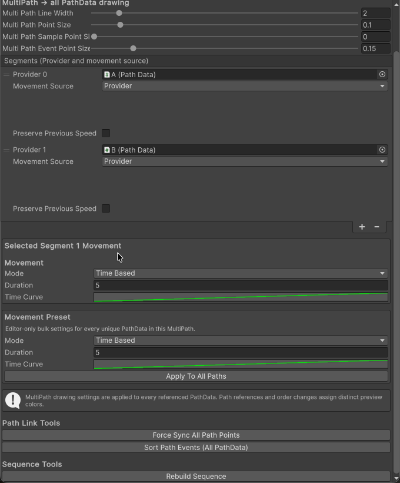
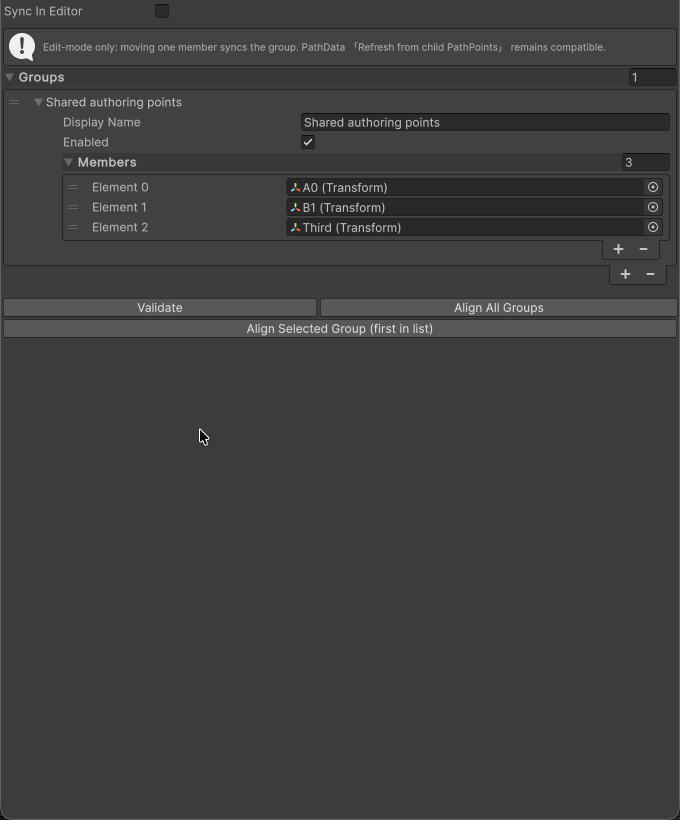

# TransformPath 에디터 UI 검증

- 검증일: 2026-10-23 (Asia/Seoul)
- 환경: Unity 2023.2.20f1, macOS, 그래픽 에디터 실행
- 대상: 현재 프로젝트의 `Common.TransformPath` Runtime/Editor와 기존 샘플
- 방식: 동일 소스를 복사한 별도 임시 Unity 프로젝트에서 원본 CustomEditor를 임시 EditorWindow에 렌더링했습니다. 체크박스와 버튼에는 Unity MouseDown/MouseUp 이벤트를 전달했고, Transform 편집에는 Inspector가 사용하는 SerializedObject/Undo 경로를 사용했습니다. 자동 연결은 실제 EditorApplication.update를 기다려 확인했습니다.
- 결과: 에디터 UI 시나리오 9개와 기존 회귀 테스트 24개를 합쳐 EditMode 33/33 통과. 기능 코드 수정은 필요하지 않았습니다.
- 보존: 이번 검증 시작 시 존재하던 TransformPath 파일 181개 모두 SHA-256 일치. 이식 전부터 보호한 씬·프리팹·샘플·설정·기존 메타 파일 105개도 원래 해시와 일치합니다. 검증 프로젝트와 현재 프로젝트의 C#/asmdef 소스도 바이트 단위로 일치합니다.

## 확인 항목

| 항목 | 관찰한 동작 | 결과 |
|---|---|---|
| MultiPath 자동 연결 | Inspector 체크박스로 활성화하면 앞 경로 끝점에 다음 경로 시작점이 정렬됨. 어느 쪽을 움직여도 반대쪽이 따라오며, 비활성화하면 독립적으로 이동함 | 통과 |
| 연결점 Undo/Redo | 이동 후 Undo하면 두 연결점이 이전 위치로, Redo하면 이동 위치로 함께 복원됨 | 통과 |
| MultiPath 버튼 | 스크롤 후 Force Sync All Path Points 클릭으로 연결점 정렬. Rebuild Sequence 클릭 후 IsReady 확인 | 통과 |
| 웨이포인트 Inspector 버튼 | Validate, Align All Groups, Align Selected Group (first in list) 클릭 후 실제 그룹 멤버의 위치 확인 | 통과 |
| 그룹 자동 동기화 | 첫 멤버와 세 번째 멤버를 각각 이동했을 때 모든 멤버의 위치가 일치함. PathData.Sample 결과도 새 위치를 반영함 | 통과 |
| 그룹 이동 Undo/Redo | 직접 이동한 멤버와 동기화된 멤버 전체의 위치가 함께 복원됨 | 통과 |
| 그룹 비활성화 | 그룹 Enabled를 끄면 멤버 위치를 동기화하지 않음 | 통과 |
| Inspector 그룹 목록 변경 | 그룹 목록을 비웠다가 새 그룹을 추가해도 Hierarchy 변경 없이 새 멤버 구성이 동작함 | 통과 |
| 그룹 정렬 버튼 Undo/Redo | Align All Groups 후 Undo하면 서로 달랐던 원래 위치가 복원되고, Redo하면 다시 정렬됨 | 통과 |

## 화면 증거

MultiPath Inspector에서 스크롤한 뒤 연결 및 재빌드 버튼을 실행한 화면입니다.

웨이포인트 그룹 Inspector입니다. 이 버튼 검증에서는 Sync In Editor를 꺼서 수동 정렬 버튼의 효과를 확인했습니다. 자동 동기화 활성화는 별도 시나리오에서 검증했습니다.

## 재실행

그래픽 Unity Editor의 Window > General > Test Runner > EditMode에서 `Common.TransformPath.Tests.TransformPathEditorUiTests`를 실행합니다. 임시 검증 오브젝트와 EditorWindow는 각 테스트 종료 시 정리합니다. Batch Mode에서는 이 UI 테스트를 건너뜁니다. 현재 검증처럼 별도 프로젝트 복사본을 사용하면 다른 에디터 작업 및 Undo 이력과 간섭하지 않습니다.

검증은 임시 오브젝트를 대상으로 했습니다. 기존 씬·프리팹·샘플 및 기존 메타 파일은 저장하거나 교체하지 않고, 검증 전후 SHA-256으로 보존을 확인합니다. 화면 확인은 원본 CustomEditor의 표시·버튼·체크박스를 대상으로 하며, OS 포인터를 이용한 Scene View 핸들 드래그는 이번 자동 검증 범위에 포함하지 않았습니다.
