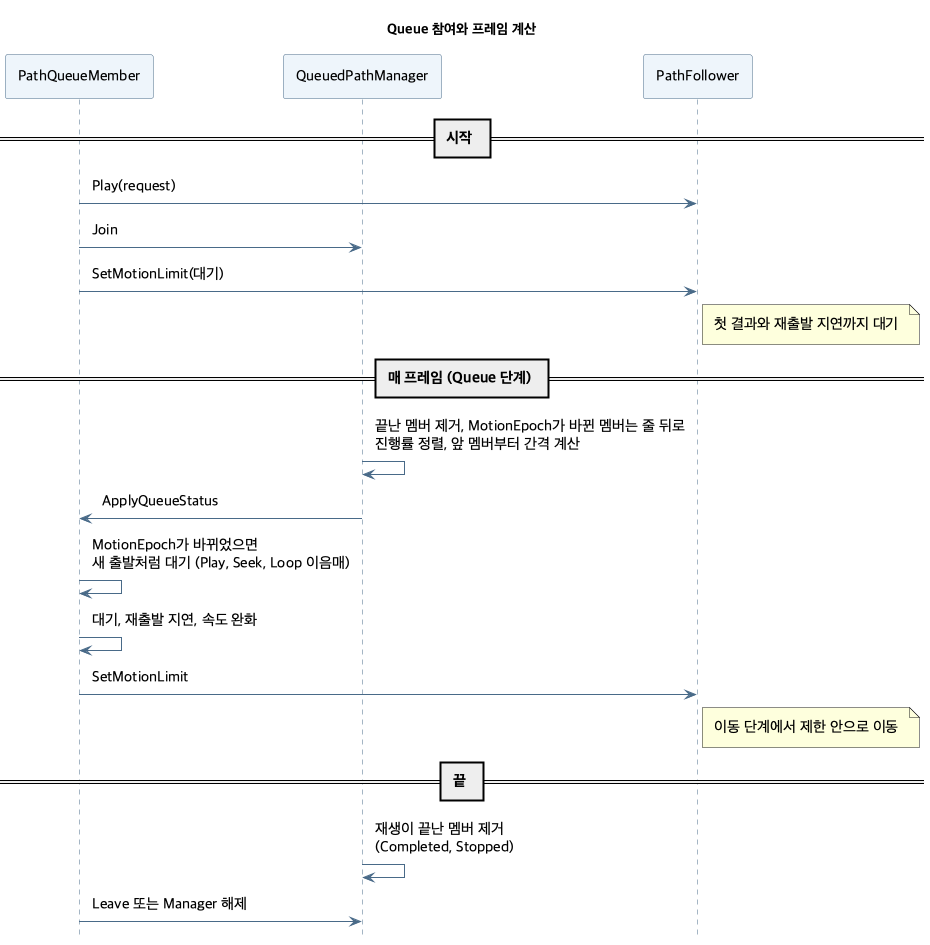
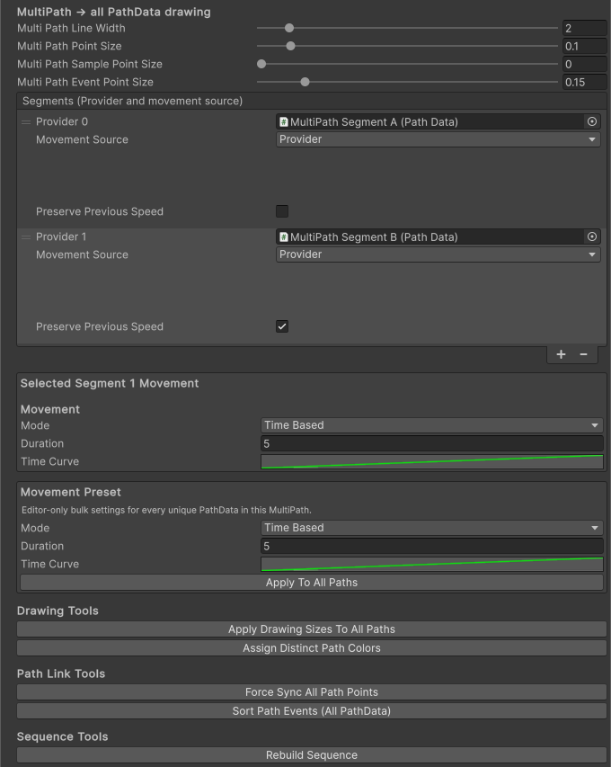
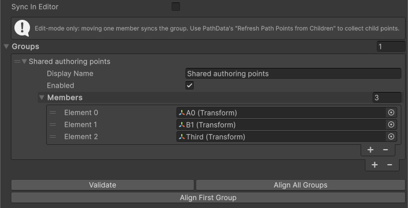

# TransformPath 기술 참고

[README](../README.md)를 보완하는 구현 요약입니다.

## 어셈블리

| 어셈블리 | 폴더 | 내용 |
| --- | --- | --- |
| `Common.TransformPath` | `Script/` | 계약, Provider, Route, 재생, 이벤트, Queue, 실행 기반, `PathDataLineRenderer`, 그룹 동기화 데이터 |
| `Common.TransformPath.Editor` | `Script/Editor/` | Inspector, 연결점과 그룹 동기화, Scene View 미리보기 |
| `Common.TransformPath.Samples` | `Samples/Scripts/` | 샘플 씬의 컨트롤러·UI·카메라·수신기, 원 모양(`TransformPathCircleShape`)과 간격 정책(`TransformPathGapPolicy`). UGUI 참조 |
| `Common.TransformPath.Tests` | `Dev/Tests/` | EditMode 테스트 |
| `Common.TransformPath.Tests.Fixtures` | `Dev/Tests/Fixtures/` | 테스트가 붙이는 컴포넌트(시험용 원 모양). Unity는 Editor 어셈블리의 컴포넌트를 붙이지 않으므로 런타임 어셈블리이며, `UNITY_INCLUDE_TESTS`일 때만 컴파일합니다 |
| `Common.TransformPath.PlayerProbe`, `.PlayerProbe.Editor` | `Dev/` | 이 저장소의 성능 측정 Player(`Tools/run-transformpath-probe.sh`)와 `-executeMethod` 빌드 진입점 |

시스템과 에디터는 `Script/` 폴더 하나입니다. 샘플, 테스트, 측정 도구는 시스템을 참조만 하고, 시스템은 이들을 모릅니다. 샘플과 테스트 고정 어셈블리에는 내부 접근을 주지 않으므로 공개 API만으로 만들어집니다. 샘플의 `TransformPathCircleShape`와 테스트 고정 어셈블리의 원은 이렇게 `PathShapeProvider`를 다른 어셈블리에서 상속할 수 있음을 컴파일로 보입니다. 측정 어셈블리는 Editor와 `TRANSFORMPATH_PLAYER_PROBE`를 정의한 측정 빌드에서만 컴파일합니다.

`Script/` 아래 시스템 코드는 역할로 나눕니다: `Core`(계약, 상수, 이벤트 정의), `Geometry`, `Providers`, `Playback`, `Queue`, `Execution`(Driver, Boundary), `Components`, `Sync`, `Utilities`.

## 구조 규칙

1. **상태 소유자는 하나입니다.** 재생 상태는 `PathPlayback`, Queue 순서와 계산은 `QueuedPathManager`, 경로 데이터는 Provider만 바꿉니다. 다른 타입은 읽기만 하고 사본을 두지 않습니다. `PathPlayback`의 상태 머신, 이동 루프, 구간 전환은 같은 상태를 함께 바꾸므로 한 클래스에 두고, 위치에 딸린 값(구간, 진행률, Speed·Duration, 다음 이벤트)은 `PathPlaybackCursor`가, 이벤트가 하는 일은 `PathEventEffects`가 맡습니다.
2. **변경 판정은 Provider가 한 번만 합니다.** `PathProviderBehaviour.Rebuild`가 이전 게시와 비교해 `Revision`과 `DefinitionRevision`을 올리고, 소비자는 이 두 값만 비교합니다.
3. **순수 계산과 Unity 연결을 나눕니다.** `PathPolyline`, `PathRoute`, `PathPlaybackCursor`, `PathPlayback`, `PathEventEffects`, Queue 계산은 MonoBehaviour와 정적 상태(알림 순서 큐 제외)에 기대지 않아 EditMode 테스트로 검증합니다. 컴포넌트는 직렬화, 생명주기, Transform 적용만 맡습니다.
4. **검증은 경계에서 한 번만 합니다.** 공개 명령의 입력과 Provider 빌드만 검증합니다.
5. **공통 값과 헬퍼는 한 곳에 둡니다.** 상수는 `PathConstants`, 수치 검증과 곡선 복사는 `PathValueUtility`, 정렬은 `PathSortUtility`, 1회 오류 보고는 `PathConfigurationErrorReporter`입니다.
6. **인터페이스는 교체할 이유가 있을 때만 둡니다.** 공개 인터페이스는 `IPathEventReceiver` 하나입니다. `IPathProvider`는 내부 계약이며(테스트의 가짜 Provider가 씁니다), 공개 시그니처는 `PathProviderBehaviour`를 받습니다. 밖에서 경로를 더하는 지점은 추상 클래스 `PathShapeProvider` 하나이고, 내부 계약은 이 클래스가 봉인한 구현으로 채웁니다. Route 갱신과 Aggregate 구성은 Provider 종류를 확인하지 않고 이 계약과 Route의 구간만 봅니다. Aggregate가 실행할 이벤트는 Provider가 `WholeRouteEvents`로 알려 주며, `MultiPathData`와 모양에는 없습니다.
7. **확장 지점은 정해 둔 두 곳뿐입니다.** 사용자 정의 경로는 `PathShapeProvider`, Queue 간격은 `PathQueueSpacingPolicy`를 상속합니다. 그 밖의 공개 타입은 컴포넌트(`PathFollower`, `PathQueueMember`, `QueuedPathManager`, `PathData`, `MultiPathData`, `PathDataLineRenderer`, `PathWaypointSyncRegistry`), 설정과 요청(`PathPlaybackRequest`, `PathMovementSettings`, `PathEventSettingSO`, `PathEventEntry`, `PathSegmentAuthoring`, `PathWaypointSyncGroup`, `PathQueueStatus`), 수신기와 enum입니다. 기반 클래스 `PathProviderBehaviour`와 `PathRuntimeBehaviour`는 `private protected` 생성자로 다른 상속을 막고, `PathShapeProvider`만 `protected` 생성자로 상속을 엽니다. 이벤트의 런타임 복사본(`PathEventDefinition` 등)은 내부 타입이며, 바깥에서는 `PathData.GetAuthoringEvent`로 작성 데이터를 읽습니다.

## 수명 규칙

- **실행 순서:** `PathRuntimeDriver`가 매 프레임 세 단계를 실행합니다. 효과(Follower의 값 보간과 지연 이벤트) → Queue(Manager의 계산과 멤버의 제한 기록) → 이동(Follower). Driver는 단계마다 목록을 따로 두어 Follower는 효과와 이동, Manager는 Queue 단계에서만 순회합니다. 같은 단계에서는 등록 순서를 따릅니다.
- **프레임 고정:** Tick 시작에 대상, PlaybackId, 등록 버전을 복사하고 실행 직전에 다시 비교합니다. 그 프레임에 등록하거나 재생이 바뀐 대상은 다음 프레임부터 실행합니다.
- **외부 코드:** 공개 명령과 Tick은 `PathExecutionBoundary.Enter()`로 작업을 엽니다. 가장 바깥 작업이 끝나면 쌓인 리스너와 수신기를 선입선출로 호출합니다. 호출 중 생긴 알림은 큐 끝에 붙어 중첩되지 않습니다. 호출 직전에 구독 여부를 다시 확인하고, 한 번에 10만 건을 넘으면 오류를 기록하고 남은 알림을 버립니다. 알림마다 `PathSignal`(인자 0~2개)이 리스너 배열과 대기 중인 인자를 갖고, Boundary는 어떤 신호가 다음인지 순서만 담은 정적 큐 하나를 둡니다. 여러 Follower와 Queue 사이의 발행 순서를 지키려면 순서 큐가 하나여야 하기 때문입니다. 발행 시점의 리스너 배열을 함께 담으므로 발행 뒤에 구독한 리스너는 그 알림을 받지 않습니다.
- **PlaybackId:** 재생을 시작할 때마다 새로 발급하고 Seek와 Pause에서는 유지합니다. 재생이 끝나면 0입니다.
- **실패 격리:** Tick 예외는 `Faults`에 모으고 `OnTickFault`로 해당 재생을 정리합니다. 다른 대상은 계속 실행하고 `PathRuntimeDriverBehaviour`가 예외를 기록합니다.
- **완료 순서:** 구간의 이벤트는 모두 끝에 닿기 전에 실행됩니다. 그 뒤 재생 효과 정리 → CharacterController 복원 → `StateChanged(Completed)` → `Completed`.
- **Driver host:** 숨긴 장면 오브젝트(`HideInHierarchy`, DontDestroyOnLoad)라 Play Mode를 끝내면 함께 지워집니다. Play Mode에서 스크립트를 다시 불러오면 Awake 없이 `OnEnable`만 불리므로, 컴포넌트는 `OnEnable`에서도 초기화합니다(두 번째 호출은 아무것도 하지 않습니다).
- **전환 한도:** 한 Tick의 구간 전환은 65회까지입니다. 남은 시간은 다음 Tick으로 넘기되 그 Tick의 deltaTime까지만 넘기므로, 매 프레임 한도에 닿는 Follower도 시간이 쌓이지 않아 나중에 몰아서 움직이지 않습니다. 넘긴 시간은 Pause, Stop, Seek와 Queue가 막을 때 버립니다.

## 경로와 재생

- `PathData`는 Transform 제어점, 또는 `SetControlPoints`로 받은 좌표를 곡선별로 샘플링한 `PathPolyline`을 발행합니다. 좌표는 직렬화하지 않는 목록에 두고, 있으면 `CopyControlPoints`, 빌드, Scene View 미리보기가 Transform 목록 대신 씁니다. `SetPathPoints`가 이 목록을 비웁니다. 좌표의 개수와 유한성은 `SetControlPoints`가, Transform의 것은 `CopyControlPoints`가 검사하므로 기하 빌더는 구간 수와 곡선 종류만 봅니다. 위치는 누적 거리로 보간하므로 진행률이 일정하면 샘플 사이에서 속도가 일정합니다. `Linear`는 제어점을 모두 꼭짓점으로 넣고 각 변을 길이 비율로(최소 1칸) 나누므로 모서리를 깎지 않습니다. 스플라인은 매개변수로 샘플링하므로 샘플 수가 적으면 구간마다 속도가 달라집니다(테스트는 500샘플에서 편차가 1% 미만인지 확인합니다).
- `MultiPathData`는 `PathData`만 구간으로 받습니다. 자식의 `PathChanged`를 구독해 자식이 바뀌면 다시 빌드하므로 자식을 폴링하지 않습니다. 빌드할 때 아직 빌드되지 않은 자식을 먼저 빌드해, Awake 순서에 기대지 않습니다.
- Provider는 빌드에 실패하거나 파괴되면 준비 상태를 잃고 `PathChanged`로 알립니다. 이 경로를 쓰는 Follower는 다음 이동 Tick에서 멈추고, Queue는 멤버를 내보내며, MultiPathData는 오류를 다시 기록하지 않고 사용 불가가 됩니다. 실패 전과 같은 내용으로 복구되어도 알리므로 MultiPathData가 함께 돌아옵니다.
- `PathShapeProvider`는 코드로 그린 모양입니다. `TryBuild`를 봉인해 ① `TryPrepare`(길이, 모양 변경 여부) ② 길이가 유한한 양수인지 ③ `Evaluate(0)`과 `Evaluate(length)`를 미리 불러 예외와 유한하지 않은 값을 빌드 실패로 바꾸기 ④ 이동 설정 검증 순서로 빌드합니다. Play, Seek, 회전 정렬은 Tick 밖에서 샘플하므로, 그때 던지면 명령이 반쯤 끝난 상태가 되기 때문에 ③을 둡니다. 기하 리비전은 첫 빌드, `shapeChanged`, 길이 변화, 그리고 실패한 빌드 다음의 첫 성공에서 오릅니다(실패한 빌드가 `TryPrepare`의 보관 값을 이미 바꿨을 수 있습니다). 정의 리비전은 첫 빌드와 이동 설정 변경에서 오릅니다. arc-length 균일성은 base가 강제할 수 없고, `Evaluate`는 `TryPrepare`가 보관한 값만 읽어야 빌드 하나가 한 덩어리로 발행됩니다. Tick 중의 예외는 Follower를 멈추며(Ready) 따로 fault 상태는 없습니다. base가 쓰는 Unity 메시지(`Awake`, `OnDestroy`)는 `protected virtual`이라, 하위 클래스가 같은 이름을 선언하면 CS0114 경고가 나고 override해서 base를 불러야 합니다.
- `PathData.MovementSettings`는 빌드 뒤에는 게시된 값을 돌려줍니다. 값을 대입하면 한 번이라도 빌드된 경로는 다시 빌드하고(`RebuildIfRequested`), 빌드 전이면 첫 빌드에 반영됩니다. `CurveType`, `SegmentCount`도 같습니다.
- `PathRoute`는 구간 배열(샘플러, 시작 거리, 길이, 이동 설정, 속도 보존, 이벤트)입니다. Single과 Sequence는 Provider가 리비전별로 하나를 캐시해 Follower들이 함께 쓰고, Aggregate는 Provider 전체를 한 구간으로 만듭니다.
- `PathPlaybackCursor`는 위치, 잔여 시간, Speed, Duration을 소유합니다. 한 걸음은 다음 이벤트, Queue 상한, 구간 끝 가운데 가까운 곳을 한계로 정해 그곳까지만 가고, 닿으면 위치를 한계에 정확히 맞추고 닿은 이유(`EPathStep`)를 돌려줍니다. 한계는 진행률로 고른 뒤 시간이나 거리로 바꾸므로, 시간 곡선을 거치며 조금 못 미친 이벤트도 닿은 것으로 봅니다. 끝에 닿았는지를 EPSILON 비교로 정하지 않고, 마지막 구간의 전체 1은 정확히 로컬 1이라 긴 Sequence도 끝납니다. 경과 시간과 거리는 double입니다. 기하가 바뀌면 거리를 새 길이 비율로 double에서 늘리거나 줄이므로, 긴 경로를 느리게 가는 Follower도 경로가 매 프레임 바뀌는 동안 계속 움직입니다.
- TimeBased는 기하가 바뀌어도 경과 시간을 그대로 둡니다. `SetDuration`(이벤트 보간 포함)은 지난 시간의 비율을 지키므로 시간 곡선의 평평한 구간에서도 시간을 잃지 않습니다. `PreservePreviousSpeed`로 이어받은 Speed는 9999를 넘지 않습니다.
- `PathMovementSettings`는 생성할 때 시간 곡선을 한 번 복사해 밖으로 내주지 않습니다. 그래서 여러 Follower가 방어 복사 없이 공유합니다. TimeBased의 빈 곡선은 선형으로 해석합니다.
- 재생 세션은 첫 `Play`부터 컴포넌트가 파괴될 때까지 남습니다. 재생이 끝난 뒤의 `Seek`는 위치만 옮기고, `SetSpeed`와 `SetDuration`은 값만 바꾸며, 어느 쪽도 재생을 다시 시작하지 않습니다.
- **Play On Start:** `PathFollower.Start`가 지정한 Provider를 자체 이동 설정으로 재생합니다(`PathPlaybackRequest.Own`). 같은 오브젝트의 `PathQueueMember`에 Manager가 있으면 Queue 밖에서 재생하지 않도록 경고하고 건너뛰며, Provider가 준비되지 않으면 Follower를 context로 오류를 기록하고 돌아갑니다.
- CharacterController는 재생 중 꺼 두고 끝나면 복원하며, Inspector에서 끌 수 있습니다.
- `RotateToPathDirection`은 지속 회전을, `AlignRotationToPathDirection`은 선택한 축의 일회 정렬을 제어합니다.

### 콜백 규칙

- 콜백이 실행될 때는 이벤트 효과와 위치가 이미 반영되어 있습니다. 앞선 콜백이 상태를 바꿨을 수 있으니 인자보다 현재 상태를 읽습니다.
- 대기 중에 구독을 해제한 리스너는 호출되지 않고, 발행 뒤에 구독한 리스너는 그 알림을 듣지 않습니다.
- Provider(`PathData`, `MultiPathData`, `PathShapeProvider`)의 `PathChanged`만 예외로 변경 작업 안에서 바로 호출됩니다. 이 콜백의 예외도 기록만 됩니다.

### Seek

- 먼저 입력을 검증하고 Route를 갱신합니다. 일시정지 중 바뀐 기하는 이때 받고, 이동 설정·이벤트·구간 구성이 바뀌었거나 Provider가 준비되지 않았으면 `InvalidOperationException`입니다. 실패하면 아무것도 바뀌지 않습니다.
- 같은 위치면 `false`입니다. 위치가 바뀌면 잔여 시간을 버리고, Queue 멤버는 새로 출발할 때처럼 첫 결과와 재출발 지연을 기다립니다(`MotionEpoch`).
- 이벤트 커서는 목표 위치와 그 이전을 건너뜁니다. 뒤로 Seek하면 다시 통과하는 이벤트는 또 실행됩니다. Seek는 `SegmentChanged`를 보내지 않습니다.
- `Seek(1f)`는 즉시 완료하지 않고 다음 이동 Tick에서 판정합니다.
- 구간 경계는 `[start, end)`이며 마지막 구간의 끝 1은 허용합니다.

자연스럽게 시작이나 구간 처음에 도달한 재생은 커서를 0으로 되돌리므로 위치 0의 이벤트도 실행됩니다.

### 경로 변경

이동 중인 다음 Tick에 리비전을 비교하므로 Pause 중에는 Resume이나 Seek까지 미룹니다. Queue 멤버는 Queue 단계에서 새 기하를 먼저 받고, 정의가 바뀌면 일시정지 중에도 Queue가 내보내 멈춥니다([Queue](#queue)).

| 변경 | 결과 |
| --- | --- |
| `Revision`만 바뀜 (기하, 길이) | 구간 로컬 진행률을 유지하고 새 Route로 이어서 재생 |
| `DefinitionRevision` 바뀜 (이동 설정, 이벤트, 구간 구성) | 정지. Aggregate도 같음 |
| Provider 준비 상태 무효 | 정지 |

## Queue



- **참여:** `PathQueueMember.StartQueuedPlayback`이 Follower를 재생하고 Manager에 참여합니다. 참여 직후와 위치가 이어지지 않고 바뀐 뒤에는 첫 결과와 재출발 지연까지 기다립니다.
- **불연속(`MotionEpoch`):** 엔진은 Play, 위치를 바꾼 Seek, Loop 이음매에서 `MotionEpoch`를 1 올립니다. 멤버와 Manager는 이 값 하나만 비교합니다. 값이 바뀌면 멤버는 새 출발처럼 첫 결과와 재출발 지연을 기다리고, Manager는 그 프레임 정렬 전에 멤버를 같은 진행률의 줄 뒤로 보냅니다. Queue 안에서 다시 `StartQueuedPlayback`하면 자리는 유지합니다.
- **계산:** Queue 단계에서 Manager가 재생이 끝났거나 다른 경로나 이전 정의를 재생하는 멤버를 빼고, 남은 멤버가 새 기하를 먼저 받게 한 다음(일시정지 포함) 진행률로 정렬한 뒤 앞 멤버부터 거리, 대기, 속도 배율, 진행 상한을 계산합니다(`PathQueueCoordinator`). 정렬은 할당 없는 삽입 정렬이고, 결과는 참여 순서대로 전달합니다.
- **간격 정책:** Manager는 정책 참조를 프레임마다 한 번 읽고, 멤버마다 한 번 `GetSpacing`을 불러 결과를 `PathQueueStatus.Spacing`에 담습니다. 감속, 대기, 진행 상한, 멤버의 추가 간격이 모두 이 값을 씁니다. 정책이 도는 동안 Manager는 줄을 순회하고 있으므로 `Join`과 `ConfigureRoute`는 `InvalidOperationException`을 던지고, 멤버의 `StartQueuedPlayback`, `StartFreePlayback`, `Leave`는 아무것도 바꾸기 전에 던집니다. 정책이 멤버를 끄거나 파괴하면 그 멤버의 `Remove`는 순회가 끝난 뒤 실행되어, 꺼진 멤버가 줄에 남지 않습니다. 그 프레임의 결과에는 아직 앞 멤버로 남습니다. 정책이 Manager 자신을 끄거나 파괴해도 순회가 끝난 뒤 멤버를 `ManagerReleased`로 내보냅니다. 잘못된 값은 Tick 예외가 되어 실패 격리 규칙대로 Manager가 멤버를 `ManagerReleased`로 내보냅니다.
- **완화:** `PathQueueWait.Step`이 수동 대기, 재출발 지연, 추가 간격, 속도 보간을 계산하고, 멤버가 그 결과를 Follower의 이동 제한으로 기록합니다. 기하를 먼저 받으므로 경로가 매 프레임 바뀌어도 멤버가 막히지 않습니다.
- **멤버:** 멤버는 같은 GameObject의 Follower 하나만 쓰고(`DisallowMultipleComponent`), 멤버와 Follower가 켜져 있을 때만 참여합니다. 꺼진 Follower는 움직이지 않아 뒤 멤버를 영원히 막으므로 시작이 던집니다. 꺼지거나 파괴되면 조용히 떠나고 Follower의 제한을 풉니다. Manager는 멤버를 인스턴스 ID로 찾으므로(`UnityEngine.Object`의 비교) 파괴된 멤버도 자기 항목을 지웁니다.
- **Pause와 Hold:** 일시정지한 멤버는 줄에 남아 뒤 멤버를 막고(`IsBlocked`와 `Blocked`), 재개하면 첫 결과부터 기다립니다. `Hold`는 Queue에 남은 채 대기를 요청하며, Queue 밖에서 부르면 다음 Queue 시작부터 적용됩니다.
- **최대 진행률:** 그 지점에서 멈추고 완료하지 않습니다. 넘어선 멤버는 그 자리에서 기다립니다.
- **Loop:** 멤버는 이음매에서 그 프레임의 남은 시간을 버리고 멈춘 뒤, 새 출발처럼 줄 맨 뒤에서 첫 결과와 재출발 지연을 기다립니다(`PathMotionLimit.WaitOnDiscontinuity`). 이음매 너머의 간격은 보지 않습니다.
- **이탈:** 재생이 끝나거나 멈추면 다음 Queue 단계에서 빠집니다(`Completed`, `Stopped`). `Leave`는 재생을 유지한 채 빠지며, 대기 중이었으면 `Resumed`가, 속도 배율이 1이 아니었으면 `SpeedChanged`가 바로 옵니다. 완료한 Follower를 `Completed` 리스너에서 `Stop`해도 끝난 이유는 `Completed`로 남습니다. 경로가 준비되지 않거나 Manager가 해제되면 이 경로의 재생을 일시정지 중이어도 멈추고 `QueueInvalidated`(`ProviderInvalid`, `ManagerReleased`)를 보냅니다. 이미 다른 경로를 재생하는 Follower는 `ProviderInvalid`로 빠지지만 멈추지 않습니다. 경로의 정의(이동 설정, 이벤트, 구간 구성)가 바뀌면 Follower가 가진 Route의 정의 리비전이 Provider와 다른 멤버만 `ManagerReleased`로 빠지고 멈춥니다. 새 정의로 다시 시작한 멤버는 남습니다. 재생은 움직이는 동안에만 정의 변경을 보므로, 일시정지 멤버는 Queue가 이 기준으로 내보내야 합니다. 이동 단계에서 정의 변경이나 Provider 무효를 먼저 보고 스스로 멈춘 Follower는 그 이유(`RouteChanged`, `RouteUnavailable`)를 기록하므로, Queue는 같은 변경을 프레임 시점과 상관없이 `ManagerReleased`나 `ProviderInvalid`로 보고합니다. 경로가 파괴되면 모든 멤버를 `ProviderInvalid`로 내보내고 그 경로를 잊습니다.
- **감속:** 앞 멤버와의 거리가 간격에서 간격 + Slowdown Range 사이일 때 속도 배율을 최소 배율에서 1까지 감속 곡선으로 올립니다. 범위가 0이면 간격에서 바로 멈춥니다. 곡선이 비어 있으면(직렬화된 빈 곡선 포함) 선형입니다.
- **Route 구성:** Inspector의 Route는 Initialize 때 이미 빌드된 경우에만 바로 쓰고, 아니면 첫 `StartQueuedPlayback`이나 첫 Queue 단계에서 빌드해 구성합니다. Route가 지정되어 있으면 요청의 Provider가 그것과 같아야 하고, 다르면 파괴된 이전 경로의 멤버를 내보내기 전에 던집니다. 멤버 하나의 새 기하 샘플이 던지면 그 Follower만 멈추고(다음 프레임에 `Stopped`) 나머지는 계속합니다.
- **기본값:** 간격 1.5, 감속 범위 1.5, 최소 속도 배율 0.1, 재출발 지연 0.1초, 추가 간격 0.3, 속도 보간율 5이며 Inspector에서 바꿉니다. `StartQueuedPlayback(request)`는 Inspector에 지정한 Manager로 시작합니다.
- **대기 알림:** `Blocked`와 `Resumed`는 Queue 단계에서 관찰한 대기 상태의 변화와 짝을 이룹니다. 대기가 한 Tick 안에 끝나면 둘 다 오지 않습니다. `Hold`의 알림은 다음 Tick에 옵니다. 정지와 완료는 `StateChanged`와 `Completed`로만 알립니다.

## 이벤트

- 작성 위치는 `0..0.995`이고 같은 위치는 작성 순서를 따릅니다. 위치 0의 이벤트도 재생 시작 후 첫 이동에서 실행됩니다.
- `PathEventDefinition`은 `PathEventSettingSO`의 불변 복사본이며, 만들 때 한 번 검증합니다(목표값 `0.001..9999`, 보간 시간과 지연 0 이상, 보간에는 곡선 필요, 지연 체인 순환 금지). 잘못된 이벤트가 있으면 경로 빌드가 실패합니다.
- 한 이벤트의 처리 순서는 이름 알림 예약 → Lifecycle(Pause 또는 Resume) → 현재 이동 방식의 값 변경 → 지연 이벤트 예약입니다. Pause 이벤트는 값을 바꾸지 않습니다. 알림은 경계 뒤에 전달되므로 수신기는 효과가 적용된 상태를 봅니다. 수신기가 `EventReached`보다 먼저 호출됩니다.
- 이벤트는 자기 위치에서 실행됩니다. 이동 한 걸음이 그 위치에서 멈추고, 그 위치까지의 이벤트를 작성 순서대로 꺼내 실행한 뒤 남은 시간으로 이어갑니다. 꺼낸 뒤 실행하므로 Pause 이벤트도 지난 것이 되고, 같은 위치의 나머지 이벤트는 재개한 뒤 시간 없이 실행됩니다.
- **Pause 주인:** `PathFollower.Pause()`로 멈춘 재생은 `Resume()`으로만 풀립니다. 이벤트의 Resume(지연 이벤트와 `TriggerEvent` 포함)은 이벤트가 멈춘 재생만 깨웁니다. 이벤트로 멈춘 재생에 `Pause()`를 부르면 `false`를 돌려주지만 명령 Pause로 바뀝니다.
- 지연 이벤트는 게임 시간을 씁니다. Lifecycle, 작성된 값 변경, 자기 지연 이벤트 중 하나를 가진 이벤트가 실행되면 앞 이벤트가 남긴 지연이 취소되고, 이름만 알리는 이벤트는 취소하지 않습니다. 지연 0은 바로 실행하며, 그 이벤트가 상태나 값을 바꾸면 같은 목록의 나머지 항목은 실행도 예약도 하지 않습니다. 상태나 값을 바꾼 지연 이벤트가 있으면 같은 프레임의 나머지 지연 이벤트는 다음 프레임으로 미룹니다.
- 값 보간은 시작한 구간의 이동 방식까지만 이어집니다. 이동 방식이 다른 구간에 들어가거나 `Pause`가 불리면(이미 멈춰 있어도) 취소합니다. Pause 이벤트도 같이 취소합니다. `SetSpeed`·`SetDuration`은 같은 채널의 보간을 취소하므로 다음 Tick에 보간이 명령 값을 덮어쓰지 않습니다.
- `TriggerEvent(setting)`은 전달한 에셋의 현재 값을 바로 실행하며, 경로에 등록된 복사본에는 다음 빌드 전까지 반영되지 않습니다.
- `CancelEventEffects`는 작업을 연 뒤 `PathPlayback.CancelEffects`가 남은 효과가 있을 때만 값 보간과 지연 이벤트를 비웁니다. 현재 값, 상태, 신호는 바꾸지 않고, 비운 것이 있었는지를 반환합니다.
- 재생이 끝나면 지연 이벤트와 값 보간을 함께 정리합니다. 재생이 없을 때(완료 뒤) `TriggerEvent`로 실행한 값 변경은 보간 없이 목표값을 바로 적용하고, 지연 이벤트는 예약하지 않습니다. 움직이지 않는 재생에서는 보간의 최종값만 의미가 있고, 지연을 진행할 재생도 없기 때문입니다.
- 엔진(`PathPlayback`)은 이벤트를 언제 지나는지만 정하고, 이벤트가 하는 일(이름 알림, Pause와 Resume, 값 보간, 지연 이벤트)은 `PathEventEffects`가 맡습니다. 효과는 좁은 내부 인터페이스 `IPathEffectTarget`으로만 엔진을 읽고 조작합니다. 이벤트가 상태나 값을 바꿨는지는 효과가 직접 부른 Pause, Resume, 값 적용의 반환값으로 판단합니다. 콜백은 경계 뒤에 실행되므로 그 사이에 다른 변경이 끼어들지 않습니다.

## Editor

- `PathEditorChangeMonitor`가 Hierarchy, 속성, Undo/Redo, 리로드 변경을 모으고, `PathTrackedTargets`가 Linker별 대상 목록을 그 변경에서만 다시 찾습니다. `MultiPathAutoLinker`(연결점)와 `PathWaypointSyncLinker`(그룹 동기화)는 동기화 규칙만 가집니다. 연결점 순회는 `PathLinkEditorUtility.SyncJoints` 하나이며, 자동 연결(움직인 쪽을 따라감)과 **Force Sync All Path Points**(뒤 구간 시작을 앞 구간 끝에 맞춤)가 함께 씁니다. Transform 이동만으로는 대상 캐시를 지우지 않아 이전 위치와 비교할 수 있습니다. 대상은 열린 씬과, Prefab Mode면 열린 Prefab의 내용에서 찾습니다. Auto Link를 다시 켜면 그 순간 스냅샷을 다시 찍으므로, 꺼 둔 동안 옮긴 점을 움직임으로 따라가지 않고 첫 동기화가 뒤 구간 시작을 앞 구간 끝에 맞춥니다.
- `PathDataScenePreviewCache`는 런타임의 `PathPolyline`을 만들어 살아 있는 경로의 미리보기를 재사용하고, 삭제된 경로의 항목을 지웁니다. PlayMode 전환과 리로드에서 비웁니다.
- Inspector 클래스는 배치만 맡습니다. `PathDataEditor`는 `PathDataGizmoDrawer`(Scene View 미리보기)와 `PathPointTools`(지면 스냅, 점 생성, 자손에서 갱신)를, `MultiPathDataEditor`는 `PathSegmentListDrawer`(구간 목록: PathData, 이동 출처, 속도 보존), `PathSegmentMovementPanel`(선택 구간 이동, 일괄 이동 설정), `PathDrawingTools`(미리보기 크기, 구별 색)를 씁니다.
- 연결점과 웨이포인트 그룹은 같은 규칙(`PathPointSync`)을 씁니다. 스냅샷보다 가장 많이 움직인 점을 기준으로 나머지를 옮기고, 동률이면 앞 멤버를 따릅니다. 연결점은 [다음 경로 시작점, 이전 경로 끝점] 두 멤버 그룹이라 동률이면 시작점을 따릅니다. 이미 같은 위치면 옮기지 않습니다.
- 미리보기 설정 필드는 Player에서도 직렬화합니다. Editor와 Player의 데이터 레이아웃이 같아야 하기 때문이며, Player에서는 읽지 않습니다.
- 이동 설정 UI와 Rebuild·이벤트 정렬 도구는 `PathInspectorGUI`에 있습니다. 이동 값은 `0.001..9999`로 제한하며, 값 칸을 고칠 때만 제한해 여러 오브젝트의 Mode만 바꾸면 각자의 값이 남습니다. Rebuild 버튼은 직렬화 데이터를 바꾸지 않으므로 Undo 기록과 씬 dirty를 남기지 않습니다. **Rebuild Sequence**는 구간 PathData를 먼저 빌드해, 선택 구간 패널에서 바꾼 경로 이동 값을 Play Mode에서도 반영합니다. 구간을 Override로 바꾸면 방금까지 쓰던 경로 자신의 이동 설정으로 시작합니다(PathData가 있을 때). `MultiPathData`의 미리보기 크기 적용과 구별 색 지정은 버튼으로만 실행합니다. 이 두 버튼과 웨이포인트 그룹의 Align 버튼은 Play Mode에서 꺼집니다.
- Scene View는 이벤트 위치와 이름을 표시만 합니다. 이벤트 진행률은 Inspector에서 편집합니다.
- `PathShapeProviderEditor`는 모든 모양의 Inspector로, 모양의 필드 다음에 `PathData`와 같은 이동 설정 UI(`PathInspectorGUI.DrawMovementSection`)와 **Rebuild Runtime Path**를 둡니다. `PathShapeGizmoDrawer`는 모양을 128점으로 샘플한 선과 시작점을 그립니다. Edit Mode에서는 그릴 때마다 `Rebuild`해 현재 설정을 보여 주고, Play Mode에서는 발행된 모양만 그립니다. 샘플이 던지면 같은 모양은 다시 그릴 수 있을 때까지 한 번만 기록합니다.

<p align="center">
  
  
</p>

## 검증

- EditMode 테스트: `Tools/run-transformpath-tests.sh`. 테스트마다 알림 순서 큐를 새로 쓰고(`PathBoundaryIsolatedTest`), 끝날 때 열린 작업이나 전달되지 않은 알림이 남으면 실패합니다.
- Player 측정: `Tools/run-transformpath-probe.sh`
- IL2CPP 빌드: `Tools/run-il2cpp-build.sh`
- 측정을 비교할 커밋은 `UNITY_TREE`로 넘깁니다. 해시, 브랜치 이름, `HEAD` 모두 이 checkout 기준으로 풉니다.

## UML 갱신

원본은 `Docs/*.puml`이고, 렌더링한 PNG를 `Docs/Images`에 저장해 문서에 넣습니다. Graphviz 없이 PlantUML 1.2024.6으로 렌더링합니다. Docs 폴더에서 실행합니다.

```sh
java -Djava.awt.headless=true -Djava.io.tmpdir="$TMPDIR" -jar plantuml-1.2024.6.jar \
  -tpng -charset UTF-8 -o Images \
  transformpath-frame.puml transformpath-structure.puml transformpath-queue.puml
```

시스템에 Java가 없으면 Unity에 들어 있는 JDK(`<Unity.app>/../PlaybackEngines/AndroidPlayer/OpenJDK/bin/java`)를 씁니다. 임시 폴더에 쓸 수 없으면 종료 코드 0으로 0바이트 PNG가 나오니 파일 크기를 확인합니다. 한글은 macOS의 `Apple SD Gothic Neo` 글꼴로 렌더링합니다.
