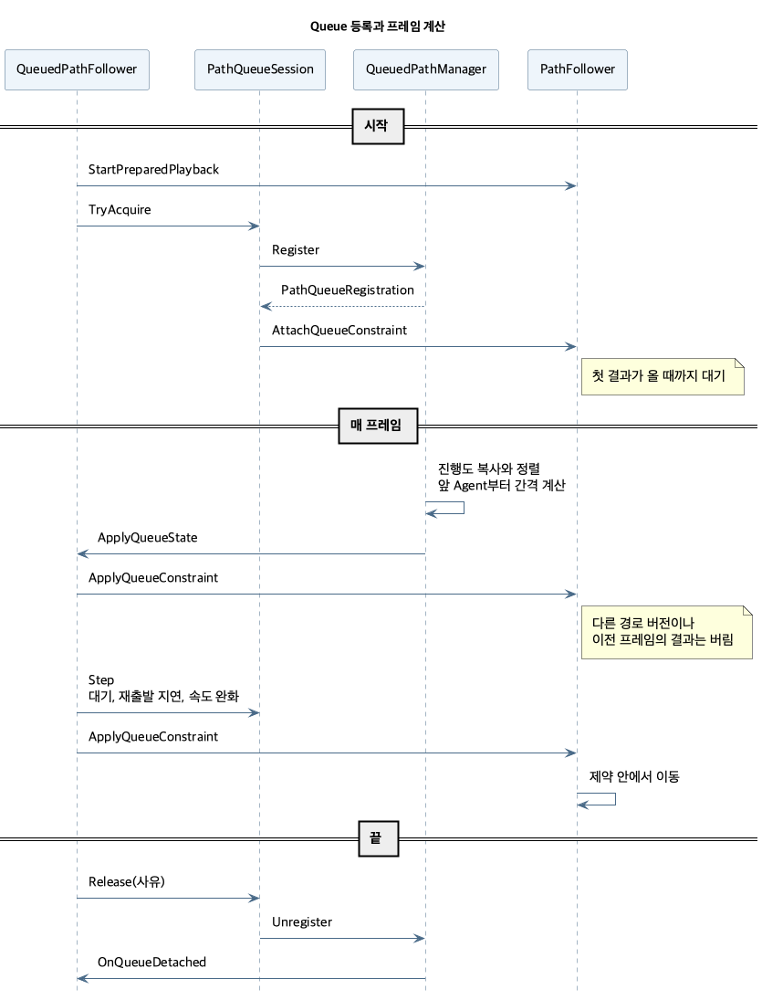
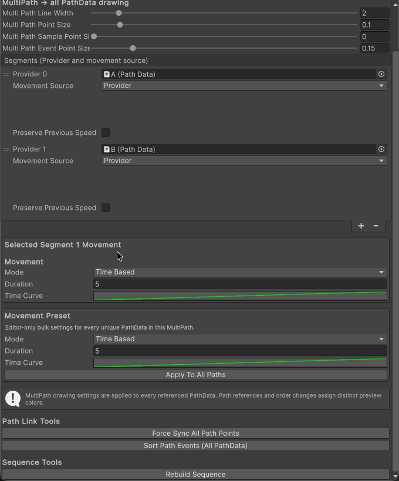
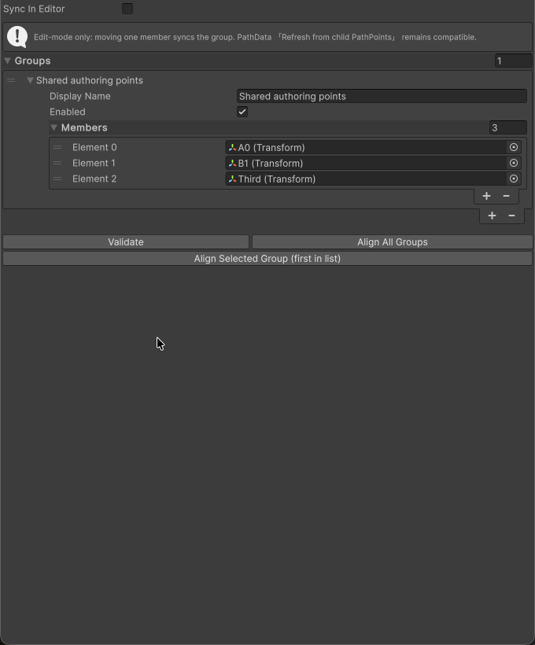

# TransformPath 기술 참고

[README](../README.md)를 보완하는 구현 요약입니다.

## 어셈블리

| 어셈블리 | 내용 |
| --- | --- |
| `Common.TransformPath.Runtime` | 계약, Provider, 재생, 이벤트, Queue |
| `Common.TransformPath.Editor` | Inspector, 연결점과 그룹 동기화, Scene View 미리보기 |
| `Common.TransformPath.Samples` | Showcase UI, 샘플 카메라 |
| `Common.TransformPath.PlayerProbe` | Player 측정 (`Tools/run-transformpath-probe.sh`). Editor와 측정 빌드에서만 컴파일 |

## 수명 규칙

- **외부 코드:** 공개 명령과 Tick은 `PathExecutionBoundary.Enter()`로 작업을 엽니다. 가장 바깥 작업이 끝나면 쌓인 리스너와 수신기를 선입선출로 호출합니다. 호출 중 생긴 알림은 큐 끝에 붙어 중첩되지 않습니다. 호출 직전에 구독 여부를 다시 확인하고, 한 번에 10만 건을 넘으면 오류를 기록하고 남은 알림을 버립니다.
- **내부 관찰:** `QueuedPathFollower`는 작업 안에서 반응해야 하므로 `PathFollower`의 `ObservedStateChanged`, `ObservedSegmentChanged`, `ObservedCompleted`, `LoopBoundary`를 동기로 받습니다. 시작을 거부하면 리스너는 남은 상태만 듣습니다.
- **PlaybackId:** 재생을 시작할 때마다 새로 발급하고 Seek와 Pause에서는 유지합니다. 재생이 끝나면 0입니다.
- **StateRevision:** 명령이 재생 상태를 바꿀 때마다 올립니다. Seek는 위치가 바뀔 때만 올립니다.
- **프레임 고정:** `PathRuntimeDriver`는 Tick 시작에 대상, PlaybackId, 등록 버전을 복사하고 실행 직전에 다시 비교합니다. 그 프레임에 등록하거나 재생이 바뀐 대상은 다음 프레임부터 실행합니다.
- **실패 격리:** Tick 예외는 `Faults`에 모으고 `HandleRuntimeFault`로 해당 재생을 정리합니다. 다른 대상은 계속 실행하고 `PathRuntimeDriverBehaviour`가 예외를 기록합니다.
- **완료 순서:** 끝점 위치와 남은 이벤트 → 재생 효과와 제약 정리 → CharacterController 복원 → `StateChanged(Completed)` → `Completed`.
- **전환 한도:** 한 Tick의 구간 전환은 65회까지입니다. 남은 시간은 다음 Tick으로 넘기고, Pause, Stop, Seek에서 버립니다.

## 재생

- `PathPlaybackSession`은 Single과 Sequence의 차이를 경로 접근자(`GetLength`, `GetEventSource`, `Sample`, `FindSegment`, `GetMovementSettings` 등) 뒤에 숨깁니다. 같은 Provider와 Revision이면 다음 시작에서 재사용합니다.
- `PathPlaybackCursor`는 위치, 잔여 시간, Speed, Duration을 소유합니다. 완료 판정은 이벤트 처리 뒤의 현재 Duration을 씁니다.
- `PathSequenceSnapshot.TryGetCurrent`와 `PathEventSourceSnapshot.GetCurrent`는 Provider와 Revision별로 스냅샷 하나를 공유합니다. 불변 객체이므로 같은 경로의 Follower가 함께 씁니다. 새 스냅샷이 이전 스냅샷과의 비교 결과를 기억하고, 교체될 때 그 참조를 끊어 스냅샷이 줄줄이 남지 않게 합니다.
- 시작은 후보 Session을 지역 변수로 준비해 전달합니다. 그 사이 외부 코드가 실행되지 않으므로 다시 검증하지 않습니다.

### Seek

- 먼저 입력과 Provider 준비 상태를 검증합니다. 실패하면 아무것도 바뀌지 않습니다.
- 같은 위치면 `Changed=false`입니다. 위치가 바뀌면 잔여 시간을 버리고 Queue 제약은 다음 결과를 기다립니다.
- 이벤트 커서는 목표 위치와 그 이전을 건너뜁니다. 뒤로 Seek하면 다시 통과하는 이벤트는 또 실행됩니다.
- 구간 경계는 `[start, end)`이며 마지막 구간의 끝 1은 허용합니다.

자연스럽게 시작이나 구간 처음에 도달한 재생은 커서를 0으로 되돌리므로 위치 0의 이벤트도 실행됩니다.

### 경로 변경

Moving 상태의 다음 Tick에 `EvaluateRefresh`로 판단하므로 Pause 중에는 Resume까지 미룹니다.

| 변경 | Single | Aggregate | Sequence |
| --- | --- | --- | --- |
| 기하, 길이 | 로컬 진행률 유지 | 로컬 진행률과 지정 설정 유지 | 구간 로컬 진행률 유지, 전체 진행률 재계산 |
| Provider 이동 설정 | 중단 | 무시 | 구간 설정이 바뀌면 중단 |
| 이벤트 정의 | 중단 | 이벤트 원본이 있으면 중단 | 구간 이벤트가 바뀌면 중단 |
| 구간 수, 순서, Provider | 해당 없음 | 해당 없음 | 중단 |
| 준비 상태 무효 | 중단 | 중단 | 중단 |

## Queue



- **Agent 호출:** Manager는 Agent 멤버를 호출하는 동안 `Register`, `Unregister`, `ConfigureRoute`, `Release`를 `InvalidOperationException`으로 거부합니다. `QueuedPathFollower`는 이 안에서 Queue를 바꾸지 않습니다.
- **소유권:** `QueuedPathManager.Register`가 발급한 `PathQueueRegistration`이 등록을 나타냅니다. 토큰의 `RouteRevision`은 등록 당시 값이고 `PathQueueConstraint.RouteRevision`은 그 계산의 값입니다. 기하가 바뀌어도 등록은 유지하며, 구간 구조가 바뀌면 모든 Agent를 해제합니다.
- **계산:** Manager는 프레임마다 진행도를 복사해 정렬하고, 앞 Agent부터 거리, 대기, 속도 배율, 진행 상한을 계산합니다(`PathQueueCoordinator`). 재생이 끝난 등록은 앞 Agent로 치지 않습니다. 정렬과 목록은 할당하지 않고, 인덱스는 순서가 바뀐 프레임에만 다시 만듭니다.
- **적용:** 다른 재생이나 경로 버전, 이전 프레임의 결과는 `QueuedPathFollower`와 `PathQueueConstraintState`가 버립니다. 등록 직후와 Seek 뒤에는 첫 결과가 올 때까지 멈춥니다.
- **완화:** `PathQueueSession.Step`이 수동 대기, 재출발 지연, 추가 간격, 속도 보간을 계산합니다.
- **위반:** `ConstraintViolation`은 시작 때 지정한 진행 상한만 봅니다. Manager의 상한은 앞 Agent를 따라 움직이므로, 재개나 경로 단축으로 넘어선 Agent는 기다립니다.
- **Pause와 ForceBlock:** Pause는 등록을 해제해 간격 계산에서 빠지고, ForceBlock은 등록을 유지합니다. Queue에 참여하지 않을 때의 ForceBlock은 재생과 표시를 바꾸지 않고 다음 Queue 시작까지 대기 요청만 남깁니다. Resume은 Manager와 경로가 유효할 때 다시 등록하고, 아니면 Queue 참여를 무효화합니다.
- **내부 Follower 직접 시작:** 같은 경로면 재등록하고 수동 대기와 상한을 유지합니다. 다른 경로면 `ProviderInvalid`로 끝냅니다.
- **Loop:** 경계에서 재등록해 Agent 순서를 다시 잡습니다.

## 이벤트

- `PathEventDefinition`은 `PathEventSettingSO`의 불변 복사본입니다. Provider가 위치순으로 안정 정렬해 발행하고 Session이 스냅샷으로 고정합니다.
- 한 이벤트의 처리 순서는 알림 예약 → Pause, Resume → TimeScale → 값 보간 → 지연 이벤트 예약입니다. 알림은 경계 뒤에 전달되므로 수신기는 효과가 적용된 상태를 봅니다. 수신기가 `OnEventDispatched`보다 먼저 호출됩니다.
- 값 보간(`PathScalarAdjustment`)은 시작한 구간의 이동 방식까지만 이어집니다. 이동 방식이 다른 구간에 들어가거나 Pause하면 취소합니다.
- `PathTimeScaleCoordinator`는 Follower별로 소유권을 구분합니다. 오래된 재생의 해제가 새 효과를 지우지 않습니다.
- 재생이 끝나면 지연 이벤트, 값 보간, TimeScale을 함께 정리합니다(`CancelPlaybackEffects`).

## Editor

- `PathEditorChangeMonitor`가 Hierarchy, 속성, Undo/Redo, 리로드 변경을 모아 `MultiPathAutoLinker`와 `PathWaypointSyncLinker`에 전달합니다. Transform 이동만으로는 대상 캐시를 지우지 않아 이전 위치와 비교할 수 있습니다.
- `PathDataScenePreviewCache`는 살아 있는 경로의 버퍼를 재사용하고, 삭제된 경로와 닫힌 Preview Scene의 항목을 지웁니다. PlayMode 전환과 리로드에서 비웁니다.
- Scene View는 이벤트 위치와 이름을 표시만 합니다. 이벤트 진행률은 Inspector에서 편집합니다.

<p align="center">
  
  
</p>

## UML 갱신

원본은 `Docs/*.puml`이고, 렌더링한 PNG를 `Docs/Images`에 저장해 문서에 넣습니다. Graphviz 없이 PlantUML 1.2024.6으로 렌더링합니다. Docs 폴더에서 실행합니다.

```sh
java -Djava.awt.headless=true -Djava.io.tmpdir="$TMPDIR" -jar plantuml-1.2024.6.jar \
  -tpng -charset UTF-8 -o Images \
  transformpath-frame.puml transformpath-structure.puml transformpath-queue.puml
```

임시 폴더에 쓸 수 없으면 종료 코드 0으로 0바이트 PNG가 나오니 파일 크기를 확인합니다. 한글은 macOS의 `Apple SD Gothic Neo` 글꼴로 렌더링합니다.
