# TransformPath

Transform 제어점으로 경로를 만들고 단일 경로, 연결 경로, Queue 이동을 재생하는 Unity 시스템입니다. 네임스페이스는 `Common.TransformPath`입니다.

| 항목 | 내용 |
| --- | --- |
| 개발 | 유원석 (You Won Sock) · [GitHub](https://github.com/youwonsock) |
| 환경 | Unity 2023.2.20f1, C# (샘플 표시는 URP, UGUI) |
| 곡선 | `Linear`, `SplineApproximating` (B-Spline), `SplineInterpolating` (Catmull–Rom) |
| 이동 방식 | `TimeBased`: Duration과 TimeCurve · `SpeedBased`: 거리와 속도 |
| 예제 | `Assets/_TransformPath/Scene/TransformPathSample.unity`, `Prefab/TransformPathShowcase.prefab` |

구현 세부는 [TechnicalNotes.md](Docs/TechnicalNotes.md), 설계 결정은 [RefactoringNotes.md](Docs/RefactoringNotes.md)에 있습니다.

## 시작하기

1. 샘플 씬을 실행해 Normal, Multi, Queue 레인을 확인합니다. macOS 입력 소스가 한글이면 샘플의 글자 키가 동작하지 않으니 영문으로 바꿉니다.
2. 새 경로는 GameObject에 `PathData`를 추가하고 Inspector의 **Create Path Points**로 제어점을 만듭니다. 제어점은 2개 이상, 경로 길이는 0보다 커야 합니다.
3. Movement에서 Duration이나 Speed를 지정합니다. 범위는 `0.001..9999`입니다.
4. **Rebuild Runtime Path**를 누르고 Console의 구성 오류를 해결합니다.
5. 이동할 GameObject에 `PathFollower`를 추가합니다. `PathEventHandler`가 함께 추가됩니다.

```csharp
using Common.TransformPath;
using UnityEngine;

public sealed class TransformPathReadmeExample : MonoBehaviour
{
    [SerializeField] private PathData _path = null;
    [SerializeField] private PathFollower _follower = null;

    private void Start()
    {
        _path.Init();
        if (!_path.IsReady)
        {
            Debug.LogError("PathData의 제어점과 이동 설정을 확인하세요.", _path);
            return;
        }

        _follower.StartPlayback(PathPlaybackRequest.Single(_path));
    }
}
```

## 구조와 흐름

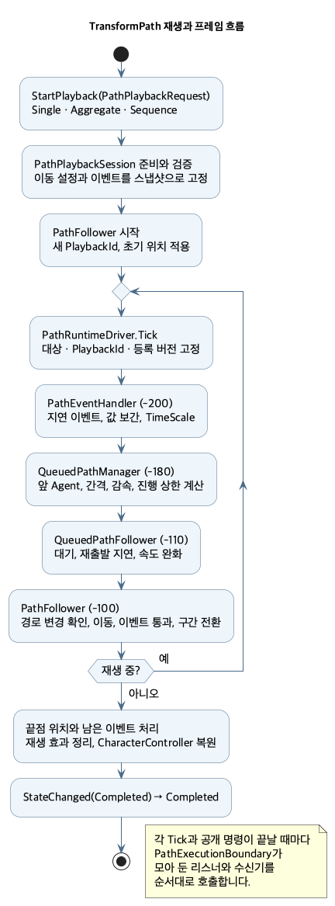

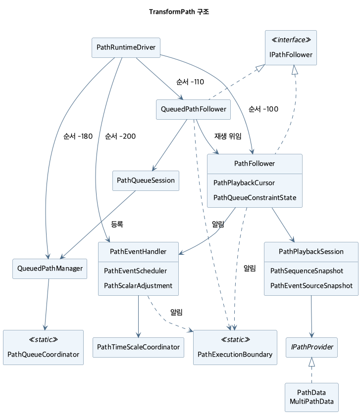

- **Provider** (`PathData`, `MultiPathData`)는 검증한 기하와 이벤트를 발행하고, 내용이 바뀌면 `Revision`을 올립니다.
- **PathFollower**는 재생과 이동을 맡습니다. `PathPlaybackSession`이 경로 스냅샷을, `PathPlaybackCursor`가 현재 위치를 소유합니다.
- **QueuedPathFollower**는 같은 명령에 Queue 참여를 더합니다. 간격은 `QueuedPathManager`가 계산합니다.
- **PathRuntimeDriver**가 한 프레임의 실행 순서를 정합니다.
- **PathExecutionBoundary**는 외부 코드를 작업이 끝난 뒤로 미룹니다.

## 재생 API

| 요청 | 이동 설정 |
| --- | --- |
| `PathPlaybackRequest.Single(path, loop)` | 경로의 설정 |
| `PathPlaybackRequest.Aggregate(provider, settings, loop)` | 지정한 설정으로 Provider 전체 |
| `PathPlaybackRequest.Sequence(sequence, loop)` | 구간별 설정 |

`IPathFollower`의 명령은 `PlaybackId`, `StateRevision`, `Changed`를 담은 `PathCommandReceipt`를 반환합니다.

| 명령 | 조건 |
| --- | --- |
| `StartPlayback`, `StopMove`, `PauseMove`, `ResumeMove` | `StartPlayback`은 준비된 Provider가 필요합니다 |
| `Seek(normalizedTime)` | 재생 세션과 준비된 Provider가 필요합니다. 입력은 `0..1`로 제한합니다 |
| `SeekSegment(index, localNormalizedTime)` | Sequence 전용입니다 |
| `SetSpeed(value)` | 현재 구간이 `SpeedBased`일 때, `0.001..9999` |
| `SetDuration(value)` | 현재 구간이 `TimeBased`일 때, `0.001..9999` |

조건을 어기면 `InvalidOperationException`, 값이 범위 밖이거나 유한하지 않으면 `ArgumentOutOfRangeException`이 발생합니다.

- **Seek:** 건너뛴 이벤트를 실행하지 않고 `SegmentChanged`도 보내지 않습니다. `Seek(1f)`는 즉시 완료하지 않고 다음 이동 Tick에서 판정합니다.
- **경로 변경:** 런타임에 제어점 Transform을 옮기면 `path.Rebuild()`를 호출합니다. `PathEventSettingSO`를 바꿔도 마찬가지입니다. 기하만 바뀌면 재생이 이어지고, 사용 중인 이동 설정이나 이벤트, 시퀀스 구성이 바뀌면 재생이 멈춥니다.
- **회전:** `SetRotateToPathDirection`은 지속 회전을, `AlignRotationToPathDirection`은 선택한 축의 일회 정렬을 제어합니다.
- **CharacterController:** 재생 중 꺼 두고 재생이 끝나면 복원합니다. Inspector에서 끌 수 있습니다.

## 콜백 규칙

`StateChanged`, `SegmentChanged`, `Completed`, Queue 알림, `OnEventDispatched`, `IPathEventReceiver`는 그것을 일으킨 작업이 끝난 뒤 발생 순서대로 호출됩니다.

- 콜백 안에서 모든 명령을 쓸 수 있습니다. 그 명령의 알림은 대기열 끝에 붙으므로 콜백이 중첩되지 않습니다.
- 콜백이 실행될 때는 이벤트 효과와 초기 위치가 이미 반영되어 있습니다. 앞선 콜백이 상태를 바꿨을 수 있으니 인자보다 현재 상태를 읽습니다.
- 콜백 예외는 Console에 기록만 되고 재생과 다른 콜백을 멈추지 않습니다.
- `PathData.PathChanged`만 예외로 `Rebuild` 안에서 바로 호출됩니다.
- 직접 구현한 `IQueuedPathAgent`의 멤버 안에서는 Queue 명령을 호출하지 않습니다. Manager가 Agent 목록을 순회하는 중입니다.

## Queue

```csharp
_queue.StartQueuedPlayback(_manager, PathPlaybackRequest.Single(_path));
```

Agent와 Manager는 같은 Provider 인스턴스를 써야 합니다. 세 번째 인자로 최대 진행률을 지정할 수 있습니다. `0.8f`면 80%에서 멈추며 완료되지 않습니다.

| 명령 | 의미 |
| --- | --- |
| `StartPlayback(request)` | Inspector에 지정한 Manager로 시작 |
| `StartFreePlayback(request)` | Queue를 떠나 일반 재생 시작 |
| `ForceBlock`, `ForceUnblock` | 등록과 간격 계산을 유지한 채 대기, 해제 |
| `PauseMove`, `ResumeMove` | 재생을 멈추고 등록을 해제, 재개하며 다시 등록 |
| `DetachQueue` | 재생을 유지하고 Queue만 해제 |

간격 1.5, 감속 시작 거리 3, 최소 속도 배율 0.1, 재출발 지연 0.1초, 추가 간격 0.3, 속도 보간율 5가 기본값이며 Inspector에서 바꿉니다.

`QueueInvalidated`는 경로가 준비되지 않았거나(`ProviderInvalid`), Manager가 해제되었거나(`ManagerReleased`), 지정한 최대 진행률을 넘었을 때(`ConstraintViolation`) 옵니다. 앞 Agent와의 간격이 부족한 것은 위반이 아니라 대기입니다.

Queue는 같은 경로 위의 진행 거리만 봅니다. Loop 경로의 끝과 시작을 잇는 간격, 물리 충돌, 교차 경로 회피는 처리하지 않습니다.

<p align="center">
  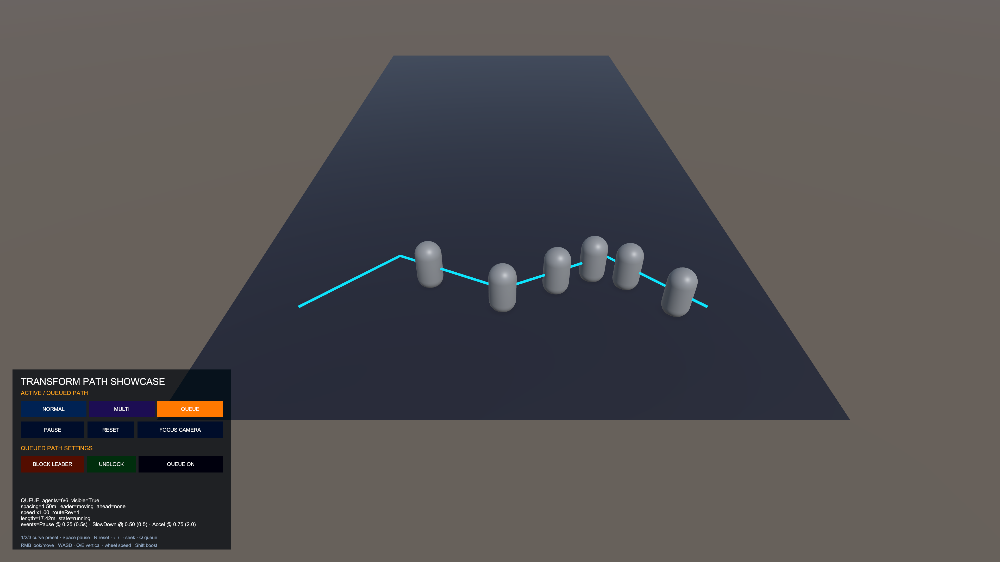
  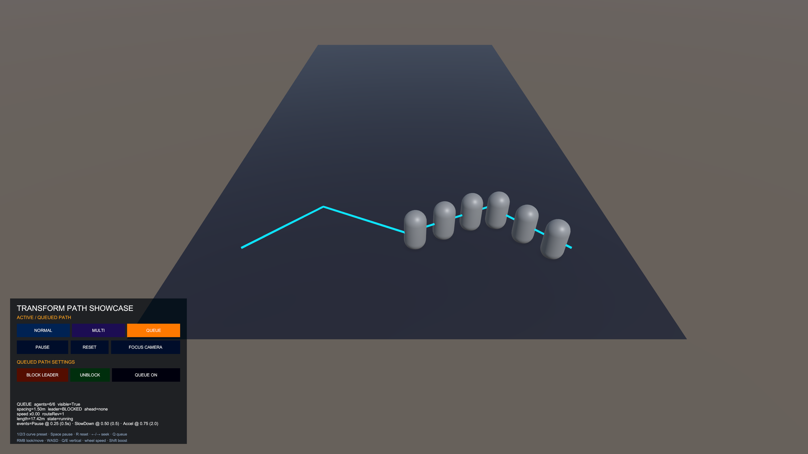
</p>

## 이벤트

`PathData`의 이벤트는 `Rebuild` 때 복사되어 위치순으로 재생됩니다. 작성 위치는 `0..0.995`이고 같은 위치는 작성 순서를 따릅니다. 위치 0의 이벤트도 재생 시작 후 첫 이동에서 실행됩니다.

- **이름 알림:** `EventName`을 채우고, `IPathEventReceiver`를 구현한 컴포넌트를 `PathEventHandler`의 **Receiver Object**에 연결합니다. 수신기는 `Init`에서 한 번 읽습니다. `OnEventDispatched`를 구독해도 됩니다.
- **수동 실행:** `HandleEvent(setting)`은 전달한 SO의 현재 값을 바로 실행합니다. 경로에 등록된 복사본에는 `Rebuild` 전까지 반영되지 않습니다.
- **지연 이벤트:** 게임 시간을 쓰며, 다음 이벤트가 실행되면 남은 지연이 취소됩니다. TimeScale 목표 0과 함께 쓰면 영원히 실행되지 않으므로 거부합니다.

Pause 이벤트는 목표값이 `SpeedBased`에서 속도 0, `TimeBased`에서 Duration 9999인 이벤트입니다. 재생을 시작할 때 다음을 검증합니다.

1. Pause의 보간 시간은 0입니다.
2. **Use Delayed Events**를 켜고 지연 이벤트를 정확히 1개 둡니다. 지연은 양수입니다.
3. 그 이벤트는 같은 이동 방식의 Resume입니다. 속도는 양수, Duration은 9999 미만, 보간 시간은 0이고 지연 이벤트가 없어야 합니다.

직접 호출하는 `SetSpeed(0)`은 범위 예외가 나고 `SetDuration(9999)`는 Pause하지 않습니다. 위 해석은 이벤트에만 적용됩니다.

<p align="center">
  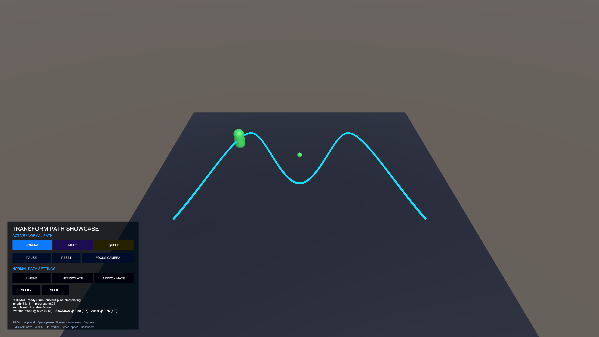
  
</p>

## 기능

### 경로

왼쪽은 `Linear`, 오른쪽은 곡선 경로를 Seek로 끝 부근에 옮긴 화면입니다.

<p align="center">
  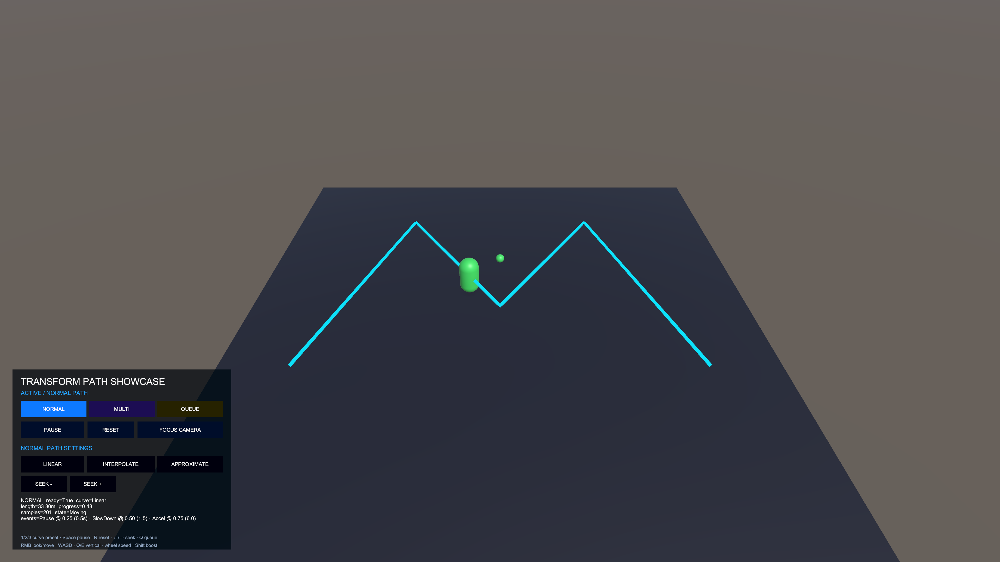
  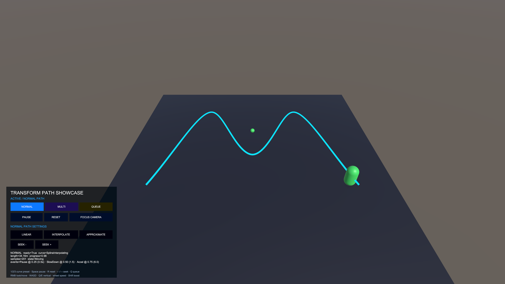
</p>

### 연결 경로

`MultiPathData`는 여러 Provider를 구간별 이동 설정과 함께 잇습니다. 전체 진행률과 구간 진행률을 각각 Seek할 수 있습니다.

<p align="center">
  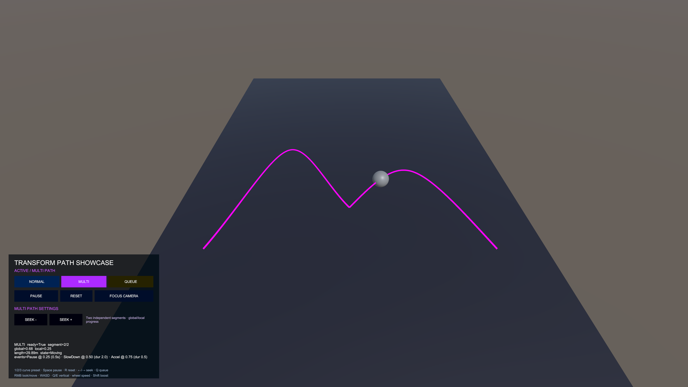
  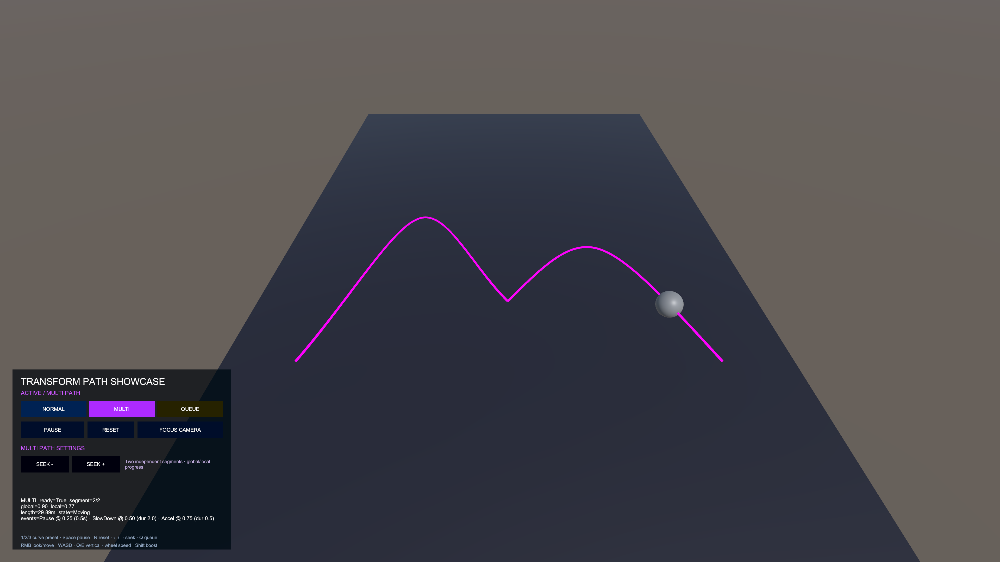
</p>

### Editor 작성

제어점은 Scene View의 이동 도구로, 이벤트 진행률과 설정은 Inspector에서 편집합니다. `MultiPathData`의 연결점 동기화와 `PathWaypointSyncRegistry`의 그룹 동기화는 Undo/Redo를 지원합니다.

<p align="center">
  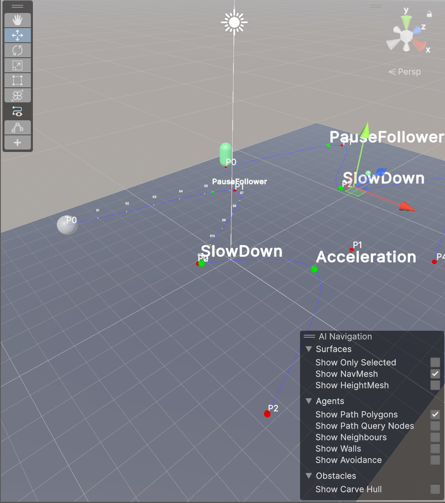
  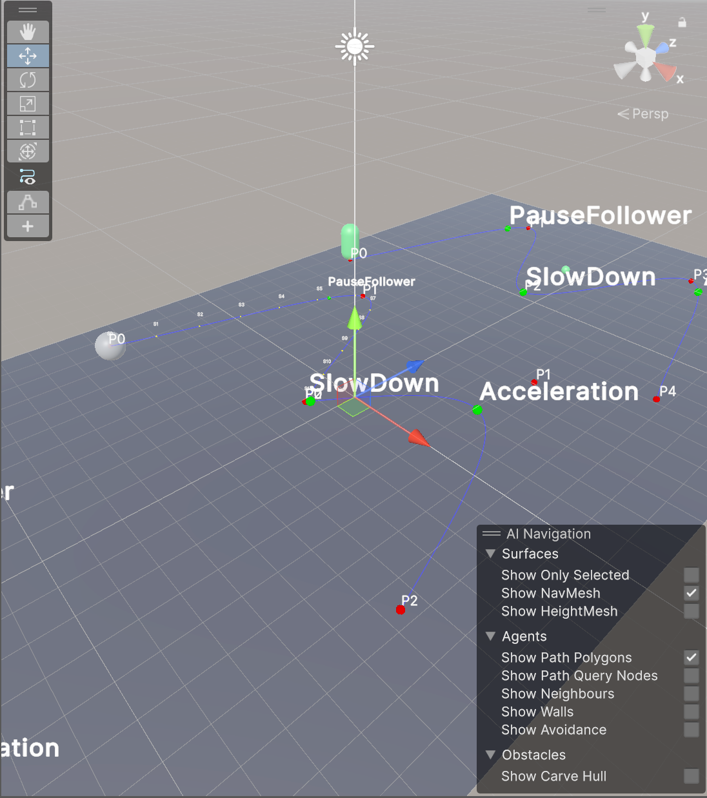
</p>
