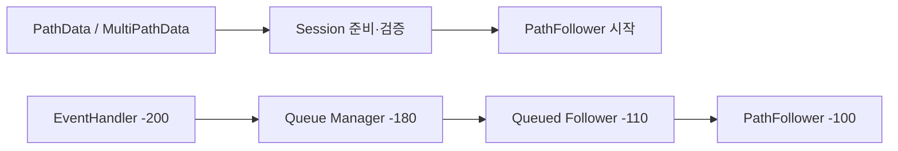

# TransformPath

Unity Transform 제어점으로 경로를 만들고 단일 경로·연결 경로·Queue 이동을 재생하는 시스템입니다. 네임스페이스는 `Common.TransformPath`입니다.

## 프로젝트 정보

| 항목 | 내용 |
|---|---|
| 개발 | 유원석 (You Won Sock), [GitHub](https://github.com/youwonsock) |
| 환경 | Unity 2023.2.20f1 |
| 런타임 | `Common.TransformPath.Runtime` |
| 에디터 | `Common.TransformPath.Editor` |
| 샘플 | `Common.TransformPath.Samples`, URP·UGUI 사용 |
| 예제 씬 | `Assets/_TransformPath/Scene/TransformPathSample.unity` |
| 예제 프리팹 | `Assets/_TransformPath/Prefab/TransformPathShowcase.prefab` |

## 구성과 책임

| 구성 | 책임 |
|---|---|
| `PathData` | 제어점에서 Linear·B-Spline·Catmull–Rom 기하, 누적 거리, 이동 설정·이벤트를 발행 |
| `MultiPathData` | Provider 목록을 구간 설정·누적 거리로 조합 |
| `PathFollower` | 재생·이동·회전·Seek·이벤트 통과·구간 전환·완료 처리 |
| `PathPlaybackSession` | 요청 준비·재사용, 스냅샷과 이벤트 커서, 경로 변경 판단 |
| `PathSequenceSnapshot` | 시퀀스 구간·거리·이벤트의 실행 스냅샷 |
| `PathRuntimeDriver` | 프레임별 실행 순서와 등록·재생 유효성 검사 |
| `QueuedPathManager` | 선행 Agent·거리·차단·감속·진행 상한 계산 |
| `QueuedPathFollower` | 재생 제어와 Queue 참여·해제, 제약·알림 전달 |
| `PathQueueSession` | 등록 소유권, 수동 대기·재출발 지연·속도 완화 상태 |
| `PathEventHandler` | 이벤트 실행·수신기 전달·취소 |
| 이벤트 보조 클래스 | 지연 예약, 속도·Duration 보간, 전역 TimeScale 소유권·복원 |
| 정적 계산 유틸리티 | 기하·진행률·Queue 계산과 입력 검증 |
| 표시 컴포넌트 | LineRenderer와 Animator 반영 |

전체 관계는 [TransformPath.uml](TransformPath.uml)에 정리했습니다.

## 현재 API

- 경로: `IPathProvider`, `IPathMovementProvider`, `IPathSequenceProvider`
- 재생 제어: `IPathFollower`
- 상태 조회·알림: `IPathPlaybackState`
- Queue: `IQueuedPathAgent`, `IPathConstraintTarget`
- 이벤트: `IPathEventSource`, `IPathEventReceiver`

`IPathFollower`는 `Init`·`Release`, `StartPlayback`·`StopMove`·`PauseMove`·`ResumeMove`, `Seek`·`SeekSegment`, `SetSpeed`·`SetDuration`을 직접 제공합니다. 명령은 `PlaybackId`, `StateRevision`, `Changed`가 담긴 `PathCommandReceipt`를 반환합니다. `Init` 후 제어하고 사용이 끝나면 `Release`합니다. 완성된 직렬화 구성을 가진 컴포넌트는 플레이 시작 시 초기화되며 Init은 반복 호출할 수 있습니다.

## 경로 준비와 첫 재생

1. 경로를 보관할 GameObject에 `PathData`를 추가합니다.
2. EditMode에서 Inspector의 `Create Path Points`로 제어점을 만들고 위치를 배치합니다. 직접 만든 Transform을 사용할 때는 `Path Points` 목록에 이동 순서대로 연결합니다. 자손의 `PathPoint` 이름으로 시작하는 Transform은 `Refresh Path Points from Children`으로 수집할 수도 있습니다. 제어점은 최소 2개이고 경로 길이는 0보다 커야 합니다.
3. Inspector의 Movement에서 TimeBased의 Duration 또는 SpeedBased의 Speed를 설정합니다. 값 범위는 `0.001..9999`입니다. TimeCurve 조건은 아래 재생 요청 설명을 참고합니다.
4. `Rebuild Runtime Path`를 실행하고 Console의 구성 오류를 해결합니다. 런타임에서도 `Init` 후 `IsReady`를 확인해야 합니다. `Init`은 누락된 제어점을 자동으로 만들지 않습니다.
5. 이동할 GameObject에 `PathFollower`를 추가합니다. 필요한 `PathEventHandler`는 함께 추가됩니다. 아래 코드의 `path`와 `follower`는 준비한 두 컴포넌트의 참조이며, 플레이 중 `Start` 등의 메서드에서 실행합니다.

```csharp
using Common.TransformPath;
using UnityEngine;

path.Init();
if (path.IsReady)
{
    follower.Init();
    IPathFollower playback = follower;
    playback.StartPlayback(PathPlaybackRequest.Single(path));
    playback.PauseMove();
    playback.ResumeMove();
    playback.Seek(0.5f);
}
else
{
    Debug.LogError("PathData의 제어점과 이동 설정을 확인하세요.", path);
}
```

### 제어 API의 조건

다음 명령은 초기화와 재생 세션이 필요합니다. `Init`만 호출한 상태에서는 세션이 없으므로 먼저 `StartPlayback`으로 재생을 시작합니다.

| 명령 | 조건과 입력 처리 |
|---|---|
| `SetSpeed(value)` | 현재 구간이 SpeedBased일 때 사용. 유한한 `0.001..9999` 값만 허용 |
| `SetDuration(value)` | 현재 구간이 TimeBased일 때 사용. 유한한 `0.001..9999` 값만 허용 |
| `Seek(normalizedTime)` | Single·Aggregate·Sequence에서 사용. 유한한 입력을 `0..1`로 제한 |
| `SeekSegment(index, localNormalizedTime)` | Sequence 전용. 유효한 구간 인덱스가 필요하며 유한한 구간 내 진행률을 `0..1`로 제한 |

세션이 없거나 이동 모드가 맞지 않으면 `InvalidOperationException`, 값 범위·구간 인덱스·유한성 조건을 위반하면 `ArgumentOutOfRangeException`이 발생합니다. 직접 호출하는 `SetSpeed`·`SetDuration`은 Pause·Resume 상태를 바꾸지 않습니다. 일시 정지와 재개에는 `PauseMove`·`ResumeMove`를 사용합니다.

## 재생 요청과 프레임 실행

| 요청 | 이동 설정 |
|---|---|
| `PathPlaybackRequest.Single(path)` | Path의 이동 설정 사용 |
| `PathPlaybackRequest.Aggregate(provider, settings)` | 명시한 이동 설정으로 전체 Provider 재생 |
| `PathPlaybackRequest.Sequence(sequence)` | 구간별 이동 설정 사용 |

각 요청의 `loop`로 반복 재생을 지정합니다. TimeBased는 Duration·단조 증가하는 TimeCurve, SpeedBased는 거리와 속도로 전진합니다. 곡선의 시작과 끝은 0과 1이어야 합니다. 자연스러운 구간 전환에서 `PreservePreviousSpeed`를 켜면 이전 명목 속도를 다음 구간의 이동 설정으로 변환합니다.

시작은 Session을 한 번 준비·검증하고 지역 변수로 전달합니다. 시작 직전에 Provider 준비 상태나 Revision이 바뀌면 다시 검증합니다. 설정 콜백의 Duration·Speed 변경은 초기 위치 반영을 취소하지 않습니다. 콜백이 실행한 Stop·Pause·Seek·새 Start는 이전 시작 처리를 중단합니다. 회전 설정을 포함한 콜백 명령의 결과를 보존합니다.



Driver가 프레임 시작의 실행 대상·PlaybackId·등록 버전을 고정합니다. 같은 프레임에서 새로 등록되거나 재생이 교체된 대상은 다음 프레임부터 처리합니다. 이동 중 통과한 경로 이벤트는 즉시 Handler로 전달합니다.

## Seek와 경로 변경

Seek는 전체 경로의 거리 기준 진행률을, SeekSegment는 지정한 구간의 로컬 진행률을 사용합니다. 두 명령은 공통 처리에서 잔여 시간·Queue 제약·이벤트 커서·위치를 갱신합니다. 실제 위치가 바뀌면 이전 Tick과 이벤트 순회를 중단하고 PlaybackId는 유지합니다. 같은 위치로의 Seek는 Changed=false이며 기존 Tick을 계속합니다. 구간 경계는 `[start, end)` 규칙을 사용하며 마지막 구간의 끝 `1`은 허용합니다.

Seek의 이벤트·알림 처리 규칙은 다음과 같습니다.

- Seek로 건너뛴 경로 이벤트는 즉시 실행하지 않습니다. 이벤트 커서는 목표 위치와 그 이전의 이벤트를 건너뛰도록 맞춥니다. 뒤로 Seek하면 이후 다시 통과하는 이벤트는 재실행될 수 있습니다.
- Seek로 구간이 바뀌어도 `SegmentChanged`를 발행하지 않습니다. 이 알림이 필요한 연동에서는 명령 후 `CurrentSegmentIndex`를 직접 확인합니다.
- `Seek(1f)`는 즉시 완료 명령이 아닙니다. 완료 또는 Loop 판정은 이후 이동 가능한 Tick에서 수행합니다. Paused 상태라면 Resume이 필요하며, Queue 제약도 이동을 허용해야 합니다.

런타임에서 제어점 Transform의 위치만 바꾸면 PathData의 기하 캐시와 Revision은 갱신되지 않습니다. 변경 후 `path.Rebuild()`로 다시 발행해야 합니다. 이미 초기화된 PathData의 `ConfigureControlPoints`처럼 내부에서 Rebuild를 수행하는 API는 별도 호출이 필요하지 않습니다. 경로에 등록된 PathEventSettingSO 변경도 Rebuild해야 새 이벤트 정의로 발행됩니다. 수동 `HandleEvent` 호출과의 차이는 아래 이벤트 설명을 참고합니다.

Path는 검증된 기하·이벤트 결과를 발행하며 실제 내용이 달라지면 Revision을 증가시킵니다. Follower는 Moving 상태의 다음 Tick에서 변경을 확인하므로 Pause 중에는 반영을 미룹니다. 기하만 변경되면 현재 구간의 로컬 진행률을 유지합니다. Sequence의 전체 진행률은 바뀐 구간 길이로 다시 계산하므로 달라질 수 있습니다. 사용 중인 이동·이벤트 정의 또는 시퀀스 구성이 달라지면 재생을 중단합니다. Aggregate의 명시적 이동 설정은 Provider 이동 설정 변경과 분리됩니다.

## Queue

앞 절에서 준비한 `path`와 `QueuedPathManager`·`QueuedPathFollower` 컴포넌트 참조를 사용합니다. 기본 예제는 최대 진행률을 `1f`로 지정해 경로 끝까지 이동할 수 있게 합니다.

```csharp
manager.Init();
manager.ConfigureRoute(path);
queue.Init();
queue.StartQueuedPlayback(manager, PathPlaybackRequest.Single(path), 1f);
```

진행 제한이 필요할 때만 마지막 인자를 `0.8f` 등으로 변경합니다. `0.8f`는 최대 80%까지만 진행하므로 해당 Queue 제약을 유지하는 동안 완료되지 않습니다. `ForceUnblock`은 수동 대기를 풀며 이 진행 상한을 해제하지 않습니다.

| 명령·값 | 의미 |
|---|---|
| `StartPlayback(request)` | Inspector에 지정한 Manager로 Queue 시작 |
| `StartQueuedPlayback(manager, request, max)` | Manager와 최대 진행률을 지정해 시작 |
| `StartFreePlayback(request)` | Queue를 해제하고 일반 재생 시작 |
| `ForceBlock` / `ForceUnblock` | 등록을 유지한 수동 대기 / 재개 요청 |
| `PauseMove` / `ResumeMove` | 재생을 Pause하고 등록·제약을 해제 / Queue 참여 모드라면 재등록 시도 |
| `DetachQueue` | 현재 재생을 유지하며 Queue 제약만 해제 |
| `IsBlocked` / `IsQueueHeld` | 적용된 차단 상태 / 수동 대기 상태 |
| `Manager` / `ActiveManager` | Inspector 설정 / 현재 참여 Manager |

Queue와 Manager는 같은 Provider 인스턴스를 사용해야 합니다. Queue Tick이 현재 PlaybackId와 등록 소유권을 맞춥니다. 내부 Follower의 동일 경로 교체는 재등록하고 수동 대기·진행 상한을 유지합니다. 다른 경로나 해제된 Manager로의 직접 시작은 무효화 처리합니다.

Queue 참여 중 `PauseMove`를 호출하면 재생 상태가 Paused가 되고 Manager 등록과 적용 중인 Queue 제약을 해제합니다. 따라서 해당 Agent는 Manager의 간격 계산에서 빠집니다. `ResumeMove`는 재생을 재개하면서 다시 등록하고 첫 Queue 계산을 기다립니다. 이때 기존 ActiveManager가 초기화·활성 상태이고 Provider가 준비되어 있으며 같은 경로 인스턴스여야 합니다. 조건을 만족하지 못하면 Queue 참여가 무효화됩니다. Free 재생의 Pause·Resume은 Queue 등록을 만들지 않습니다.

등록과 간격 계산 참여를 유지하면서 대기하려면 `ForceBlock`을 사용합니다. 이 명령은 재생 상태를 Paused로 바꾸지 않고 Queue 제약으로 이동을 막습니다. 수동 대기는 `ForceUnblock`으로 풀며, 실제 재출발은 Manager 결과와 지연·간격 조건을 따릅니다.

등록 토큰은 Manager.Register에서 받습니다. `PathQueueState` 생성 시 현재 PlaybackId와 FrameId를 명시합니다. 다른 재생·경로 버전 또는 오래된 프레임의 결과는 적용하지 않습니다. 등록 토큰의 RouteRevision은 등록 당시 값이고, 제약의 RouteRevision은 해당 계산 버전입니다. 기하 변경에도 등록 소유권은 유지됩니다.

재출발 기본값은 지연 0.1초, 추가 간격 0.3, 속도 보간율 5입니다. Inspector에서 각각 조절할 수 있습니다. 진행 상한이 1 미만이면 그 경계를 넘어 완료·Loop·구간 전환하지 않습니다.

OnBlocked·OnResumed·OnSpeedChanged와 완료·무효화 알림은 고정된 리스너 목록을 순회합니다. 콜백에서 ForceBlock·ForceUnblock·Detach 등 Queue 명령이나 재생 변경이 발생하면 이전 알림 묶음과 그 후속 묶음을 중단합니다. Queue 알림 변경 검사는 내부 값으로 관리하며 공개 StateRevision의 의미는 유지합니다. 이후 Tick의 정상 알림은 계속 전달됩니다.

## 이벤트와 수명

경로에 등록한 PathEventSettingSO는 Rebuild 시 불변 PathEventDefinition으로 복사됩니다. 경로를 따라 이동하며 이벤트를 처리할 때는 이 스냅샷을 사용하고 SO 변경을 직접 읽지 않습니다. 경로 이벤트는 위치순으로 안정 정렬하며 같은 위치에서는 작성 순서를 유지합니다.

| 실행 방식 | 정의를 읽는 시점 | 실행 시점 |
|---|---|---|
| 경로에 등록한 이벤트 | PathData의 Rebuild 시 SO를 복사 | 재생 중 이벤트 위치를 통과할 때 |
| `PathEventHandler.HandleEvent(setting)` | 호출할 때마다 전달한 SO를 새 정의로 변환 | 호출 즉시 처리하며 지연 항목은 별도 예약 |

- 이벤트 이름은 `IPathEventReceiver.ReceivePathEvent`와 OnEventDispatched로 전달합니다.
- **이벤트 목표값**에서 SpeedBased의 속도 0은 Pause, TimeBased의 Duration 9999는 Pause 신호입니다. Paused 상태에서 유효한 목표값의 이벤트를 실행하면 Resume과 값 변경을 함께 수행합니다. 이는 이벤트 해석 규칙입니다. 직접 `SetSpeed(0)`을 호출하면 값 범위 예외가 발생하고, `SetDuration(9999)`는 Duration을 변경하며 Pause하지 않습니다.
- 지연 이벤트는 게임 시간을 사용하며, 경로의 다음 이벤트가 실행되면 기존 지연 목록을 취소합니다.
- TimeScale 변경은 소유자를 구분해 복원하며 오래된 재생의 해제가 새 효과를 정리하지 않습니다.
- 재생 중 Follower가 비활성화한 CharacterController는 종료 시 복원합니다. Pause에서는 비활성을 유지합니다. Inspector에서 이 기능을 끌 수 있습니다.
- `SetRotateToPathDirection`은 지속 회전을, `AlignRotationToPathDirection`은 선택 축의 일회 정렬을 제어합니다.

### 이벤트 수신기 연결

1. 이름 알림을 받을 PathEventSettingSO의 `EventName`을 설정합니다. 이름이 비어 있으면 수신기와 `OnEventDispatched`를 호출하지 않습니다. 이동·TimeScale 효과의 실행 여부는 이름과 별개입니다.
2. `IPathEventReceiver`를 구현한 MonoBehaviour 컴포넌트를 준비합니다. 구현 메서드는 `ReceivePathEvent(string eventName, IPathPlaybackState playback)`입니다.
3. 플레이 전에 이동 객체의 PathEventHandler Inspector에서 **Receiver Object** (`_receiverObject`)에 해당 컴포넌트를 연결합니다. 같은 GameObject에 구현체를 추가하는 것만으로는 자동 연결되지 않습니다.

수신기 참조는 `PathEventHandler.Init`에서 한 번 읽습니다. 초기화 후 Inspector 참조를 변경하거나 Init을 반복 호출해도 자동으로 다시 연결하지 않습니다. 수신기 대신 또는 함께 `PathEventHandler.OnEventDispatched`를 구독할 수도 있습니다. 코드로 구독한 이벤트는 사용이 끝날 때 해제합니다.

이름 알림은 수신기를 먼저 호출하고 그다음 `OnEventDispatched` 리스너를 순회합니다. 이 알림은 해당 이벤트의 이동 제어·TimeScale 효과 적용보다 먼저 전달됩니다. 콜백이 재생 상태를 바꾸거나 새 이벤트를 실행하면 이전 알림 순회와 효과 후처리가 중단될 수 있습니다.

### 수동 HandleEvent 호출

`HandleEvent(setting)`은 전달한 SO의 현재 값을 사용하므로 이 호출을 위해 PathData를 Rebuild할 필요는 없습니다. 다만 같은 SO를 경로에도 등록했다면 경로 쪽 스냅샷은 여전히 Rebuild 전 값입니다. 이미 예약한 지연 이벤트 역시 복사된 정의를 사용하므로 이후 SO 변경이 자동 반영되지 않습니다.

수동 호출에는 null이 아닌 SO와 미리 연결된 Follower가 필요합니다. 일반적으로 `PathFollower.Init`이 같은 이동 객체의 Handler를 자동 연결합니다. Handler의 `Init`만 호출해서는 Follower가 연결되지 않으며, 직접 연결할 때는 `Bind(IPathFollower)`를 사용합니다. 이동 제어 이벤트는 Follower를 초기화하고 재생 세션을 시작한 뒤 현재 이동 모드에 맞게 실행합니다.

수동 호출도 이벤트 정의를 검증하며, 유효한 새 이벤트를 실행하면 기존 지연 이벤트 목록을 취소합니다. Pause·Resume 이벤트에도 아래 구성 조건이 동일하게 적용됩니다.

### Pause·Resume 이벤트 구성

Pause 목표값만 지정한 이벤트는 재생 준비 검증에서 거부됩니다. 해당 이동 모드의 값 변경을 켜고 다음 조건을 모두 만족해야 합니다.

1. Pause 이벤트의 목표값은 SpeedBased에서 `0`, TimeBased에서 `9999`이며, 이동 값의 보간 시간은 `0`입니다.
2. Pause 이벤트의 **Use Delayed Events** (`UseDelayedEvents`)를 켜고, Delayed Events 항목을 **정확히 1개** 추가합니다. 지연 시간은 유한한 양수이고 Resume 이벤트 정의를 연결해야 합니다. 체크박스를 끄면 목록에 항목이 있어도 런타임 정의에 포함되지 않아 Pause 구성 검증에 실패합니다.
3. 연결한 Resume 이벤트는 같은 이동 모드의 유효한 목표값을 사용합니다. 속도는 양수, Duration은 `9999` 미만이며, 이동 값의 보간 시간은 `0`이어야 합니다.
4. Resume 이벤트는 추가 지연 이벤트를 예약하지 않아야 합니다. 보통 `UseDelayedEvents`를 끄며, 켠다면 목록이 비어 있어야 합니다. 활성화된 지연 이벤트 참조가 순환하는 구성도 허용하지 않습니다.

예를 들어 SpeedBased에서는 `Pause(UseDelayedEvents=true, 속도 0, 보간 0초) → 지연 1초 → Resume(UseDelayedEvents=false, 속도 2, 보간 0초)`으로 구성합니다. Pause·Resume의 이동 값 보간 시간과 두 이벤트 사이의 지연 시간은 별개의 값입니다. 조건을 어긴 Pause 구성은 `StartPlayback`의 이벤트 검증에서 예외가 발생하므로 재생 전에 수정해야 합니다.

## 에디터 작성과 샘플

PathData의 제어점 참조·순서는 Inspector에서 설정하고, 각 제어점 Transform의 위치는 Scene View의 이동 도구로 편집합니다. 이벤트의 진행률과 PathEventSettingSO 참조·설정은 Inspector에서 편집합니다. Scene View는 이벤트 위치와 이름을 표시하며, 이벤트를 직접 이동하는 편집 핸들은 제공하지 않습니다.

MultiPathData는 구간별 Provider·이동 설정과 연결점 자동 동기화를 제공합니다. PathWaypointSyncRegistry의 그룹은 이동한 멤버를 기준으로 위치를 동기화합니다. 연결·그룹 편집은 Undo/Redo와 Prefab 변경 기록을 지원합니다.

미리보기 캐시는 살아 있는 경로의 버퍼를 재사용하고, 삭제된 경로·닫힌 Preview Scene의 항목을 정리합니다. PlayMode 전환·리로드 시에는 캐시를 비웁니다.

예제 씬에서 Showcase의 일반·시퀀스·Queue 레인을 확인할 수 있습니다. 샘플 씬·프리팹·설정 파일은 런타임 계약 변경과 분리해 보존합니다.

## 검증

`Window → General → Test Runner`에서 다음을 실행합니다.

- EditMode: `Common.TransformPath.Tests`
- PlayMode: `Common.TransformPath.Tests.PlayMode`
- 에디터 UI 회귀는 그래픽 에디터에서 실행합니다. 배치 모드에서는 UI 테스트를 건너뜁니다.

최신 변경·검증과 제거된 계약의 정확한 범위는 [알림·현재 API 정리](Docs/NotificationAndApiCleanup.md), [검증 JSON](Docs/NotificationAndApiCleanupValidation.json)에 정리합니다. API 기준 파일은 현재 공개 표면을 검사하며, Docs의 과거 검증 기록은 해당 작업 당시 결과입니다.
