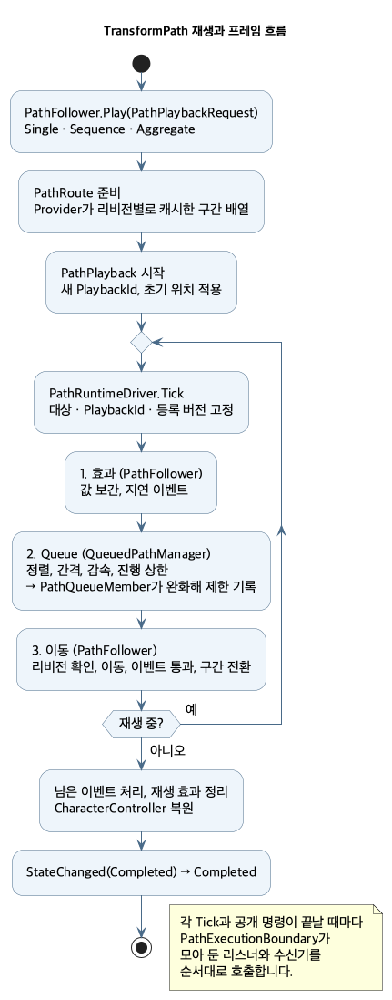
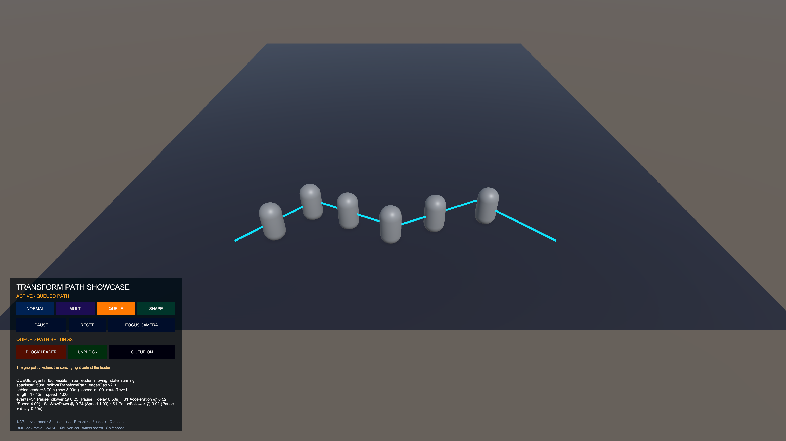
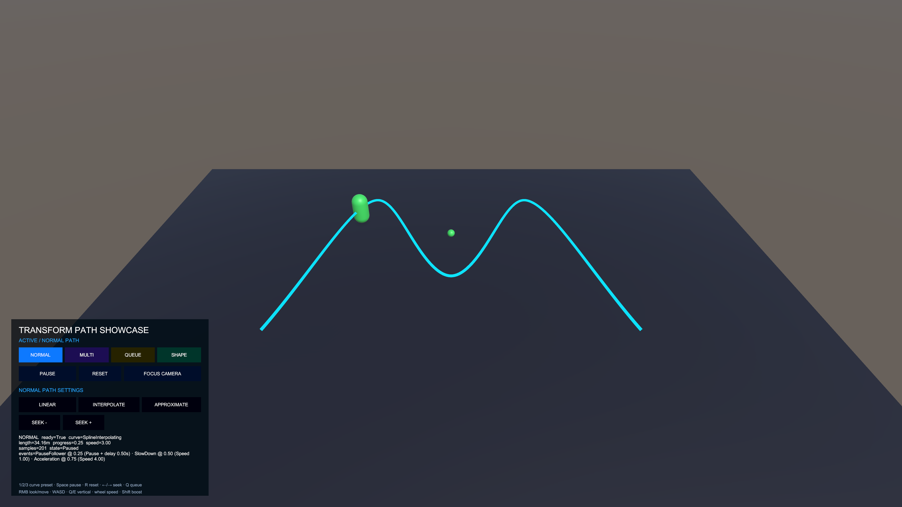
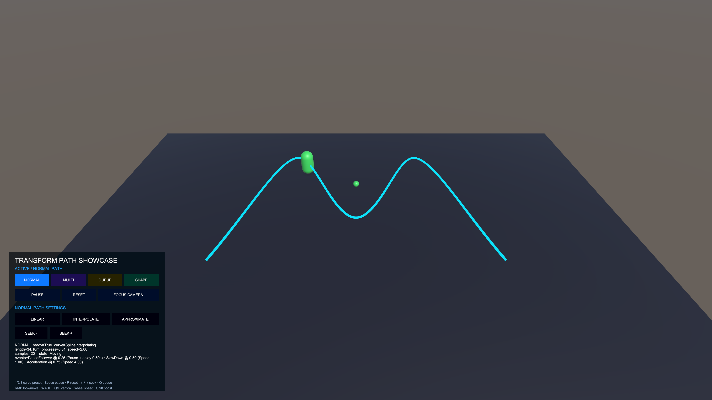
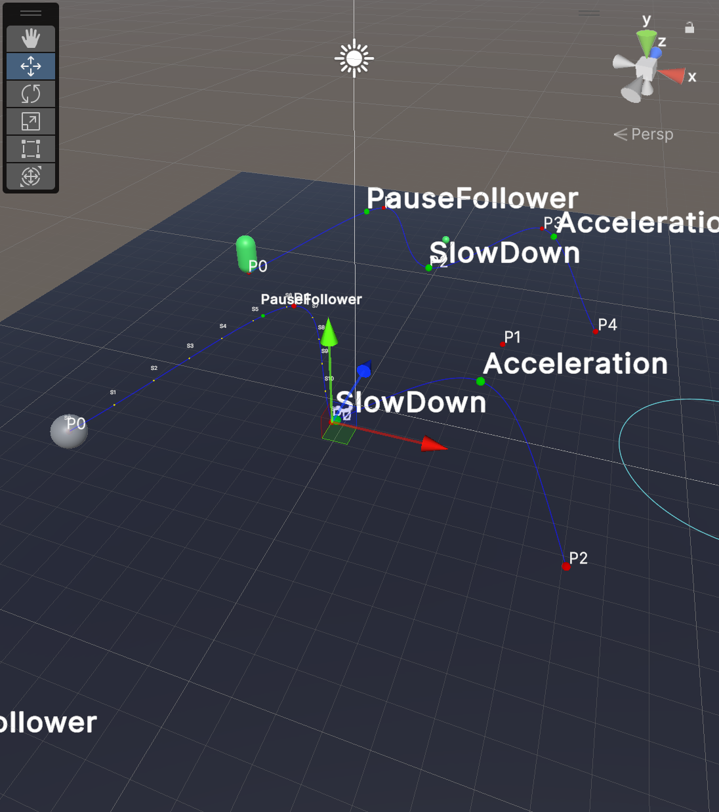

# TransformPath

Transform 제어점으로 경로를 만들고 단일 경로, 연결 경로, Queue 이동을 재생하는 시스템입니다. 네임스페이스는 `Common.TransformPath`입니다.

| 항목 | 내용 |
| --- | --- |
| 개발 | 유원석 (You Won Sock) · [GitHub](https://github.com/youwonsock) |
| 환경 | Unity 2023.2.20f1, C# (샘플 표시는 URP, UGUI) |
| 곡선 | `Linear`, `SplineApproximating` (B-Spline), `SplineInterpolating` (Catmull–Rom) |
| 이동 방식 | `TimeBased`: Duration과 TimeCurve · `SpeedBased`: 거리와 속도 |
| 예제 | `Samples/Scenes/TransformPathSample.unity`, `Samples/Prefabs/TransformPathShowcase.prefab` |

구현 세부는 [TechnicalNotes.md](Docs/TechnicalNotes.md)에 있습니다. 코드의 메시지(예외, 로그, Inspector 문구와 Tooltip, 주석)는 모두 영어입니다.

## 다른 프로젝트로 옮기기

- `Assets/_TransformPath/Script/` 폴더를 `.meta`와 함께 복사합니다. 시스템(`Common.TransformPath`)과 에디터(`Common.TransformPath.Editor`) 어셈블리가 들어 있습니다.
- 추가 패키지는 필요 없습니다. CharacterController를 쓰므로 기본 Physics 모듈이 켜져 있어야 합니다. Unity 2023.2.20f1 빈 프로젝트(기본 모듈만)에 `Script/`만 복사해 두 어셈블리가 경고와 오류 없이 컴파일되는 것을 확인했습니다.
- `Samples/`(샘플 씬·스크립트·이벤트 에셋. UGUI 필요)와 `Dev/`(테스트와 측정 도구)는 옮기지 않아도 됩니다. 문서가 필요하면 이 README와 `Docs/`를 함께 옮깁니다.

## 시작하기

1. 샘플 씬을 실행해 Normal, Multi, Queue 레인을 확인합니다. macOS 입력 소스가 한글이면 샘플의 글자 키가 동작하지 않습니다.
2. GameObject에 `PathData`를 추가하고 Inspector의 **Create Path Points**로 제어점을 2개 이상 만듭니다.
3. Movement에서 Duration이나 Speed(`0.001..9999`)를 지정합니다. Play Mode에서 `PathData`는 Awake에서 스스로 빌드합니다.
4. 이동할 GameObject에 `PathFollower`를 추가하고 재생을 시작합니다.

```csharp
using Common.TransformPath;
using UnityEngine;

public sealed class TransformPathReadmeExample : MonoBehaviour
{
    [SerializeField] private PathData _path = null;
    [SerializeField] private PathFollower _follower = null;

    private void Start()
    {
        if (!_path.IsReady)
        {
            Debug.LogError("PathData의 제어점과 이동 설정을 확인하세요.", _path);
            return;
        }

        _follower.Play(PathPlaybackRequest.Single(_path));
    }
}
```

## 구조




- **Provider** (`PathData`, `MultiPathData`)는 검증한 기하와 이벤트를 한 번에 발행합니다. 무엇이든 바뀌면 `Revision`을 올리고, 이동 설정·이벤트·구간 구성이 바뀌면 내부 정의 리비전도 올립니다. 재생은 기하 변경에는 이어지고 정의 변경에는 멈춥니다.
- **PathFollower**는 Transform에 위치를 적용하고, 재생은 내부의 `PathPlayback`, 이벤트 효과는 `PathEventEffects`가 맡습니다. Single, Sequence, Aggregate 재생은 모두 구간 배열 하나(`PathRoute`)로 표현됩니다.
- **QueuedPathManager**가 매 프레임 멤버를 정렬해 간격을 계산하고, **PathQueueMember**가 그 결과를 완화해 Follower의 이동을 제한합니다.
- **PathRuntimeDriver**가 효과 → Queue → 이동 순서로 한 프레임을 실행하고, **PathExecutionBoundary**가 콜백 시점을 정합니다.

## 재생 API

| 요청 | 이동 설정 |
| --- | --- |
| `PathPlaybackRequest.Single(pathData, loop)` | 경로의 설정 |
| `PathPlaybackRequest.Sequence(multiPathData, loop)` | 구간별 설정 |
| `PathPlaybackRequest.Aggregate(provider, settings, loop)` | 지정한 설정으로 `PathData`나 `MultiPathData` 전체를 한 경로처럼. `PathData`의 이벤트는 실행하고 `MultiPathData`는 이벤트 없이 |

| 명령 | 조건 |
| --- | --- |
| `Play`, `Stop`, `Pause`, `Resume` | `Play`는 준비된 Provider가 필요 |
| `Seek(0..1)`, `SeekSegment(index, local)` | `SeekSegment`는 Sequence 전용. 건너뛴 이벤트는 실행하지 않음 |
| `SetSpeed(value)`, `SetDuration(value)` | 현재 구간의 이동 방식과 맞을 때, `0.001..9999` |
| `TriggerEvent(setting)` | 이벤트 에셋을 지금 실행 |

- 명령은 상태가 바뀌었는지를 `bool`로 반환합니다. 조건을 어기면 `InvalidOperationException`, 값이 범위 밖이면 `ArgumentOutOfRangeException`이며, 예외가 나면 아무것도 바뀌지 않습니다.
- 상태는 `State`, `Progress`(전체), `SegmentProgress`, `SegmentIndex`, `PlaybackId`로 읽습니다.

| 조회와 설정 | 내용 |
| --- | --- |
| `PathFollower` | `IsMoving`, `CurrentProvider`, `MoveType`, `Speed`, `Duration`, `RotateToPathDirection`(지속 회전), `AlignRotationToPathDirection(axes)`(일회 정렬) |
| `PathData` | `CurveType`, `SegmentCount`, `MovementSettings`, `SetPathPoints`, `CopyControlPoints`, `SamplePointCount`, `GetSamplePoint`, `AuthoringEventCount`, `GetAuthoringEvent`, `SortPathEventsByNormalizedTime` |
| `MultiPathData` | `SegmentCount`, `GetSegmentPath`, `GetSegmentMovement`, `GetSegmentStartDistance`, `GetSegmentLength`, `SetSegments`, `AuthoringSegmentCount`, `GetAuthoringSegment` |
| 공통 (`PathData`, `MultiPathData`) | `IsReady`, `PathLength`, `Revision`, `PathChanged`, `Rebuild()`, `Sample(progress)` |
- 런타임에 제어점이나 `PathEventSettingSO`를 바꾸면 `path.Rebuild()`를 호출합니다. `MovementSettings`, `CurveType`, `SegmentCount` 속성은 바꾸는 즉시 다시 빌드합니다. 기하만 바뀌면 재생이 이어지고, 이동 설정·이벤트·구간 구성이 바뀌면 멈춥니다.
- 콜백(`StateChanged`, `SegmentChanged`, `Completed`, `EventReached`, Queue 알림, 이벤트 수신기)은 그것을 일으킨 작업이 끝난 뒤 순서대로 호출됩니다. 콜백 안에서 모든 명령을 쓸 수 있고, 예외는 Console에 기록만 됩니다.

## Queue

```csharp
_member.StartQueuedPlayback(_manager, PathPlaybackRequest.Single(_path));
```

`PathQueueMember`는 `PathFollower`와 같은 GameObject에 둡니다. 멤버와 Manager는 같은 Provider 인스턴스를 씁니다. 세 번째 인자로 최대 진행률을 지정하면 그 지점에서 멈추며 완료되지 않습니다. 재생 제어(Pause, Seek, Stop)는 `member.Follower`로 합니다. Seek한 멤버는 새로 출발할 때처럼 재출발 지연을 기다립니다.

| 명령 | 의미 |
| --- | --- |
| `StartFreePlayback(request)` | Queue를 떠나 일반 재생 |
| `Hold`, `ReleaseHold` | Queue에 남은 채 대기, 해제 |
| `Leave` | 재생을 유지하고 Queue만 떠남 |
| `Follower.Pause`, `Follower.Resume` | 멈춘 멤버도 줄에 남아 뒤 멤버를 막음 |

| 조회와 설정 | 내용 |
| --- | --- |
| `PathQueueMember` | `Follower`, `Manager`, `IsInQueue`, `IsBlocked`, `IsHeld`, `CurrentSpeedMultiplier`, `ActorSpacing`, `UseManagerSpacing`, `EnableGradualSlowdown`, `EnableOvertakeProtection` |
| `QueuedPathManager` | `ConfigureRoute(provider)`, `RouteProvider`, `RouteRevision`, `MemberCount`, `GetMember(index)`(앞에서부터), `TryGetMemberStatus`, `DefaultSpacing`, `EnableGradualSlowdown`, `SlowdownStartDistance`, `MinSpeedMultiplier` |

`Blocked`·`Resumed`·`SpeedChanged`로 대기 상태를, `QueueInvalidated`로 경로 무효와 Manager 해제를 알립니다. 재생이 끝나거나 멈춘 멤버는 다음 프레임에 Queue에서 빠집니다. Queue는 같은 경로 위의 진행 거리만 봅니다. Loop 이음매의 간격, 물리 충돌, 교차 경로 회피는 처리하지 않습니다.

<p align="center">
  
  
</p>

## 이벤트

`PathData`의 이벤트(`0..0.995` 위치)는 빌드 때 복사되어 위치순으로 실행됩니다. 이벤트 에셋(`PathEventSettingSO`)은 다음을 담습니다.

- **Lifecycle**: `Pause`는 재생을 멈추고, `Resume`은 멈춘 재생을 재개합니다.
- **속도 변경, Duration 변경**: 현재 구간이 SpeedBased면 속도 변경만, TimeBased면 Duration 변경만 적용합니다. 보간 시간과 곡선을 지정할 수 있습니다.
- **지연 이벤트**: 게임 시간으로 지연한 뒤 다른 이벤트 에셋을 실행합니다. Pause 뒤 자동 재개는 지연된 Resume 이벤트로 만듭니다.

이름 알림은 `IPathEventReceiver`를 `PathFollower`의 **Event Receiver**에 연결하거나 `EventReached`를 구독해 받습니다.

<p align="center">
  
  
</p>

## 기능

**경로:** 왼쪽은 `Linear`, 오른쪽은 곡선 경로를 끝 부근으로 Seek한 화면입니다.

<p align="center">
  
  
</p>

**연결 경로:** `MultiPathData`가 여러 `PathData`를 구간별 이동 설정과 함께 잇습니다. 전체와 구간 진행률을 각각 Seek할 수 있습니다.

<p align="center">
  
  
</p>

**Editor 작성:** 제어점은 Scene View에서, 이벤트는 Inspector에서 편집합니다. 연결점과 그룹 동기화는 Undo/Redo를 지원합니다. `MultiPathData` Inspector의 **Apply Drawing Sizes To All Paths**와 **Assign Distinct Path Colors**로 구간 경로의 미리보기 모양을 맞춥니다.

<p align="center">
  
  
</p>
