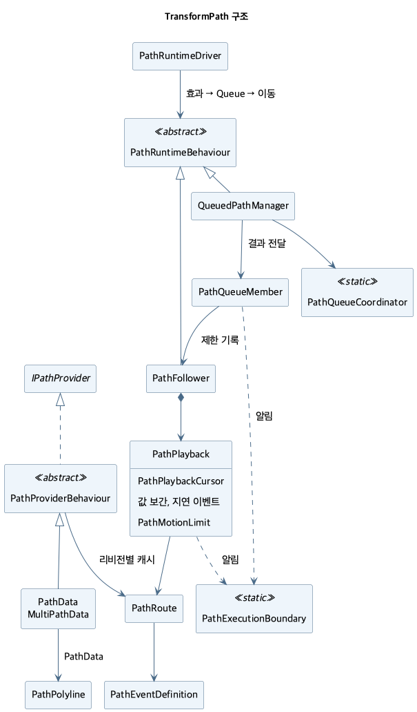
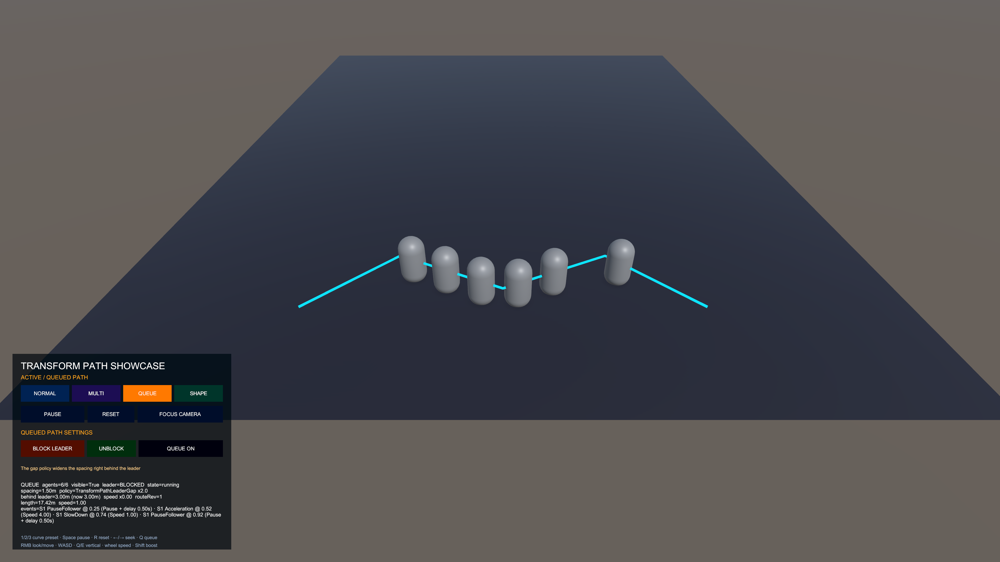
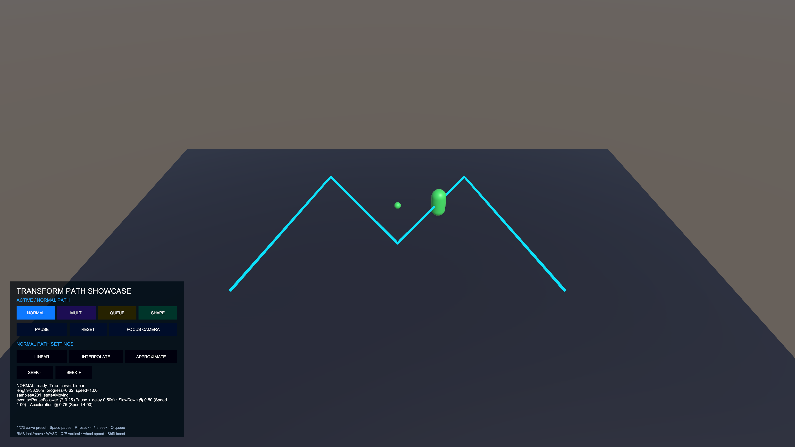
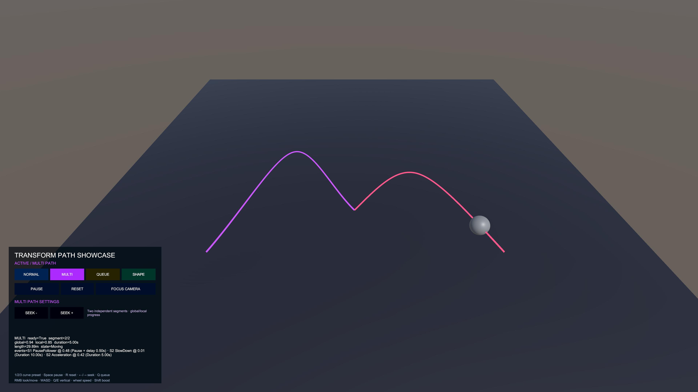
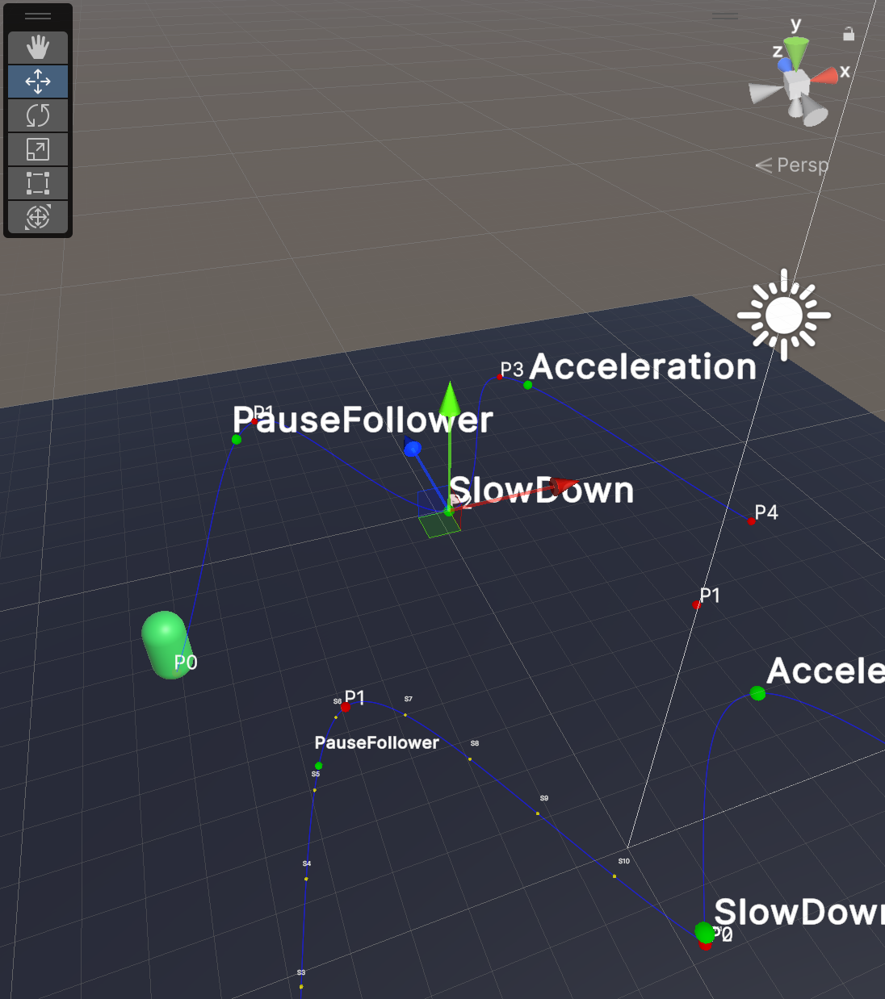

# TransformPath

Transform 제어점, Vector3 좌표, 코드로 그린 모양(`PathShapeProvider`)으로 경로를 만들고 단일 경로, 연결 경로, Queue 이동을 재생하는 시스템입니다. 네임스페이스는 `Common.TransformPath`입니다.

| 항목 | 내용 |
| --- | --- |
| 개발 | 유원석 (You Won Sock) · [GitHub](https://github.com/youwonsock) |
| 환경 | Unity 2023.2.20f1, C# (샘플 표시는 URP, UGUI) |
| 곡선 | `Linear`(제어점이 꼭짓점), `SplineApproximating` (B-Spline), `SplineInterpolating` (Catmull–Rom) |
| 이동 방식 | `TimeBased`: Duration과 TimeCurve · `SpeedBased`: 거리와 속도 |
| 예제 | `Samples/Scenes/TransformPathSample.unity`, `Samples/Prefabs/TransformPathShowcase.prefab` |

구현 세부는 [TechnicalNotes.md](Docs/TechnicalNotes.md)에 있습니다. 코드 메시지(예외, 로그, Inspector 문구·Tooltip·Header·HelpBox, XML·코드 주석, 샘플 화면 문구)는 모두 영어입니다. README와 TechnicalNotes 본문은 한국어이고, 인용하는 UI·로그 문구는 영어 원문 그대로 적습니다.

## 다른 프로젝트로 옮기기

- `Assets/_TransformPath/Script/` 폴더를 `.meta`와 함께 복사합니다. 시스템(`Common.TransformPath`)과 에디터(`Common.TransformPath.Editor`) 어셈블리가 들어 있습니다.
- 추가 패키지는 필요 없습니다. CharacterController를 쓰므로 기본 Physics 모듈이 켜져 있어야 합니다. Unity 2023.2.20f1 빈 프로젝트(기본 모듈만)에 `Script/`만 복사해 두 어셈블리가 경고와 오류 없이 컴파일되는 것을 확인했습니다.
- `Samples/`(샘플 씬·스크립트·이벤트 에셋. UGUI 필요)와 `Dev/`(테스트와 측정 도구)는 옮기지 않아도 됩니다. 문서가 필요하면 이 README와 `Docs/`를 함께 옮깁니다.

## 시작하기

1. 샘플 씬을 실행해 Normal, Multi, Queue, Shape 레인을 확인합니다. macOS 입력 소스가 한글이면 샘플의 글자 키가 동작하지 않습니다.
2. GameObject에 `PathData`를 추가하고 Inspector의 **Create Path Points**로 제어점을 2개 이상 만듭니다.
3. Movement에서 Duration이나 Speed(`0.001..9999`)를 지정합니다. Play Mode에서 `PathData`는 Awake에서 스스로 빌드합니다.
4. 이동할 GameObject에 `PathFollower`를 추가하고 재생을 시작합니다. 코드 없이 시작하려면 Inspector의 **Play On Start**를 켜고 Provider(`PathData`, `MultiPathData`, `PathShapeProvider`)를 지정합니다. Start에서 Provider 자체의 이동 설정으로 재생하며, 같은 오브젝트의 `PathQueueMember`가 Manager를 쓰면(Inspector에 지정했거나 부모에 있으면) 경고를 남기고 건너뜁니다(`StartQueuedPlayback`으로 시작합니다).

```csharp
using Common.TransformPath;
using UnityEngine;

public sealed class TransformPathReadmeExample : MonoBehaviour
{
    [SerializeField] private PathData _path = null;
    [SerializeField] private PathFollower _follower = null;

    private void Start()
    {
        if (!_path.IsReady)
        {
            Debug.LogError("Check the PathData control points and movement settings.", _path);
            return;
        }

        _follower.Play(PathPlaybackRequest.Single(_path));
    }
}
```

## 구조




- **Provider** (`PathData`, `MultiPathData`, `PathShapeProvider`)는 검증한 기하와 이벤트를 한 번에 발행합니다. 무엇이든 바뀌면 `Revision`을 올리고, 이동 설정·이벤트·구간 구성이 바뀌면 내부 정의 리비전도 올립니다. 재생은 기하 변경에는 이어지고 정의 변경에는 멈춥니다.
- **PathFollower**는 Transform에 위치를 적용하고, 재생은 내부의 `PathPlayback`, 이벤트 효과는 `PathEventEffects`가 맡습니다. Single, Sequence, Aggregate 재생은 모두 구간 배열 하나(`PathRoute`)로 표현됩니다.
- **QueuedPathManager**가 매 프레임 멤버를 정렬해 간격을 계산하고, **PathQueueMember**가 그 결과를 완화해 Follower의 이동을 제한합니다.
- **PathRuntimeDriver**가 효과 → Queue → 이동 순서로 한 프레임을 실행하고, **PathExecutionBoundary**가 콜백 시점을 정합니다.

## 재생 API

| 요청 | 이동 설정 |
| --- | --- |
| `PathPlaybackRequest.Single(pathData, loop)` | 경로의 설정 |
| `PathPlaybackRequest.Sequence(multiPathData, loop)` | 구간별 설정 |
| `PathPlaybackRequest.Shape(shape, loop)` | 모양의 설정 |
| `PathPlaybackRequest.Aggregate(provider, settings, loop)` | 지정한 설정으로 Provider 전체를 한 경로처럼. `PathData`의 이벤트는 실행하고 `MultiPathData`와 모양은 이벤트 없이 |

| 명령 | 조건 |
| --- | --- |
| `Play`, `Stop`, `Pause`, `Resume` | `Play`는 준비된 Provider와 켜진 Follower가 필요(꺼진 Follower는 움직이지 않으므로 던짐). `Pause`로 멈춘 재생은 `Resume`으로만 재개(이벤트의 Resume은 이벤트가 멈춘 재생만 깨움) |
| `Seek(0..1)`, `SeekSegment(index, local)` | `SeekSegment`는 Sequence 전용. 건너뛴 이벤트는 실행하지 않음. 구간 진행률 `1e-5` 안이면 같은 위치. 다른 구간으로 가면 그 구간에 들어간 것처럼 이동 값을 정함(속도 보존 구간은 현재 속도를 이어받음). 일시정지 중 바뀐 기하를 먼저 받고(새 기하를 받으면 같은 위치여도 `true`), 이동 설정·이벤트·구간 구성이 바뀌었으면 던짐 |
| `SetSpeed(value)`, `SetDuration(value)` | 현재 구간의 이동 방식과 맞을 때, `0.001..9999`. 같은 채널의 이벤트 값 보간을 취소 |
| `TriggerEvent(setting)` | 이벤트 에셋을 지금 실행 |
| `CancelEventEffects()` | 이벤트가 남긴 값 보간과 지연 이벤트를 취소. 현재 Speed·Duration과 상태는 그대로이고 알림도 없음 |

- `TriggerEvent`(반환값 없음)를 뺀 명령은 상태나 값이 바뀌었는지를 `bool`로 반환합니다. 조건을 어기면 `InvalidOperationException`, `SetSpeed`·`SetDuration`의 값이나 `SeekSegment`의 구간 번호가 범위 밖이면 `ArgumentOutOfRangeException`이며, 예외가 나면 아무것도 바뀌지 않습니다. `Seek`·`SeekSegment`의 진행률과 `StartQueuedPlayback`의 최대 진행률은 `0..1`로 고정하고, 유한하지 않을 때만 `ArgumentOutOfRangeException`입니다. 명령은 Follower의 Awake 전에 불러도 됩니다(켜진 Follower는 그때 초기화).
- 상태는 `State`, `Progress`(전체), `SegmentProgress`, `SegmentIndex`, `PlaybackId`로 읽습니다.

| 조회와 설정 | 내용 |
| --- | --- |
| `PathFollower` | `IsMoving`, `CurrentProvider`, `MoveType`, `Speed`, `Duration`, `HasPendingEventEffects`(값 보간이나 지연 이벤트가 남았는지), `RotateToPathDirection`(지속 회전), `AlignRotationToPathDirection(axes)`(일회 정렬) |
| `PathData` | `CurveType`, `SegmentCount`, `MovementSettings`, `SetPathPoints`, `SetControlPoints`, `CopyControlPoints`, `SamplePointCount`, `GetSamplePoint`, `AuthoringEventCount`, `GetAuthoringEvent`, `SortPathEventsByNormalizedTime`, `MaxEventNormalizedTime`, `ClampPathEventNormalizedTime` |
| `MultiPathData` | `SegmentCount`, `GetSegmentPath`, `GetSegmentMovement`, `GetSegmentStartDistance`, `GetSegmentLength`, `SetSegments`, `AuthoringSegmentCount`, `GetAuthoringSegment` |
| `PathDataLineRenderer` | `Init`, `Release`, `IsInitialized`, `Refresh`, `SetVisible`. `PathData`가 발행한 샘플을 LineRenderer로 그리고, 경로가 바뀌면 다시 그림. 꺼진 컴포넌트는 그리지 않음 |
| `PathShapeProvider` | `MovementSettings`. 하위 클래스가 `TryPrepare`, `Evaluate`를 구현 |
| 공통 (`PathData`, `MultiPathData`, `PathShapeProvider`) | `IsReady`, `PathLength`, `Revision`, `PathChanged`, `Rebuild()`, `Sample(progress)` |
- `SetControlPoints(positions)`는 Transform 목록 대신 월드 좌표로 경로를 만듭니다. 점이 2개 미만이거나 유한하지 않으면 아무것도 바꾸기 전에 예외를 던지고, 좌표는 직렬화하지 않으며, `SetPathPoints`를 부르면 Transform 목록으로 돌아갑니다. `CopyControlPoints`는 이 좌표를 먼저 돌려줍니다. 점이 없는 `PathData`는 Awake에서 빌드하지 않고 점을 받을 때 빌드하며, 그런 구간 경로를 가진 `MultiPathData`도 Awake 대신 첫 사용(재생, Manager의 Route 구성)에 빌드합니다.
- 런타임에 제어점이나 `PathEventSettingSO`를 바꾸면 `path.Rebuild()`를 호출합니다. `MovementSettings`, `CurveType`, `SegmentCount` 속성은 한 번이라도 빌드된 경로라면 바꿀 때 다시 빌드합니다(빌드 전이면 첫 빌드에 반영). 기하만 바뀌면 재생이 이어지고, 이동 설정·이벤트·구간 구성이 바뀌면 멈춥니다.
- 콜백(`StateChanged`, `SegmentChanged`, `Completed`, `EventReached`, Queue 알림, 이벤트 수신기)은 그것을 일으킨 작업이 끝난 뒤 순서대로 호출됩니다. 콜백 안에서 모든 명령을 쓸 수 있고, 예외는 Console에 기록만 됩니다.

## 사용자 정의 경로

`PathShapeProvider`를 상속하면 제어점 대신 코드로 경로를 그립니다. 이동 설정(Mode, Speed·Duration, Time Curve)은 Inspector에서 정하고, 하위 클래스는 두 메서드만 구현합니다.

- `TryPrepare(out length, out shapeChanged, out error)`: 현재 설정으로 모양을 계산해 `Evaluate`가 쓸 값을 보관하고, 길이(유한한 양수)와 이전 빌드에서 모양이 바뀌었는지 알립니다.
- `Evaluate(distance)`: 0..길이의 arc-length 위치. `TryPrepare`가 보관한 값만 읽고, 0..길이의 어느 거리에서도 던지지 않아야 합니다(빌드는 양 끝만 확인).

Play Mode에서는 Awake에서 스스로 빌드하고, 모양이 읽는 값을 바꾼 뒤에는 `Rebuild()`를 호출합니다. `Evaluate(0)`이나 `Evaluate(length)`가 던지거나 유한하지 않은 값을 주면 빌드가 실패합니다. 재생 중에 던지면 Follower가 멈춥니다(Ready). 거리가 arc length가 아니면 속도가 고르지 않습니다. `Awake`나 `OnDestroy`를 선언할 때는 override해서 base를 불러야 합니다. 샘플의 Shape 레인은 공개 API만으로 만든 원 `TransformPathCircleShape`를 `PathFollower`의 **Play On Start** 설정만으로 시작합니다(RESET은 코드로 다시 재생합니다).

## Queue

```csharp
_member.StartQueuedPlayback(_manager, PathPlaybackRequest.Single(_path));
```

`PathQueueMember`는 `PathFollower`와 같은 GameObject에 하나만 두고 그 Follower만 씁니다. 그래서 Follower 하나가 두 Queue에 들어가지 않습니다. 멤버와 그 Follower가 켜져 있을 때만 참여하고(꺼져 있으면 `StartQueuedPlayback`이 던짐), 멤버가 꺼지거나 파괴되면 Queue를 떠납니다(Follower는 제한 없이 계속 재생). Follower가 꺼지면 재생이 멈추고 다음 프레임에 `Stopped`로 빠집니다. 멤버와 Manager는 같은 Provider 인스턴스를 씁니다. Manager의 **Route**에 지정한 경로는 첫 `StartQueuedPlayback`이나 첫 프레임에 빌드해 구성하므로, 런타임에 제어점을 받는 경로도 쓸 수 있습니다. 세 번째 인자로 최대 진행률을 지정하면 그 지점에서 멈추며 완료되지 않습니다. 재생 제어(Pause, Seek, Stop)는 `member.Follower`로 합니다. Seek한 멤버는 새로 출발할 때처럼 재출발 지연을 기다립니다.

| 명령 | 의미 |
| --- | --- |
| `StartFreePlayback(request)` | Queue를 떠나 일반 재생 |
| `Hold`, `ReleaseHold` | Queue에 남은 채 대기, 해제 |
| `Leave` | 재생을 유지하고 Queue만 떠남 |
| `Follower.Pause`, `Follower.Resume` | 멈춘 멤버도 줄에 남아 뒤 멤버를 막음(`Blocked`를 보냄) |

| 조회와 설정 | 내용 |
| --- | --- |
| `PathQueueMember` | `Follower`, `Manager`, `ActiveManager`(참여 중인 Manager), `IsInQueue`, `IsBlocked`, `IsHeld`, `CurrentSpeedMultiplier`, `ActorSpacing`, `UseManagerSpacing`, `EnableGradualSlowdown`, `EnableOvertakeProtection` |
| `QueuedPathManager` | `IsInitialized`, `ConfigureRoute(provider)`, `RouteProvider`, `RouteRevision`, `MemberCount`, `GetMember(index)`(앞에서부터), `TryGetMemberStatus`(`Spacing` 포함), `DefaultSpacing`, `SpacingPolicy`, `EnableGradualSlowdown`, `SlowdownRange`(간격 너머 감속 거리), `MinSpeedMultiplier` |

**간격 정책:** `PathQueueSpacingPolicy`(ScriptableObject)를 상속해 `GetSpacing(member, ahead, resolvedSpacing)`을 구현하고 Manager의 **Spacing Policy**에 지정하면, 멤버마다 앞 멤버와의 간격을 정합니다. `resolvedSpacing`은 정책이 없을 때의 간격(`DefaultSpacing`, 또는 `UseManagerSpacing`을 끈 멤버의 `ActorSpacing`)입니다. Manager는 매 프레임 멤버마다 한 번 묻고, 감속·대기·추월 방지에 같은 값을 씁니다. 감속은 그 간격 너머 **Slowdown Range** 동안 일어나므로, 정책이 간격을 넓혀도 감속이 함께 뒤로 옮겨 갑니다. 여러 Manager가 한 정책을 함께 쓸 수 있습니다. 샘플의 Queue 레인은 `TransformPathGapPolicy` 에셋(`Samples/Settings/Queue/TransformPathLeaderGap.asset`)으로 선두 바로 뒤의 간격만 두 배로 넓힙니다. 유한하지 않거나 음수인 값은 정책 이름을 담은 예외가 되어 Manager가 모든 멤버를 `ManagerReleased`로 내보내고 그 재생을 멈추며(실패 격리), 정책 안에서 `Leave`나 `StartQueuedPlayback`처럼 줄을 바꾸면 `InvalidOperationException`입니다. 정책이 멤버를 끄거나 파괴하면 그 멤버는 그 프레임의 계산이 끝난 뒤 빠집니다. 정책이 Manager를 끄고 다시 켜면 계산이 끝난 뒤 멤버를 내보내고 다시 초기화합니다.

`Blocked`·`Resumed`·`SpeedChanged`로 대기 상태를, `QueueInvalidated`로 경로 무효와 Manager 해제를 알립니다. `QueueInvalidated`가 오면 그 경로의 재생은 일시정지 중이어도 멈추고, 이미 다른 경로를 재생하는 Follower는 그대로 둡니다. 경로의 이동 설정·이벤트·구간 구성이 바뀌면 이전 설정으로 재생 중인 멤버만 `ManagerReleased`로 빠지고, 새 설정으로 다시 시작한 멤버는 남습니다. 변경이 콜백 안에서 일어나 일부 Follower가 먼저 스스로 멈춰도 같은 이유로 빠집니다. 경로가 파괴되면 모든 멤버가 `ProviderInvalid`로 빠지고 Manager는 그 경로를 잊습니다. 같은 프레임에 경로를 파괴한 뒤 Manager를 해제해도 `ProviderInvalid`입니다. 기하만 바뀌면 멤버가 Queue 단계에서 새 기하를 먼저 받으므로, 경로가 매 프레임 바뀌어도 Queue가 움직입니다. 재생이 끝나거나 멈춘 멤버는 다음 프레임에 Queue에서 빠지고, 다시 시작한 멤버는 같은 진행률의 멤버 뒤로 갑니다. Queue는 같은 경로 위의 진행 거리만 봅니다. Loop 이음매의 간격, 물리 충돌, 교차 경로 회피는 처리하지 않습니다.

<p align="center">
  
  
</p>

## 이벤트

`PathData`의 이벤트(`0..0.995` 위치)는 빌드 때 복사되어 위치순으로 실행됩니다. 이벤트 에셋(`PathEventSettingSO`)은 다음을 담습니다.

- **Lifecycle**: `Pause`는 재생을 멈추고, `Resume`은 이벤트가 멈춘 재생을 재개합니다. `PathFollower.Pause()`로 멈춘 재생은 이벤트의 Resume으로 풀리지 않고 `Resume()`으로만 풀립니다.
- **속도 변경, Duration 변경**: 현재 구간이 SpeedBased면 속도 변경만, TimeBased면 Duration 변경만 적용합니다. 보간 시간과 곡선을 지정할 수 있습니다.
- **지연 이벤트**: 게임 시간으로 지연한 뒤 다른 이벤트 에셋을 실행합니다. Pause 뒤 자동 재개는 지연된 Resume 이벤트로 만듭니다. 경로에서 닿거나 `TriggerEvent`로 실행한 이벤트가 Lifecycle, 값 변경, 지연 이벤트 중 하나를 가지면 앞 이벤트가 남긴 지연 이벤트가 취소되고, 이름만 알리는 이벤트는 취소하지 않습니다. 지연 이벤트끼리는 취소하지 않으므로 지연 목록 하나에 Pause와 Resume을 함께 둘 수 있습니다.

이벤트는 자기 위치에서 실행됩니다. 이동은 그 위치에서 멈춰 이벤트를 실행한 뒤 남은 시간으로 이어지므로, Pause 이벤트는 정확히 그 위치에서 멈추고 값 변경은 그 지점부터 적용됩니다. 같은 위치의 이벤트는 작성 순서대로 실행하고, Pause가 멈추면 나머지는 재개한 뒤 실행합니다.

이름 알림은 `IPathEventReceiver`를 `PathFollower`의 **Event Receiver**에 연결하거나 `EventReached`를 구독해 받습니다.

<p align="center">
  
  
</p>

## 기능

**경로:** 왼쪽은 `Linear`, 오른쪽은 `SplineApproximating` 경로를 끝 부근으로 Seek한 화면입니다.

<p align="center">
  
  
</p>

**연결 경로:** `MultiPathData`가 여러 `PathData`를 구간별 이동 설정과 함께 잇습니다. 전체와 구간 진행률을 각각 Seek할 수 있습니다.

<p align="center">
  
  
</p>

**Editor 작성:** 제어점은 Scene View에서, 이벤트는 Inspector에서 편집합니다. 연결점과 그룹 동기화는 Undo/Redo를 지원하고 Prefab Mode에서도 동작하며, 씬이나 Prefab을 여는 것만으로는 점을 옮기지 않습니다. **Snap to Ground**는 경로가 있는 씬의 콜라이더에 붙습니다(Trigger 제외. Prefab Mode에서는 Prefab 내용, In Context면 그다음 주변 씬). 각 점의 0.5 m 위에서 아래로 찾으므로 지면 바로 아래의 점도 올라오고, 같은 Transform이 두 번 있으면 한 번만 옮깁니다. `MultiPathData` Inspector의 **Apply Drawing Sizes To All Paths**와 **Assign Distinct Path Colors**로 구간 경로의 미리보기 모양을 맞춥니다. `PathShapeProvider`는 샘플한 모양을 Scene View에 그립니다(오른쪽 화면 가장자리의 원).

<p align="center">
  
  
</p>
